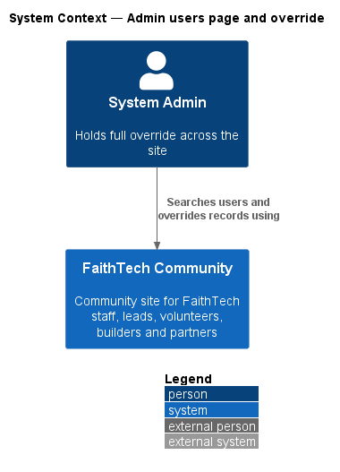
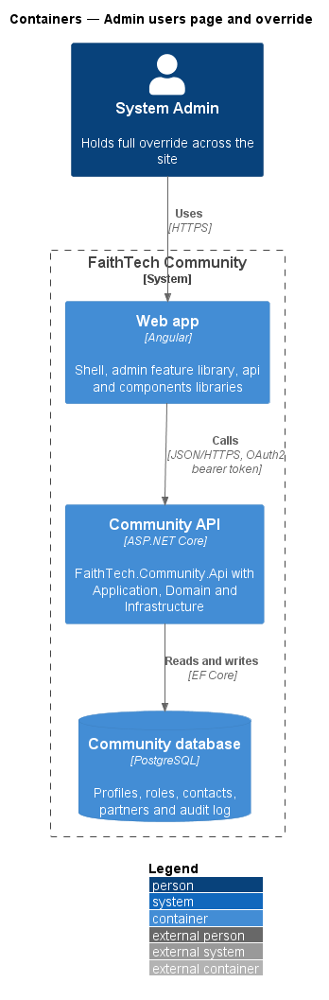
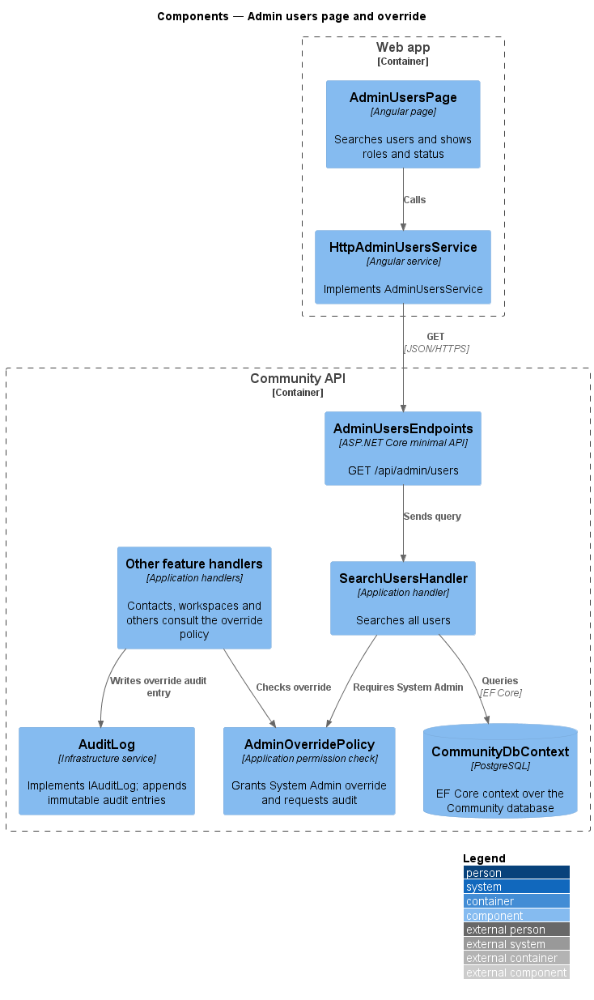
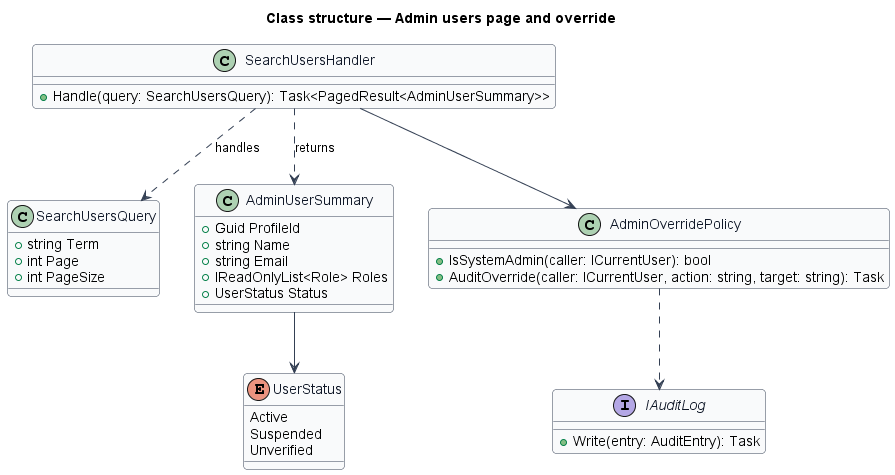
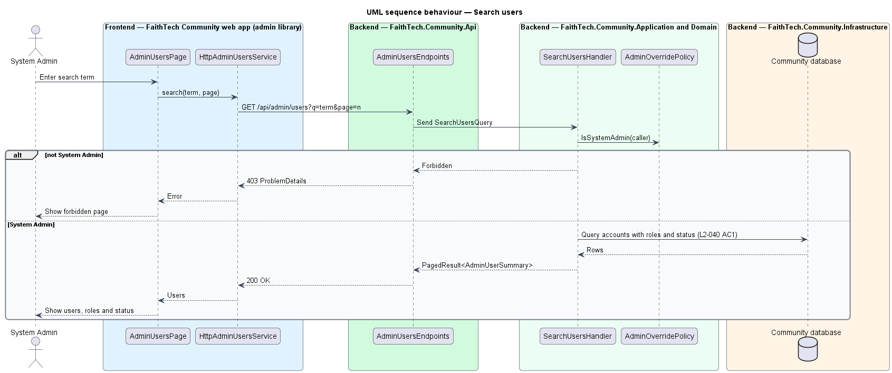
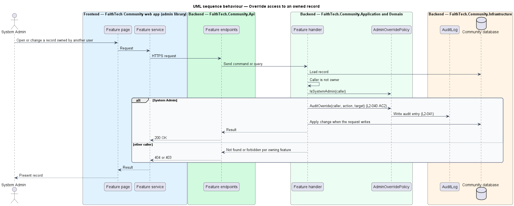

# Admin users page and override

## Overview

A System Admin holds **full override** — authority to view or change any record in FaithTech Community, including records otherwise restricted to their owner, such as private contacts and Agile workspaces. This feature provides the admin users page, where a System Admin searches every account and sees each user's roles and status, and defines how override is applied across the rest of the system.

Override is not a separate set of screens. Each feature's Application permission check treats System Admin as permitted, and each overriding access is written to the audit log (`L2-041`). This document describes the shared policy and the admin users page; the feature designs that own each record type apply the policy.

## Description

- **`AdminUsersPage`** — page in the `admin` feature library. It shows a search box and a paged list of users with name, email, roles and status (Active, Suspended, Unverified). Row actions link to the profile, the role dialogs (`admin/assign-roles`) and suspension (`admin/suspend-users`). At XS widths the table collapses to cards.
- **`AdminUsersService`** / **`ADMIN_USERS_SERVICE`** / **`HttpAdminUsersService`** — API client calling `GET /api/admin/users?q=&page=`.
- **`AdminUsersEndpoints`** — minimal API mapping for the query.
- **`SearchUsersQuery`** (`Term`, `Page`, `PageSize`) and **`SearchUsersHandler`** in Application `Admin/`. The handler requires System Admin and returns `AdminUserSummary` items. Page size: `<TO SUPPLY>`.
- **`AdminOverridePolicy`** — Application permission rule shared by every feature: `IsSystemAdmin(caller)` grants access, and the calling handler writes an `AuditEntry` whenever the grant was by override rather than ownership or role.
- **`IAuditLog`** — records override accesses and changes.

Whether read-only override views (for example, reading a private contact) are audited per request or per session: per request, as `L2-012` AC2 requires for contacts.

## Requirements

The feature realizes the following level-2 (L2) requirements. Each L2 requirement refines a level-1 (L1) requirement, cited by identifier.

| L2 ID | Refines (L1) | Requirement |
|-------|--------------|-------------|
| `L2-040` | `L1-014` | Admin users page and override |

### Acceptance criteria

**`L2-040` — Admin users page and override**

1. Given a System Admin, when they open admin users, then they can search all users and see each user's roles and status.
2. Given a System Admin, when they view or change any record, including private contacts and workspaces, then the action succeeds.

## Diagrams

### System context

The System Admin is the only actor. Override applies inside FaithTech Community; no external system participates.

### Containers

The `admin` feature library in the Angular web app calls the Community API over HTTPS with an OAuth2 bearer token. The API persists state in the PostgreSQL Community database.

### Components

`SearchUsersHandler` serves the admin users page. Every other feature handler consults `AdminOverridePolicy` and writes to `AuditLog` when access is by override.

### Class structure

`SearchUsersHandler` returns `AdminUserSummary` items and depends on `AdminOverridePolicy`. `AdminUserSummary` carries the `UserStatus` enumeration.

### Behaviour — search users

The handler requires System Admin and returns a page of users with roles and status (`L2-040` AC1).

### Behaviour — override access to an owned record

Any feature handler that receives a request for a record the caller does not own consults the override policy. A System Admin is granted access and an audit entry is written (`L2-040` AC2).

