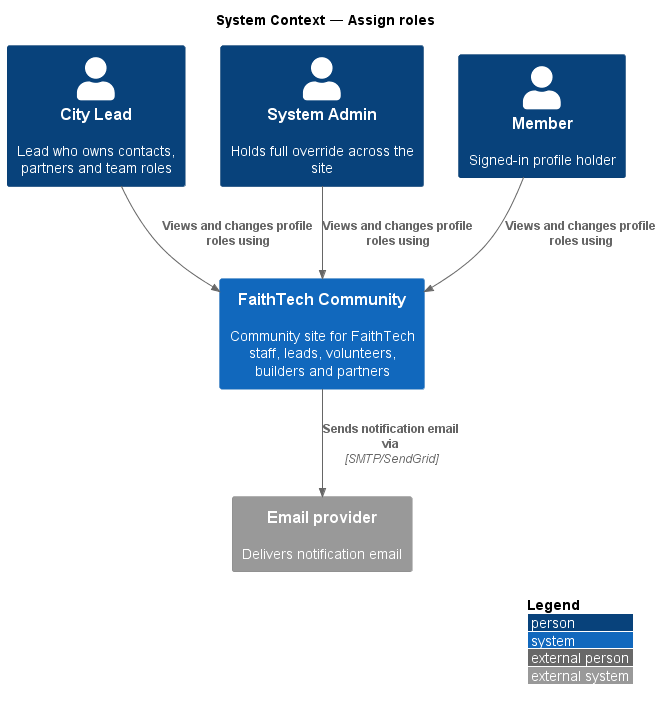
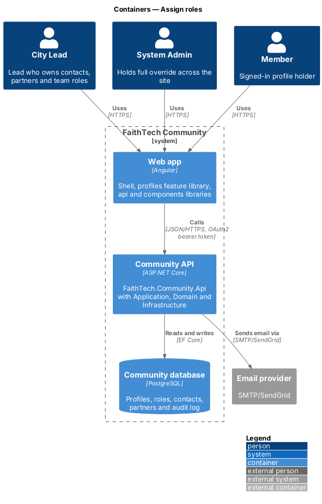
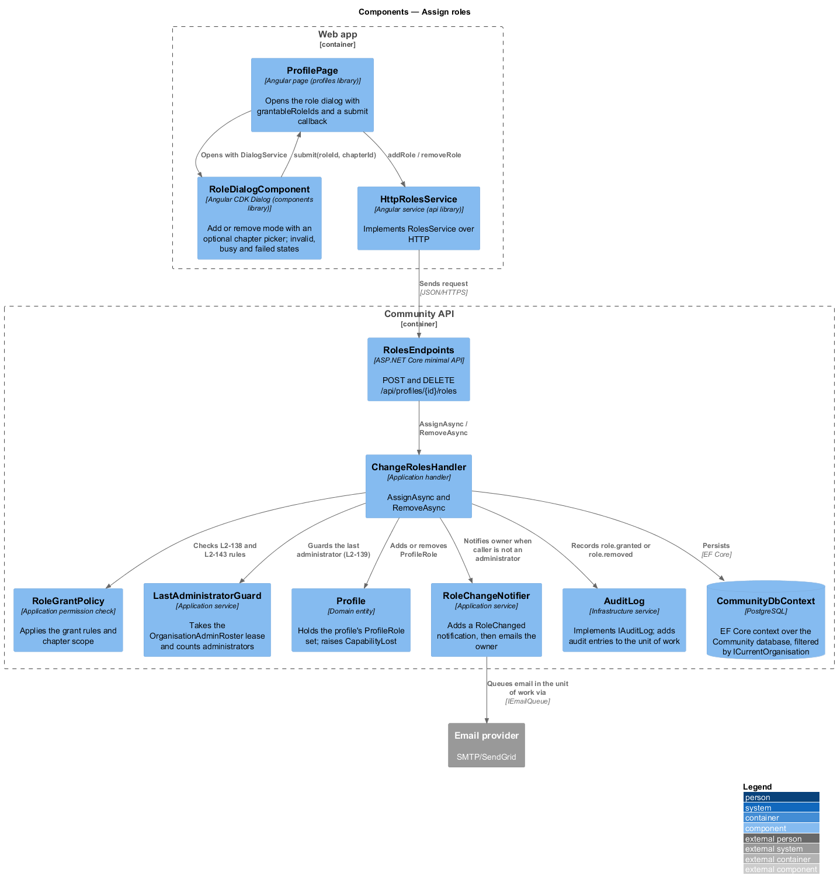
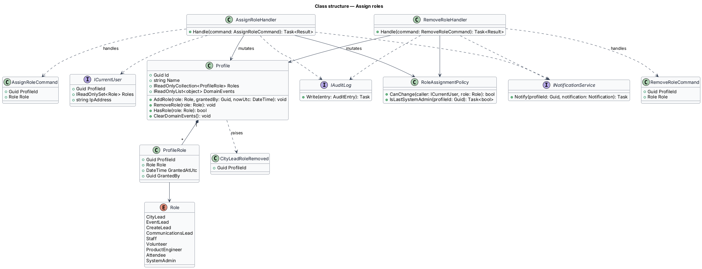
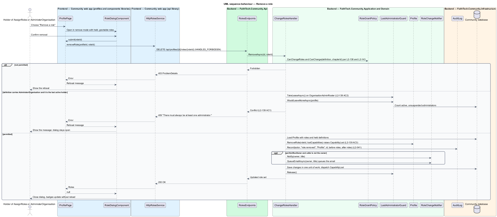

# Assign roles

## Overview

FaithTech Community grants permissions through *global roles*. A **global role** — named permission set held by a profile, not tied to any city. The nine roles are City Lead, Event Lead, Create Lead, Communications Lead, Staff, Volunteer, Product Engineer, Attendee and System Admin. A profile may hold any combination of them, and a new account holds none.

This feature covers adding and removing roles on a profile. Two tiers of authority apply. A City Lead may add or remove the Event Lead, Create Lead, Communications Lead, Volunteer, Product Engineer and Attendee roles on any profile. Only a System Admin may grant or remove City Lead, Staff and System Admin. Every role change is audited, and the profile owner is notified when a City Lead changes their roles. The last remaining System Admin role can never be removed, so the site always keeps an administrator.

The feature sits in the admin subsystem because role grants are the root of every other permission check. The add-role and remove-role dialogs open from a profile page.

## Description

The slice runs from the profile page in the web app to the `ProfileRole` rows in the Community database.

- **`RoleDialogComponent`** — presentational Angular CDK dialog in the `components` library with an `add` and a `remove` mode (ADR 0005), opened from the profile page. It lists only the roles the caller may change (`assignableRoles` in `api`) and confirms the change. On success the profile's role badges update without a page reload.
- **`RolesService`** / **`ROLES_SERVICE`** / **`HttpRolesService`** — API client contract, injection token and HTTP implementation in the `api` library. They call `POST /api/profiles/{id}/roles` and `DELETE /api/profiles/{id}/roles/{role}`.
- **`RolesEndpoints`** — minimal API mapping in `FaithTech.Community.Api`. It authenticates the caller and sends the command; it holds no business logic.
- **`AssignRoleCommand`** / **`RemoveRoleCommand`** — request objects carrying `ProfileId` and `Role`.
- **`AssignRoleHandler`** / **`RemoveRoleHandler`** — Application handlers in `Admin/`. Each asks `RoleAssignmentPolicy` whether the caller may change the role, applies the change, writes an audit entry and, when the caller is a City Lead, notifies the profile owner.
- **`RoleAssignmentPolicy`** — Application permission check. It maps each `Role` to the authority required to change it and refuses removal of the last System Admin role.
- **`Role`** — Domain enumeration of the nine global roles. **`Profile`** — Domain entity that owns a set of `ProfileRole` entries (role, who granted it, when) and enforces no duplicates: `AddRole(role, grantedBy, nowUtc)` rejects a role already held and `RemoveRole(role)` rejects one not held. Removing City Lead raises the **`CityLeadRoleRemoved`** domain event in `Profile.DomainEvents` (`L2-037`).
- **`ICurrentUser`** — caller identity and roles, read from the access token.
- **`IAuditLog`** — records actor, action, target, before and after role sets, UTC time and IP address (`L2-041`).
- **`RoleChangeNotifier`** — Application service that adds an in-app `Notification` (`RoleChanged`) for the profile owner and sends them an email; the notifications feature will later route both through `INotificationService`.

The visible role options in the dialogs are a convenience; the server returns `403` for any change the caller is not permitted to make.

## Requirements

The feature realizes the following level-2 (L2) requirements. Each L2 requirement refines a level-1 (L1) requirement, cited by identifier.

| L2 ID | Refines (L1) | Requirement |
|-------|--------------|-------------|
| `L2-008` | `L1-003` | The roles are City Lead, Event Lead, Create Lead, Communications Lead, Staff, Volunteer, Product Engineer, Attendee and System Admin. |
| `L2-009` | `L1-003` | Role assignment limits |

### Acceptance criteria

**`L2-008` — Multiple global roles**

1. Given a profile, when roles are assigned, then it can hold any combination of roles at once, and no role is tied to a city.
2. Given a new account, when it is created, then it holds no role.

**`L2-009` — Role assignment limits**

1. Given a City Lead, when they add or remove Event Lead, Create Lead, Communications Lead, Volunteer, Product Engineer or Attendee on any profile, then the change succeeds and the profile owner is notified.
2. Given a City Lead, when they try to grant or remove City Lead, Staff or System Admin, then the option is not shown and the API returns 403.
3. Given a System Admin, when they grant or remove any role, then the change succeeds and an audit entry is written.
4. Given any other role, when it tries to change roles through the API, then the response is 403.
5. Given a removal, when the add-role or remove-role dialog is confirmed, then the profile's roles update without a page reload.
6. Given the last System Admin, when anyone tries to remove that role, then the change is refused.

## Diagrams

### System context

City Leads and System Admins change roles on member profiles through FaithTech Community. The site notifies the affected member by email through the email provider.

### Containers

The `admin` feature library in the Angular web app calls the Community API over HTTPS with an OAuth2 bearer token. The API persists state in the PostgreSQL Community database and sends email through the email provider.

### Components

The dialogs call `HttpRolesService`, which reaches `RolesEndpoints`. The handler consults `RoleAssignmentPolicy`, mutates the `Profile`, writes the audit entry, notifies the owner and saves through `CommunityDbContext`.

### Class structure

`Profile` composes zero or more `ProfileRole` entries, each holding a `Role`. Both handlers depend on `RoleAssignmentPolicy`, `ICurrentUser`, `IAuditLog` and `INotificationService`.

### Behaviour — add a role

The handler checks `L2-009` limits before any write. A permitted change is persisted, audited and, for a City Lead caller, notified to the owner; a forbidden change returns `403` with no state change.

### Behaviour — remove a role

Removal follows the same checks and additionally refuses removal of the last System Admin role (`L2-009` AC6).

## Open questions

Decisions recorded while building the Domain layer (`FaithTech.Community.Domain`):

- Role count: `L2-008` lists nine roles and the Domain `Role` enumeration holds exactly those nine. The earlier single `Lead` value is replaced by City Lead, Event Lead, Create Lead and Communications Lead. Resolved.
- Roles persist as `ProfileRole` rows (table `ProfileRoles`, key profile and role), replacing the earlier text-array column.
- Domain events: `Profile` collects `CityLeadRoleRemoved` in `DomainEvents`; the handler that saves the profile dispatches and clears them. A shared domain-event base type is deferred until a second aggregate raises events.
- Domain rule violations throw `InvalidOperationException` (a broken rule) or `ArgumentException` (invalid input); there is no shared domain exception type. Handlers check permissions and preconditions first and map any remaining violation to a `400` or `409` result.
- Responses: both routes return the profile's new role set. Adding a role already held, or removing one not held, answers `409`. Removing the last System Admin answers `409` "There must always be at least one System Admin." An unknown profile answers `404` to a caller who may change roles and `403` to anyone else.
- Every role change is audited (`role.granted`, `role.removed`), whoever makes it; the owner is notified only when the caller is a City Lead acting without System Admin.
- A caller changing roles through the profile page is shown "Add a role" and "Remove a role" only when `assignableRoles` offers at least one option.
