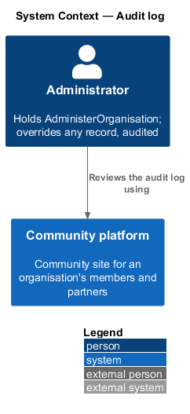
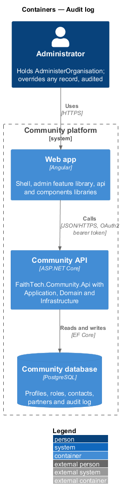
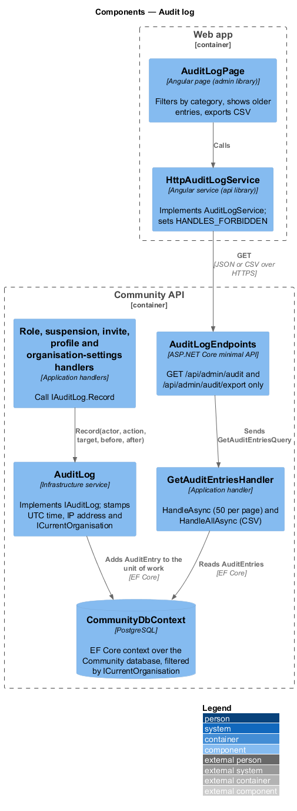
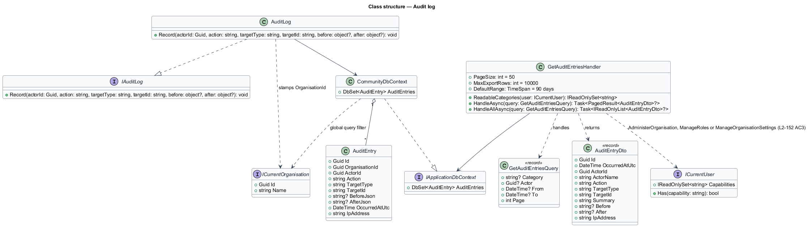
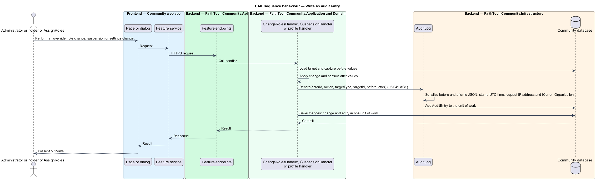
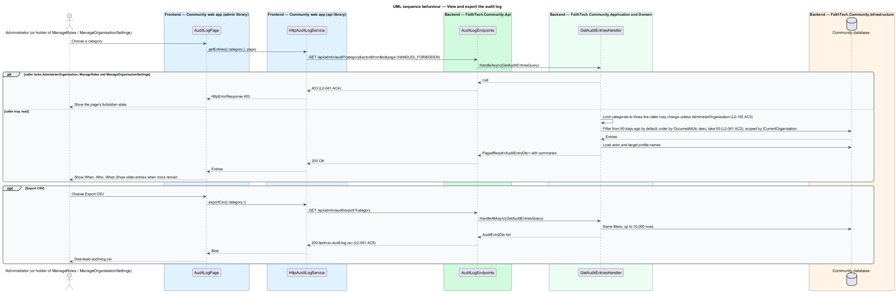

# Audit log

## Overview

The **audit log** — append-only record of every administrator override, every role change, every suspension and every change to the organisation's settings in the Community platform. Each **audit entry** — immutable row naming the actor, the action, the target, the before and after values, the time in UTC and the caller's IP address. Every entry belongs to the organisation in which it was written and is listed only on that organisation's audit page (`L2-130` AC7); platform operator actions go to the platform audit log instead (`L2-148` AC4, `docs/detailed-designs/organisations/platform-operations`). The log supports accountability for the override authority that holders of `AdministerOrganisation` hold (`L2-135` AC5).

This feature covers both writing entries, which other features trigger through `IAuditLog`, and reading them on the audit log page. A holder of `AdministerOrganisation` reads every entry; a holder of `ManageRoles` or `ManageOrganisationSettings` without it reads only the categories they may change (`L2-152` AC3). No user, including an administrator, may edit or delete an entry: the API exposes no such operation.

## Description

Every query is scoped by the DbContext's global filter on `ICurrentOrganisation`, and `AuditLog` stamps each entry with the current organisation.

- **`AuditLogPage`** — page in the `admin` feature library at `/admin/audit-log` with a category filter (all, role changes, suspensions, private contact access, deletions, organisation, roles, chapters, taxonomies), the last 90 days by default, 50 entries at a time with a **Show older entries** button, and an **Export CSV** button that reads "Exporting…" and is busy (`ButtonComponent` `loading`) while the file is prepared, then shows a `ToastService` success toast ("Audit log exported") or, on failure, a danger toast with **Try again** (mocks `exporting`, `exported`, `export-failed`). It shows When, Who and What (the entry summary). While loading, `TableComponent` with `loading` keeps the When, Who and What headers and shows skeleton rows, and a `403` shows the page's own forbidden state. The filter offers only the categories the caller may read. Each category change or retry starts a new request generation; an entries page, a *Show older entries* page or a failure from an older one is dropped, so the rows, totals, empty text and paging always match the chosen category.
- **`AuditLogService`** / **`AUDIT_LOG_SERVICE`** / **`HttpAuditLogService`** — API client in the `api` library. `getEntries(filters, page)` calls `GET /api/admin/audit?category=&actor=&from=&to=&page=` and `exportCsv(filters)` calls `GET /api/admin/audit/export?category=&actor=&from=&to=` for a CSV blob. Both requests carry the `HANDLES_FORBIDDEN` `HttpContextToken`, so a `403` reaches the page instead of the global `/forbidden` redirect. The page sends only the category; the API also accepts `actor`, `from` and `to`.
- **`AuditLogEndpoints`** — maps only the two `GET` routes. No `PUT`, `PATCH` or `DELETE` route exists. The export route writes the CSV with the columns When (UTC), Who, Action, Summary, Target type, Target id and IP address, and prefixes a cell that starts with `=`, `+`, `-` or `@` with `'`. Dates without an offset are read as UTC.
- **`GetAuditEntriesQuery`** (`Category`, `Actor`, `From`, `To`, `Page`) and **`GetAuditEntriesHandler`** — Application `Admin/` query. `HandleAsync` requires `AdministerOrganisation`, `ManageRoles` or `ManageOrganisationSettings`, restricts a caller without `AdministerOrganisation` to the `roles` category for `ManageRoles` and the `organisation`, `chapters` and `taxonomies` categories for `ManageOrganisationSettings` (`L2-152` AC3), defaults `From` to 90 days ago, pages 50 at a time newest first and returns `AuditEntryDto` items with the actor's name, the target's name and a one-line summary ("Granted {role} to Esther Nakamura"). `HandleAllAsync` applies the same filters unpaged, up to 10,000 rows, for the CSV export. Both return `null` to any other caller, which the endpoint answers with `403`.
- **`IAuditLog`** — Application abstraction with a single `Record(actorId, action, targetType, targetId, before, after)` method, called by the role, suspension, invite-acceptance, profile-override and organisation-settings handlers. It adds the entry to the current unit of work, so the entry is saved with the change it records.
- **`AuditLog`** — Infrastructure implementation in `Infrastructure/Admin/`. It serializes before and after to JSON, stamps the UTC time and the current organisation, takes the IP address from the current HTTP request (`unknown` when there is none), and adds the entry to the `AuditEntries` table. Retention: entries are kept indefinitely in v1; a purge job is deferred.
- **`AuditEntry`** — Domain record with `Id`, `OrganisationId`, `ActorId`, `Action`, `TargetType`, `TargetId`, `BeforeJson`, `AfterJson`, `OccurredAtUtc` and `IpAddress`. Its constructor requires an action, a target type, a target id and a UTC time; it has no mutators, so an entry cannot change after it is written.
- **`ICurrentUser`** — supplies the caller's user id and capabilities; handlers resolve the actor's profile id from it.
- **`CommunitySeeder.GrantSystemAdminAsync`** — writes the one entry made outside a request: the Cli `grant-admin` command's `role.granted`, with an empty actor id (shown as "System") and IP address `cli`. Provisioning's break-glass invite (`L2-149` AC2) is recorded in the platform audit log, not here.

## Requirements

The feature realizes the following level-2 (L2) requirements. Each L2 requirement refines a level-1 (L1) requirement, cited by identifier.

| L2 ID | Refines (L1) | Requirement |
|-------|--------------|-------------|
| `L2-041` | `L1-014` | Audit log |
| `L2-152` | `L1-028`, `L1-014` | Organisation-level audit |

### Acceptance criteria

**`L2-041` — Audit log**

1. Given any override by a holder of `AdministerOrganisation` (`L2-135` AC5), any role change (`L2-138` AC5), any suspension or reinstatement (`L2-039`) or any change to the organisation's settings (`L2-152` AC1), when it completes, then an audit entry stores the actor, the action, the target, the before and after values, the time in UTC, and the IP address.
2. Given the audit log, when a holder of `AdministerOrganisation` views it, then it shows when, who and what for the last 90 days by default, can be filtered by category (role changes, suspensions, private contact access, deletions, organisation, roles, chapters, taxonomies, `L2-152` AC2), and is paged 50 at a time; a holder of `ManageRoles` or `ManageOrganisationSettings` without `AdministerOrganisation` sees only the categories they may change (`L2-152` AC3).
3. Given any user, when they try to edit or delete an audit entry, then no API exists to do so, and the entry is unchanged.
4. Given a user without `AdministerOrganisation`, `ManageRoles` or `ManageOrganisationSettings`, when they request the audit log, then the response is 403.
5. Given the audit log, when a holder of `AdministerOrganisation` chooses "Export CSV", then the filtered entries are downloaded.
6. Given an export in progress, when the file is being prepared, then "Export CSV" is busy and cannot be pressed again; when the download is ready, a success toast "Audit log exported" confirms it; when it fails, a danger toast "We couldn’t export the audit log" offers "Try again".

**`L2-152` — Organisation-level audit**

1. Given any change to the organisation's general settings, role definitions, grant rules, chapters or taxonomies, when it succeeds, then an audit entry is written under the category `organisation`, `roles`, `chapters` or `taxonomies` with the actor, the UTC time, the IP address, the target and the before and after values (`L2-041`).
2. Given the audit log page (`L2-041`), when it renders, then its category filter offers the four new categories alongside the existing ones, and the export includes them.
3. Given a holder of `ManageRoles` or `ManageOrganisationSettings` without `AdministerOrganisation`, when they open the audit log, then they see only the entries of the categories they may change; `AdministerOrganisation` sees everything.
4. Given a platform operator action, when it is audited, then it goes to the platform audit log (`L2-148` AC4), never to an organisation's audit log, and an organisation's audit page never shows it.

## Diagrams

### System context

Administrators read the log; every override, role-changing, suspension and settings action inside the Community platform writes to it. No external system participates.

### Containers

The `admin` feature library in the Angular web app calls the Community API over HTTPS with an OAuth2 bearer token. The API persists state in the PostgreSQL Community database.

### Components

Writers reach the log through `IAuditLog`, implemented by `AuditLog`; the Cli first-admin grant is the one exception. Readers reach it only through `GetAuditEntriesHandler`.

### Class structure

`AuditLog` realizes `IAuditLog` and adds `AuditEntry` rows stamped with `ICurrentOrganisation`. `GetAuditEntriesHandler` handles `GetAuditEntriesQuery`, reads entries through `IApplicationDbContext` and returns `AuditEntryDto` items.

### Behaviour — write an audit entry

An override, role-changing, suspension or settings handler writes the entry in the same unit of work as the change, so a change never commits without its entry.

### Behaviour — view the audit log

Only holders of `AdministerOrganisation`, `ManageRoles` or `ManageOrganisationSettings` may read entries, filtered by category, actor and date range and paged 50 at a time, with the categories limited by capability (`L2-041` AC2, AC4, `L2-152` AC3). The export uses the same filters (`L2-041` AC5).

## Open questions

Decisions recorded while building the Domain layer (`FaithTech.Community.Domain`):

- Filter categories (`L2-041` AC2) map onto the `Action` values written by each feature; the Domain does not add a separate category field.
- Categories: `roles` → actions starting `role.`; `suspensions` → `member.suspended`, `member.reinstated`; `contacts` → actions starting `contact.`; `deletions` → actions ending `.deleted`; `organisation` → `organisation.updated`; `chapters` → actions starting `chapter.`; `taxonomies` → `taxonomy.updated`. The role-changes category and the `roles` settings category share the `role.` prefix: `role.granted` and `role.removed` are role changes; `role.defined`, `role.updated`, `role.archived` and `role.grants.updated` are definition changes (`L2-152`).
- Actions written so far: `role.granted`, `role.removed` (before and after hold the role sets and the chapter tag), `member.suspended` (after holds the reason), `member.reinstated`, and the profile actions of ADR 0004. Accepting an invite with a pre-assigned role writes `role.granted` with the inviter as actor (ADR 0006).
- Docs & notes adds `note.opened`, `note.edited`, `note.shared`, `note.moved`, `note.archived` and `note.restored` (target type `NotePage`), written for an administrator acting on, or opening a Private, Shared or archived, page they do not own (ADR 0025, `notes/share-and-visibility`).
- The CSV export holds at most 10,000 rows; columns are When (UTC), Who, Action, Summary, Target type, Target id, IP address.
- Immutability rests on the entity having no mutators and the API having no edit or delete route. The migrations do not restrict the database role to insert and select on `AuditEntries`; a database-level insert-and-select grant is deferred to the deployment design (`eng/infra`), since the role the API connects as is created there.
- Capabilities: entries carry `OrganisationId` and are read under the global filter, the four organisation categories and the partial visibility for `ManageRoles` and `ManageOrganisationSettings` are added, and the suspension actions are renamed `member.*` (ADR 0032, ADR 0033, `L2-152`).
