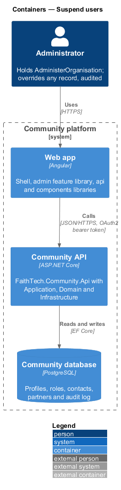
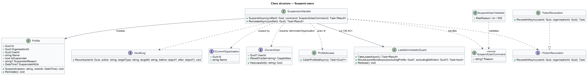
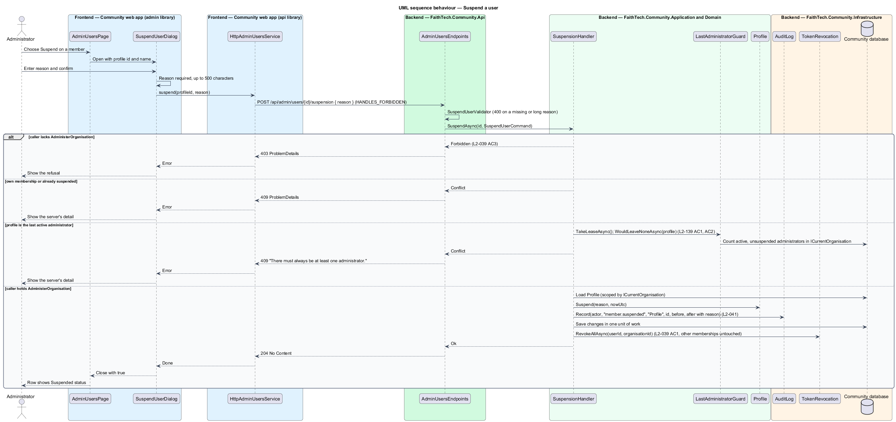
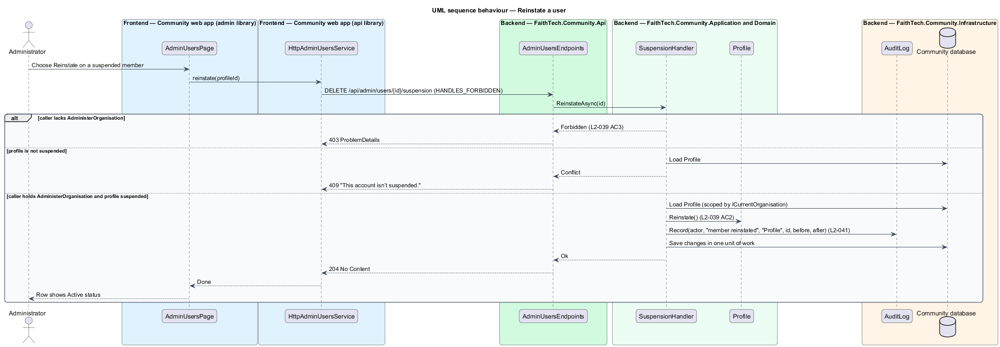

# Suspend users

## Overview

A holder of `AdministerOrganisation` (seeded as System Admin in FaithTech) may need to stop a person from using the organisation's community, for example after misuse. **Suspension** — administrator-imposed state of a membership that refuses sign-in on the organisation's host and revokes the organisation's sessions until reinstatement. Suspension is per membership: it applies to the profile in one organisation, never to the account, so the member's other memberships are untouched (`L2-132` AC5, ADR 0032). Suspension does not delete the profile or its data; reinstatement returns the membership to normal use. A platform operator may additionally lock an account everywhere (`L2-148` AC5, `docs/detailed-designs/organisations/platform-operations`).

This feature covers suspending a member with a reason and reinstating them. Only a holder of `AdministerOrganisation` may do either. Sign-in itself enforces the suspended state (`L2-003`), so this feature changes membership state and revokes tokens, while the identity subsystem refuses later sign-ins. Suspending the last active holder of `AdministerOrganisation` is refused by the last-administrator guard (`L2-139` AC1).

## Description

Every query is scoped by the DbContext's global filter on `ICurrentOrganisation`, so a suspension can only name a profile in the current organisation.

- **`AdminUsersPage`** — page in the `admin` feature library that lists members and offers a **Suspend** action on active rows and a **Reinstate** action on suspended rows. Reinstate calls the service directly, with no dialog. On success the row's status badge changes without a reload.
- **`SuspendUserDialog`** — CDK dialog in the `admin` library, opened with `DialogService`, that collects the required reason and confirms the suspension; the reason is read-only while the request is in flight. It checks the reason on the client with the server's messages, shows a `4xx` refusal (for example `409`) from the server's `detail`, shows an *Account not suspended* alert otherwise (failed dialog titles name what was not saved), and closes with `true` once the member is suspended.
- **`AdminUsersService`** / **`ADMIN_USERS_SERVICE`** / **`HttpAdminUsersService`** — API client in the `api` library. `suspend(id, reason)` calls `POST /api/admin/users/{id}/suspension` and `reinstate(id)` calls `DELETE /api/admin/users/{id}/suspension`, where `{id}` is the profile id. Requests carry the `HANDLES_FORBIDDEN` `HttpContextToken`, so a `403` reaches the page or dialog instead of the global `/forbidden` redirect.
- **`AdminUsersEndpoints`** — minimal API mapping; requires an authenticated caller, validates the body with `SuspendUserValidator` and calls the handler. Both routes answer `204` on success.
- **`SuspendUserCommand`** (`Reason`) — request body of the suspend route; the profile id comes from the route.
- **`SuspensionHandler`** in Application `Admin/` — `SuspendAsync(profileId, command)` and `ReinstateAsync(profileId)`. Each requires the caller to hold `AdministerOrganisation` and returns `403` otherwise, `404` for an unknown profile, and `409` when the profile is already in the requested state. `SuspendAsync` asks `LastAdministratorGuard` whether suspending the profile would leave the organisation without an active, unsuspended administrator and refuses with `409` "There must always be at least one administrator." when it would (`L2-139` AC1); otherwise it saves the suspension and its audit entry, then revokes the organisation's tokens of the account linked to the profile.
- **`SuspendUserValidator`** — requires a non-empty reason ("Give a reason so other admins understand."). Maximum reason length: 500 characters.
- **`Profile`** — Domain entity (the membership) that holds the suspended state: `IsSuspended`, `SuspendedReason`, `SuspendedAtUtc`, `Suspend(reason, nowUtc)` and `Reinstate()`. `Suspend` requires a reason and rejects a profile that is already suspended; `Reinstate` rejects a profile that is not suspended.
- **`LastAdministratorGuard`** — Application service (`Organisations/`) that takes the `OrganisationAdminRoster` lease in a save of its own and counts the active, unsuspended profiles holding a non-archived definition carrying `AdministerOrganisation`, excluding the profile being suspended (`L2-139` AC2, `admin/assign-roles`).
- **`ITokenRevocation`** — Application abstraction in `Identity/` with `RevokeAllAsync(userId, organisationId)`; **`TokenRevocation`** in Infrastructure implements it over the OpenIddict token and authorization stores, revoking only the tokens issued for the organisation's host so other memberships keep their sessions.
- **`ProfileAccess`** — resolves the caller's profile id, used as the audit actor and for the own-account check.
- **`IAuditLog`** — `Record(actorId, action, targetType, targetId, before, after)` records each suspension as `member.suspended` and each reinstatement as `member.reinstated` (`L2-041`).

An administrator may suspend another administrator but not their own membership (`409` "You can’t suspend your own account."), and never the last one, so the organisation always keeps an administrator who can reinstate.

## Requirements

The feature realizes the following level-2 (L2) requirements. Each L2 requirement refines a level-1 (L1) requirement, cited by identifier.

| L2 ID | Refines (L1) | Requirement |
|-------|--------------|-------------|
| `L2-039` | `L1-014` | Suspend users |
| `L2-139` | `L1-026`, `L1-014` | Last administrator and consequences of role changes |

### Acceptance criteria

**`L2-039` — Suspend users**

1. Given a holder of `AdministerOrganisation`, when they suspend a member of the organisation with a reason after confirming, then that member's sessions in the organisation are revoked, sign-in on the organisation's host is refused (`L2-003` AC4), the member's other memberships are untouched, and the action is audited as `member.suspended` (`L2-041`); suspending the last active holder of `AdministerOrganisation` is refused (`L2-139` AC1).
2. Given a suspended member, when a holder of `AdministerOrganisation` reinstates them, then they can sign in again on the organisation's host, audited as `member.reinstated`.
3. Given a member without `AdministerOrganisation`, when they call the suspend or reinstate API, then the response is 403.

**`L2-139` — Last administrator and consequences of role changes**

1. Given an organisation, when a role removal, a profile suspension, a definition edit or a definition archive would leave no active, unsuspended profile holding `AdministerOrganisation`, then it is refused with 409 "There must always be at least one administrator." and nothing changes, is audited or is notified.
2. Given two such requests that overlap, when both settle, then at most one succeeds: each takes the organisation's administrator-roster lease in a save of its own before counting, and the loser answers 409 "Someone else changed administrator roles at the same time. Reload and try again."; a lease left behind expires after 30 seconds.
3. Given a profile loses a capability (its role was removed, or its definition lost the capability) and no other role it holds still gives it, when the change is saved, then a `CapabilityLost(profile, capability)` domain event is raised in the same unit of work.
4. Given `CapabilityLost` for `OwnWorkspaces` on a profile that owns workspaces, when it is handled, then every administrator is notified (`WorkspaceOwnerLostCapability`, "{Name} no longer holds a role that can own workspaces: {workspace list}") so they can reassign the owner (`L2-037` AC2); the workspace keeps working meanwhile.
5. Given `CapabilityLost` for `ConnectLink`, when it is handled, then the profile's connect link answers as unknown until the capability is held again (`L2-082` AC3).
6. Given a definition gains a capability, when the change is saved, then every holder has it on their next request, and nothing is notified.

## Diagrams

### System context

Only the administrator uses this feature. No external system takes part; session revocation happens inside the Community API's OpenIddict stores.

### Containers

The `admin` feature library in the Angular web app calls the Community API over HTTPS with an OAuth2 bearer token. The API persists state in the PostgreSQL Community database.

### Components

The page opens `SuspendUserDialog`, which calls the API client. `SuspensionHandler` asks `LastAdministratorGuard`, changes `Profile`, records the audit entry, saves, and then revokes the organisation's tokens through `TokenRevocation`.

### Class structure

`SuspensionHandler` depends on `ICurrentUser`, `ProfileAccess`, `LastAdministratorGuard`, `ITokenRevocation` and `IAuditLog`, and mutates `Profile` under `ICurrentOrganisation`. `SuspendUserValidator` validates `SuspendUserCommand` at the endpoint.

### Behaviour — suspend a user

`SuspensionHandler.SuspendAsync` rejects callers without `AdministerOrganisation` with `403`, the caller's own membership with `409` and the last administrator with `409` (`L2-139` AC1). It then sets the suspended state and saves it with the audit entry in one unit of work, and revokes the organisation's tokens once the save succeeds.

### Behaviour — reinstate a user

`SuspensionHandler.ReinstateAsync` clears the suspended state and audits it, so the next sign-in on the organisation's host succeeds (`L2-039` AC2).

## Open questions

Decisions recorded while building the Domain layer (`FaithTech.Community.Domain`):

- Suspension lives on `Profile`, not on a separate `UserAccount` entity: the Domain has no dependency on ASP.NET Identity, and sign-in already reads `Profile.IsSuspended` (`identity/sign-in-and-sign-out`). Resolved.
- Domain rule violations throw `InvalidOperationException` (a broken rule) or `ArgumentException` (invalid input); there is no shared domain exception type. Handlers check permissions and preconditions first and map any remaining violation to a `400` or `409` result.
- Suspending an already-suspended profile, or reinstating an active one, answers `409`. Audit actions are `member.suspended` (after: `IsSuspended` and the reason) and `member.reinstated` (before: the reason). Suspending one's own membership answers `409` "You can’t suspend your own account."; a missing or over-long reason answers `400`.
- Token revocation runs after the suspension is saved, not inside the same unit of work: the OpenIddict authorization and token managers save each revocation themselves. If revocation fails after the save, the profile stays suspended and sign-in stays refused.
- Capabilities: suspension moved from the account to the membership, the audit actions were renamed from `user.*` to `member.*`, revocation is limited to the organisation's tokens, and the last-administrator guard now covers suspension; the platform-wide account lock belongs to `organisations/platform-operations` (ADR 0032, ADR 0033).
