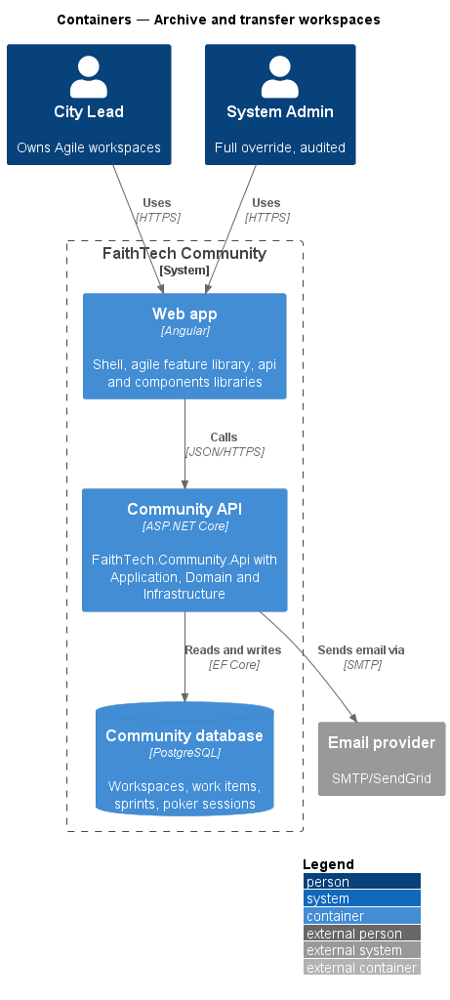
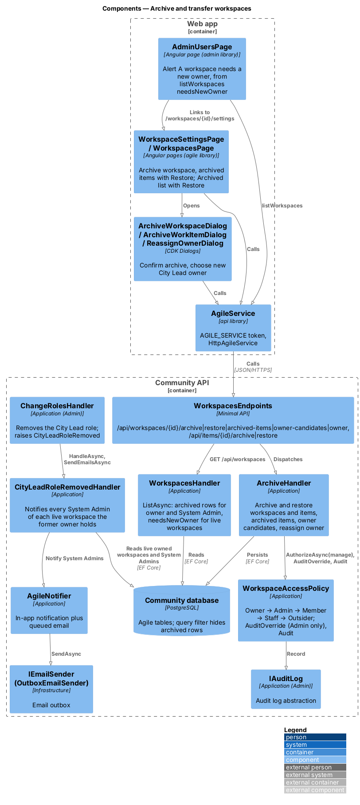
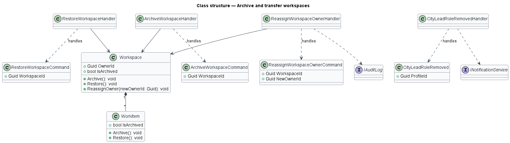
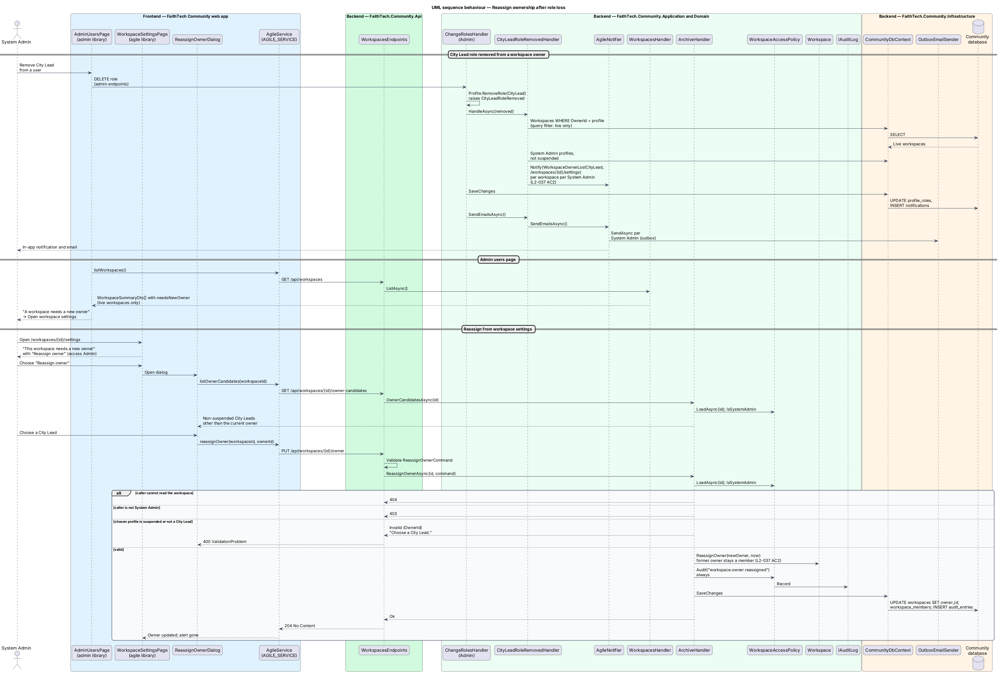

# Archive and transfer workspaces

## Overview

Workspaces and work items are never hard-deleted by their owners; they are archived.

> **archive** — soft delete that hides a workspace or work item from normal views while keeping it restorable
>
> **ownership transfer** — System Admin reassignment of a workspace to another City Lead

The workspace owner archives a workspace or an item and may restore it; System Admin may also restore it. When an owner loses the City Lead role (see the role assignment feature), the system notifies System Admin, who reassigns ownership to another City Lead. Each System Admin action is written to the audit log.

## Description

- **`WorkspaceSettingsPage`** — owner actions for archive and restore of the workspace and archived items (mock `docs/mocks/pages/workspace-settings`). System Admin sees the same page; when the owner lost City Lead it shows "This workspace needs a new owner" with **Reassign owner** (state `needs-owner`).
- **`WorkspacesPage`** — lists archived workspaces to their owner and System Admin under **Archived**, each with **Restore** (state `archived`).
- **`AdminUsersPage`** — shows "A workspace needs a new owner" for each live workspace whose owner lost City Lead, linking to its settings. The admin library may not depend on the agile library, so the dialog opens from settings.
- **`ArchiveWorkspaceDialog`** and **`ArchiveWorkItemDialog`** — CDK Dialogs confirming the archive (mocks `archive-workspace`, `archive-work-item`).
- **`ReassignOwnerDialog`** — CDK Dialog for System Admin to pick a new City Lead owner (mock `docs/mocks/dialogs/reassign-owner`). It opens from workspace settings, which the admin users alert and the notification link to.
- **`AgileService`** — `api` contract (`AGILE_SERVICE`, `HttpAgileService`).
- **`WorkspacesEndpoints`** — maps `POST /workspaces/{id}/archive` and `/restore`, `GET /workspaces/{id}/archived-items`, `GET /workspaces/{id}/owner-candidates`, `PUT /workspaces/{id}/owner`, and `POST /items/{id}/archive` and `/restore`.
- **`ArchiveHandler`** — archives and restores workspaces and items, lists archived items and owner candidates, and reassigns the owner. Archive sets `IsArchived`, `ArchivedById` and `ArchivedAt`; a global EF query filter hides archived rows from normal views. Owner and System Admin only; anyone else gets 403, or 404 for an archived workspace they can't see.
- **`ReassignOwnerCommand`** — System Admin only, always audited; `Workspace.ReassignOwner(newOwner, now)` rejects a profile without the City Lead role and keeps the former owner as a member.
- **`CityLeadRoleRemovedHandler`** — Application handler for the `CityLeadRoleRemoved` domain event that `Profile.RemoveRole` raises when the City Lead role is removed. `ChangeRolesHandler` calls it before saving; it notifies every System Admin, the acting one included, of each workspace the former owner holds (`WorkspaceOwnerLostCityLead`, linking to `/workspaces/{id}/settings`).
- **`WorkspaceAccessPolicy`** — Application service shared by every agile handler. It resolves the caller from `ICurrentUser` and classifies the caller as owner, member, Staff, System Admin or outsider for a workspace. Outsiders receive 404, Staff and non-owner members receive 403 on writes they lack, and System Admin actions pass and are written to the audit log (`L2-031`, `L2-042`).
- **`IAuditLog`** and **`INotificationService`** — audit and notification abstractions.

## Requirements

The feature realizes the following level-2 (L2) requirements. Each L2 requirement refines a level-1 (L1) requirement, cited by identifier.

| L2 ID | Refines (L1) | Requirement |
|-------|--------------|-------------|
| `L2-037` | `L1-012` | Archive and ownership of workspaces |

### Acceptance criteria

**`L2-037` — Archive and ownership of workspaces**

1. Given the owner, when they archive a workspace or an item, then it is hidden from normal views and can be restored by the owner or a System Admin. Archiving a story also archives its tasks.
2. Given an owner who loses the City Lead role, when the role is removed, then System Admin is notified and can reassign ownership to another City Lead.
3. Given a member who is not the owner, when they view an item, then no Archive action is shown.

## Diagrams

### System context

The owner archives and restores; System Admin restores and reassigns ownership. Notifications reach System Admin by email as well as in-app.

### Containers

The Web app calls the Community API, which updates archive flags and ownership in PostgreSQL and sends email through the provider.

### Components

Archive and reassign handlers check access and audit System Admin actions; `CityLeadRoleRemovedHandler` notifies System Admin.

### Class structure

`Workspace` and `WorkItem` expose `Archive` and `Restore`; `CityLeadRoleRemovedHandler` handles the `CityLeadRoleRemoved` event.

### Behaviour — archive and restore a workspace

Archiving hides the workspace from normal views; the owner or System Admin restores it (`L2-037`). Items follow the same flow through `/items/{id}/archive`.

### Behaviour — reassign ownership after role loss

Removing the City Lead role from an owner notifies System Admin, who reassigns the workspace to another City Lead; the action is audited (`L2-037`).

## Open questions

Decisions recorded while building the Domain layer (`FaithTech.Community.Domain`):

- `WorkItem.Archive(items, archivedById, now)` archives the item and everything under it among `items`, so a story takes its tasks and an epic its stories and their tasks (`L2-037` AC1). `Restore(items)` brings back only what was archived at the same moment; an item archived earlier stays archived. Settings lists an archived item only when its parent is not archived.
- Archive and restore reject an item or workspace already in the target state. Domain rule violations throw `InvalidOperationException` (a broken rule) or `ArgumentException` (invalid input); there is no shared domain exception type. Handlers check permissions and preconditions first and map any remaining violation to a `400` or `409` result.
