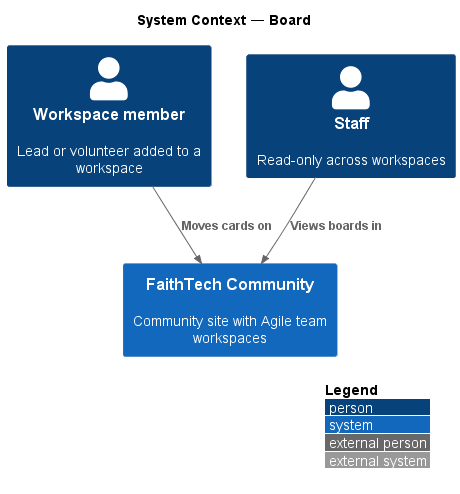
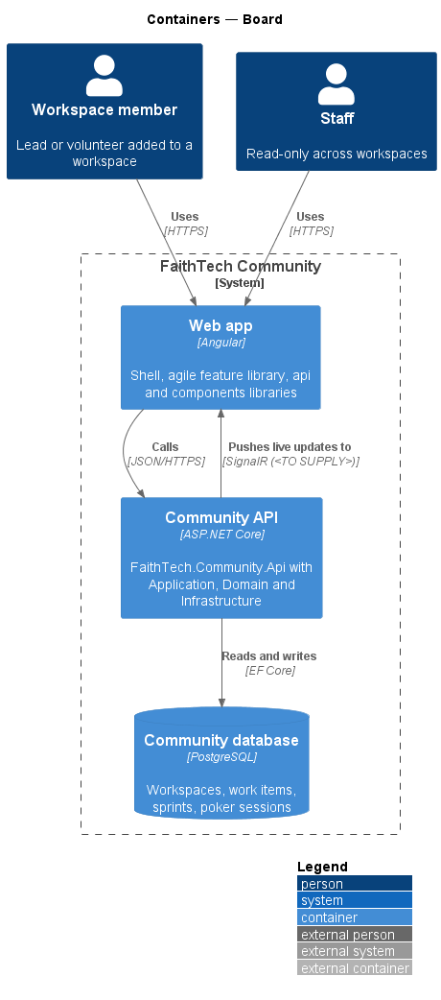
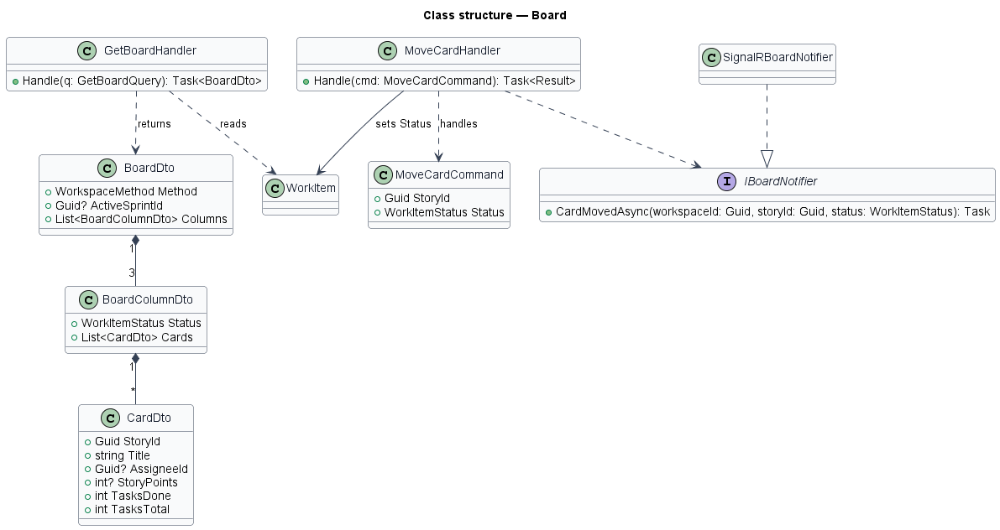
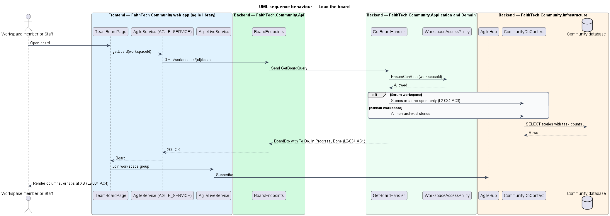

# Board

## Overview

The *board* is the visual view of a workspace's stories.

> **board** — three fixed columns, To Do, In Progress and Done, that show a workspace's stories as cards
>
> **card** — board representation of one story, showing its title, assignee, points and a task checklist count such as `2/5`
>
> **active sprint** — the one running sprint of a Scrum workspace (see `agile/sprints`)

In a Kanban workspace the board shows every non-archived story. In a Scrum workspace it shows only stories in the active sprint. The board has no work-in-progress (WIP) limits. A member moves a card by drag or by keyboard; the move changes the story's status, and other open viewers see the change within 2 seconds. On an extra small (XS, <576px) viewport the columns become tabs with one column visible at a time.

The live transport for board updates is not fixed by the specifications; `decisions.txt` names SignalR only for Planning Poker. The design assumes a SignalR hub, `<TO SUPPLY>` confirmation.

## Description

- **`TeamBoardPage`** — renders the three columns and cards, supports drag and keyboard moves, and switches to tabs at XS (mock `docs/mocks/pages/team-board`). Column and card UI comes from the `components` library Kanban column and card components.
- **`AgileService`** — `api` contract (`AGILE_SERVICE`, `HttpAgileService`) with `getBoard` and `moveCard`.
- **`AgileLiveService`** — `api` contract for live updates (`AGILE_LIVE_SERVICE`), implemented over SignalR; name and transport `<TO SUPPLY>`.
- **`BoardEndpoints`** — minimal API mapping for `GET /workspaces/{id}/board` and `PUT /items/{id}/status`.
- **`GetBoardQuery`** / **`GetBoardHandler`** — returns stories grouped by status with task counts; filters to the active sprint for Scrum.
- **`MoveCardCommand`** / **`MoveCardHandler`** — changes a story's status and publishes a `CardMoved` event to the workspace group.
- **`WorkspaceAccessPolicy`** — Application service shared by every agile handler. It resolves the caller from `ICurrentUser` and classifies the caller as owner, member, Staff, System Admin or outsider for a workspace. Outsiders receive 404, Staff and non-owner members receive 403 on writes they lack, and System Admin actions pass and are written to the audit log (`L2-031`, `L2-042`).
- **`IBoardNotifier`** — Application abstraction, implemented in Infrastructure by `SignalRBoardNotifier` on `AgileHub`, that pushes `CardMoved` to viewers of the workspace.
- **`WorkItem`** / **`WorkItemStatus`** — from `agile/work-items`.

## Requirements

The feature realizes the following level-2 (L2) requirements. Each L2 requirement refines a level-1 (L1) requirement, cited by identifier.

| L2 ID | Refines (L1) | Requirement |
|-------|--------------|-------------|
| `L2-034` | `L1-012` | Board |

### Acceptance criteria

**`L2-034` — Board**

1. Given a workspace, when the board is shown, then stories appear as cards in the fixed columns To Do, In Progress and Done, with a task checklist count on each card. There are no WIP limits.
2. Given a member, when they move a card by drag or keyboard, then its status changes, and other open viewers see the change within 2 seconds.
3. Given a Scrum workspace, when the board is shown, then only stories in the active sprint appear.
4. Given an XS viewport, when the board is shown, then the columns are shown as tabs with one visible at a time.

## Diagrams

### System context

Members move cards on the board; Staff view it. No external system takes part.

### Containers

The Web app reads the board over HTTPS and receives live moves from the Community API over the assumed SignalR connection.

### Components

`MoveCardHandler` updates the story and publishes `CardMoved` through `IBoardNotifier`, which `AgileHub` pushes to `AgileLiveService` in other viewers' browsers.

### Class structure

`BoardDto` composes exactly three `BoardColumnDto` columns of `CardDto` cards. `SignalRBoardNotifier` implements `IBoardNotifier`.

### Behaviour — move a card

A drag or keyboard move changes the story's status and pushes the change to other viewers within 2 seconds (`L2-034`).

### Behaviour — load the board

The board query returns the three fixed columns, filtered to the active sprint in a Scrum workspace (`L2-034`).

