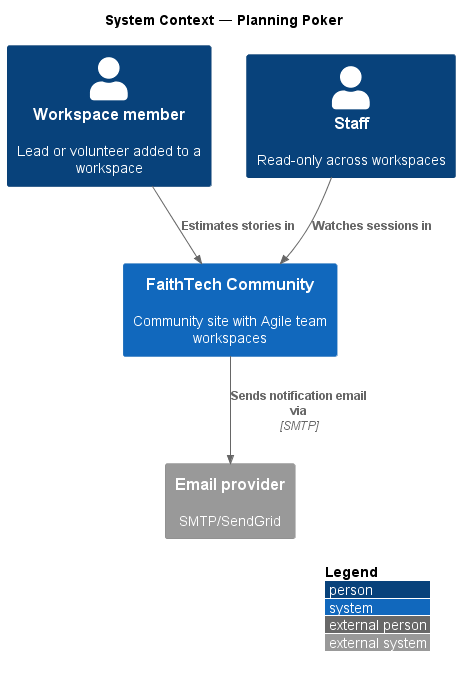
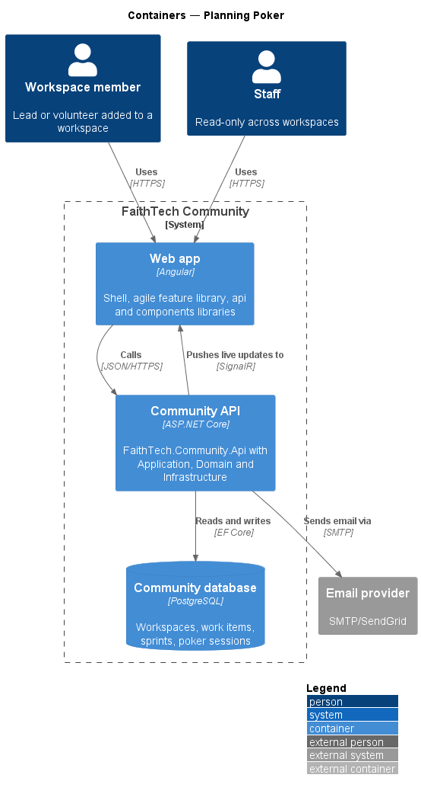
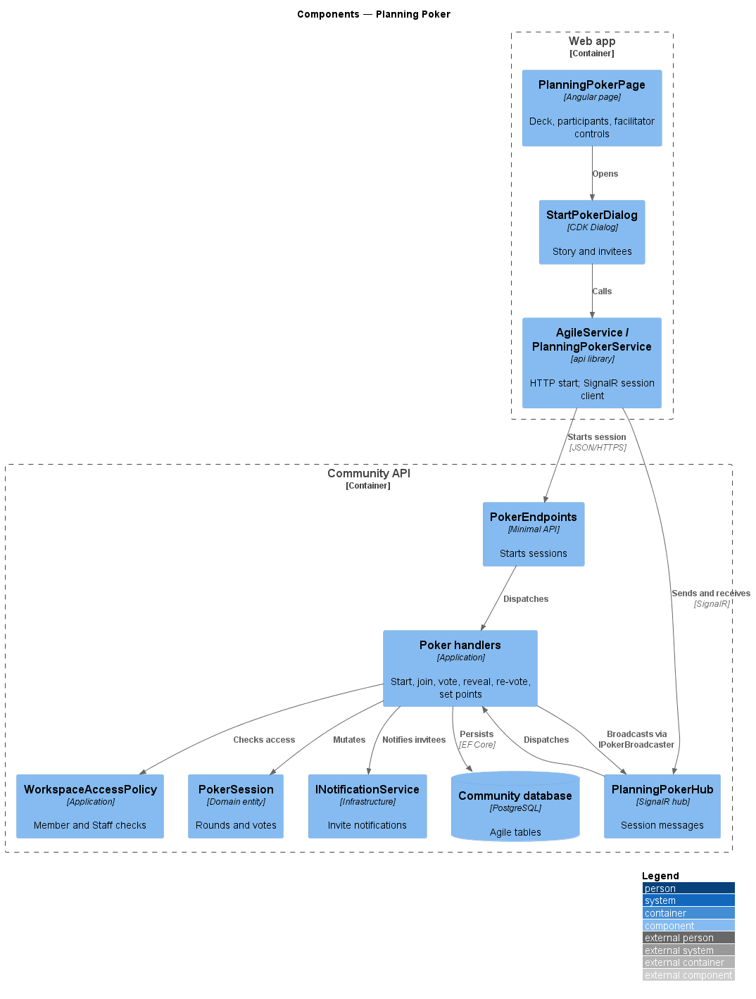
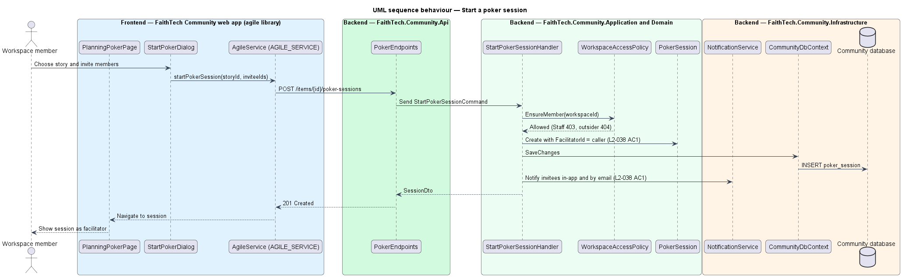
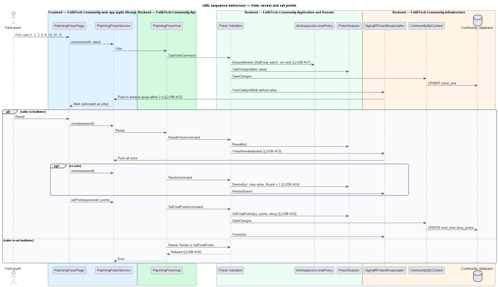
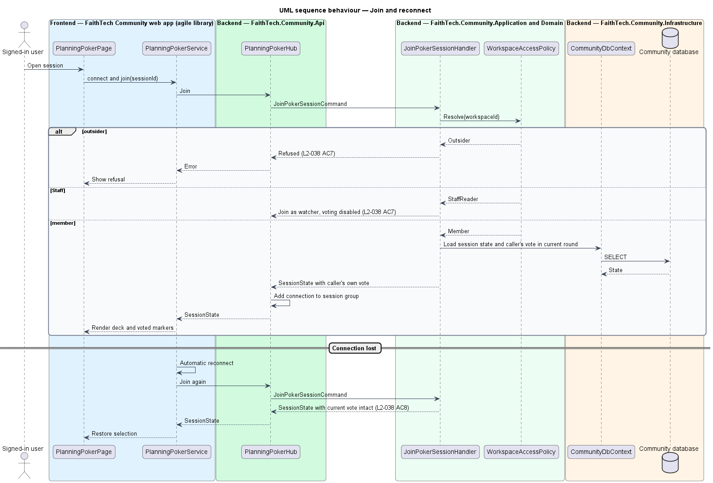

# Planning Poker

## Overview

*Planning Poker* is a live estimation game for one story.

> **poker session** — live estimation of one story by invited workspace members
>
> **facilitator** — member who started the session and alone may reveal, start a re-vote or set the final points
>
> **deck** — fixed set of vote values: 1, 2, 3, 5, 8, 13, 21 and ?

Any workspace member starts a session for a story and becomes its facilitator; invited members are notified in-app and by email. While voting is open, participants see who has voted but not the values. The facilitator reveals all votes, may clear them for a re-vote, and saves the final points to the story. Non-members cannot join. Staff may watch but not vote. Live updates travel over SignalR, as agreed in `decisions.txt`, and reach every participant within 2 seconds. A participant whose connection drops rejoins with their vote intact.

## Description

- **`PlanningPokerPage`** — session view with the story, deck, participant list with voted markers, and facilitator controls (mock `docs/mocks/pages/planning-poker`).
- **`StartPokerDialog`** — CDK Dialog that picks the story and the members to invite (mock `docs/mocks/dialogs/start-poker`).
- **`AgileService`** — `api` contract (`AGILE_SERVICE`, `HttpAgileService`) with `startPokerSession`.
- **`PlanningPokerService`** — `api` contract behind `PLANNING_POKER_SERVICE`, implemented by `SignalRPlanningPokerService` over `@microsoft/signalr`, with automatic reconnect.
- **`PokerEndpoints`** — minimal API mapping `POST /items/{id}/poker-sessions`.
- **`PlanningPokerHub`** — SignalR hub in `FaithTech.Community.Api`. It authenticates the connection and forwards `Join`, `Vote`, `Reveal`, `Revote` and `SetPoints` to Application handlers; it holds no business logic.
- **`StartPokerSessionHandler`**, **`CastVoteHandler`**, **`RevealVotesHandler`**, **`RevoteHandler`**, **`SetFinalPointsHandler`**, **`JoinPokerSessionHandler`** — Application handlers. Facilitator-only actions are refused for others; vote values are withheld from broadcasts until reveal.
- **`WorkspaceAccessPolicy`** — Application service shared by every agile handler. It resolves the caller from `ICurrentUser` and classifies the caller as owner, member, Staff, System Admin or outsider for a workspace. Outsiders receive 404, Staff and non-owner members receive 403 on writes they lack, and System Admin actions pass and are written to the audit log (`L2-031`, `L2-042`).
- **`PokerSession`** — Domain entity with `StoryId`, `FacilitatorId`, `Round`, `IsRevealed`, `InvitedIds` and `Votes`; persisting votes lets a reconnecting participant recover the current vote.
- **`PokerVote`** — value of one participant in one round; `DeckValue` restricts the value to the deck.
- **`IPokerBroadcaster`** — Application abstraction, implemented by `SignalRPokerBroadcaster`, that sends `VoteCast(profileId)`, `VotesRevealed(votes)`, `RevoteStarted` and `PointsSet` to the session group.
- Session end and expiry rules are `<TO SUPPLY>`.

## Requirements

The feature realizes the following level-2 (L2) requirements. Each L2 requirement refines a level-1 (L1) requirement, cited by identifier.

| L2 ID | Refines (L1) | Requirement |
|-------|--------------|-------------|
| `L2-038` | `L1-013` | Planning Poker sessions |

### Acceptance criteria

**`L2-038` — Planning Poker sessions**

1. Given a member, when they start a session for one or more stories and invite workspace members, then they become the facilitator, the invited members are notified in-app and by email, and the stories are estimated one at a time.
2. Given an open session, when members vote from the deck 1, 2, 3, 5, 8, 13, 21 or ?, then other participants see who has voted, but not the values, within 2 seconds, using SignalR.
3. Given the facilitator, when they reveal, then all votes are shown to everyone.
4. Given revealed votes, when the facilitator starts a re-vote, then the previous votes are cleared.
5. Given the facilitator sets the final points, when they save, then the story's points update.
6. Given a non-facilitator, when they try to reveal, re-vote or set the points, then the action is refused.
7. Given a user who is not a member, when they try to join, then they are refused. Staff can watch but not vote.
8. Given a lost connection, when it is restored, then the participant rejoins with their current vote intact.

## Diagrams

### System context

Members estimate stories and Staff watch. The system emails invitees when a session starts.

### Containers

The Web app starts a session over HTTPS and exchanges session messages with the Community API over SignalR.

### Components

`PlanningPokerHub` forwards each message to a handler, which checks access, mutates `PokerSession` and broadcasts through `IPokerBroadcaster`.

### Class structure

`PokerSession` composes `PokerVote` values restricted to `DeckValue` and sets the story's points. `SignalRPokerBroadcaster` implements `IPokerBroadcaster`.

### Behaviour — start a poker session

Starting a session makes the caller facilitator and notifies invitees in-app and by email (`L2-038`).

### Behaviour — vote, reveal and set points

Votes broadcast only the voter's identity until the facilitator reveals; facilitator-only actions are refused for others (`L2-038`).

### Behaviour — join and reconnect

Joining checks membership; Staff join as watchers and non-members are refused. After a dropped connection the client rejoins and receives its current vote (`L2-038`).

