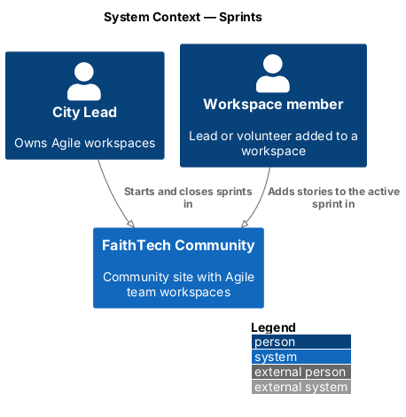
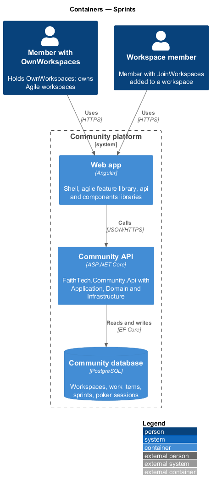
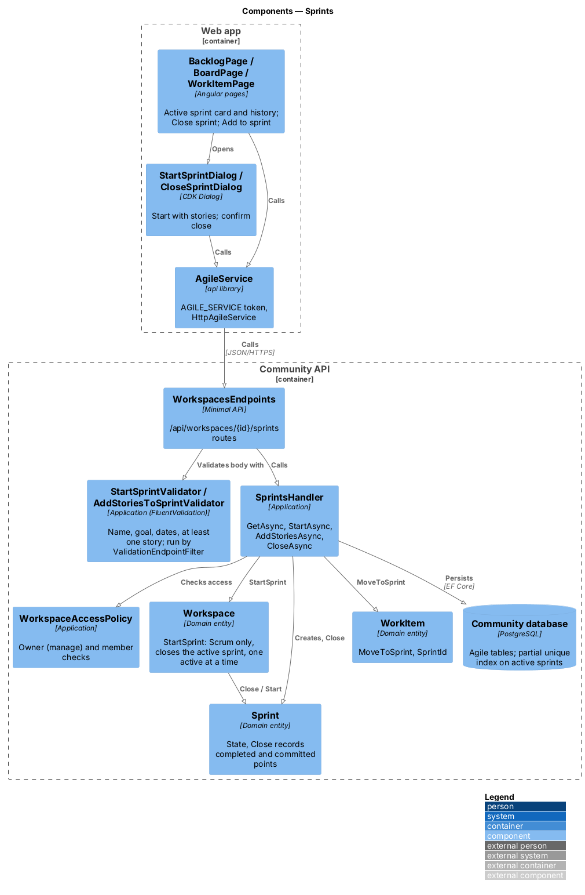
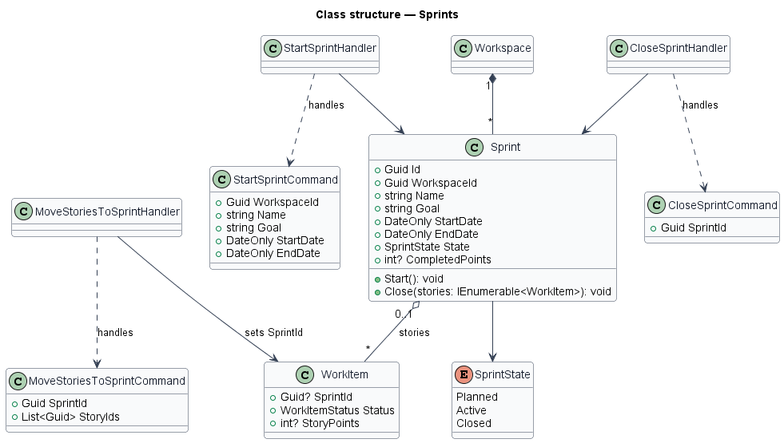
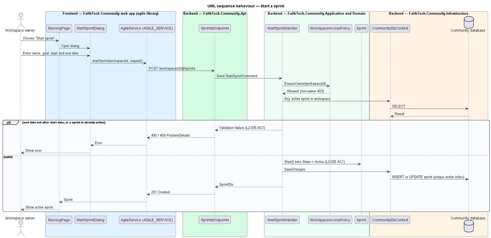
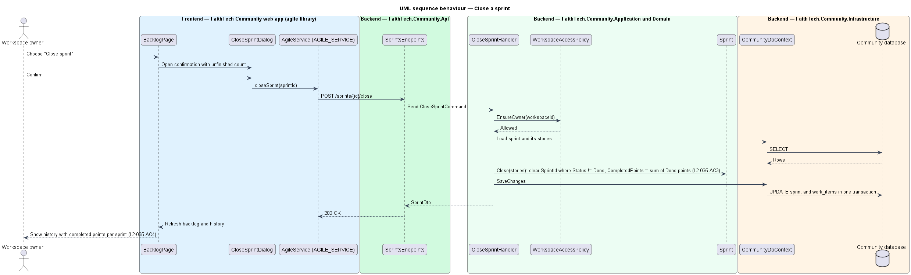

# Sprints

## Overview

Sprints apply only to workspaces that use the Scrum method.

> **sprint** — time-boxed iteration with a name, a goal, a start date and an end date after the start date
>
> **planned sprint** — sprint created but not yet started
>
> **completed story points** — sum of the story points of the stories that were Done when the sprint closed

The workspace owner starts and closes sprints; at most one sprint is active at a time. Members move stories from the backlog into the planned or active sprint. When the owner closes the active sprint, every story that is not Done returns to the backlog and the sprint records its completed story points. The sprint history lists the completed points per sprint; there is no burndown chart.

## Description

- **`BacklogPage`** — shows the backlog and the planned or active sprint, and lets members move stories into a sprint (mock `docs/mocks/pages/backlog`). It also shows sprint history.
- **`StartSprintDialog`** — CDK Dialog for name, goal, start date and end date (mock `docs/mocks/dialogs/start-sprint`).
- **`CloseSprintDialog`** — CDK Dialog that confirms closing and states how many stories return to the backlog (mock `docs/mocks/dialogs/close-sprint`).
- **`AgileService`** — `api` contract (`AGILE_SERVICE`, `HttpAgileService`).
- **`SprintsEndpoints`** — minimal API mapping for `/workspaces/{id}/sprints`.
- **`StartSprintCommand`** / **`StartSprintHandler`** — owner only; calls `Workspace.StartSprint(sprint, sprints, stories)`, which runs only in a Scrum workspace and closes the active sprint first, so no second sprint is ever active (`L2-035` AC1, AC5).
- **`MoveStoriesToSprintCommand`** / **`MoveStoriesToSprintHandler`** — any member; assigns stories to the planned or active sprint through `WorkItem.MoveToSprint`, which takes only stories of the same workspace and refuses a closed sprint.
- **`CloseSprintCommand`** / **`CloseSprintHandler`** — owner only; returns unfinished stories to the backlog and records completed points.
- **`GetSprintHistoryQuery`** — lists closed sprints with completed points.
- **`WorkspaceAccessPolicy`** — Application service shared by every agile handler. It resolves the caller from `ICurrentUser` and classifies the caller as owner, member, Staff, System Admin or outsider for a workspace. Outsiders receive 404, Staff and non-owner members receive 403 on writes they lack, and System Admin actions pass and are written to the audit log (`L2-031`, `L2-042`).
- **`Sprint`** — Domain entity with `Name`, `Goal`, `StartDate`, `EndDate`, `State` and `CompletedPoints`. The constructor requires a name, a goal and an end date after the start date; `Close(stories)` sums the points of its Done stories and returns the rest to the backlog.
- **`SprintState`** — enumeration `Planned`, `Active`, `Closed`.
- A partial unique index on `(WorkspaceId) WHERE State = 'Active'` in `CommunityDbContext` backs the one-active-sprint rule.

## Requirements

The feature realizes the following level-2 (L2) requirements. Each L2 requirement refines a level-1 (L1) requirement, cited by identifier.

| L2 ID | Refines (L1) | Requirement |
|-------|--------------|-------------|
| `L2-035` | `L1-012` | Sprints (Scrum) |

### Acceptance criteria

**`L2-035` — Sprints (Scrum)**

1. Given the owner of a Scrum workspace, when they start a sprint with a name, a goal, a start date and an end date after the start date, then it becomes active, and no second sprint can be active at the same time.
2. Given the backlog, when a member moves stories into the planned or active sprint, then they appear in that sprint.
3. Given the owner closes the active sprint, when the sprint closes, then stories that are not Done return to the backlog, and the sprint records its completed story points.
4. Given closed sprints, when the sprint history is viewed, then each sprint shows its goal, dates and "completed N of M points", with the average completed points per sprint.
5. Given an active sprint, when the owner starts the next sprint, then the active sprint is closed first (as in criterion 3) and the new sprint becomes active.
6. Given the start-sprint dialog, when the goal is empty or no story is chosen, then an inline error is shown. The dialog shows the chosen stories' points total and the recent average.

## Diagrams

### System context

The owner starts and closes sprints; members plan stories into them.

### Containers

The `agile` library calls the Community API, which stores sprints and story assignments in PostgreSQL.

### Components

`SprintsEndpoints` dispatches to the sprint handlers, which check owner or member access and mutate `Sprint` and its stories.

### Class structure

A `Workspace` composes its `Sprint` records; each sprint aggregates the stories whose `SprintId` points to it.

### Behaviour — start a sprint

The owner starts a sprint; the handler validates the dates and refuses a second active sprint (`L2-035`).

### Behaviour — move stories into a sprint

Any member moves stories from the backlog into the planned or active sprint (`L2-035`).

### Behaviour — close a sprint

Closing returns unfinished stories to the backlog and records the completed points shown in sprint history (`L2-035`).

## Open questions

Decisions recorded while building the Domain layer (`FaithTech.Community.Domain`):

- Starting a sprint is a `Workspace` operation so the one-active-sprint rule holds in the Domain as well as in the partial unique index. A planned sprint may also be closed (used by a switch to Kanban). Domain rule violations throw `InvalidOperationException` (a broken rule) or `ArgumentException` (invalid input); there is no shared domain exception type. Handlers check permissions and preconditions first and map any remaining violation to a `400` or `409` result.
- `Sprint.CommittedPoints` is recorded when a sprint closes: the points of every story the sprint held, Done or not. The sprint history shows completed of committed points, and the average of the last three closed sprints guides the next sprint.
- Starting a sprint closes the active one first and then moves the chosen stories in, so the closing sprint's committed points do not include them.
