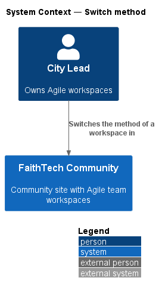
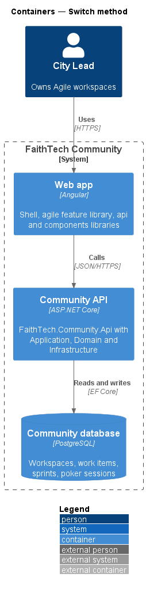
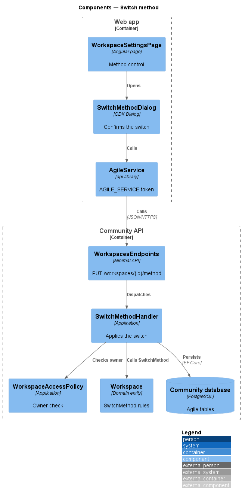
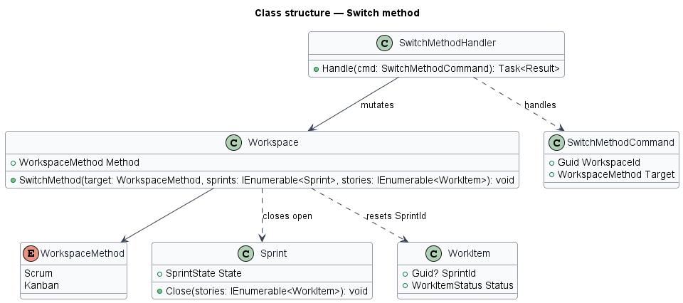
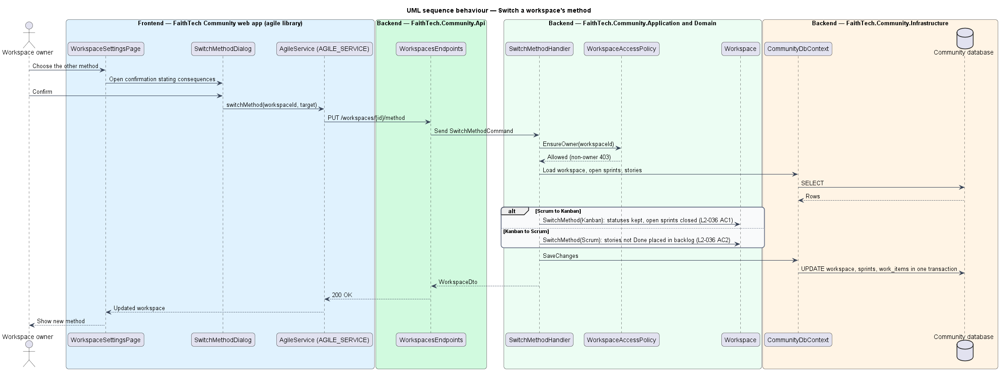

# Switch method

## Overview

Each Agile workspace runs with one *method*.

> **method** — way a workspace organizes work: Scrum, with sprints and a backlog, or Kanban, with a continuous board

The workspace owner chooses the method when creating the workspace (see `agile/workspaces-and-membership`) and may switch it later after confirming. Switching from Scrum to Kanban keeps every item's status and closes any open sprint. Switching from Kanban to Scrum places every story that is not Done in the backlog, ready for sprint planning (see `agile/sprints`).

## Description

- **`WorkspaceSettingsPage`** — owner-only settings page with the method control (mock `docs/mocks/pages/workspace-settings`).
- **`SwitchMethodDialog`** — CDK Dialog that states the consequences and asks for confirmation (mock `docs/mocks/dialogs/switch-method`).
- **`AgileService`** — `api` contract (`AGILE_SERVICE`, `HttpAgileService`) with `switchMethod`.
- **`WorkspacesEndpoints`** — maps `PUT /workspaces/{id}/method`.
- **`SwitchMethodCommand`** / **`SwitchMethodHandler`** — owner only; applies the transition in one unit of work.
- **`Workspace.SwitchMethod(target, sprints, stories)`** — Domain method that closes open sprints when moving to Kanban and clears sprint membership of unfinished stories when moving to Scrum.
- **`WorkspaceAccessPolicy`** — Application service shared by every agile handler. It resolves the caller from `ICurrentUser` and classifies the caller as owner, member, Staff, System Admin or outsider for a workspace. Outsiders receive 404, Staff and non-owner members receive 403 on writes they lack, and System Admin actions pass and are written to the audit log (`L2-031`, `L2-042`).
- Whether closing sprints on a switch to Kanban records completed points as in `agile/sprints` is `<TO SUPPLY>`.

## Requirements

The feature realizes the following level-2 (L2) requirements. Each L2 requirement refines a level-1 (L1) requirement, cited by identifier.

| L2 ID | Refines (L1) | Requirement |
|-------|--------------|-------------|
| `L2-036` | `L1-012` | Switch method |

### Acceptance criteria

**`L2-036` — Switch method**

1. Given the owner, when they switch a workspace from Scrum to Kanban after confirming, then every item keeps its status, and any open sprint is closed.
2. Given the owner, when they switch from Kanban to Scrum, then all stories that are not Done are placed in the backlog.

## Diagrams

### System context

Only the workspace owner switches the method.

### Containers

The settings page calls the Community API, which updates the workspace, its sprints and its stories in PostgreSQL.

### Components

`SwitchMethodHandler` checks ownership and calls `Workspace.SwitchMethod`, then persists every change in one unit of work.

### Class structure

`Workspace.SwitchMethod` closes open `Sprint` records or clears `WorkItem.SprintId` depending on the target method.

### Behaviour — switch a workspace's method

The owner confirms the switch; the handler applies the Scrum-to-Kanban or Kanban-to-Scrum rule in one unit of work (`L2-036`).

