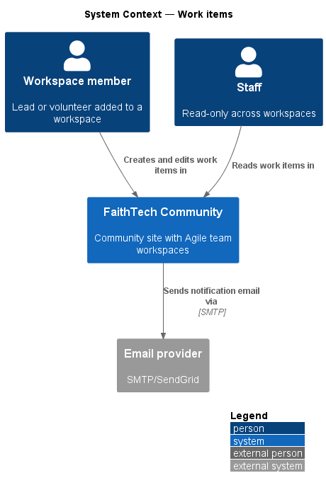
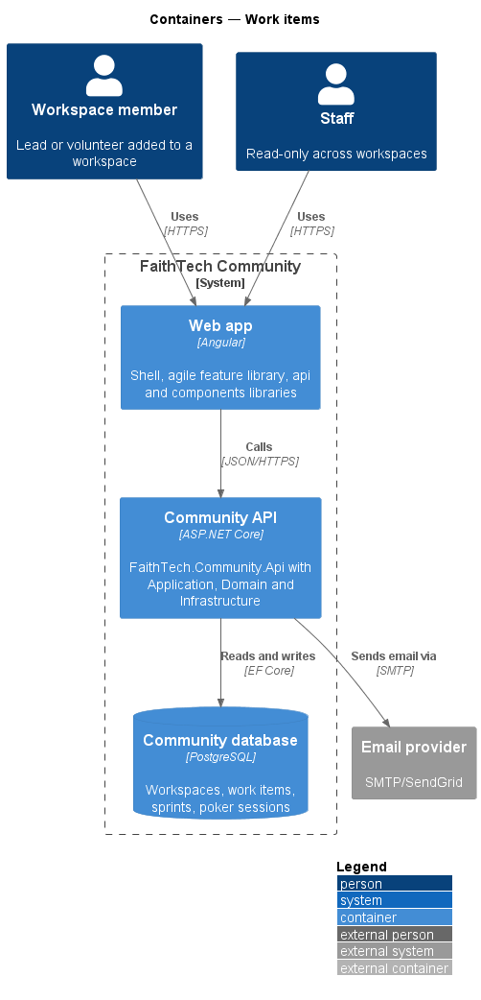
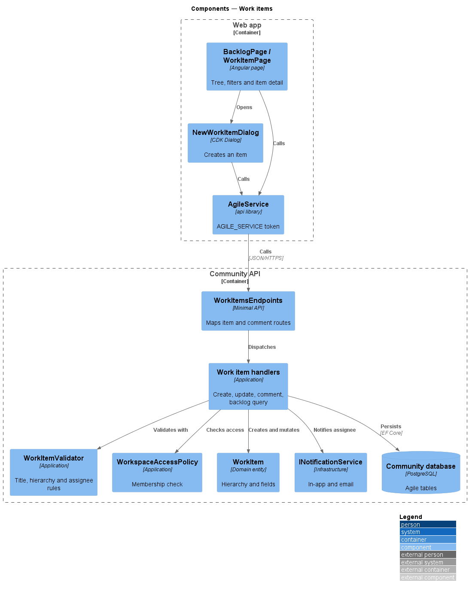
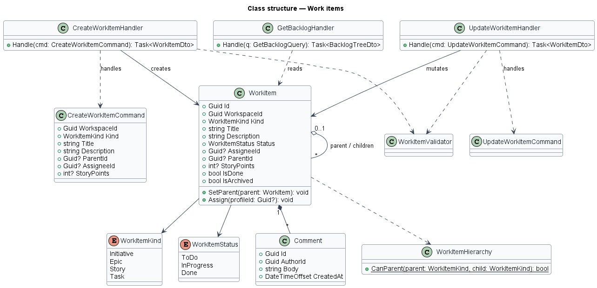
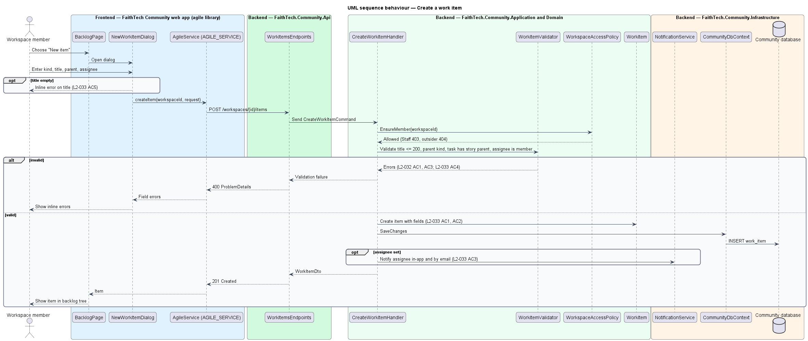
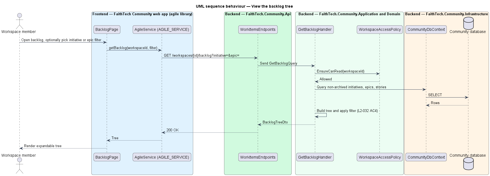

# Work items

## Overview

A *work item* is a unit of work inside an Agile workspace (see `agile/workspaces-and-membership`).

> **work item** — initiative, epic, story or task that belongs to one workspace
>
> **initiative** — top-level goal that groups epics
>
> **epic** — body of work that groups stories
>
> **story** — deliverable shown as a card on the board and estimated in story points
>
> **task** — checklist step inside a story, with a done flag
>
> **backlog** — ordered list of stories not in an active or planned sprint, shown with its parents as a tree

The hierarchy is strict: an epic may sit only under an initiative, a story only under an epic, and a task only under a story. Parents are optional except for tasks, which always belong to a story. Members create and edit items, assign one workspace member to each and comment on them; an assignee is notified in-app and by email.

This feature owns the work item model, the new-work-item dialog, the work item detail page and the backlog tree. The board, sprints and Planning Poker read and update the same items.

## Description

- **`BacklogPage`** — shows initiatives, epics and stories as an expandable tree with initiative and epic filters (mock `docs/mocks/pages/backlog`).
- **`WorkItemPage`** — detail view of one item: fields, tasks checklist, assignee and comments (mock `docs/mocks/pages/work-item`).
- **`NewWorkItemDialog`** — CDK Dialog for creating an item; it shows an inline error when the title is empty (mock `docs/mocks/dialogs/new-work-item`).
- **`AgileService`** — `api` library contract behind the `AGILE_SERVICE` token, implemented by `HttpAgileService`.
- **`WorkItemsEndpoints`** — minimal API mapping for `/workspaces/{id}/items` and `/items/{id}/comments`.
- **`CreateWorkItemCommand`**, **`UpdateWorkItemCommand`**, **`AddCommentCommand`** and their handlers — create and edit items and add comments.
- **`WorkItemValidator`** — FluentValidation-style validator: title required and at most 200 characters, assignee is a workspace member, parent kind matches the allowed hierarchy, task has a story parent.
- **`GetBacklogQuery`** / **`GetBacklogHandler`** — returns the initiative/epic/story tree, optionally filtered by initiative or epic.
- **`WorkspaceAccessPolicy`** — Application service shared by every agile handler. It resolves the caller from `ICurrentUser` and classifies the caller as owner, member, Staff, System Admin or outsider for a workspace. Outsiders receive 404, Staff and non-owner members receive 403 on writes they lack, and System Admin actions pass and are written to the audit log (`L2-031`, `L2-042`).
- **`WorkItem`** — Domain entity with `Kind`, `Title`, `Description`, `Status`, `AssigneeId`, `ParentId`, `StoryPoints` (stories only), `IsDone` (tasks only), `IsArchived` and `Comments`.
- **`WorkItemKind`** — enumeration `Initiative`, `Epic`, `Story`, `Task`; `WorkItemHierarchy.CanParent(parent, child)` encodes the allowed links.
- **`WorkItemStatus`** — enumeration `ToDo`, `InProgress`, `Done`. Initiative and epic status values are `<TO SUPPLY>` if they differ from story status.
- **`INotificationService`** — sends the in-app and email assignment notification.

## Requirements

The feature realizes the following level-2 (L2) requirements. Each L2 requirement refines a level-1 (L1) requirement, cited by identifier.

| L2 ID | Refines (L1) | Requirement |
|-------|--------------|-------------|
| `L2-032` | `L1-012` | Work item hierarchy |
| `L2-033` | `L1-012` | Work item fields and editing |

### Acceptance criteria

**`L2-032` — Work item hierarchy**

1. Given a work item, when it is given a parent, then only these links are allowed: an epic under an initiative, a story under an epic, and a task under a story.
2. Given an initiative, epic or story, when it is created, then the parent is optional.
3. Given a task, when it is created, then it must belong to a story.
4. Given the backlog, when it is shown, then initiatives, epics and stories appear as an expandable tree that can be filtered by initiative or epic.

**`L2-033` — Work item fields and editing**

1. Given an initiative, epic or story, when it is saved, then it has a title (required, up to 200 characters), a description, one optional assignee who is a workspace member, a status and comments. Stories also have story points.
2. Given a task, when it is saved, then it has a title, a done flag and an optional assignee.
3. Given an item is assigned to a member, when it is saved, then the assignee receives an in-app and email notification.
4. Given an assignee who is not a member of the workspace, when the item is saved, then the API rejects it.
5. Given the new-work-item dialog, when the title is empty, then an inline error is shown.

## Diagrams

### System context

Members create and edit work items; Staff read them. The system emails an assignee when an item is assigned.

### Containers

The `agile` library calls the Community API, which stores items in PostgreSQL and sends assignment email through the provider.

### Components

`WorkItemsEndpoints` dispatches to the handlers, which validate with `WorkItemValidator`, check membership and persist `WorkItem` changes.

### Class structure

`WorkItem` references its parent item and composes its comments. `WorkItemHierarchy` holds the allowed parent links for each `WorkItemKind`.

### Behaviour — create a work item

The dialog enforces a non-empty title on the client; the server re-validates the title, the parent link and the assignee, then notifies the assignee (`L2-032`, `L2-033`).

### Behaviour — view the backlog tree

The backlog query returns initiatives, epics and stories as a tree, optionally filtered by initiative or epic (`L2-032`).

