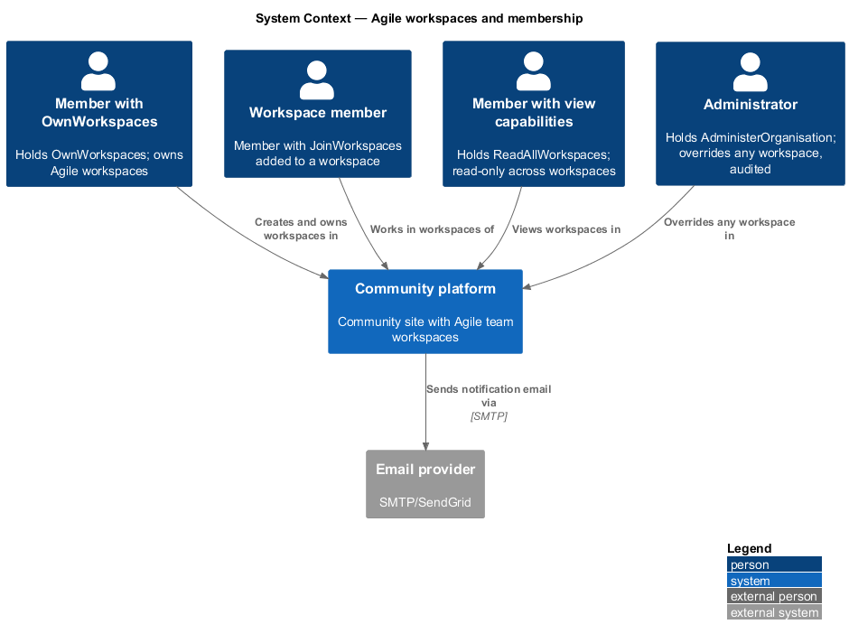
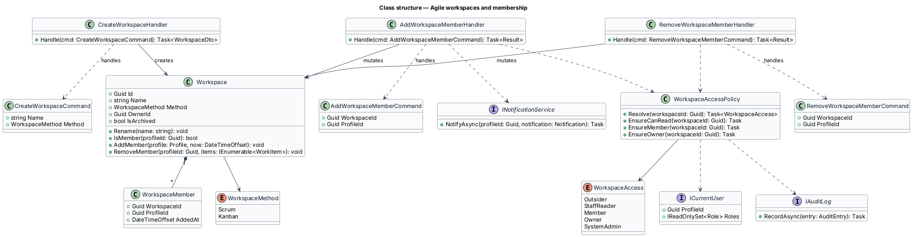
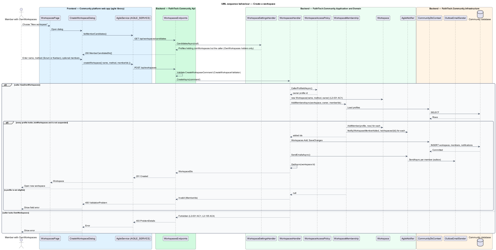
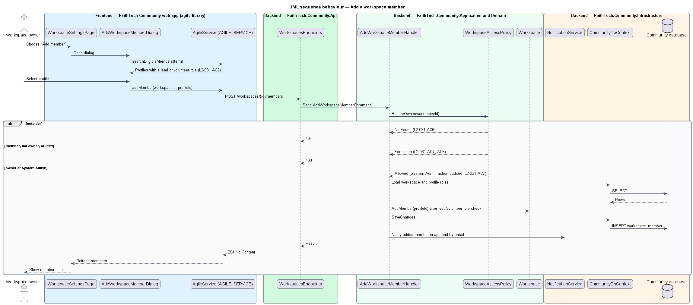
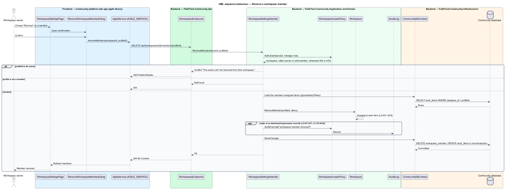

# Agile workspaces and membership

## Overview

FaithTech Community lets a City Lead run a team's work in an *Agile workspace*.

> **Agile workspace** — named container for a team's work items, run with either the Scrum or the Kanban method
>
> **workspace owner** — City Lead who created the workspace and alone manages its members, settings, sprints and archive state
>
> **workspace member** — profile holding a lead or volunteer role that the owner has added to the workspace

Community data is global, but workspace access comes from membership. Members create and edit items, move cards, comment and vote in Planning Poker. Staff read every workspace and write nothing. System Admin may act on any workspace, and each such action is audited. Any other signed-in user receives 404 for the workspace and its items, and none of its content appears in that user's global search.

This feature is the entry point of the agile subsystem. Every other agile feature (work items, board, sprints, switch method, archive and transfer, Planning Poker) relies on the membership model and the access policy defined here.

The repository layout in `AGENTS.md` lists the `Agile/` folders in `FaithTech.Community.Domain` and `FaithTech.Community.Application` and the `agile` feature library in `frontend/projects/` ([ADR 0010](../../../adr/0010-agile-feature-layout.md)).

## Description

The slice runs from the workspaces pages in the `agile` feature library to the Community database.

- **`WorkspacesPage`** — lists the workspaces the caller may see (mock `docs/mocks/pages/workspaces`) and opens `CreateWorkspaceDialog`.
- **`CreateWorkspaceDialog`** — CDK Dialog that captures a name and a method (Scrum or Kanban) (mock `docs/mocks/dialogs/create-workspace`).
- **`WorkspaceSettingsPage`** — owner-only page for name, method and members (mock `docs/mocks/pages/workspace-settings`). Owner controls are hidden for other roles.
- **`AddWorkspaceMemberDialog`** and **`RemoveWorkspaceMemberDialog`** — CDK Dialogs for adding an eligible profile and confirming a removal (mocks `add-workspace-member`, `remove-workspace-member`).
- **`AgileService`** — API client contract in the `api` library, provided through the `AGILE_SERVICE` injection token and implemented by `HttpAgileService`.
- **`WorkspacesEndpoints`** — minimal API mapping for `/workspaces` and `/workspaces/{id}/members`. It authenticates the caller and dispatches to handlers; it holds no business logic.
- **`CreateWorkspaceCommand`** / **`CreateWorkspaceHandler`** — creates a workspace with the caller as owner. Only a City Lead (or System Admin) may create one; a City Lead may own more than one workspace.
- **`AddWorkspaceMemberCommand`** / **`AddWorkspaceMemberHandler`** — adds a profile that holds a lead or volunteer role and notifies it in-app and by email.
- **`RemoveWorkspaceMemberCommand`** / **`RemoveWorkspaceMemberHandler`** — removes a member and clears that member as assignee from every item in the workspace.
- **`GetWorkspaceQuery`** / **`ListWorkspacesQuery`** — read the workspace and the caller's visible workspaces.
- **`WorkspaceAccessPolicy`** — Application service shared by every agile handler. It resolves the caller from `ICurrentUser` and classifies the caller as owner, member, Staff, System Admin or outsider for a workspace. Outsiders receive 404, Staff and non-owner members receive 403 on writes they lack, and System Admin actions pass and are written to the audit log (`L2-031`, `L2-042`).
- **`Workspace`** — Domain entity with `Name`, `Method`, `OwnerId`, `IsArchived` and a `Members` collection of `WorkspaceMember`. `AddMember(profile, now)` accepts only a profile on the team (`TeamRoles.IsTeamMember`) and rejects a duplicate; `RemoveMember(profileId, items)` unassigns that member's items (`L2-031` AC8); `IsMember` counts the owner as a member.
- **`WorkspaceMethod`** — enumeration `Scrum`, `Kanban`.
- **`INotificationService`** and **`IAuditLog`** — Application abstractions implemented in Infrastructure for in-app plus email notification and the audit log.
- **`CommunityDbContext`** — EF Core context in Infrastructure that persists workspaces and members to PostgreSQL.

## Requirements

The feature realizes the following level-2 (L2) requirements. Each L2 requirement refines a level-1 (L1) requirement, cited by identifier.

| L2 ID | Refines (L1) | Requirement |
|-------|--------------|-------------|
| `L2-031` | `L1-012` | Agile workspaces and membership |

### Acceptance criteria

**`L2-031` — Agile workspaces and membership**

1. Given a City Lead, when they create a workspace with a name and a method (Scrum or Kanban), then they become its owner. A City Lead can own more than one workspace.
2. Given the owner, when they add members, then only profiles holding a lead or volunteer role can be chosen, and each added member is notified.
3. Given a member, when they open the workspace, then they can create and edit stories and tasks, move cards, comment and vote in Planning Poker. Only the owner creates and edits initiatives and epics.
4. Given a member who is not the owner, when they try to manage members, change settings, manage sprints, or archive the workspace, then the control is hidden and the API returns 403.
5. Given Staff, when they open any workspace, then they can view it but every write returns 403.
6. Given a non-member who is not Staff or System Admin, when they request the workspace or its items, then the response is 404, and nothing appears in their search.
7. Given a System Admin, when they act on any workspace, then the action succeeds and is audited.
8. Given a removed member, when the removal completes, then their assigned items become unassigned.

## Diagrams

### System context

City Leads own workspaces, members work in them, Staff read them and System Admin overrides them. The system emails members when they are added.

### Containers

The `agile` library in the Web app calls the Community API, which persists workspaces in PostgreSQL and sends email through the provider.

### Components

`WorkspacesEndpoints` dispatches to the workspace handlers, which consult `WorkspaceAccessPolicy` before loading or changing a `Workspace`.

### Class structure

`Workspace` composes its `WorkspaceMember` rows. Each handler handles one command and depends on `WorkspaceAccessPolicy`, which classifies the caller as a `WorkspaceAccess` value.

### Behaviour — create a workspace

The handler accepts the command only from a City Lead or System Admin and records the caller as owner (`L2-031`).

### Behaviour — add a workspace member

Only the owner may add members, and only profiles holding a lead or volunteer role are eligible; the new member is notified (`L2-031`).

### Behaviour — remove a workspace member

Removing a member clears that member as assignee from every item in the workspace within the same unit of work (`L2-031`).

### Behaviour — open a workspace

Reads resolve the caller's access first; outsiders receive 404 so the workspace's existence is not revealed (`L2-031`).

## Open questions

Decisions recorded while building the Domain layer (`FaithTech.Community.Domain`):

- Domain types for the agile subsystem live in `FaithTech.Community.Domain/Agile/`, the folder name these designs use; `AGENTS.md` lists it.
- `AddMember` takes the `Profile` so the Domain enforces the lead-or-volunteer rule itself; the owner cannot be removed as a member.
- Domain rule violations throw `InvalidOperationException` (a broken rule) or `ArgumentException` (invalid input); there is no shared domain exception type. Handlers check permissions and preconditions first and map any remaining violation to a `400` or `409` result.
- Search (L2-031 AC6, L2-026 AC2) is deferred: global search is not built yet. When work items are indexed, the search query applies the same member, Staff or System Admin filter as `WorkspaceAccessPolicy.Visible` and leaves out archived items (ADR 0011).
- `WorkspaceMemberDto.IsYou` marks the caller, so the web app can show "(you)" and leave the facilitator out of Planning Poker invites without knowing its own profile id.
