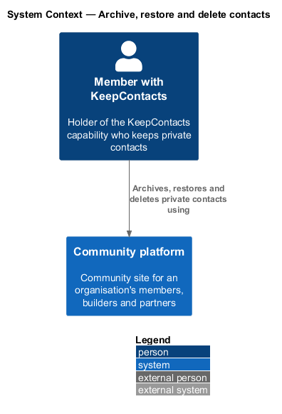
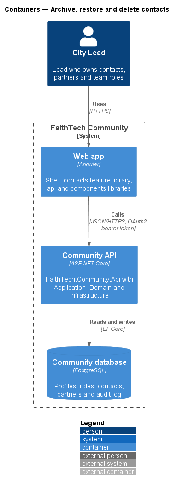
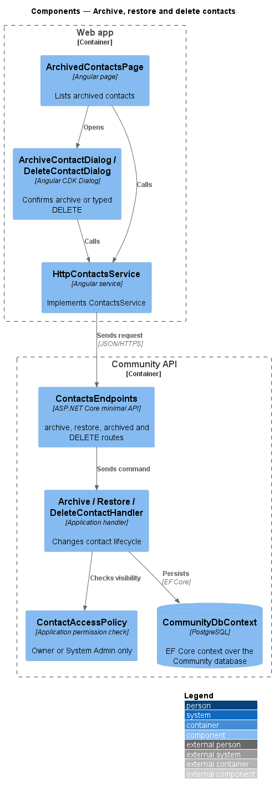
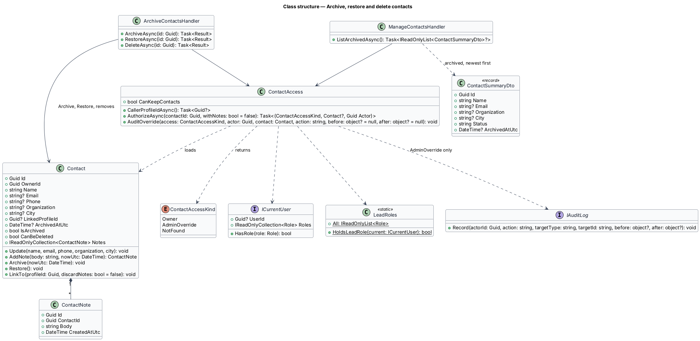
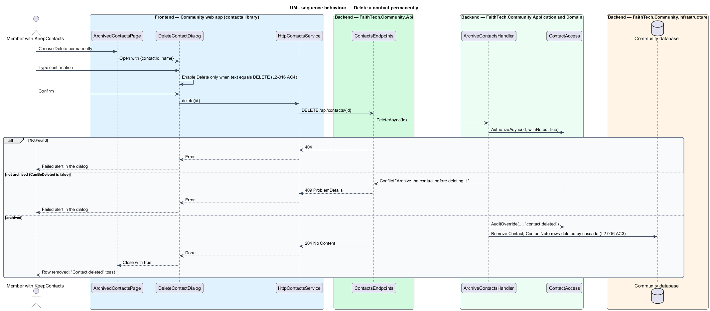

# Archive, restore and delete contacts

## Overview

Leads remove contacts they no longer track in two stages. **Archive** — soft delete that hides a contact from the main list while keeping it and its notes for restoration. **Permanent delete** — irreversible removal of an archived contact and all of its notes. Only an archived contact may be permanently deleted, and the lead confirms by typing `DELETE`.

The archived contacts page lists the caller's archived contacts and offers Restore and Delete permanently. All operations follow the private-contact visibility rule (`L2-012`).

## Description

- **`ArchiveContactDialog`** — CDK confirmation dialog opened from `ContactPage` or `ContactsPage`.
- **`ArchivedContactsPage`** — page listing archived contacts with Restore and Delete permanently actions.
- **`DeleteContactDialog`** — CDK dialog with a text input; the Delete button stays disabled until the input equals `DELETE` exactly (case-sensitive).
- **`ContactsService`** — `archive`, `restore`, `listArchived` and `delete`, calling `POST /api/contacts/{id}/archive`, `POST /api/contacts/{id}/restore`, `GET /api/contacts/archived` and `DELETE /api/contacts/{id}`.
- **`ArchiveContactHandler`**, **`RestoreContactHandler`** and **`DeleteContactHandler`** in Application `Contacts/`. Each applies `ContactAccessPolicy`. `DeleteContactHandler` refuses a contact that is not archived with `409`.
- **`Contact.Archive(nowUtc)`** sets `ArchivedAtUtc`; **`Contact.Restore()`** clears it. Each rejects a contact already in the target state. **`Contact.CanBeDeleted`** is true only for an archived contact, and `DeleteContactHandler` checks it. Active queries filter on `ArchivedAtUtc IS NULL`.
- **Cascade** — deleting a `Contact` deletes its `ContactNote` rows through an EF Core cascade.

Archived contacts do not expire automatically ([ADR 0007](../../../adr/0007-contacts-and-partners-access-and-open-questions.md)).

## Requirements

The feature realizes the following level-2 (L2) requirements. Each L2 requirement refines a level-1 (L1) requirement, cited by identifier.

| L2 ID | Refines (L1) | Requirement |
|-------|--------------|-------------|
| `L2-016` | `L1-005` | Archive, restore and delete contacts |

### Acceptance criteria

**`L2-016` — Archive, restore and delete contacts**

1. Given a contact, when the lead archives it after confirming, then it disappears from the main list and appears in archived contacts.
2. Given an archived contact, when the lead restores it, then it returns to the main list with its notes.
3. Given an archived contact, when the lead types DELETE and confirms permanent deletion, then the contact and its notes are removed permanently.
4. Given the delete dialog, when the typed text is not exactly DELETE, then the delete button stays disabled.

## Diagrams

### System context

The owning lead archives, restores and deletes contacts within FaithTech Community; no external system participates.

### Containers

The `contacts` feature library in the Angular web app calls the Community API over HTTPS with an OAuth2 bearer token. The API persists state in the PostgreSQL Community database.

### Components

The three handlers share `ContactAccessPolicy`, and each lifecycle change is a single save through `CommunityDbContext`.

### Class structure

`Contact` exposes `Archive` and `Restore`; deleting it removes the composed `ContactNote` entries.

### Behaviour — archive and restore a contact

Archiving moves the contact to the archived list after confirmation; restoring returns it with its notes (`L2-016` AC1, AC2).

### Behaviour — delete a contact permanently

The dialog keeps Delete disabled until the input is exactly `DELETE`; the server deletes only archived contacts.

## Open questions

Decisions recorded while building the Domain layer (`FaithTech.Community.Domain`):

- Domain rule violations throw `InvalidOperationException` (a broken rule) or `ArgumentException` (invalid input); there is no shared domain exception type. Handlers check permissions and preconditions first and map any remaining violation to a `400` or `409` result.
