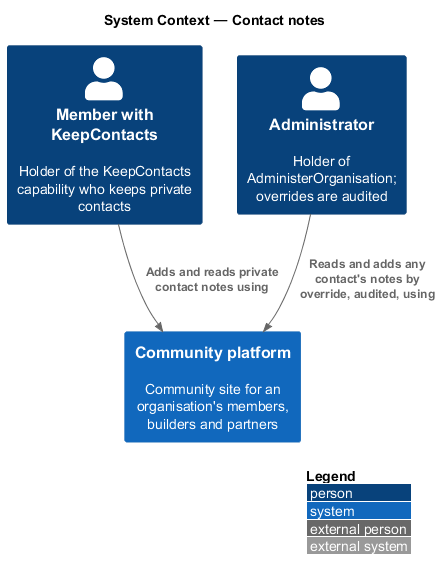
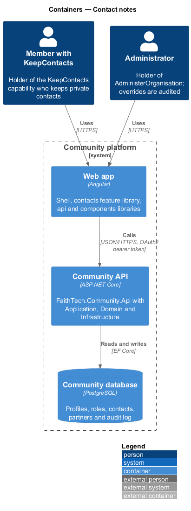
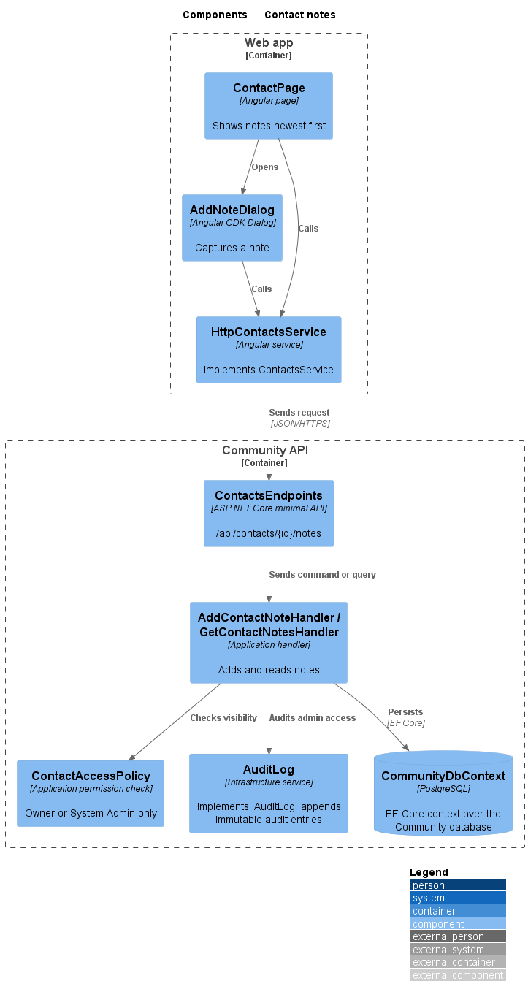
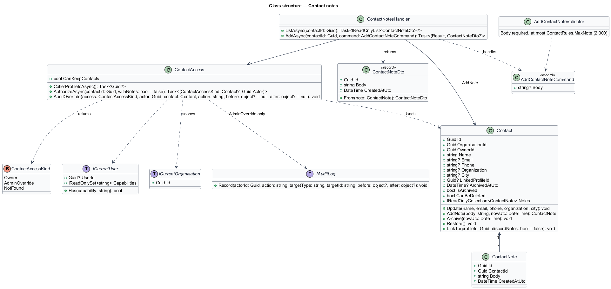
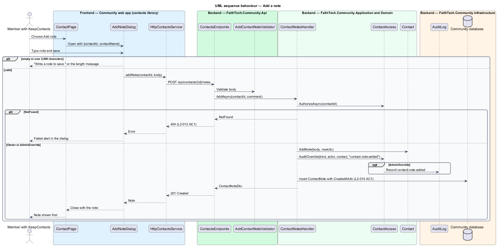
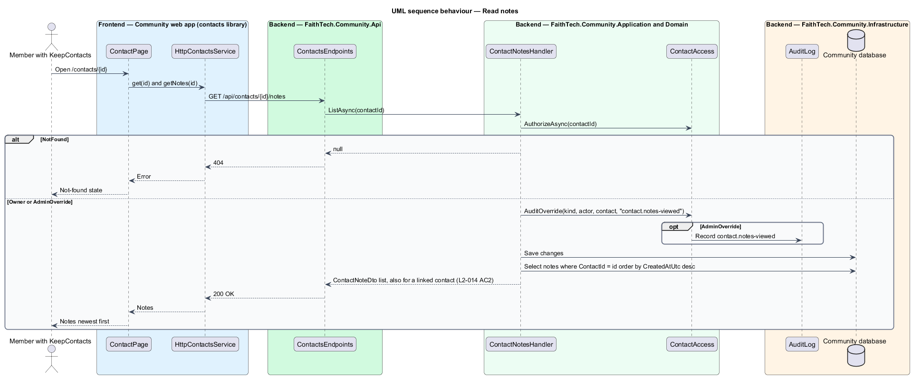

# Contact notes

## Overview

A **contact note** — timestamped free-text entry a holder of `KeepContacts` records against one of their private contacts. Notes hold the owner's own observations and follow-ups. They share the contact's visibility: only the owning member and, as an audited override, a holder of `AdministerOrganisation` may read them (`L2-135` AC5).

Notes remain private even after the contact is linked to the person's real profile (`contacts/link-contact-on-sign-up`); linking shows the profile's name and photo on the contact but never exposes the notes to the person or anyone else.

## Description

- **`ContactPage`** — contact detail page in the `contacts` feature library. It loads the notes with the contact, lists them newest first and offers an Add note button that opens `AddNoteDialog` with `DialogService` (no inline form, `AGENTS.md`). The saved note is put at the top of the list without a reload.
- **`AddNoteDialog`** — CDK dialog in the `contacts` library with a single required text area (mock `dialogs/add-note`). It checks the note is 1 to 2,000 characters ("Write a note to save."), calls `CONTACTS_SERVICE.addNote` itself, shows busy and failed states, and closes with the saved `ContactNoteDto`.
- **`ContactsService`** / **`HttpContactsService`** — `getNotes(contactId)` and `addNote(contactId, body)` calling `GET` and `POST /api/contacts/{id}/notes`.
- **`ContactsEndpoints`** — maps the notes routes. `GET` answers `200` or `404`; `POST` answers `201`, `400` or `404`.
- **`AddContactNoteCommand`** (`Body`) and **`AddContactNoteValidator`** — the request body and its rule: required, at most `ContactRules.MaxNote` (2,000) characters.
- **`ContactNotesHandler`** — Application handler in `Contacts/` with `ListAsync(contactId)` and `AddAsync(contactId, command)`. Both call `ContactAccess.AuthorizeAsync`; non-owners receive `404`, and `AdministerOrganisation` access is audited as an override through `ContactAccess.AuditOverride` (`contact.notes-viewed`, `contact.note-added`). Every query is scoped by the DbContext's global filter on `ICurrentOrganisation`.
- **`ContactNoteDto`** — `Id`, `Body` and `CreatedAtUtc`.
- **`ContactNote`** — Domain entity with `Body` (required) and `CreatedAtUtc`, composed by `Contact` and created only through `Contact.AddNote(body, nowUtc)`. `CommunityDbContext` maps it to `ContactNotes` (body at most 2,000 characters) with an index on contact and time.

Notes cannot be edited or deleted after creation; `L2-014` defines only adding and reading ([ADR 0014](../../../adr/0014-contacts-and-partners-access-and-open-questions.md)).

## Requirements

The feature realizes the following level-2 (L2) requirements. Each L2 requirement refines a level-1 (L1) requirement, cited by identifier.

| L2 ID | Refines (L1) | Requirement |
|-------|--------------|-------------|
| `L2-014` | `L1-005` | Contact notes |

### Acceptance criteria

**`L2-014` — Contact notes**

1. Given a contact, when the owning member adds a note, then it is saved with a timestamp and shown newest first.
2. Given a contact linked to a real profile, when the owner views it, then their private notes are still shown, and are visible only to them and, as an audited override, to holders of `AdministerOrganisation` (`L2-012` AC2).

## Diagrams

### System context

The owning member writes and reads notes; an administrator may read and add them by override, audited.

### Containers

The `contacts` feature library in the Angular web app calls the Community API through the `api` library over HTTPS with an OAuth2 bearer token. The API persists state in the PostgreSQL Community database.

### Components

`ContactNotesHandler` applies `ContactAccess` before reading or writing any note; `AddContactNoteValidator` rejects an empty or overlong note with `400` first.

### Class structure

`Contact` composes `ContactNote`. `ContactNotesHandler` depends on `ContactAccess` and returns `ContactNoteDto`.

### Behaviour — add a note

The note is saved with a UTC timestamp and appears at the top of the list (`L2-014` AC1).

### Behaviour — read notes

Notes are returned newest first, including on a contact linked to a real profile (`L2-014` AC2).

## Open questions

Decisions recorded while building the Domain layer (`FaithTech.Community.Domain`):

- Notes are append-only in the Domain; editing and deleting single notes stay deferred until a requirement defines them.
- The contact page's inline note form in the original mock is replaced by an Add note button and `AddNoteDialog`; the contact form's first note becomes the first `ContactNote` on create.
- A note added by an administrator to another member's contact is allowed and audited (`contact.note-added`), like reading the notes (`contact.notes-viewed`).
- Capabilities: access was decided by role name through `LeadRoles`; it is now `KeepContacts` with the `AdministerOrganisation` override (ADR 0033).
