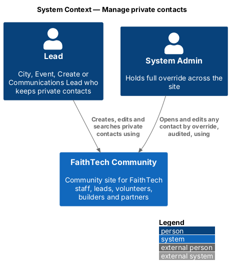
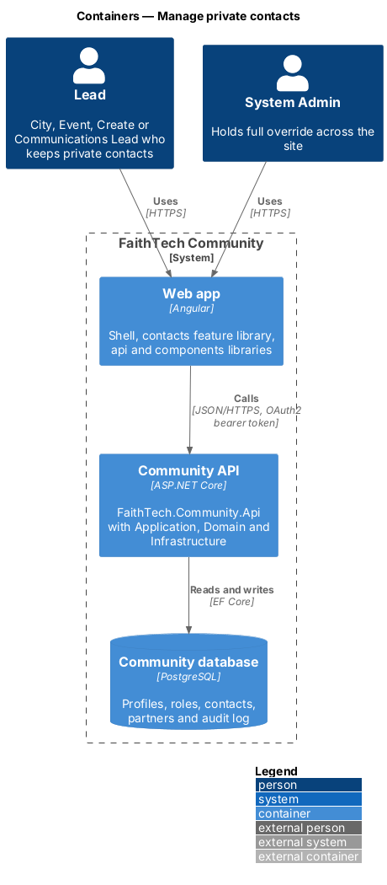
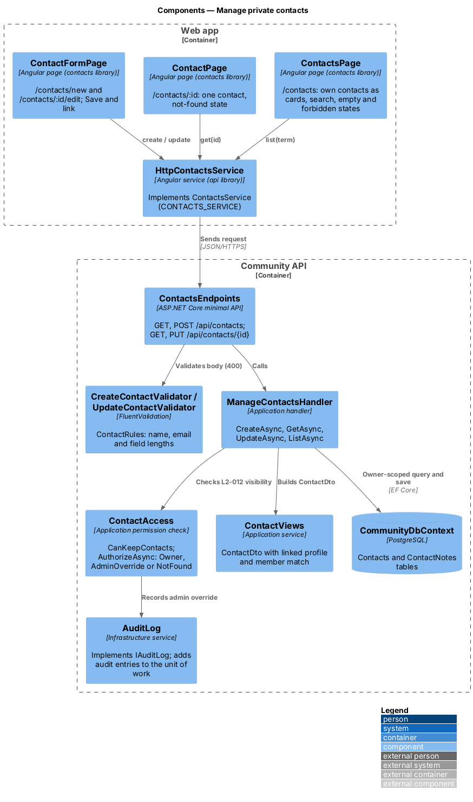
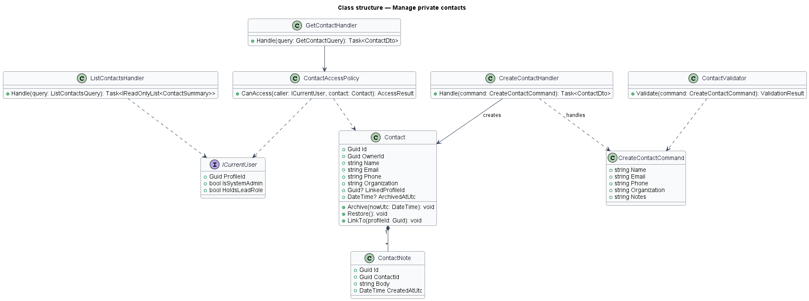
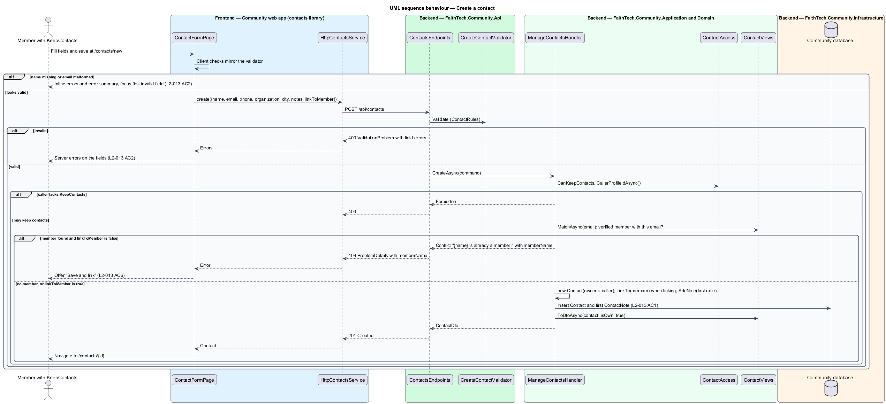
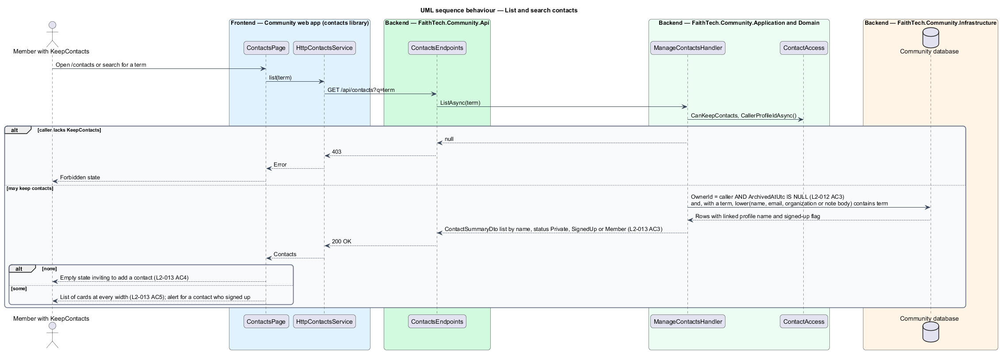
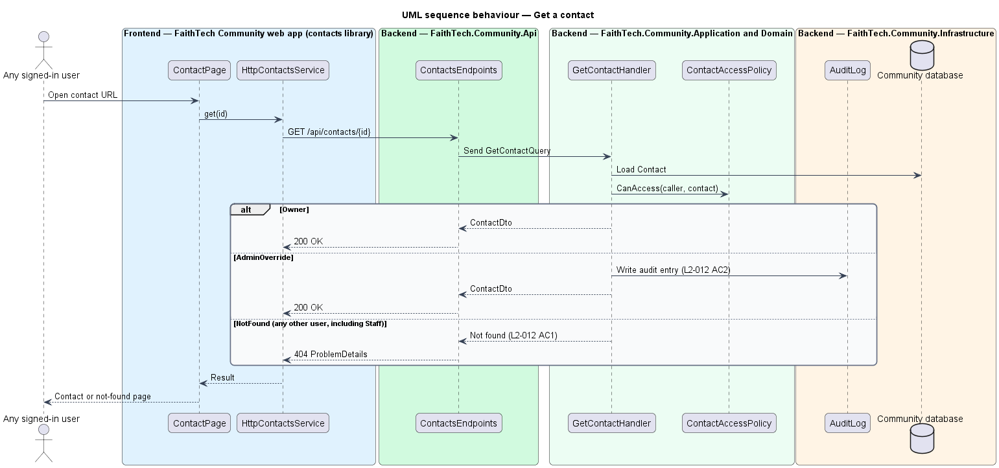

# Manage private contacts

## Overview

Leads meet people who have not yet joined FaithTech Community. A **private contact** — record of such a person, owned by the lead who created it and visible only to that lead and to System Admin. Private contacts are the one exception to the rule that data in FaithTech Community is global. Staff, who can read everything else, cannot see them.

This feature covers listing, creating, editing and searching contacts, and the visibility rule that every contact query enforces. Notes, linking on sign-up and archiving are separate slices in the contacts subsystem that rely on the same visibility rule.

## Description

- **`ContactsPage`** — page in the `contacts` feature library. It shows the caller's active contacts in a table, or as a single column of cards at XS widths, with a search box and an empty state that invites the lead to add one.
- **`ContactPage`** — detail page for one contact. Its Details card is an `ft-description-list`; the email is a `mailto:` link, and an optional fact with no value (email, phone, organization, city) keeps its row and reads "Not added" through `ft-description-list-item [missing]` (mock `pages/contact/missing`).
- **`ContactFormPage`** — create and edit screen with name (required), email, phone, organization, city and initial notes. Inline errors appear on invalid fields. Editing navigates to this screen rather than editing inline.
- **`ContactsService`** / **`CONTACTS_SERVICE`** / **`HttpContactsService`** — API client for `GET /api/contacts?q=`, `GET /api/contacts/{id}`, `POST /api/contacts` and `PUT /api/contacts/{id}`.
- **`ContactsEndpoints`** — minimal API mapping.
- **`CreateContactCommand`**, **`UpdateContactCommand`**, **`GetContactQuery`**, **`ListContactsQuery`** and their handlers in Application `Contacts/`.
- **`ContactValidator`** — requires a name and validates email format.
- **`ContactAccessPolicy`** — returns `Owner`, `AdminOverride` or `NotFound`. A non-owner, non-admin caller receives `404`, never `403`, so existence is not revealed. `AdminOverride` access writes an audit entry (`L2-012` AC2).
- **`Contact`** — Domain entity owned by `OwnerId`, with `Name` (required), `Email`, `Phone`, `Organization` and `City`; `Update(...)` edits the details but never the owner.
- **`ContactSearch`** — Infrastructure query filtering on name, email or organization with a `WHERE owner_id = caller` predicate, meeting the 500 ms target. The same owner predicate applies to global search results.

Which lead roles may own contacts: `decisions.txt` assigns contacts to City Lead, while `L2-012` to `L2-016` say "lead". The design reads `ICurrentUser.HoldsLeadRole`; the exact role set is `<TO SUPPLY>`.

## Requirements

The feature realizes the following level-2 (L2) requirements. Each L2 requirement refines a level-1 (L1) requirement, cited by identifier.

| L2 ID | Refines (L1) | Requirement |
|-------|--------------|-------------|
| `L2-012` | `L1-005` | Private contact visibility |
| `L2-013` | `L1-005` | Create, edit and search contacts |

### Acceptance criteria

**`L2-012` — Private contact visibility**

1. Given a contact created by a lead, when any other user, including Staff, requests it by page, API or search, then it is not returned (404 for a direct request).
2. Given a System Admin, when they request any contact, then it is returned, and an audit entry is written.
3. Given the owning lead, when they list contacts, then only their own contacts appear.

**`L2-013` — Create, edit and search contacts**

1. Given a lead, when they create a contact with a name and an optional email, phone, organization, city and notes, then it appears in their contact list.
2. Given a contact without a name, or with an invalid email, when the lead saves, then inline errors are shown.
3. Given a search term, when the lead filters their contacts, then the list shows matches on name, email, organization or their notes within 500 ms.
4. Given a lead with no contacts, when they open the contacts page, then an empty state invites them to add one.
5. Given an XS viewport, when the contacts page is shown, then the contacts appear as a single-column list of cards instead of a table.
6. Given a new contact whose email belongs to an existing member, when the lead saves, then they are offered "Save and link" to link the contact to that profile.

## Diagrams

### System context

Leads manage their own contacts; a System Admin may read any contact by override. No external system takes part.

### Containers

The `contacts` feature library in the Angular web app calls the Community API over HTTPS with an OAuth2 bearer token. The API persists state in the PostgreSQL Community database.

### Components

Every handler passes through `ContactAccessPolicy`. List and search go through `ContactSearch`, which always scopes to the caller.

### Class structure

`Contact` composes its `ContactNote` entries. `ContactAccessPolicy` decides access from `ICurrentUser` and the contact's `OwnerId`.

### Behaviour — create a contact

The validator rejects a missing name or malformed email before persistence; a valid contact is owned by the caller.

### Behaviour — list and search contacts

Listing is always scoped to the caller, so other leads' contacts never appear (`L2-012` AC3).

### Behaviour — get a contact

A direct request from a non-owner returns `404`. A System Admin is granted access and audited.

## Open questions

Decisions recorded while building the Domain layer (`FaithTech.Community.Domain`):

- `L2-013` adds a city to a contact; `Contact.City` is added to match. Resolved.
- Domain rule violations throw `InvalidOperationException` (a broken rule) or `ArgumentException` (invalid input); there is no shared domain exception type. Handlers check permissions and preconditions first and map any remaining violation to a `400` or `409` result.
