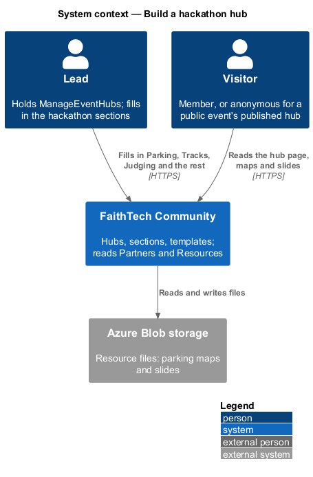
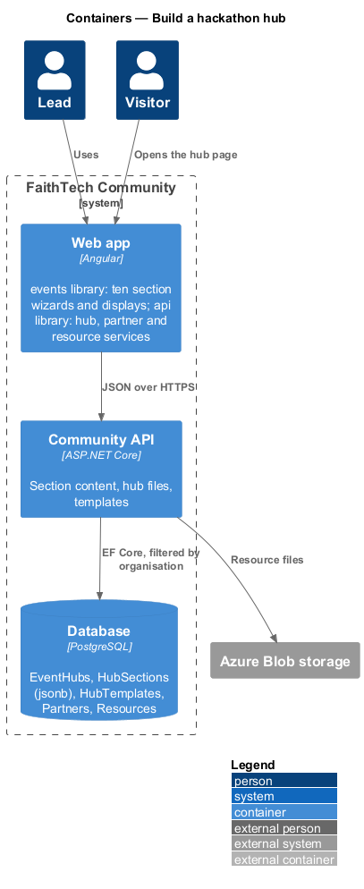
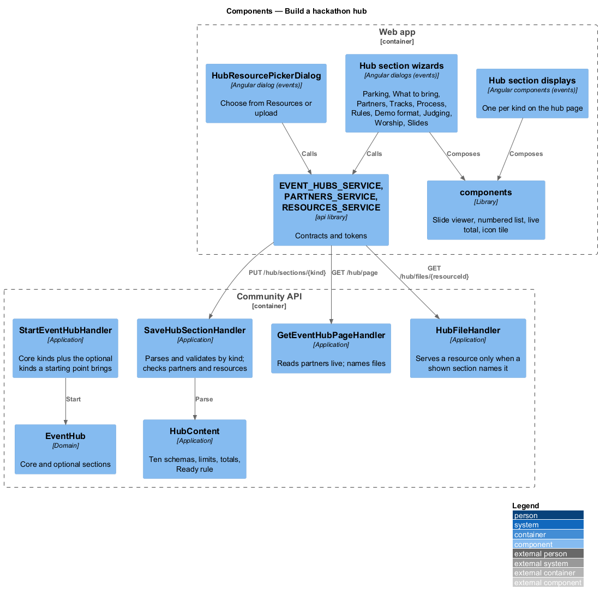
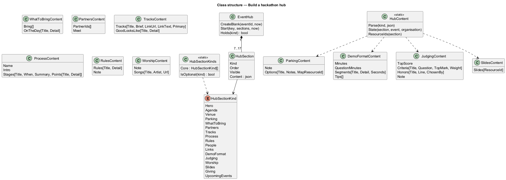
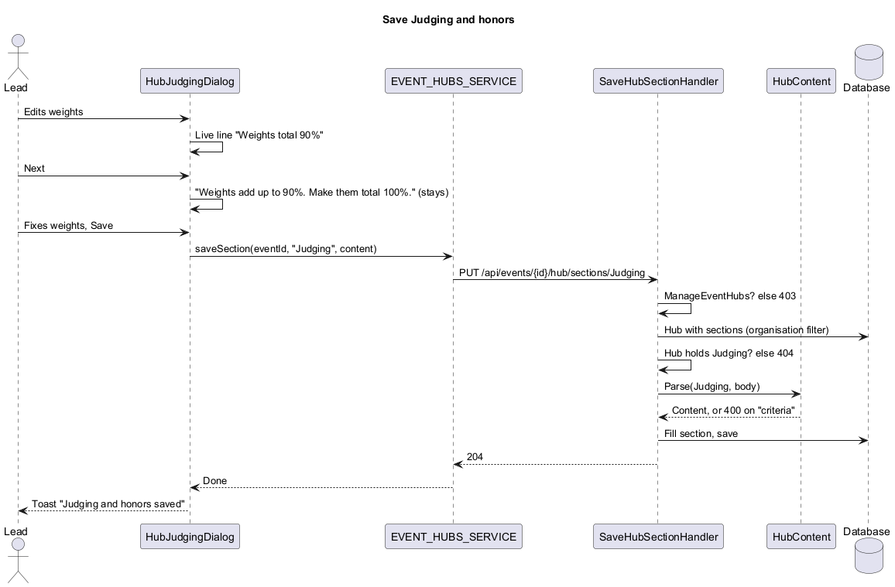
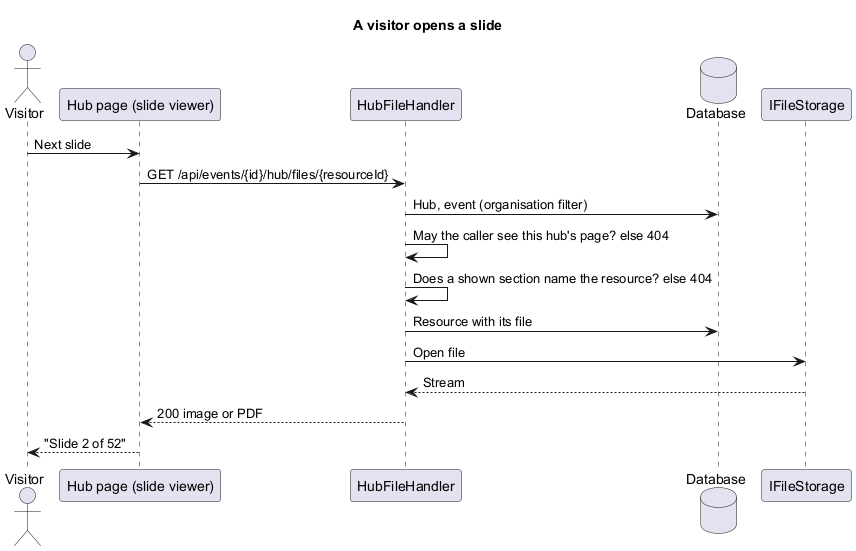

# Build a hackathon hub

## Overview

Slices 41 to 45 gave a hub seven sections and a way to start it from a template. A hackathon needs more: where to park, what to bring, the partner, the tracks, how teams work, the rules, how demos run, how judges score, the worship set and the slides. This slice adds those ten section kinds, each with a short wizard, a display on the hub page and defaults in FaithTech's Hackathon template, so a hub started from Hackathon can hold everything the hand-made SoCal hub (`docs/events/socal-hackathon-2026/`) showed. The proposal is `docs/proposals/event-hubs.md` (phase 2); the decisions are in ADR 0042.

Event hubs belong to the events subsystem.

Key terms:

- **core kinds** — the seven phase 1 kinds every hub holds: Hero, Agenda, Venue, People, Submission and feedback, Giving and Upcoming events.
- **optional kinds** — the ten kinds of this slice. A hub holds one only when its starting point brings it.
- **catalogue order** — Hero, Agenda, Venue, Parking, What to bring, Partners, Tracks, Process, Rules, People, Submission and feedback, Demo format, Judging and honors, Worship, Slides, Giving, Upcoming events.
- **hub file** — a resource a shown Parking or Slides section names, served to the hub's visitors through the hub.

## Description

- **`HubSectionKind`** gains `Parking`, `WhatToBring`, `Partners`, `Tracks`, `Process`, `Rules`, `DemoFormat`, `Judging`, `Worship` and `Slides`, and is reordered into catalogue order (stored as strings, so no data moves). **`HubSectionKinds.Core`** lists the seven core kinds.
- **`EventHub`** — `CreateBlank` adds the core kinds only. `Start(key, sections, now)` takes every core kind and any optional kinds, adds optional sections it names, removes those it doesn't, and sets place, visibility and content. `Holds(kind)` says whether the hub has that section.
- **Template and copy** — `HubTemplateSections.Read` returns every core kind (hidden when unnamed) plus the optional kinds the template names; a copy brings the source hub's sections as they are, optional ones included.
- **`HubContent`** gains ten content records and validators, their limits and the two totals, and the Ready rule: an optional section is Ready with at least one item. `ResourceIds(section)` lists the resources a Parking or Slides section names.
- **`SaveHubSectionHandler`** — 404 for a kind the hub doesn't hold; checks that partner ids are partners of the organisation ("Choose a partner from the list.") and that maps are image resources ("Choose an image.") and slides image or PDF resources ("Choose a PDF or an image.") of the organisation.
- **Reading the hub** — the manager's `EventHubDto` and the page add, per section, what the page needs that the content doesn't hold: for Partners, each partner's `name`, `offering` and `website` (archived or merged partners left out); for Parking maps and slides, each resource's `title` and `kind` (`Image` or `Pdf`); a resource no longer available is left out.
- **`HubFileHandler`** — `GET /api/events/{id}/hub/files/{resourceId}` and `.../thumbnail`, anonymous-capable: the caller must be able to see the hub's page (ADR 0040) and a shown section must name the resource; else 404.
- **Reorder** — the kinds must be exactly the hub's.
- **Seed** — the Hackathon template names the ten kinds with defaults from the SoCal hub (`L2-183`); `CommunitySeeder` upgrades the stored Hackathon template only when its sections are exactly what slice 45 seeded.
- **Frontend (`events`)** — `HUB_SECTIONS` grows to 17 with titles, lines and Needs info lines; step 3 of Create event hub and the hub home list the hub's own sections; ten wizards (`HubParkingDialog`, `HubWhatToBringDialog`, `HubPartnersDialog`, `HubTracksDialog`, `HubProcessDialog`, `HubRulesDialog`, `HubDemoFormatDialog`, `HubJudgingDialog`, `HubWorshipDialog`, `HubSlidesDialog`) and `HubResourcePickerDialog`; ten display components on the hub page.
- **`components`** — the pieces the design system adds for these screens (slide viewer, numbered list, live total line and the icon tile with initials), built once there.
- **`api`** — `EventHubsService.saveSection` already takes any kind; `hubFileUrl(eventId, resourceId, thumbnail)` builds file links; the wizards reuse `PARTNERS_SERVICE` and `RESOURCES_SERVICE` for picking and uploading.

### Content shapes

| Kind | Content | Limits |
|---|---|---|
| Parking | `{ note, options: [{ title, notes, mapResourceId }] }` | note 300; 6 options; title 80 required; notes 300 |
| WhatToBring | `{ bring: [text], onTheDay: [{ title, detail }] }` | 15 × 120; 10 × title 60 required, detail 160 |
| Partners | `{ partnerIds: [id], meet }` | 6 partners; meet 400 |
| Tracks | `{ tracks: [{ title, brief, linkUrl, linkText, primary }], goodLooksLike: [{ title, detail }] }` | 6 tracks; title 80 and brief 400 required; https link; link text 60; one primary at most; 6 marks |
| Process | `{ name, intro, stages: [{ title, when, summary, points: [{ title, detail }] }] }` | name 60; intro 300; 8 stages; title 40 required; when 40; summary 160; 6 points of 40 and 160 |
| Rules | `{ rules: [{ title, detail }], note }` | 12 rules; title 60 required; detail 160; note 300 |
| DemoFormat | `{ minutes, questionMinutes, segments: [{ title, detail, seconds }], tips: [text] }` | minutes 1–30; questions 0–30; 8 segments; title 60 required; detail 120; 15–1800 s; segments fit the minutes; 5 tips × 80 |
| Judging | `{ topScore, criteria: [{ title, question, topMark, weight }], honors: [{ title, line, chosenBy }], note }` | top score 3–10; 6 criteria; title 60 required; 200 each; weight 1–100 totalling 100; 6 honors; `TopScore`, `JudgesPick`, `MentorsPick` or `Vote`; note 200 |
| Worship | `{ note, songs: [{ title, artist, url }] }` | note 200; 10 songs; title 80 required; artist 80; https link |
| Slides | `{ slides: [{ resourceId }] }` | 60 slides |

### API contract

| Method and path | Caller | Success | Failures |
|---|---|---|---|
| `PUT /api/events/{id}/hub/sections/{kind}` (ten new kinds) | `ManageEventHubs` | 204 | 400 field errors, 401, 403, 404 (no hub, kind not held, other organisation) |
| `GET /api/events/{id}/hub/files/{resourceId}` | anyone who may see the hub page | 200 file | 404 |
| `GET /api/events/{id}/hub/files/{resourceId}/thumbnail` | as above | 200 image | 404 |
| `PUT /api/events/{id}/hub/sections/order` | `ManageEventHubs` | 204 | 400 when the kinds aren't exactly the hub's |

### Data

No new table. `HubSections.Kind` holds the new names (32 characters is enough). The Hackathon template's `Sections` JSON gains the ten kinds. No migration.

### E2E fake

`e2e/fixtures/mock-event-hubs.ts` applies the same rules: core and optional kinds, the ten schemas with their messages and totals, the partners and resources checks, the read-time partner and resource fields, and the hub file routes. `e2e/fixtures/hub-templates.ts` gains the Hackathon defaults.

## Requirements

| L2 ID | Refines (L1) | Requirement |
|-------|--------------|-------------|
| `L2-172` | `L1-008` | Optional hub section kinds |
| `L2-173` | `L1-008` | Parking section |
| `L2-174` | `L1-008` | What to bring section |
| `L2-175` | `L1-008`, `L1-006` | Partners section |
| `L2-176` | `L1-008` | Tracks section |
| `L2-177` | `L1-008` | Process section |
| `L2-178` | `L1-008` | Rules section |
| `L2-179` | `L1-008` | Demo format section |
| `L2-180` | `L1-008` | Judging and honors section |
| `L2-181` | `L1-008` | Worship section |
| `L2-182` | `L1-008`, `L1-020` | Slides section and hub files |
| `L2-183` | `L1-008`, `L1-025` | Hackathon template covers the hackathon sections |

They build on `L2-156` (the checklist), `L2-157` (section content), `L2-166` (who may see a hub page), `L2-169` to `L2-171` (templates and copy) and `L2-151` (the FaithTech seed).

## Diagrams

### System context

### Containers

### Components

### Class structure

### Behaviour — save Judging and honors

### Behaviour — a visitor opens a slide

## Open questions

- **Add a section to an existing hub.** Deferred: a hub started from Blank, Meetup or Workshop holds no optional kind. A hub home action "Add a section" would add one.
- **Custom text section** (proposal open question 2). Deferred; every SoCal section has a kind.
- **Partner logos.** Partners has no logo; the page shows initials until it does.
