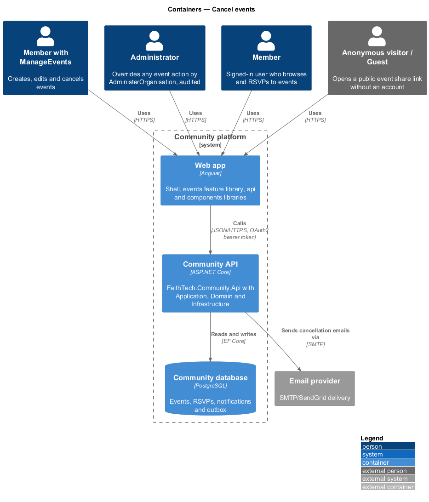
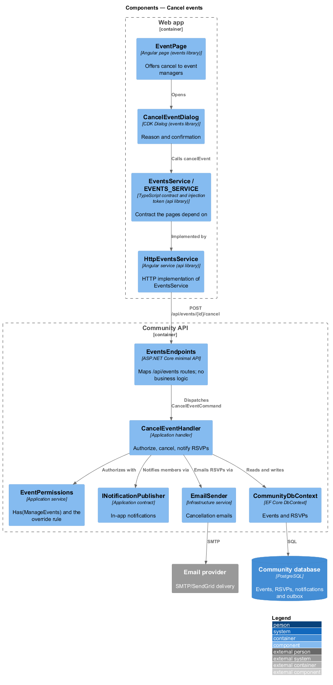
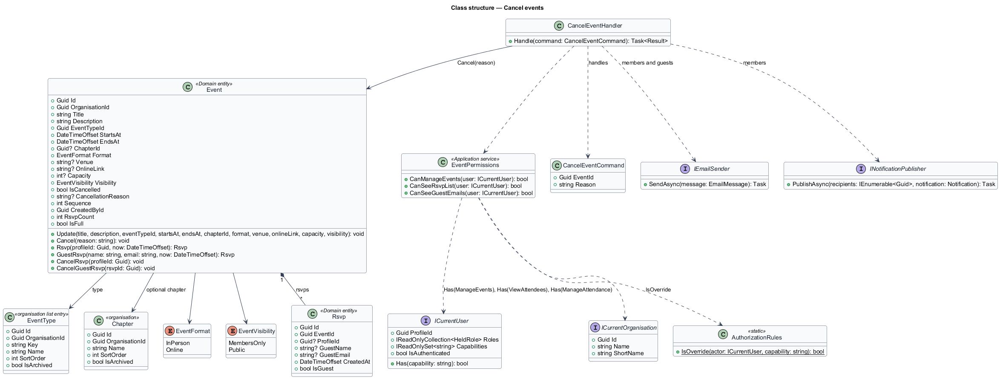
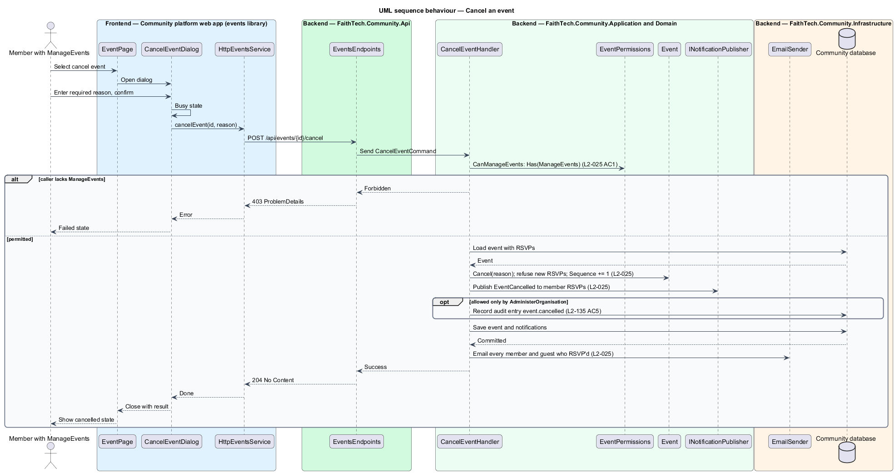

# Cancel events

## Overview

An event manager may cancel an event that no longer takes place. Cancelling is a state change, not a deletion: the event stays visible, marked cancelled, and refuses new RSVPs.

Key terms:

- **event manager** — holder of `ManageEvents` (seeded as Event Lead and City Lead in FaithTech); a holder of `AdministerOrganisation` without it cancels by override, audited (`L2-135` AC5)
- **cancellation reason** — required free text explaining why the event was cancelled (`L2-025` AC1, AC3)

Cancelling notifies everyone who RSVP'd: members by email and in-app notification, guests by email. The event's `.ics` SEQUENCE increases and its status becomes cancelled (`L2-024`).

## Description

- **`EventPage`** — offers the cancel action to event managers (mock state `lead`).
- **`CancelEventDialog`** — Angular CDK Dialog in the `events` library (mock: `docs/mocks/dialogs/cancel-event/`, states `default`, `busy`, `invalid`, `failed`) with a required reason, a safe *Keep event* button and a danger *Cancel event* button.
- **`EventsService` / `EVENTS_SERVICE`** — `cancelEvent(id, reason)`, implemented by `HttpEventsService`.
- **`EventsEndpoints`** — maps `POST /api/events/{id}/cancel`.
- **`CancelEventCommand` / `CancelEventHandler`** — checks `EventPermissions.CanManageEvents` (`ICurrentUser.Has(Capability.ManageEvents)`; a caller without it answers 403), calls `Event.Cancel(reason)`, records in-app notifications for member RSVPs, and queues emails to every member and guest who RSVP'd.
- **`Event.Cancel(reason)`** — rejects an empty reason and an event already cancelled, then sets `IsCancelled`, stores the reason and increments `Sequence`. The RSVP handlers refuse cancelled events.
- **`IEmailSender`** — Infrastructure email service. Delivery is asynchronous through the email outbox (`OutboxEmailSender` queues, `EmailOutboxDispatcher` sends and retries).
- **`INotificationPublisher`** — records in-app notifications.

The cancellation reason is at most 500 characters. Every query is scoped by the `CommunityDbContext` global filter on `ICurrentOrganisation`, and the cancellation emails carry the organisation's name (`L2-134` AC5).

## Requirements

The feature realizes the following level-2 (L2) requirements. Each L2 requirement refines a level-1 (L1) requirement, cited by identifier.

| L2 ID | Refines (L1) | Requirement |
|-------|--------------|-------------|
| `L2-025` | `L1-008` | Cancel events |
| `L2-135` | `L1-026`, `L1-015` | Capability catalogue and server authorisation |

### Acceptance criteria

**`L2-025` — Cancel events**

1. Given a holder of `ManageEvents`, when they cancel an event with a required reason after confirming, then the event is marked cancelled and new RSVPs are refused; a member without `ManageEvents` gets 403, and a holder of `AdministerOrganisation` without it succeeds as an override, audited (`L2-135` AC5).
2. Given a cancelled event, when the cancellation completes, then every member and guest who RSVP'd receives an email, and members also receive an in-app notification.
3. Given an empty reason, when they confirm, then an inline error asks them to tell attendees why.

**`L2-135` — Capability catalogue and server authorisation**

1. Given the platform, when `GET /api/organisation/capabilities` is called by any member, then it lists exactly: `ManageEvents`, `ViewAttendees`, `ManageAttendance`, `KeepContacts`, `ViewPartners`, `ManagePartners`, `InviteMembers`, `ConnectLink`, `OwnWorkspaces`, `JoinWorkspaces`, `ReadAllWorkspaces`, `ViewPeopleDirectory`, `AssignRoles`, `SendAnnouncements`, `AddResources`, `ViewReports`, `ManageRoles`, `ManageOrganisationSettings`, `AdministerOrganisation`, each with a one-line description, and no organisation can add, rename or remove one.
2. Given a request, when the server authorises it, then it checks the caller's capabilities, computed on that request from the union of the capabilities of every non-archived role the caller's profile holds in the current organisation, and never compares a role name.
3. Given a holder of `AdministerOrganisation`, when any capability is checked, then it is held.
4. Given an action that needs a capability the caller lacks, when it is called, then the response is 403 (or 404 where `L2-042` AC2 hides existence), and nothing changes.
5. Given an action the caller is allowed only because they hold `AdministerOrganisation` (they lack the specific capability, or do not own the record), when it succeeds, then it is an override and an audit entry is written (`L2-041`); given the caller holds the specific capability or owns the record, then it is not audited (role changes excepted, `L2-138` AC5).
6. Given every signed-in member of the organisation, when they view profiles, the team, events and announcements, RSVP, open resources and notes visible to them, create their own notes, search, or edit their own profile and settings, then no capability is required.
7. Given the frontend, when it decides what to show, then it reads capabilities from `/api/me`, never role names, and hiding is a convenience only: the server refuses what the member may not do.

## Diagrams

### System context

Event managers cancel events. Members and guests who RSVP'd receive notice; email leaves through the email provider.

### Containers

The `CancelEventDialog` calls the Community API, which updates the event and sends emails through the email provider.

### Components

`CancelEventHandler` authorizes through `EventPermissions`, cancels the `Event`, and fans out notifications and emails to RSVPs.

### Class structure

`Event` composes `Rsvp` records; `CancelEventHandler` reads them to address notifications and emails.

### Behaviour — cancel an event

The manager confirms in `CancelEventDialog`. The handler marks the event cancelled, closes RSVPs, and notifies every member and guest who RSVP'd (`L2-025`).

## Open questions

Decisions recorded while building the Domain layer (`FaithTech.Community.Domain`):

- The reason is required, as `L2-025` states; the earlier "optional reason" wording is corrected. Resolved.

Decisions recorded while building the slice:

- `POST /api/events/{id}/cancel` takes `{ reason }`. The validator runs first: an empty reason is 400 on `Reason` with "Tell attendees why, so they aren’t left guessing." (AC3), and over 500 characters is 400. Then a caller who may not manage events gets 403, an unknown event 404 and an event already cancelled 409 "This event is already cancelled."; success is 204.
- `Event.Cancel(reason, cancelledById, cancelledAt)` also records who cancelled and when, so the event page reads "Esther Nakamura cancelled it on Tue 20 Oct: “…” Everyone who RSVP’d was emailed." (`EventDetailDto.cancelledByName`, `cancelledAt`).
- Members who RSVP'd get an `EventCancelled` in-app notification through `INotificationPublisher`, the notifications feature's seam (not the person who cancelled, ADR 0011). Every member and guest who RSVP'd gets an email, "Cancelled: {title}", with the reason and the cancelled `.ics` attached, which carries `STATUS:CANCELLED` and the higher `SEQUENCE` so calendars drop the event.
- Capabilities: a holder of `AdministerOrganisation` without `ManageEvents` cancels by override and is audited (`event.cancelled`, `L2-135` AC5, ADR 0033).
- The dialog's description counts who will hear: "All {n} people who RSVP’d get an email; the {m} members also get an in-app notification", or "No one has RSVP’d yet". After cancelling, the page shows a success toast, "Event cancelled", and the cancelled state; Edit and Cancel event go away and the calendar download becomes *Update your calendar (.ics)*.
