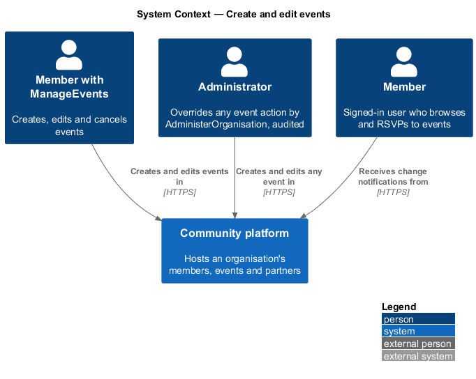
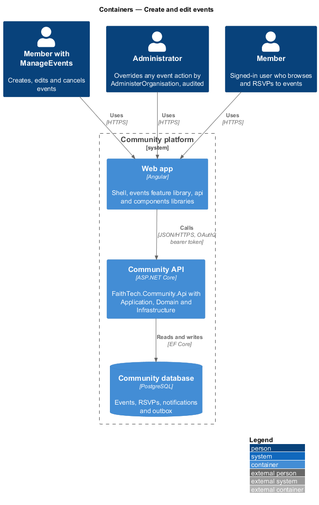
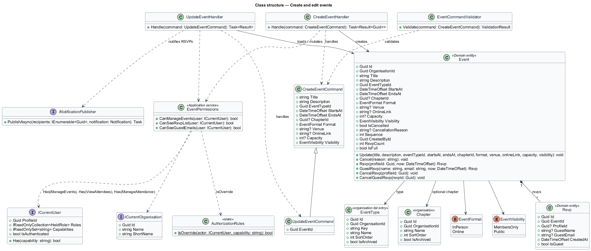
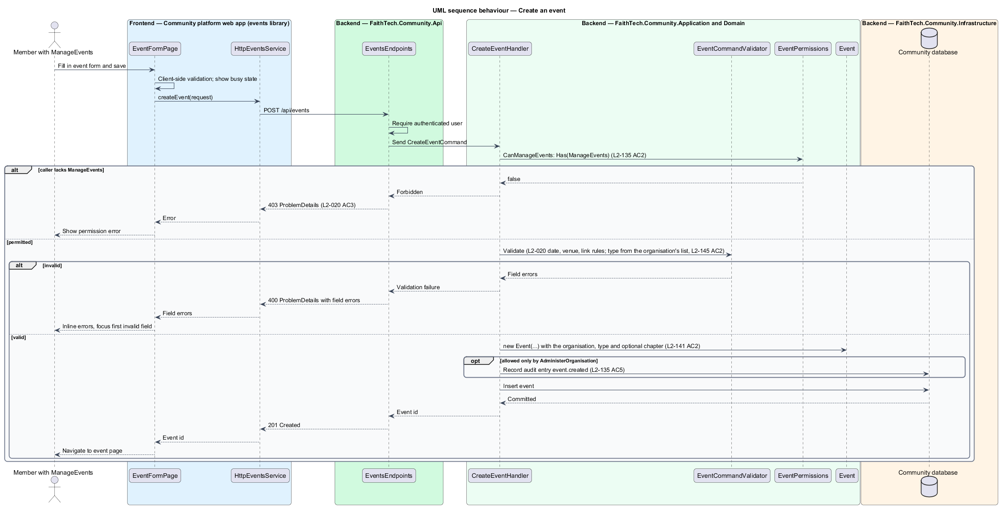

# Create and edit events

## Overview

The Community platform hosts an organisation's members, builders, event attendees and partners. An *event* is a dated gathering, held in person or online, that members can attend. Data is organisation-wide, so every event is visible across {chapters}, subject to its visibility.

This feature covers authoring an event: creating a new one and editing an existing one. It belongs to the events subsystem, which also covers listing, RSVP, public pages, calendar export and cancellation.

Key terms:

- **event type** — entry in the organisation's event types list (`EventType`, `L2-145`; seeded as Gathering, Builders night, Hackathon, Prayer & planning and Panel in FaithTech); hackathon teams, projects and judging are out of scope for v1
- **{chapter}** — optional organisation-labelled tag on an event (`Event.ChapterId`, `L2-141` AC2); none means "{Organisation}-wide"
- **format** — whether an event is held in person, at a venue, or online, at a link
- **visibility** — audience setting of an event, either members-only or public
- **event manager** — holder of `ManageEvents`, the capability that permits creating, editing and cancelling events (`L2-135`)

Only event managers may create or edit events; a caller without `ManageEvents` answers 403, and a holder of `AdministerOrganisation` without it succeeds as an override, audited (`L2-135` AC5). Editing an event notifies every member who RSVP'd that the event changed.

## Description

The slice runs from the event form page to the database.

- **`EventFormPage`** — routed page in the `events` feature library (mock: `docs/mocks/pages/event-form/`). It hosts the create and edit form, shows inline validation errors and a busy state while saving. It composes form fields, date-time inputs and buttons from the `components` library.
- **`EventsService` / `EVENTS_SERVICE`** — API client contract and injection token in the `api` library. `HttpEventsService` implements it with `createEvent(request)` and `updateEvent(id, request)`.
- **`EventsEndpoints`** — minimal API mapping in `FaithTech.Community.Api` for `POST /api/events` and `PUT /api/events/{id}`. Both require authentication and dispatch to the Application layer.
- **`CreateEventCommand` / `UpdateEventCommand`** — request objects carrying title, description, event type, start, end, optional chapter, format, venue or link, optional capacity, and visibility.
- **`EventCommandValidator`** — validator that rejects an end before the start, an in-person event without a venue and an online event without a link (`L2-020`).
- **`CreateEventHandler` / `UpdateEventHandler`** — Application handlers. Each checks `EventPermissions.CanManageEvents` and returns 403 to a caller without `ManageEvents`, then writes the `Event` entity; a write allowed only by `AdministerOrganisation` is audited. Each rejects a type that is not one of the organisation's active event types (`L2-145` AC2) and a chapter that is not one of the organisation's chapters (`L2-141` AC2). `UpdateEventHandler` increments `Event.Sequence` and raises an `EventChanged` notification for each member RSVP.
- **`Event`** — Domain entity holding the event state; `Update(...)` applies edits and increments `Sequence` for calendar export (`L2-024`). The constructor and `Update` reject a blank title, an end before the start, an in-person event without a venue, an online event without a link and a capacity below 1, so an invalid edit changes nothing.
- **`EventPermissions`** — Application service that reads capabilities from `ICurrentUser`: `CanManageEvents` is `Has(Capability.ManageEvents)` and `IsAdminOverride` is `AuthorizationRules.IsOverride(actor, ManageEvents)`.
- **`INotificationPublisher`** — Application contract from the notifications subsystem that records in-app notifications. Its implementation lives in Infrastructure.
- **`CommunityDbContext`** — EF Core context in Infrastructure that persists events and RSVPs. Every query is scoped by its global filter on `ICurrentOrganisation`.

The {chapter} is an optional picker of the organisation's active chapters, shown only when the organisation has chapters; the type picker offers the active event types, both read from `GET /api/organisation` (`L2-141` AC2, `L2-145` AC2).

## Requirements

The feature realizes the following level-2 (L2) requirements. Each L2 requirement refines a level-1 (L1) requirement, cited by identifier.

| L2 ID | Refines (L1) | Requirement |
|-------|--------------|-------------|
| `L2-020` | `L1-008` | Create and edit events |
| `L2-135` | `L1-026`, `L1-015` | Capability catalogue and server authorisation |
| `L2-141` | `L1-027`, `L1-002`, `L1-008` | Chapters on profiles, events and role assignments |
| `L2-145` | `L1-028`, `L1-008` | Event types |

### Acceptance criteria

**`L2-020` — Create and edit events**

1. Given a holder of `ManageEvents`, when they create an event with a title, description, a type chosen from the organisation's active event types (`L2-145` AC2; seeded as Gathering, Builders night, Hackathon, Prayer & planning and Panel in FaithTech, `L2-151`), start and end, an optional {chapter} when chapters are on (none means "{Organisation}-wide", `L2-141` AC2), an in-person or online flag, a venue or link, an optional capacity, and members-only or public visibility, then the event is saved.
2. Given an end before the start, an in-person event with no venue, or an online event with no link, when the form is saved, then inline errors are shown.
3. Given a member without `ManageEvents`, when they call the create or edit API, then the response is 403; a holder of `AdministerOrganisation` without `ManageEvents` succeeds as an override, audited (`L2-135` AC5).
4. Given an event, when it is edited, then everyone who RSVP'd receives an in-app notification of the change.
5. Given an event at capacity, when anyone tries to RSVP, then the RSVP is refused with a "this event is full" message.

**`L2-135` — Capability catalogue and server authorisation**

1. Given the platform, when `GET /api/organisation/capabilities` is called by any member, then it lists exactly: `ManageEvents`, `ViewAttendees`, `ManageAttendance`, `KeepContacts`, `ViewPartners`, `ManagePartners`, `InviteMembers`, `ConnectLink`, `OwnWorkspaces`, `JoinWorkspaces`, `ReadAllWorkspaces`, `ViewPeopleDirectory`, `AssignRoles`, `SendAnnouncements`, `AddResources`, `ViewReports`, `ManageRoles`, `ManageOrganisationSettings`, `AdministerOrganisation`, each with a one-line description, and no organisation can add, rename or remove one.
2. Given a request, when the server authorises it, then it checks the caller's capabilities, computed on that request from the union of the capabilities of every non-archived role the caller's profile holds in the current organisation, and never compares a role name.
3. Given a holder of `AdministerOrganisation`, when any capability is checked, then it is held.
4. Given an action that needs a capability the caller lacks, when it is called, then the response is 403 (or 404 where `L2-042` AC2 hides existence), and nothing changes.
5. Given an action the caller is allowed only because they hold `AdministerOrganisation` (they lack the specific capability, or do not own the record), when it succeeds, then it is an override and an audit entry is written (`L2-041`); given the caller holds the specific capability or owns the record, then it is not audited (role changes excepted, `L2-138` AC5).
6. Given every signed-in member of the organisation, when they view profiles, the team, events and announcements, RSVP, open resources and notes visible to them, create their own notes, search, or edit their own profile and settings, then no capability is required.
7. Given the frontend, when it decides what to show, then it reads capabilities from `/api/me`, never role names, and hiding is a convenience only: the server refuses what the member may not do.

**`L2-141` — Chapters on profiles, events and role assignments**

1. Given chapters are on, when a member edits their profile (`L2-006`), then "Home {chapter}" is an optional picker of the active chapters (plus the member's current one if archived) in place of the former free-text home city; the profile page and person cards show it.
2. Given chapters are on, when an event is created or edited (`L2-020`), then "{Chapter}" is an optional picker of the active chapters; none means organisation-wide, shown as "{Organisation}-wide"; the event list, event page, public page, `.ics` location line and Home show the chapter name.
3. Given a role assignment on a chapter-scopable definition (`L2-138` AC6), when it is shown as a badge on a profile, in People, on the team list or on the connect page, then it reads "{role} · {chapter}", or "{role}" when untagged.
4. Given a contact (`L2-013`), when it is created or edited, then its city stays a free-text field labelled "City", whatever the chapter label, because a contact is an outsider.
5. Given a partner, when it is shown or counted, then it has no chapter of its own; reports attribute it to its owner's home chapter (`L2-125`).
6. Given the FaithTech migration, when it runs, then one chapter per distinct trimmed, case-folded former home city and event city value is created with the label City/Cities, exact matches are mapped, unmatched values are set to none and written to the migration log, and running it again changes nothing.

**`L2-145` — Event types**

1. Given a holder of `ManageOrganisationSettings` on Stages & types, when they view "Event types", then it lists the active types in order with their event counts and offers add, rename, reorder and archive under `/api/organisation/event-types`, audited under `taxonomies`; a name is required, up to 40 characters and unique among active types ignoring case.
2. Given the event form (`L2-020` AC1), when it renders, then "Type" offers the active types in order, plus the event's current type if archived, and at least one active type must exist for an event to be created.
3. Given the event list (`L2-021`), when it renders, then its type filter offers "All types" and the active types in place of the former fixed filter chips; the `type=` query carries the type key.
4. Given an event of an archived type, when it is shown, then the type name is shown as before; the type leaves the form's picker and the filter.
5. Given `.ics` export and the public event page, when they render, then the type name appears where it did before.

## Diagrams

### System context

Event managers author events on the Community platform. Members who RSVP'd receive change notifications in the app.

### Containers

The `EventFormPage` in the web app calls the Community API with a bearer token. The API persists events in the Community database.

### Components

`EventsEndpoints` dispatches commands to the handlers. The handlers validate input, authorize the caller through `EventPermissions`, write the `Event`, and publish change notifications.

### Class structure

`UpdateEventCommand` extends `CreateEventCommand` with the target identifier. Both handlers depend on `EventPermissions`; `UpdateEventHandler` also depends on `INotificationPublisher`. `Event` composes its `Rsvp` records.

### Behaviour — create an event

The validator rejects invalid date order, venue and link combinations before the handler writes anything. Callers without `ManageEvents` receive 403 (`L2-020` AC3).

### Behaviour — edit an event and notify RSVPs

An edit increments the event's `Sequence` and records an in-app notification for every member who RSVP'd, in the same unit of work (`L2-020`).

## Open questions

Decisions recorded while building the Domain layer (`FaithTech.Community.Domain`):

- Event types follow `L2-020`: Gathering, Builders night, Hackathon, Prayer & planning and Panel, replacing the earlier `Standard`/`Hackathon` pair. Resolved.
- Capacity: `L2-020` AC1 and AC5 define an optional capacity; `Event.Capacity` is nullable and `Event.IsFull` refuses RSVPs at capacity. Resolved.
- Domain rule violations throw `InvalidOperationException` (a broken rule) or `ArgumentException` (invalid input); there is no shared domain exception type. Handlers check permissions and preconditions first and map any remaining violation to a `400` or `409` result.

Decisions recorded while building the slice:

- The endpoints run `SaveEventValidator` (one validator for `SaveEventCommand`, used by create and edit) before the handler, so an invalid request is 400 for anyone signed in; a valid request from a role that may not manage events is 403. The validator's words are the form's inline errors: "The end time must be after the start time.", "Enter a venue address, or choose Online.", "Enter the joining link, or choose In person.", "Give the event a title people will recognise." and "Capacity must be at least 1, or leave it empty for no limit.". A joining link must be an `http` or `https` address.
- The venue is kept only for in-person events and the link only for online ones. On the form, choosing Online swaps the Venue address field for a Joining link field.
- `POST /api/events` answers 201 with `{ id }` and the event's location; `PUT /api/events/{id}` answers 204, 404 for an unknown event and 409 for a cancelled one. `GET /api/events/{id}` returns `EventDetailDto` (every field, RSVP count, cancelled state and `canManage`) for any signed-in member; the edit form loads from it, and the RSVP slice extends it.
- `INotificationPublisher` is the notifications subsystem's seam: `DbNotificationPublisher` adds a `Notification` row to the unit of work, which the bell will read when the notifications feature is built. Members are not notified of their own edit (ADR 0011). The "event changed" email of `L2-028` arrives with the notifications feature.
- A holder of `AdministerOrganisation` without `ManageEvents` is acting by override, so their create and edit are audited (`event.created`, `event.updated`, `L2-135` AC5).
- Capabilities: the fixed event types became the organisation's event types list and the free-text city an optional {chapter}, so the validator's former "Enter the city the event is in." message is gone and the form's Type and {Chapter} pickers read `GET /api/organisation` (ADR 0033, ADR 0034, ADR 0035).
