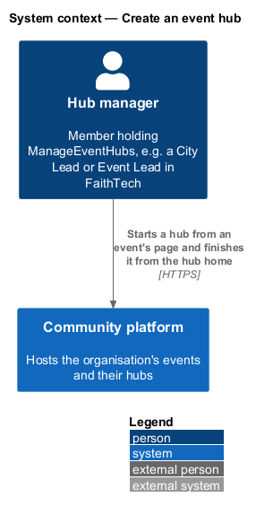
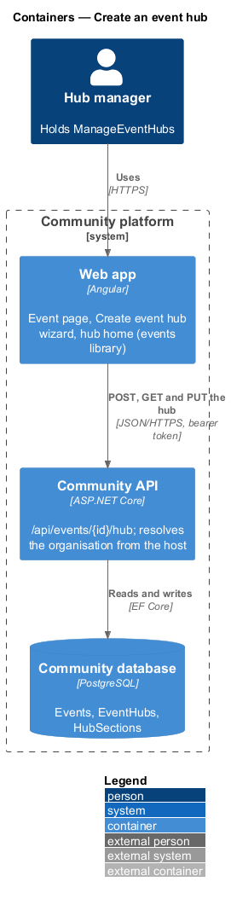
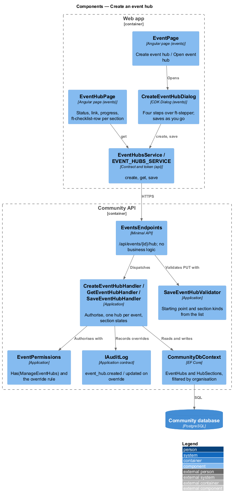
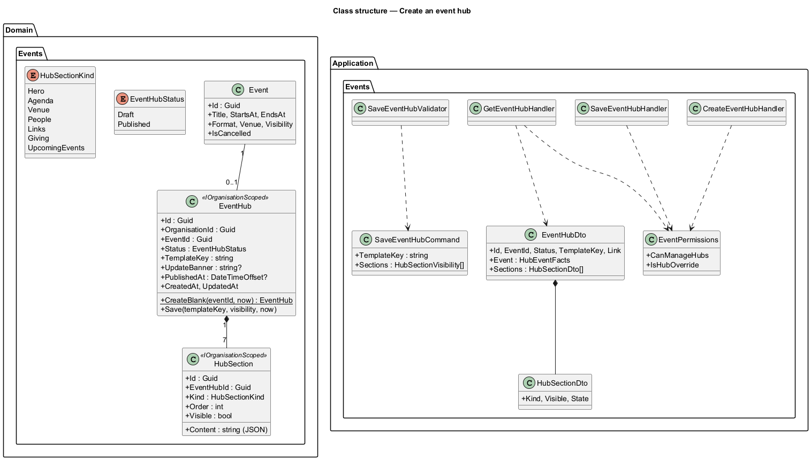
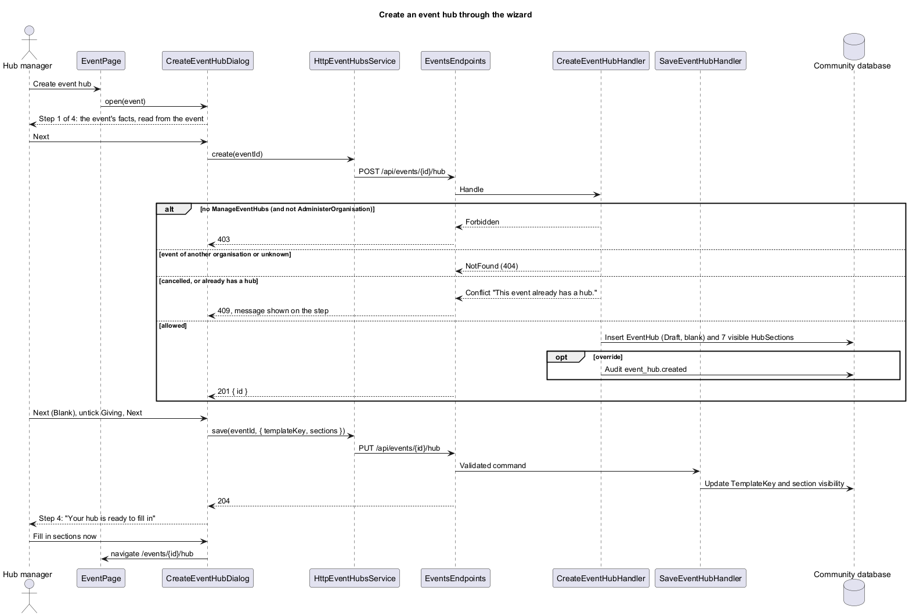
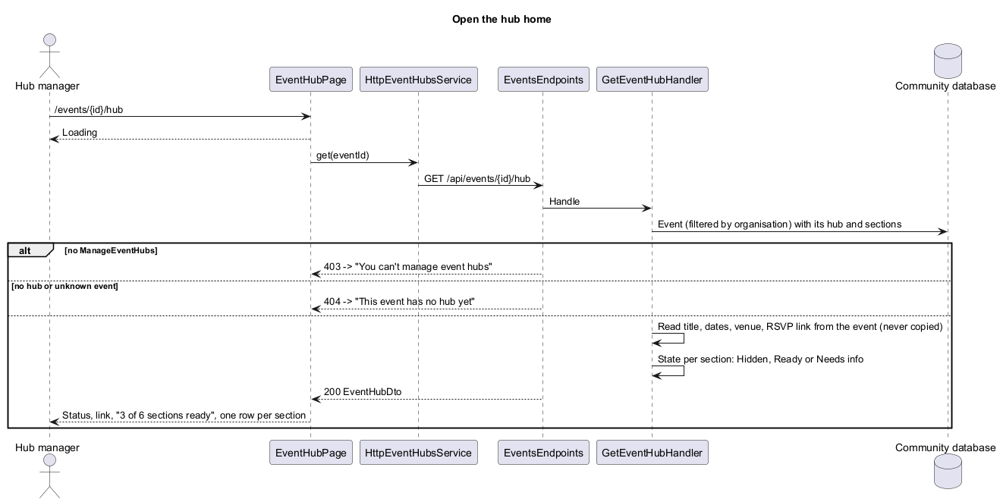

# Create an event hub

## Overview

An *event hub* is an optional page generated from data and attached to one event, like the hand-made SoCal Hackathon hub (`docs/events/socal-hackathon-2026/index.html`). A lead fills it in through short wizards; the app renders it. The proposal is `docs/proposals/event-hubs.md`; the decisions are in ADR 0036.

This first slice starts a hub. It lays the foundations every later hub slice uses: the `EventHub` and `HubSection` records, the `ManageEventHubs` capability, the hub API and its e2e fake. It belongs to the events subsystem; event hubs are not a subsystem of their own.

Key terms:

- **hub** — `EventHub`: one per event, Draft until published (slice 43), with a starting point (`TemplateKey`, only `blank` in this slice)
- **section** — `HubSection`: a part of the hub with a kind, an order, a visible flag and JSON content filled by its wizard (slice 42)
- **section state** — computed, never stored: **Hidden**, **Ready** or **Needs info**
- **hub manager** — holder of `ManageEventHubs` (`L2-155` AC1)

## Description

The slice runs from the event page to the database.

- **`EventPage`** (`frontend/projects/events/src/lib/pages/event/`) — adds **Create event hub** when the event detail says `canManageHub`, the event has no `hubId` and is not cancelled, and **Open event hub** once `hubId` is set (mocks `pages/event/lead-hub-create`, `lead-hub-open`).
- **`CreateEventHubDialog`** (`frontend/projects/events/src/lib/dialogs/create-event-hub/`) — a CDK Dialog over `ft-stepper` with four steps (Event, Starting point, Sections, Done), and **Save and finish later** on every step (mocks `dialogs/create-event-hub/*`). Step 1 shows the event's facts from the event detail already loaded by the page. **Next** on step 1 creates the hub; **Next** on later steps and **Save and finish later** save the starting point and section visibility. The pressed button shows "Saving…"; a network failure shows "We couldn’t save your hub" with **Try again**; a 400 or 409 shows its message on the step.
- **`EventHubPage`** (`frontend/projects/events/src/lib/pages/event-hub/`, route `/events/:id/hub`) — the hub home: status badge, link with **Copy link**, the progress line ("3 of 6 sections ready", `ft-progress`) and one `ft-checklist-row` per section. Loading, error with **Try again**, forbidden ("You can’t manage event hubs") and no-hub ("This event has no hub yet") states (mocks `pages/event-hub/*`). Fill in, Preview, Publish and Share arrive with slices 42, 43 and 49.
- **`EventHubsService` / `EVENT_HUBS_SERVICE`** (`frontend/projects/api/`) — `create(eventId)`, `get(eventId)`, `save(eventId, request)`; `HttpEventHubsService` implements it. The plain-language section titles and lines ("Shown at the top…") live in the `events` library, keyed by kind.
- **`EventsEndpoints`** — `POST`, `GET` and `PUT /api/events/{id}/hub`, authenticated; the PUT runs `SaveEventHubValidator`.
- **`CreateEventHubHandler`** — checks `EventPermissions.CanManageHubs` (403), finds the event through the organisation filter (404), refuses a cancelled event or a second hub (409), and adds a Draft `blank` hub with one visible section per kind. Audits `event_hub.created` when the caller acts only through `AdministerOrganisation`.
- **`GetEventHubHandler`** — reads the event and its hub and returns `EventHubDto`: the event's facts read live (title, start, end, format, venue, RSVP link), the hub link `{origin}/public/events/{id}/hub`, and each section's kind, visibility and state.
- **`SaveEventHubHandler`** — saves the starting point and the visibility of the sections named in the request; a kind left out keeps its visibility. Audits `event_hub.updated` on override.
- **`EventHub` / `HubSection`** (`Domain/Events/`) — both `IOrganisationScoped`, stamped and filtered by `CommunityDbContext`; unique index on `(OrganisationId, EventId)`. Content defaults to `{}`.
- **`Capability.ManageEventHubs`** — "Create, edit, publish and unpublish event hubs.", after `ManageEvents`. `FaithTechSeed` grants it to City Lead and Event Lead; the migration appends it to those two seeded definitions in existing databases when missing.
- **`EventDetailDto`** gains `HubId` and `CanManageHub`.

### API contract

| Method and path | Body | Success | Failures |
|---|---|---|---|
| `POST /api/events/{id}/hub` | none | 201 `{ id }`, `Location: /api/events/{id}/hub` | 401, 403, 404, 409 `This event already has a hub.` / `This event is cancelled, so it can’t have a hub.` |
| `GET /api/events/{id}/hub` | — | 200 `EventHubDto` | 401, 403, 404 (no event or no hub) |
| `PUT /api/events/{id}/hub` | `{ templateKey: "blank", sections: [{ kind, visible }] }` | 204 | 400 `Choose a starting point from the list.` (`templateKey`) / `Choose sections from the list.` (`sections`), 401, 403, 404 |

`EventHubDto`: `{ id, eventId, status: "Draft" | "Published", templateKey, link, event: { title, startsAt, endsAt, format, venue, onlineLink, rsvpLink, isCancelled }, sections: [{ kind, visible, state: "Ready" | "NeedsInfo" | "Hidden" }] }`, sections in order. Kinds: `Hero`, `Agenda`, `Venue`, `People`, `Links`, `Giving`, `UpcomingEvents`.

### Section state

Hidden when not visible. Ready for Hero, Giving and Upcoming events, which the system fills, and for Venue when the event is in person with a venue. Needs info otherwise. The progress line counts Ready sections out of the visible ones.

### E2E fake

`e2e/fixtures/mock-event-hubs.ts` keeps hubs per organisation beside the events of `mock-events.ts`, answers the three routes with the same status codes, messages and capability rules, and adds `hubId` and `canManageHub` to the fake event detail.

## Requirements

| L2 ID | Refines (L1) | Requirement |
|-------|--------------|-------------|
| `L2-153` | `L1-008` | Create an event hub |
| `L2-154` | `L1-008` | Event hub home |
| `L2-155` | `L1-008`, `L1-026`, `L1-025` | Event hub access and data |

The acceptance criteria are in `docs/specs/L2.md`. They build on `L2-020` (events), `L2-130` (organisation isolation), `L2-135` (capabilities), `L2-141` (chapters) and `L2-151` (the FaithTech seed).

## Diagrams

### System context

### Containers

### Components

### Class structure

### Behaviour — create a hub through the wizard

### Behaviour — open the hub home

## Open questions

- **Chapter-tagged leads (proposal open question 1).** Resolved: a holder whose role is tagged with a chapter manages hubs for every chapter's events and organisation-wide events, because chapters tag and filter and never hide (ADR 0034, `L2-155` AC3).
- **When the hub is created.** Resolved: on step 1's **Next**, or on **Save and finish later** from step 1, so closing the wizard before that leaves nothing behind and every later step has a hub to save to.
- **Preview on step 4.** Deferred to slice 43, which builds the preview; step 4 offers **Fill in sections now** until then.
- **Time zone.** Events carry no time zone today, so times show in the viewer's time zone, as on the event page; a per-event time zone is deferred to the agenda's live highlight (slices 42 and 44).
- **Starting points.** Slice 45 (`events/start-hub-from-template`, ADR 0041) turns on the organisation's templates and Copy a past hub; the save's `templateKey` becomes optional there.
