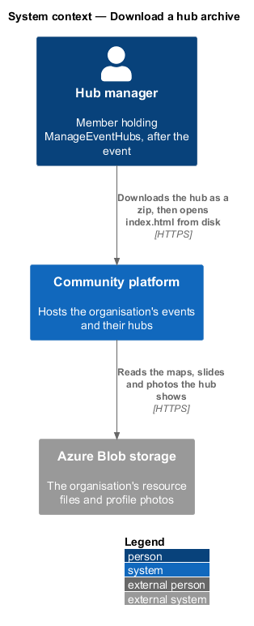
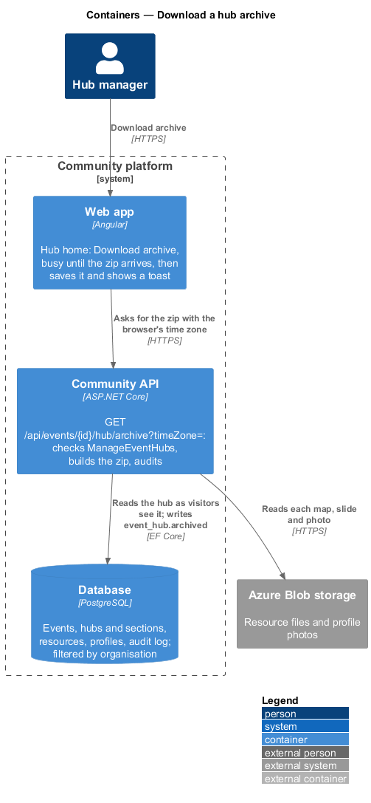
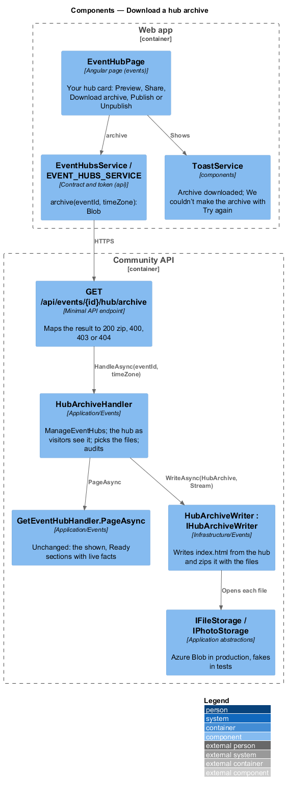
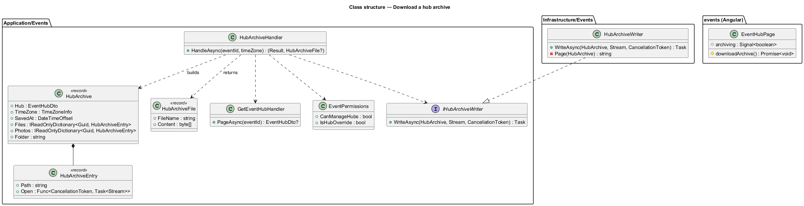
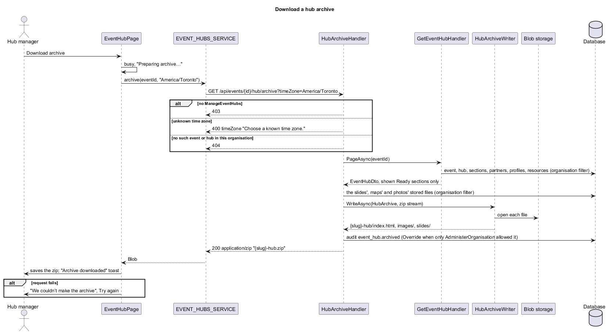
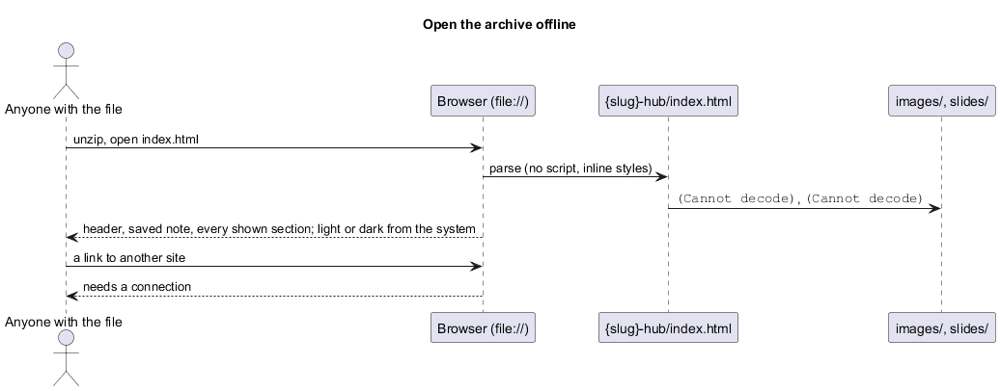

# Download a hub archive

## Overview

Slices 41 to 49 built the hub, its page and the tools for the day. This slice keeps it afterwards: **Download archive** on the hub home asks the server for a zip that holds the hub as visitors see it, as a folder with a static `index.html`, its images and its slides. It is the same shape as `docs/events/socal-hackathon-2026/`, so a chapter keeps a copy after the event page goes away. The proposal is `docs/proposals/event-hubs.md` (phase 3, "Download as an archive, for the record"); the decisions are in ADR 0046.

Event hubs belong to the events subsystem. The handler is in `Application/Events/`, the writer in `Infrastructure/Events/`, the button in the `events` library and the service call in `api`. Nothing is stored and there is no migration.

Key terms:

- **archive** — the zip, "{slug}-hub.zip", holding one folder "{slug}-hub/" with `index.html`, `images/` and `slides/`. `{slug}` is `EventFileNames.Slug(event title)`, as for the event's `.ics` and attendance CSV.
- **saved copy** — `index.html`: one static page with no script, no web font and no external stylesheet; its styles are inline and read the design tokens' roles with their light and dark values (`docs/design-system/patterns/event-hub-sections.html#saved-copy`).
- **saved note** — the info note under the header: "A copy of the hub, saved {day}. It opens without the app; links to other sites need a connection. Times are in {time zone}."

## Description

- **`EventHubPage`** (`events/src/lib/pages/event-hub/`) — the Your hub card gains **Download archive** (`ft-button`, icon `download`) after Share. `downloadArchive()` ignores a press while `archiving()` is true, sets it, calls `EVENT_HUBS_SERVICE.archive(eventId, timeZone)` with `Intl.DateTimeFormat().resolvedOptions().timeZone`, saves the blob with `saveFile(blob, "{fileSlug(title)}-hub.zip")` and shows the toast "Archive downloaded" / "{file} is in your downloads.". On failure it shows the danger toast "We couldn’t make the archive" / "Check your connection and try again." with **Try again** (calls `downloadArchive()` again). The button reads "Preparing archive…" and is `loading` while it waits.
- **`EventHubsService.archive(eventId, timeZone)`** (`api/src/lib/events/`) — `GET /api/events/{id}/hub/archive?timeZone=…` with `responseType: 'blob'`.
- **`HubArchiveHandler`** (`Application/Events/HubArchive.cs`) — `HandleAsync(eventId, timeZone)`:
  1. 403 unless `EventPermissions.CanManageHubs` and the caller has a profile here.
  2. The time zone: none gives UTC; one `TimeZoneInfo.TryFindSystemTimeZoneById` does not know gives a validation failure (400, `timeZone` "Choose a known time zone.").
  3. `GetEventHubHandler.PageAsync(eventId)`: the hub as the hub page answers it, so only shown, Ready sections in order, with the event's facts, the organisation and People, Partners, Parking and Slides read live. No event or hub in this organisation is 404.
  4. The files: for Slides and Parking, the resource ids in the DTO are looked up with `HubFiles.FindAsync` (active, stored, an image or a PDF, through the organisation's query filter); for People, each `profileId` is looked up in `Profiles` (the organisation's filter again) for its featured photo's `BlobName`. Each gets a path in the archive: `slides/01.{ext}` in slide order, `images/parking-{n}.{ext}` in option order, `images/person-{n}.{ext}` in the order people are listed. A file that cannot be found is left out, and its slide, map or photo with it.
  5. `IHubArchiveWriter.WriteAsync(HubArchive, stream)` into memory, then audits `event_hub.archived` against the hub (`Override` when only `AdministerOrganisation` allowed it) and returns `HubArchiveFile("{slug}-hub.zip", bytes)`.
- **`HubArchive`** — `Hub` (`EventHubDto`), `TimeZone`, `SavedAt` (from `TimeProvider`), `Folder` ("{slug}-hub"), `Files` (resource id → `HubArchiveEntry`) and `Photos` (profile id → `HubArchiveEntry`). `HubArchiveEntry(Path, Open)` opens the stored file on demand: `IFileStorage.OpenReadAsync(blobName)` or `IPhotoStorage.ReadAsync(key)`.
- **`HubArchiveWriter`** (`Infrastructure/Events/HubArchiveWriter.cs`) — writes `{Folder}/index.html` (UTF-8, no BOM) and then each entry under `{Folder}/`, with `System.IO.Compression.ZipArchive`. The page is built with `HtmlEncoder`-escaped text, in the order and words of the hub page's displays (`docs/design-system/patterns/event-hub-sections.html`):
  - header: overline organisation name, `h1` event title, Hero subtitle (when Hero is shown), "{day} · {time range} · {place}" in the time zone; the saved note; the update banner as a second note when there is one;
  - one `section` with an `h2` per shown section except Hero: Agenda (an ordered list of time, title and detail; no live states), Where, Parking (cards; a map is an image linked to its file, "Map of {option}"), What to bring, Partners, Tracks, the process (its name as heading), Rules, Submission and feedback (links and "Code freeze at {time}"), Demo format, Judging and honors (a table that stacks at phone width), People (Speakers, Mentors, Judges; photo or initials), Worship, Slides (a numbered grid of images linked to their files; a PDF is a link), Giving and Upcoming events;
  - footer: "Saved from {organisation}. The live hub: {link}".
  - Times read `TimeZoneInfo.ConvertTime(at, zone)` and format as the app does: "Fri 6 Nov 2026", "6:30 pm", "6:30 – 9:00 pm".
- **Endpoint** (`Api/Endpoints/EventEndpoints.cs`) — `GET /api/events/{id:guid}/hub/archive` with `string? timeZone`; authenticated like every events endpoint; `result.ToHttp(() => Results.File(file.Content, "application/zip", file.FileName))`.

### API contract

| Method and path | Caller | Success | Failures |
|---|---|---|---|
| `GET /api/events/{id}/hub/archive?timeZone={IANA zone}` | `ManageEventHubs` | 200 `application/zip`, `Content-Disposition: attachment; filename={slug}-hub.zip` | 400 `timeZone` "Choose a known time zone."; 401 anonymous; 403 without the capability; 404 no event or hub in this organisation |

### Data

No migration and nothing stored. The handler reads events, hubs, sections, partners, profiles and photos, and resources through the organisation's query filter; it writes one audit entry, `event_hub.archived`, with `{ Override, TimeZone }`.

### E2E fake

`e2e/fixtures/mock-event-hubs.ts` answers `GET /api/events/{id}/hub/archive` the same way the API does for the cases the app can reach: 403 without `ManageEventHubs`, 404 for an unknown event or hub, otherwise 200 `application/zip` with a small zip (one `{slug}-hub/index.html` naming the event) and the attachment name, and it records the `timeZone` it was asked for. `api.eventHubs.failArchive()` makes the next request fail with 500. Specs check the busy button, the saved file's name and zip signature, the toast, Try again and axe; what the zip holds is the backend's tests.

## Requirements

| L2 ID | Refines (L1) | Requirement |
|-------|--------------|-------------|
| `L2-196` | `L1-008` | Download a hub archive from the hub home |
| `L2-197` | `L1-008` | A hub archive opens offline as the hub visitors saw |
| `L2-198` | `L1-008` | Who may download a hub archive |

They build on `L2-154` (the hub home and its 403), `L2-157` to `L2-162` and `L2-172` to `L2-183` (the sections and how they display), `L2-163` and `L2-166` (what visitors see), `L2-168` (the live agenda, which the archive leaves out) and `L2-151` (the FaithTech seed, which grants `ManageEventHubs` to City Lead and Event Lead).

## Diagrams

### System context

### Containers

### Components

### Class structure

### Behaviour — download

### Behaviour — open the archive offline

## Open questions

- **Where the zip is made.** Decided: on the server (ADR 0046). The browser cannot read another member's photo or every resource file as one request, and the server already holds the section rules.
- **Which time zone.** Decided: the browser's, sent with the request; the server has no organisation or event time zone. With none, UTC, and the note says so.
- **Draft hubs.** Decided: allowed. The archive is the hub as visitors would see it; a lead may keep a copy before publishing.
- **The RSVP button and the live agenda.** Left out: the archive is a record, not a way to RSVP, and has no clock.
- **Large hubs.** The zip is built in memory. A hub's files are the slides and maps a lead picked (each upload is limited by Resources), so this is fine for v1; streaming is a later change if hubs grow.
- **Scheduled archives and archiving to Resources.** Deferred by the prompt.
