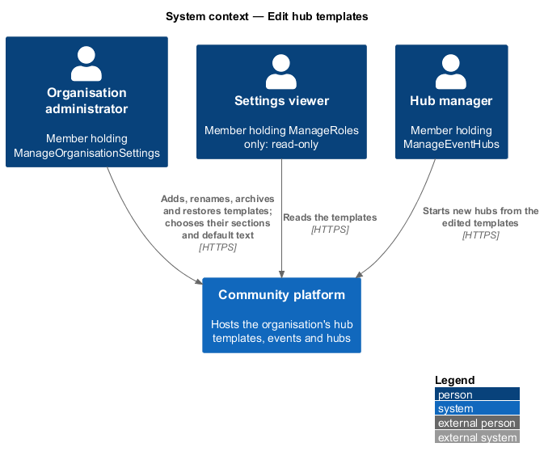
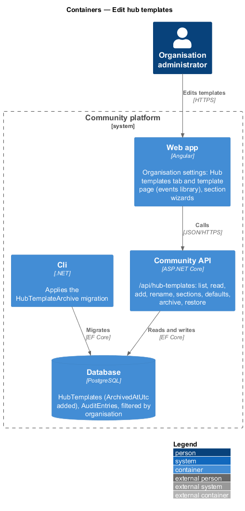
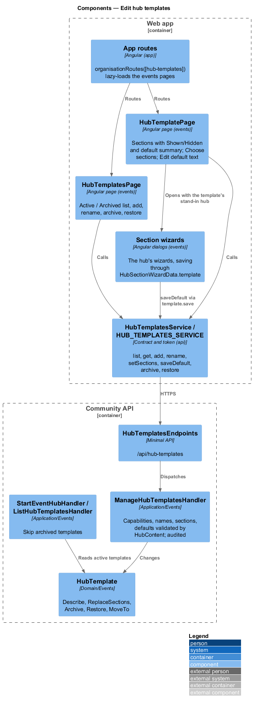
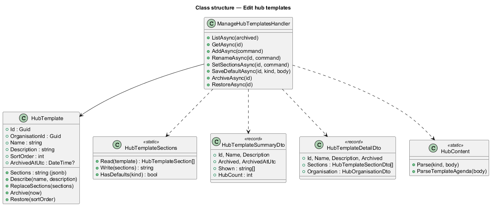
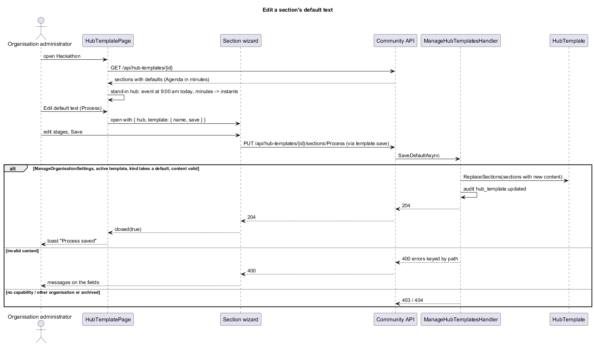
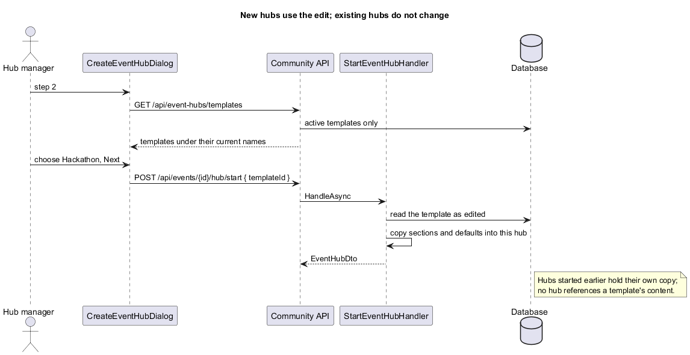

# Edit hub templates

## Overview

Slice 45 (`events/start-hub-from-template`) made hub templates organisation data and seeded FaithTech's Hackathon, Meetup and Workshop. This slice lets an organisation edit them in Organisation settings: add, rename, archive and restore a template, choose which sections it shows, and edit each section's default text with the same wizards a hub uses. New hubs use the edited templates; hubs already started never change, because applying a template copies it. The proposal is `docs/proposals/event-hubs.md` (open question 3); the decisions are in ADR 0041 and ADR 0043.

Event hubs belong to the events subsystem. The pages live in the `events` library and are mounted under Organisation settings by the app shell.

Key terms:

- **template** — a `HubTemplate` of the organisation (ADR 0041): name, description, place in the list, sections as JSON, and now an archived time.
- **default** — a section's content in a template, in the kind's own shape; an Agenda row holds `minutes` from the event's start.
- **kinds with defaults** — Hero, Agenda, What to bring, Tracks, Process, Rules, Demo format, Judging and honors, Worship, Giving and Upcoming events. The other six (Venue, Parking, Partners, People, Submission and feedback, Slides) are filled in on each hub.
- **stand-in hub** — the `EventHubDto` the template page builds so a hub wizard can open on a template: an event "starting" at 9:00 am local time today, ending 12 hours later, with the template's sections and the organisation's giving facts.

## Description

- **`HubTemplate`** (`Domain/Events/HubTemplate.cs`) gains `ArchivedAtUtc`, `IsArchived`, `Archive(now)` and `Restore(sortOrder)`; `Describe` and `ReplaceSections` are reused.
- **`HubTemplateSections`** (`Application/Events/HubTemplates.cs`) gains `Write(sections)` (the JSON array again, catalogue order, every core kind plus each optional kind that is shown or has a default) and `HasDefaults(kind)`.
- **`ManageHubTemplatesHandler`** (`Application/Events/ManageHubTemplates.cs`):
  - `ListAsync(archived)` and `GetAsync(id)` need `ManageOrganisationSettings` or `ManageRoles` (403). The list is `{ id, name, description, sortOrder, archived, archivedAtUtc, shown, hubCount }`, where `hubCount` counts hubs whose `TemplateKey` is the template's id. The read is `{ id, name, description, archived, archivedAtUtc, hubCount, sections: [{ kind, visible, content }], organisation }`.
  - Every write needs `ManageOrganisationSettings` and a membership (403); a template of another organisation is 404 through the global query filter; an archived one is 404 for every write but Restore.
  - `AddAsync({ name, description })` — name required (60), description optional (120), name unique among active templates ignoring case ("There’s already a template called {name}."). Added last, showing the seven core kinds with no content.
  - `RenameAsync(id, { name, description })` — the same rules, excluding itself.
  - `SetSectionsAsync(id, { shown: kinds[] })` — every name must parse to a catalogue kind, once ("Choose sections from the list."), at least one ("Tick at least one section."). Shown kinds are visible; the rest hidden; defaults kept; an optional kind hidden without a default is dropped.
  - `SaveDefaultAsync(id, kind, body)` — an unknown kind is 404; a kind without defaults is 400 `kind` "This section is filled in on each hub."; Agenda is parsed as `{ items: [{ minutes, title, detail }] }` (0 to 10,080 minutes, "Use a time within a week of the start.", plus the hub's title and detail rules); the other kinds through `HubContent.Parse`, so the hub's messages and paths apply. The section becomes visible if the template didn't hold it.
  - `ArchiveAsync(id)`, `RestoreAsync(id)` — restore puts it last and refuses a name an active template now has (409).
  - Every write records `hub_template.updated` with `{ Name, Description, Archived, Shown }` before and after (and `Section` for a default).
- **`ListHubTemplatesHandler`** and **`StartEventHubHandler`** skip archived templates (`L2-185` AC4).
- **`OrganisationAuditCategories.Taxonomies`** also holds `hub_template.updated`.
- **`HubTemplatesService`** (`frontend/projects/api/src/lib/events/hub-templates.service.ts`) with `HUB_TEMPLATES_SERVICE` and `HttpHubTemplatesService`.
- **`organisationRoutes(extra)`** (`frontend/projects/organisations/`) builds the section's routes with extra children; the app passes `hub-templates` and `hub-templates/:id`, lazy-loading `HubTemplatesPage` and `HubTemplatePage` from `events`. `OrganisationPage` adds the **Hub templates** tab.
- **`HubTemplatesPage`** — Active / Archived chips, the list (`ft-list-item` with link, meta, description and a row menu: Rename, Archive), Restore on archived rows, empty, loading, error and read-only states.
- **`HubTemplatePage`** — back link, name and description, **Rename** and **Choose sections**, one `ft-list-item` per section with a Shown or Hidden badge, the default's summary and **Edit default text**; an archived template is read-only with **Restore**.
- **Dialogs** (`events`): `HubTemplateNameDialog` (add and rename), `ArchiveHubTemplateDialog`, `HubTemplateSectionsDialog` (one `ft-checkbox-group` of the 17 kinds).
- **Section wizards** — `HubSectionWizardData` gains `template?: { name; save(kind, content) }`. `SectionSaver` takes the data and saves through `template.save` when present; `HubPreviewLinkComponent` is left out and a note "You’re editing the default for new hubs started from {template}…" is shown. Hero hides the event's facts; Agenda shows the 9:00 am note. The template page's `save` turns Agenda instants into minutes from the stand-in start.

### API contract

| Method and path | Caller | Success | Failures |
|---|---|---|---|
| `GET /api/hub-templates?archived=` | `ManageOrganisationSettings` or `ManageRoles` | 200 summaries | 401, 403 |
| `GET /api/hub-templates/{id}` | same | 200 detail | 401, 403, 404 |
| `POST /api/hub-templates` `{ name, description }` | `ManageOrganisationSettings` | 201 summary | 400 `name`/`description`, 401, 403 |
| `PUT /api/hub-templates/{id}` `{ name, description }` | same | 200 summary | 400, 401, 403, 404 |
| `PUT /api/hub-templates/{id}/sections` `{ shown }` | same | 200 detail | 400 `shown`, 401, 403, 404 |
| `PUT /api/hub-templates/{id}/sections/{kind}` content | same | 204 | 400 field paths or `kind`, 401, 403, 404 |
| `POST /api/hub-templates/{id}/archive` | same | 200 summary | 401, 403, 404 |
| `POST /api/hub-templates/{id}/restore` | same | 200 summary | 401, 403, 404, 409 |

### Data

`HubTemplates` gains a nullable `ArchivedAtUtc` (migration `HubTemplateArchive`, applied by the Cli). The seed adds templates missing by id, so an archived FaithTech template stays archived.

### E2E fake

`e2e/fixtures/mock-hub-templates.ts` answers `/api/hub-templates` with the same rules (capabilities, validation messages, archive, restore, minutes for Agenda) on the same template data `mock-event-hubs.ts` starts hubs from, and `hubTemplates.fail` switches for the error states.

## Requirements

| L2 ID | Refines (L1) | Requirement |
|-------|--------------|-------------|
| `L2-184` | `L1-008`, `L1-025` | Hub templates in Organisation settings |
| `L2-185` | `L1-008`, `L1-025` | Add, rename, archive and restore a hub template |
| `L2-186` | `L1-008`, `L1-025` | Choose a template's sections and edit their default text |
| `L2-187` | `L1-008` | Edited templates start new hubs only |

They build on `L2-147` (read-only settings), `L2-152` (organisation audit), `L2-157` to `L2-162` and `L2-174` to `L2-181` (section content), and `L2-169` to `L2-172` (templates).

## Diagrams

### System context

### Containers

### Components

### Class structure

### Behaviour — edit a section's default text

### Behaviour — new hubs use the edit

## Open questions

- **Who edits templates** (proposal open question 3). Decided: holders of `ManageOrganisationSettings` only; chapter leads who manage hubs read nothing here and get 403 (ADR 0043).
- **Reordering templates.** Not offered; new and restored templates go last. Deferred until an organisation asks.
- **Sharing templates between organisations.** Deferred by the prompt; nothing crosses organisations.
- **Defaults for Venue directions, Parking and links.** Left to each hub: they depend on the venue and the event's own forms.
