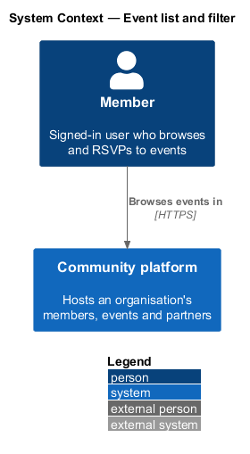
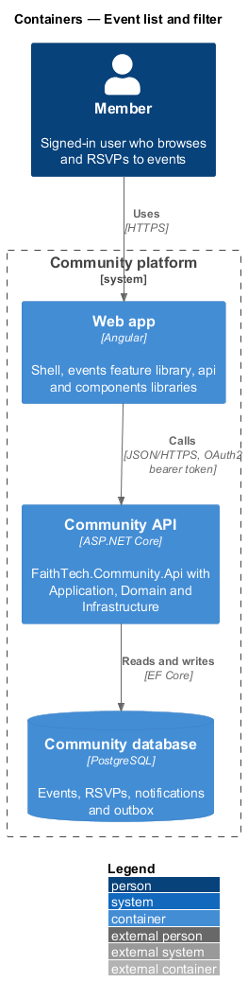
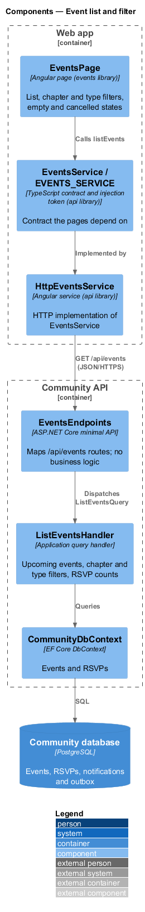
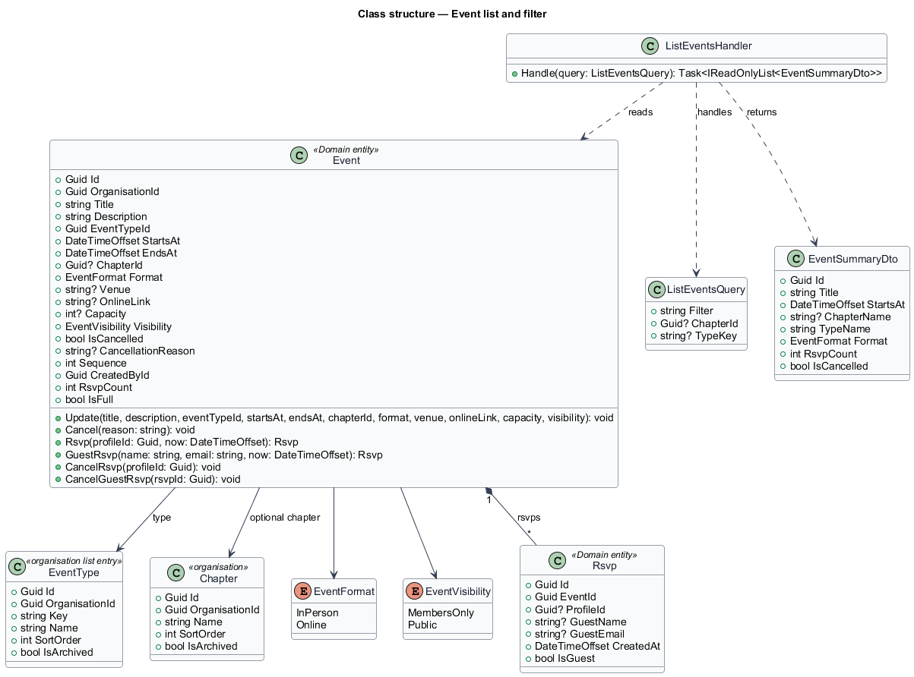
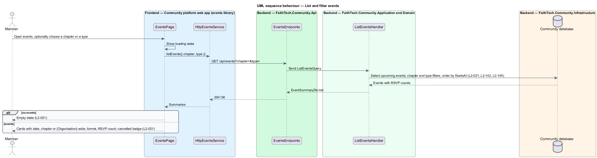

# Event list and filter

## Overview

The Community platform lists an organisation's events for signed-in members. An *event* is a dated gathering, held in person or online, that members can attend. Data is organisation-wide, so the list spans every {chapter}.

This feature covers the events list page: upcoming events in date order, filtered by {chapter} and type, with an empty state and a clear cancelled marker. It is the entry point to the rest of the events subsystem.

Key terms:

- **upcoming event** — event whose end time has not passed
- **RSVP count** — number of members and guests who have RSVP'd to an event
- **{chapter} filter** — list constraint that keeps only events tagged with the chosen chapter (`L2-142`); it is absent when the organisation has no chapters
- **type filter** — list constraint offering the organisation's active event types (`L2-145` AC3), in place of a fixed chip per type

## Description

- **`EventsPage`** — routed page in the `events` feature library (mock: `docs/mocks/pages/events/`). It renders the loading, empty, no-results and error states and the {chapter} and type filters, and lists event cards from the `components` library.
- **`EventsService` / `EVENTS_SERVICE`** — API client contract and token; `HttpEventsService.listEvents({ filter, chapter, type })` calls the API.
- **`EventsEndpoints`** — maps `GET /api/events?filter=&chapter=&type=` with authentication required; an unknown filter is 400.
- **`ListEventsQuery`** — query carrying the chip filter (`Upcoming`, `Past`, `Online`; default `Upcoming`), the optional chapter id and the optional event type key.
- **`ListEventsHandler`** — Application handler that selects upcoming events soonest first (past events newest first), applies the chip, chapter and type filters in the database, and projects each to `EventSummaryDto` with date, chapter name (or "{Organisation}-wide" when the event has none, `L2-141` AC2; omitted when chapters are off), type, format, venue, visibility, RSVP count and cancelled flag.
- **`EventSummaryDto`** — read model returned to the page, inside `EventListDto { events }`; the chapter and type options come from `GET /api/organisation` (`L2-142` AC1, `L2-145` AC3), so the list carries no distinct-city list.
- **`CommunityDbContext`** — EF Core context that reads events and RSVP counts. Every query is scoped by its global filter on `ICurrentOrganisation`.

The list is not paged in v1. Past events are reachable from this page through the Past chip.

## Requirements

The feature realizes the following level-2 (L2) requirements. Each L2 requirement refines a level-1 (L1) requirement, cited by identifier.

| L2 ID | Refines (L1) | Requirement |
|-------|--------------|-------------|
| `L2-021` | `L1-008` | Event list and filter |
| `L2-142` | `L1-027`, `L1-007`, `L1-008`, `L1-024` | Chapter filters |
| `L2-145` | `L1-028`, `L1-008` | Event types |

### Acceptance criteria

**`L2-021` — Event list and filter**

1. Given a signed-in member, when they open events, then upcoming events are listed soonest first, with date, {chapter} (or "{Organisation}-wide" when the event has none, `L2-141` AC2; omitted when chapters are off), format and RSVP count.
2. Given a {chapter} filter (`L2-142`, absent when chapters are off), the type filter offering the organisation's event types (`L2-145` AC3), or one of the filters Upcoming, Past or Online, when it is applied, then only matching events are listed.
3. Given no matching events, when the list is shown, then an empty state is shown.
4. Given a cancelled event, when it is listed, then it is clearly marked as cancelled.

**`L2-142` — Chapter filters**

1. Given chapters are on, when the team list (`L2-019`), the event list (`L2-021`), People (`L2-053`) and Reports (`L2-124`) render their filter, then it offers "All {Chapters}" and the active chapters in order, from `GET /api/organisation`, in place of the former distinct-city lists, and the URL carries `chapter=` in place of `city=`.
2. Given a chapter filter, when it is applied, then only records tagged with that chapter are listed, and an event with no chapter appears only under "All {Chapters}" and under "{Organisation}-wide" when that option is offered (events only).
3. Given chapters are off, when those pages render, then the filter is absent and the lists are organisation-wide.
4. Given a people picker or share picker that shows a person's role and city (`L2-056` AC4, `L2-061` AC1, `L2-064` AC3, `L2-093` AC2), when it renders, then it shows "{name} · {role} · {chapter}", omitting what is missing.
5. Given an empty result for a chapter, when the list renders, then the empty state names the chapter ("No upcoming events in Toronto").

**`L2-145` — Event types**

1. Given a holder of `ManageOrganisationSettings` on Stages & types, when they view "Event types", then it lists the active types in order with their event counts and offers add, rename, reorder and archive under `/api/organisation/event-types`, audited under `taxonomies`; a name is required, up to 40 characters and unique among active types ignoring case.
2. Given the event form (`L2-020` AC1), when it renders, then "Type" offers the active types in order, plus the event's current type if archived, and at least one active type must exist for an event to be created.
3. Given the event list (`L2-021`), when it renders, then its type filter offers "All types" and the active types in place of the former fixed filter chips; the `type=` query carries the type key.
4. Given an event of an archived type, when it is shown, then the type name is shown as before; the type leaves the form's picker and the filter.
5. Given `.ics` export and the public event page, when they render, then the type name appears where it did before.

## Diagrams

### System context

Members browse events on the Community platform.

### Containers

The `EventsPage` calls the Community API, which reads events and RSVP counts from the Community database.

### Components

`EventsEndpoints` dispatches `ListEventsQuery` to `ListEventsHandler`, which projects events into summaries.

### Class structure

`ListEventsHandler` reads `Event` and its `Rsvp` records and returns `EventSummaryDto` rows.

### Behaviour — list and filter events

The handler orders upcoming events soonest first and applies the chapter and type filters on the server. The page shows an empty state when nothing matches and marks cancelled events (`L2-021`).

## Open questions

Decisions recorded while building the Domain layer (`FaithTech.Community.Domain`):

- `Event.RsvpCount` counts member and guest RSVPs; the list query computes the same count in the database.
- The chips are exclusive, like the team list's role chips: one is pressed at a time. Upcoming means the event has not ended, so an event in progress is still listed. Hackathons and Online list upcoming events only; Past lists ended events, newest first.
- The city filter compares trimmed city names without regard to case. Cities are a filter, never a permission boundary: every signed-in member sees every event, members-only or public.
- Each row's meta line is "date · time · city · venue or Online · N going" (`Fri 6 Nov · 6:30 pm · Toronto · Kestrel Labs, 220 King St W · 34 going`); events across several days show the day range (`Sat 14 – Sun 15 Nov`) and no time. Times are shown in the viewer's time zone. The mocks were aligned to carry the city and the RSVP count on every row. A cancelled event keeps its meta line and is marked by the Cancelled badge and the muted card.
- No-results states read "No upcoming events in {chapter}" (or "No past events", "No upcoming {type} events", "No upcoming online events"), with *Show all {chapters}* when a chapter is chosen and *Show upcoming events* otherwise (`L2-142` AC5). *New event* shows only to holders of `ManageEvents` (`canManageEvents`).
- Capabilities: the city filter became the {chapter} filter, absent when the organisation has no chapters, and the Hackathons chip became the type filter over the organisation's event types; both option lists come from `GET /api/organisation` (ADR 0033, ADR 0034, ADR 0035).
