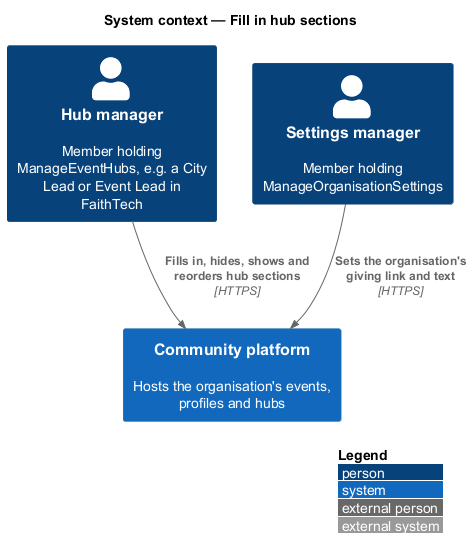
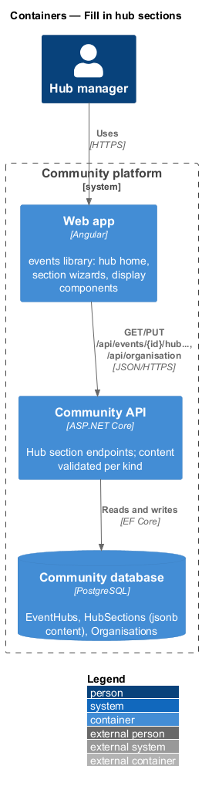
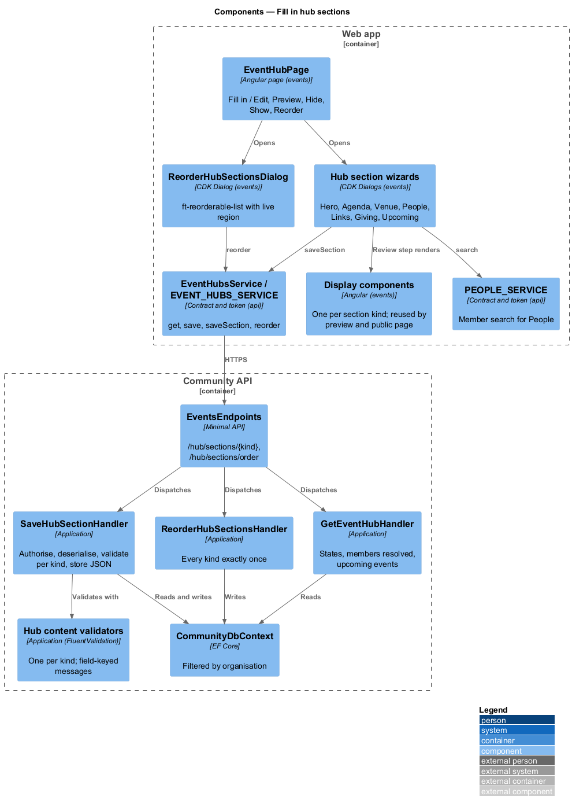
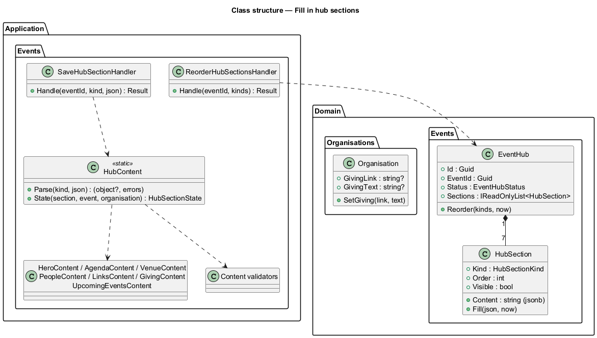
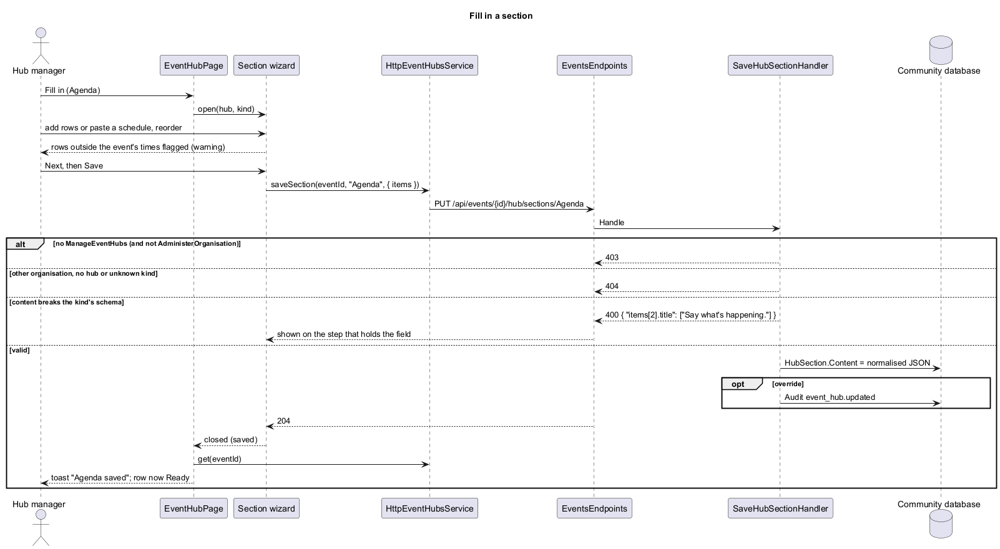
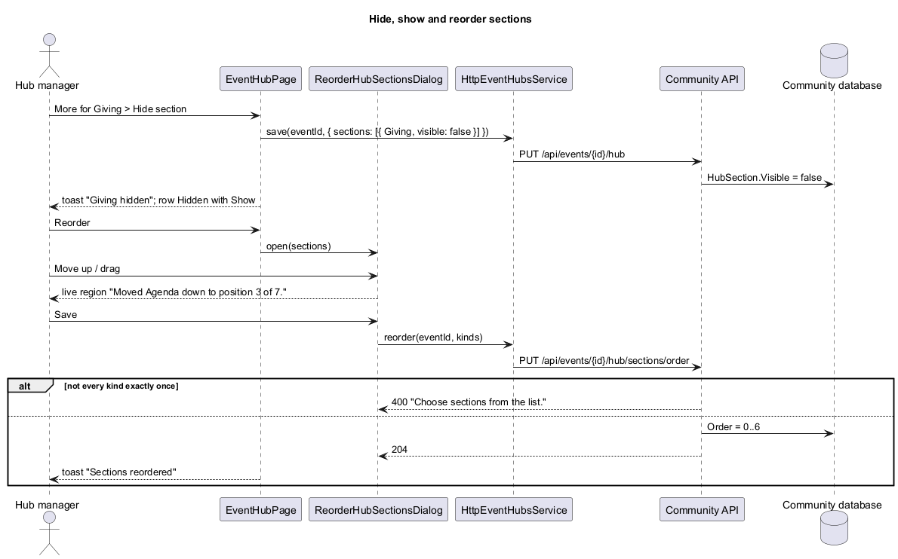

# Fill in hub sections

## Overview

Slice 41 (`events/create-event-hub`) started a hub and showed a read-only checklist. This slice makes the checklist work: each row opens its section's own short wizard, sections can be hidden, shown and reordered, and every phase 1 section kind gets its content schema, its wizard and one display component. The proposal is `docs/proposals/event-hubs.md`; the decisions are in ADR 0036 and ADR 0038.

The seven phase 1 kinds are Hero, Agenda, Venue, People, Submission and feedback (`Links`), Giving and Upcoming events. Event hubs belong to the events subsystem.

Key terms:

- **content** — the JSON a section's wizard stores in `HubSection.Content`, validated against its kind's schema in Application. It holds only what the lead types; values another feature owns are read live (design rule 4).
- **section wizard** — a CDK Dialog of one or two steps for one section kind.
- **display component** — the Angular component that renders one section kind from the hub DTO; used by the section preview and the wizards' review steps now, and by the hub preview (slice 43) and public page (slice 44) later.

## Description

- **`EventHubPage`** (`frontend/projects/events/src/lib/pages/event-hub/`) — each `ft-checklist-row` gains actions (mocks `pages/event-hub/*`): **Fill in** (Needs info) or **Edit** (Ready) opening the kind's wizard, an `ft-menu` "More for {Section}" with **Preview** and **Hide section**, and **Show** on hidden rows. The Sections card gains **Reorder**. After any change the page reloads the hub and shows a toast ("Agenda saved", "Giving hidden", "Giving shown", "Sections reordered").
- **`ReorderHubSectionsDialog`** (`dialogs/reorder-hub-sections/`) — `ft-reorderable-list` of the seven sections, drag or Move up and Move down with the list's live-region announcement; **Save** sends the order.
- **`HubSectionPreviewDialog`** (`dialogs/hub-section-preview/`) — renders one display component with **Edit**.
- **Section wizards** (`dialogs/hub-sections/`) — `HubHeroDialog`, `HubAgendaDialog` (two steps: Rows, Review; add row, paste a schedule, reorder, out-of-range warning), `HubVenueDialog`, `HubPeopleDialog` (two steps: People, Review; `ft-person-picker` over `PEOPLE_SERVICE` search, guest fields, `ft-select` role on the day), `HubLinksDialog`, `HubGivingDialog` and `HubUpcomingDialog`. All share the save behaviour of `L2-157` AC2 to AC4: the pressed button reads "Saving…", a network failure keeps the input and offers **Try again**, and a 400 maps each error key (`subtitle`, `items[2].title`, `people[0].name`, `submissionUrl`, `count`) onto the field on its step.
- **Display components** (`frontend/projects/events/src/lib/hub-sections/`) — `HubHeroComponent`, `HubAgendaComponent`, `HubVenueComponent`, `HubPeopleComponent`, `HubLinksComponent`, `HubGivingComponent`, `HubUpcomingComponent`, each taking the `EventHubDto` (and, for the wizards' review steps, the unsaved content). They compose `components` primitives (`ft-card`, `ft-list`, `ft-avatar`, `ft-button`, `ft-event-card`); the layouts are documented in `docs/design-system/patterns/event-hub-sections.html`.
- **`parseSchedule`** (`hub-sections/parse-schedule.ts`) — reads "6:30 Doors open", "7:15 pm Lightning talks", "19:45 – Demos" into rows on the event's date; a time without am or pm is read within the event's hours (12-hour times are moved to the afternoon when that lands inside the event); unreadable lines are returned for the message.
- **`EventHubsService`** (`frontend/projects/api/`) gains `saveSection(eventId, kind, content)` and `reorder(eventId, kinds)`; `EventHubDto` gains `organisation`, each section's `content` and `upcomingEvents`.
- **`EventsEndpoints`** — `PUT /api/events/{id}/hub/sections/{kind}` and `PUT /api/events/{id}/hub/sections/order`.
- **`SaveHubSectionHandler`** (`Application/Events/HubSections.cs`) — authorises like the other hub handlers (`EventPermissions.CanManageHubs`, 403; override audited `event_hub.updated`), finds the event and hub (404), parses the kind (unknown kind is 404), deserialises the body into the kind's content record and validates it with that kind's FluentValidation validator (400 with field keys), checks what needs the database (People profile ids belong to the organisation; a code freeze matches an agenda row), then stores the normalised JSON (agenda rows sorted by time are **not** re-sorted: the lead's order is kept).
- **`ReorderHubSectionsHandler`** — requires every kind exactly once ("Choose sections from the list.", 400) and sets `Order` 0 to 6.
- **`GetEventHubHandler`** — now also returns the organisation's name and giving link and text, each section's content with People members resolved to their current name and featured photo (unknown or removed profiles are skipped), and the upcoming events: public, not cancelled, starting after now, in the event's chapter (or organisation-wide for an organisation-wide event), excluding this event, earliest first, limited by the Upcoming events count (default 3). States follow `L2-156` AC2 and read the content.
- **`Organisation`** gains `GivingLink` (https, up to 500) and `GivingText` (up to 120), edited on Organisation settings General (`EditGeneralSettingsDialog`, `PUT /api/organisation`, audited) and shown on `GeneralPage`. `FaithTechSeed` sets `https://faithtech.com/donate` and "Help us build the next one." when they are empty; the migration does the same for the existing FaithTech row.

### Content schemas

| Kind | JSON content | Rules (400 message) | Ready when |
|---|---|---|---|
| `Hero` | `{ subtitle? }` | subtitle ≤ 140 ("Use 140 characters or fewer.") | always |
| `Agenda` | `{ items: [{ startsAt, title, detail? }] }` | ≤ 40 items ("You can add up to 40 rows."); startsAt required ("Enter a time."); title required ("Say what’s happening."), ≤ 100; detail ≤ 200 | ≥ 1 item |
| `Venue` | `{ directions? }` | ≤ 500 | event in person with a venue |
| `People` | `{ people: [{ profileId?, name?, line?, role }] }` | ≤ 60; member: profile of this organisation ("Choose a member from the search."); guest: name required ("Enter their name."), ≤ 80, line ≤ 120; role Mentor, Judge or Speaker ("Choose mentor, judge or speaker.") | ≥ 1 person |
| `Links` | `{ submissionUrl?, feedbackUrl?, codeFreezeAt? }` | https, ≤ 500 ("Use a link that starts with https://"); codeFreezeAt equals an agenda row's time ("Pick a time from the agenda.") | a submission or feedback link |
| `Giving` | `{ line? }` | ≤ 200 | the organisation has a giving link |
| `UpcomingEvents` | `{ count }` | 1 to 6 ("Choose between 1 and 6."); missing means 3 | always |

### API contract

| Method and path | Body | Success | Failures |
|---|---|---|---|
| `PUT /api/events/{id}/hub/sections/{kind}` | the kind's content | 204 | 400 field errors, 401, 403, 404 (event, hub or kind) |
| `PUT /api/events/{id}/hub/sections/order` | `{ kinds: [...] }` | 204 | 400 `Choose sections from the list.` (`kinds`), 401, 403, 404 |
| `PUT /api/events/{id}/hub` (slice 41) | `{ templateKey, sections: [{ kind, visible }] }` | 204 | hide and show use it with one section |
| `GET /api/events/{id}/hub` | — | 200 `EventHubDto` | as slice 41 |
| `GET`/`PUT /api/organisation` | gains `givingLink`, `givingText` | | 400 `Use a link that starts with https://` (`givingLink`) |

`EventHubDto` gains `organisation: { name, givingLink, givingText }`, `upcomingEvents: [{ id, title, startsAt, endsAt, format, venue, chapterName }]`, and per section `content` (People members carry `name` and `photoUrl`).

### E2E fake

`e2e/fixtures/mock-event-hubs.ts` stores each section's content, validates it with the same rules and messages, resolves People members from the fake's profiles, computes upcoming events from the fake's events and answers the two new routes. The fake organisation (`mock-api.ts`) carries the FaithTech giving link and text, and `PUT /api/organisation` accepts the two new fields.

## Requirements

| L2 ID | Refines (L1) | Requirement |
|-------|--------------|-------------|
| `L2-156` | `L1-008` | Hub sections checklist |
| `L2-157` | `L1-008`, `L1-026`, `L1-025` | Hub section wizards and content |
| `L2-158` | `L1-008`, `L1-026` | Hero and Giving sections |
| `L2-159` | `L1-008` | Agenda section |
| `L2-160` | `L1-008` | Venue and Submission and feedback sections |
| `L2-161` | `L1-008`, `L1-025` | People section |
| `L2-162` | `L1-008` | Upcoming events section |

They refine `L2-154` AC2 (states) and build on `L2-153` to `L2-155`, `L2-020` (events), `L2-005` (photos), `L2-147` and `L2-152` (organisation settings and their audit) and `L2-151` (the FaithTech seed).

## Diagrams

### System context

### Containers

### Components

### Class structure

### Behaviour — fill in a section

### Behaviour — hide, show and reorder sections

## Open questions

- **Images.** Deferred: the Hero cover image, the Venue photo and guest photos need a Resources image picker and upload; they arrive with Slides (slice 46), which needs both. Guests show initials until then (ADR 0038).
- **Logos in the Hero.** Deferred: organisations have no logo and events no linked partners yet; the Hero shows the organisation's name.
- **Time zone.** Resolved for this slice: events carry no time zone, so agenda times are entered and shown in the member's time zone and stored as instants, like every other event time (ADR 0038). A per-event time zone is still open for the live highlight (slice 44).
- **Multi-day events.** Agenda rows sit on the event's start date; a pasted time is placed on that date. Rows on later days are entered with Edit's time field and flagged when outside the event.
- **Row previews.** The hub home previews a section through **Preview** in a dialog rather than inline, which keeps the checklist small (proposal "deliberately small").
