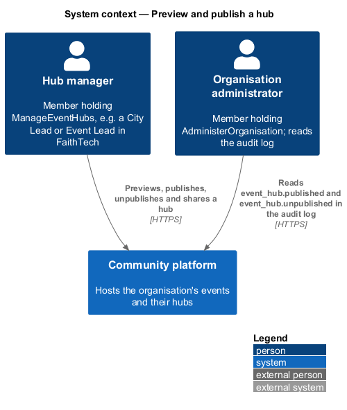
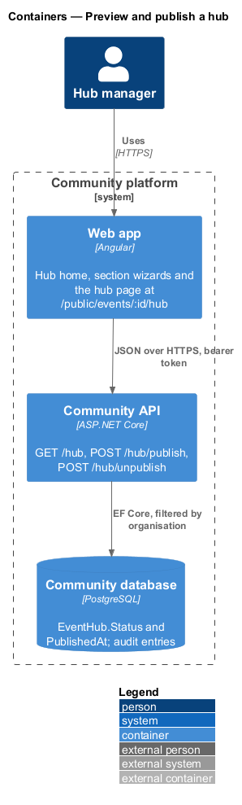
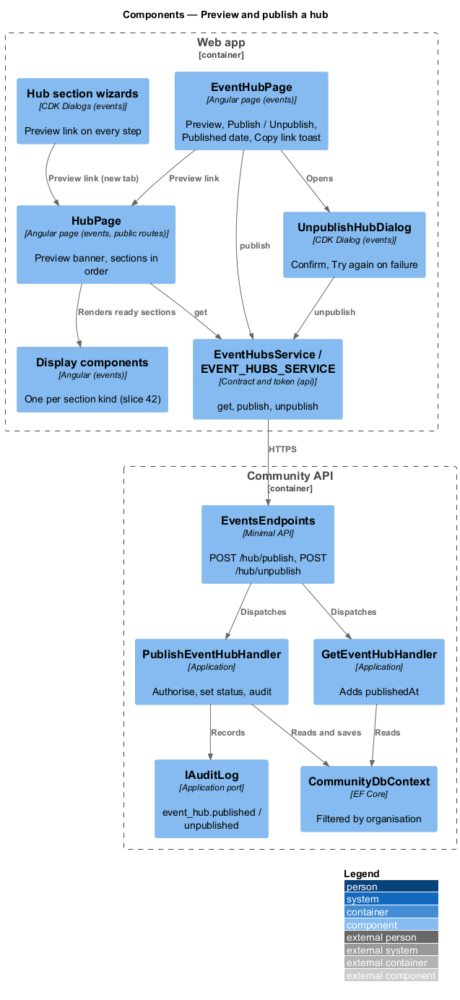
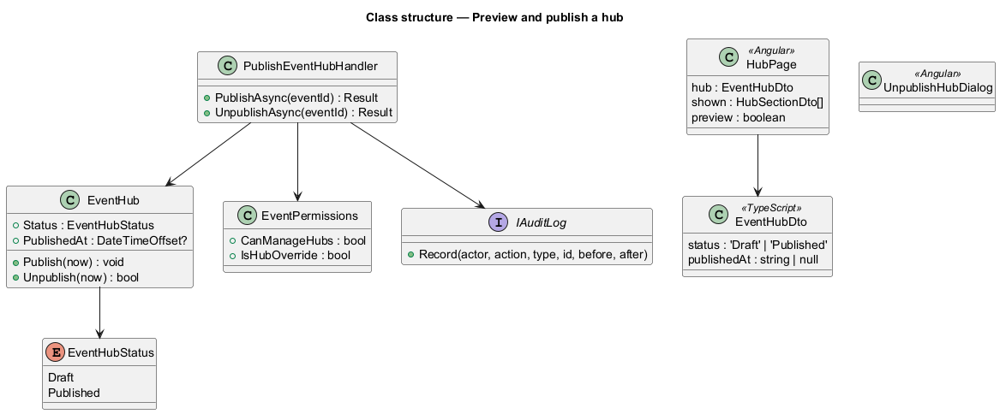
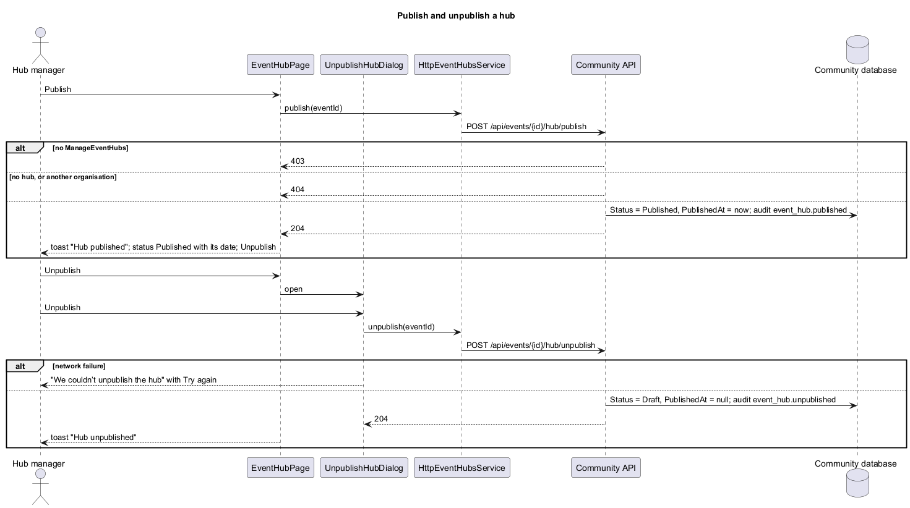
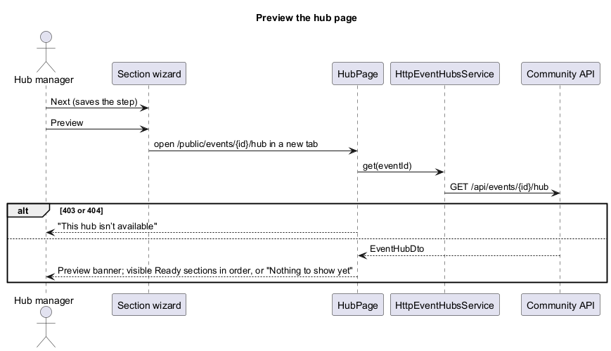

# Preview and publish a hub

## Overview

Slices 41 and 42 (`events/create-event-hub`, `events/fill-in-hub-sections`) start a hub and fill in its sections. This slice shows the real generated page and puts it in front of visitors: **Preview** is one tap away on the hub home and on every wizard step, **Publish** and **Unpublish** change the hub's status, and **Copy link** shares it. The proposal is `docs/proposals/event-hubs.md`; the decisions are in ADR 0036, ADR 0038 and ADR 0039.

Event hubs belong to the events subsystem.

Key terms:

- **hub page** — the Angular route `/public/events/:id/hub` that renders a hub's sections with the slice-42 display components. It is the page visitors will open; slice 44 adds anonymous and member reading.
- **preview mode** — the hub page read by a holder of `ManageEventHubs`, shown under a "Preview" banner whatever the hub's status.
- **shown section** — a visible section whose state is Ready; Upcoming events is shown only when there are upcoming events.

## Description

- **`HubPage`** (`frontend/projects/events/src/lib/pages/hub/`, route `:id/hub` in `PUBLIC_EVENT_ROUTES`, under `PublicShellComponent`) — loads the hub through `EVENT_HUBS_SERVICE.get` and renders, in the hub's order, every shown section with its display component (`ft-hub-hero`, `ft-hub-agenda`, `ft-hub-venue`, `ft-hub-people`, `ft-hub-links`, `ft-hub-giving`, `ft-hub-upcoming`). In preview mode an `ft-alert` info "Preview" banner says what visitors see (Draft: "This is how your hub will look. It’s a draft, so visitors can’t open it yet."; Published: "This is your published hub, as visitors see it.") with **Back to hub home**. With nothing shown it says "Nothing to show yet". A 403 or 404 says "This hub isn’t available"; any other failure says "We couldn’t load the hub" with **Try again**. The page title is "{event} hub". Mocks `pages/hub-page/*`.
- **`EventHubPage`** (hub home) — the "Your hub" card gains **Preview** (a link to the hub page), **Publish** (primary, "Publishing…" while saving) or **Unpublish**, and, when published, a "Published" fact with the date and time. The link's help reads "Visitors can open it once you publish." for a draft and "Visitors can open it now." when published. `ft-copy-field`'s `copied` output shows the toast "Link copied". Toasts: "Hub published" / "Visitors can open it now.", "Hub unpublished", and the danger "We couldn’t publish the hub". Mocks `pages/event-hub/*`.
- **`UnpublishHubDialog`** (`dialogs/unpublish-hub/`) — "Unpublish the hub?" with **Cancel** and danger **Unpublish** ("Unpublishing…"); a network failure keeps the dialog open with "We couldn’t unpublish the hub" and **Try again**; success closes with true. Mocks `dialogs/unpublish-hub/*`.
- **Section wizards** (slice 42) — each shows a ghost **Preview** link at the top of its body that opens the hub page in a new tab. Wizards save as you go (Next, Save and finish later, Save), so the preview shows what has been saved.
- **`EventHubsService`** (`frontend/projects/api/`) gains `publish(eventId)` and `unpublish(eventId)`; `EventHubDto` gains `publishedAt`.
- **`EventsEndpoints`** — `POST /api/events/{id}/hub/publish` and `POST /api/events/{id}/hub/unpublish`.
- **`PublishEventHubHandler`** (`Application/Events/PublishEventHub.cs`) — authorises with `EventPermissions.CanManageHubs` (403), finds the event and hub (404, filtered by organisation), then calls `EventHub.Publish(now)` or `EventHub.Unpublish(now)`. Publish always sets Published and `PublishedAt = now`; Unpublish sets Draft and clears `PublishedAt`, and reports whether anything changed. Every change is audited (`event_hub.published`, `event_hub.unpublished`, after `{ Override }` true when only `AdministerOrganisation` allowed it). Unpublishing a draft changes and records nothing.
- **`GetEventHubHandler`** — returns `publishedAt`.

### API contract

| Method and path | Body | Success | Failures |
|---|---|---|---|
| `POST /api/events/{id}/hub/publish` | — | 204 | 401, 403 (no `ManageEventHubs`), 404 (no event or hub in this organisation) |
| `POST /api/events/{id}/hub/unpublish` | — | 204 | 401, 403, 404 |
| `GET /api/events/{id}/hub` | — | 200 `EventHubDto` with `publishedAt` | as slice 41 |

### Data

No schema change: `EventHub.Status` and `EventHub.PublishedAt` were added in slice 41 (ADR 0036).

### E2E fake

`e2e/fixtures/mock-event-hubs.ts` answers the two new routes with the same permission and not-found rules, sets `status` and `publishedAt`, records `event_hub.published` and `event_hub.unpublished` in the fake audit log, and can fail the next publish or unpublish. The hub page is served by the same `GET /api/events/{id}/hub` route.

## Requirements

| L2 ID | Refines (L1) | Requirement |
|-------|--------------|-------------|
| `L2-163` | `L1-008` | Hub page and preview |
| `L2-164` | `L1-008`, `L1-025` | Publish and unpublish a hub |
| `L2-165` | `L1-008` | Share a hub's link |

They build on `L2-153` to `L2-162` (create and fill in a hub), `L2-041` and `L2-152` (the audit log) and `L2-151` (the FaithTech seed, which grants `ManageEventHubs` to City Lead and Event Lead).

## Diagrams

### System context

### Containers

### Components

### Class structure

### Behaviour — publish and unpublish

### Behaviour — preview the hub page

## Open questions

- **Notify RSVPs on publish** (proposal open question 5). Deferred, default no: publishing sends nothing. A later slice can add an opt-in notification through Notifications (ADR 0039).
- **Anonymous and member reading.** Deferred to slice 44: a public read endpoint that serves a published hub of a public event to anyone, and a published hub of a members-only event to signed-in members, without the preview banner. Until then the hub page reads through the manager endpoint and says "This hub isn’t available" to everyone else.
- **Unsaved wizard input in the preview.** The preview shows what has been saved. Wizards save on every Next and on Save and finish later, so at most the current step's unsaved fields are missing (ADR 0039).
- **QR code.** Deferred to slice 49.
