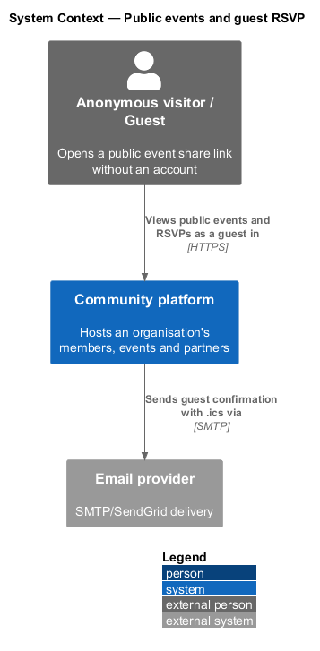
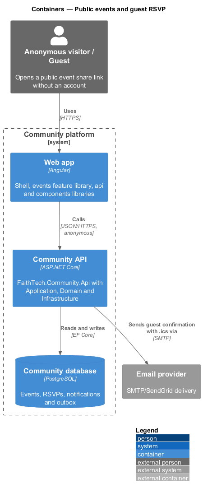
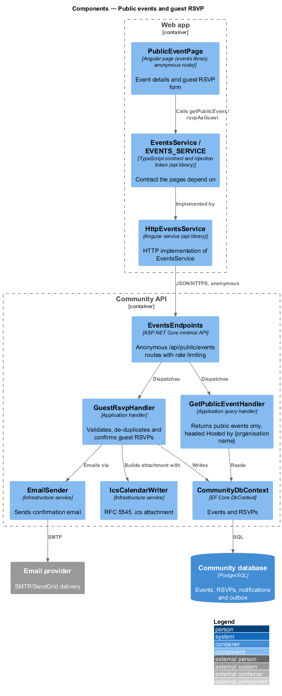
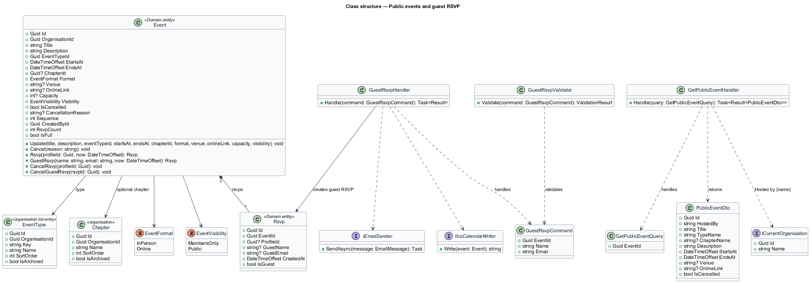
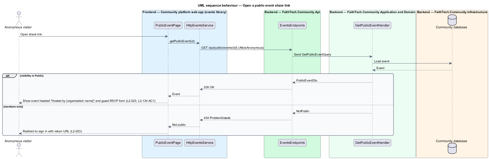
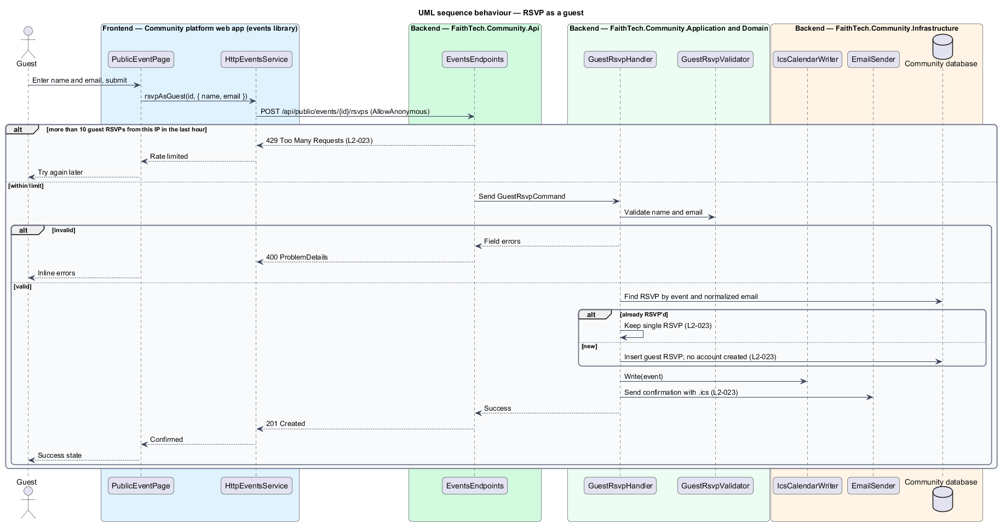

# Public events and guest RSVP

## Overview

Profiles and most content on the Community platform are visible to signed-in members only. Public events are the one exception: an anonymous visitor may open a public event's share link, read the event headed "Hosted by {organisation name}" (`L2-134` AC1), RSVP as a guest and download its `.ics`.

Key terms:

- **public event** — event whose visibility is `Public`
- **share link** — stable URL of an event's public page
- **guest RSVP** — RSVP made with a name and email address, without creating an account

The anonymous endpoints are opted in explicitly. A members-only event requested anonymously redirects to sign-in. Guest RSVPs are rate limited per IP address and de-duplicated per email address.

## Description

- **`PublicEventPage`** — anonymous route in the `events` library (mock: `docs/mocks/pages/public-event/`, states `default`, `invalid`, `success`, `cancelled`, `error`). It shows the event and a guest RSVP form with name and email.
- **`EventsService` / `EVENTS_SERVICE`** — `getPublicEvent(id)` and `rsvpAsGuest(id, request)`, implemented by `HttpEventsService` without a bearer token.
- **`EventsEndpoints`** — maps `GET /api/public/events/{id}` and `POST /api/public/events/{id}/rsvps`, each with explicit `AllowAnonymous`. The guest RSVP endpoint applies the `guest-rsvp` rate-limit policy: 10 requests per IP address per hour (`L2-023`).
- **`GetPublicEventHandler`** — returns the event only when its visibility is `Public`, with the organisation's name from `ICurrentOrganisation` for the "Hosted by" line (`L2-134` AC1); otherwise returns a not-public result that the web app turns into a sign-in redirect.
- **`GuestRsvpCommand` / `GuestRsvpValidator`** — name and email, with email format validation.
- **`GuestRsvpHandler`** — calls `Event.GuestRsvp(name, email, now)`, which refuses cancelled, full or started events and keeps a single RSVP per event and case-insensitive email; the handler then sends the confirmation email with the `.ics`. No account is created.
- **`IIcsCalendarWriter`** and **`IEmailSender`** — Infrastructure services for the attachment and delivery.

Emails are trimmed and compared without regard to case; nothing else is normalised. Every query is scoped by the `CommunityDbContext` global filter on `ICurrentOrganisation`, so a share link opened on another organisation's host answers 404 (`L2-130` AC3).

## Requirements

The feature realizes the following level-2 (L2) requirements. Each L2 requirement refines a level-1 (L1) requirement, cited by identifier.

| L2 ID | Refines (L1) | Requirement |
|-------|--------------|-------------|
| `L2-023` | `L1-008` | Public events and guest RSVP |
| `L2-134` | `L1-025` | Organisation name in copy and email |

### Acceptance criteria

**`L2-023` — Public events and guest RSVP**

1. Given a public event, when an anonymous visitor opens its share link, then they see the event without signing in, headed "Hosted by {organisation name}" (`L2-134` AC1).
2. Given a guest, when they RSVP with a name and a valid email, then a confirmation email with the .ics is sent and no account is created.
3. Given a members-only event, when an anonymous visitor requests it, then they are redirected to sign in.
4. Given more than 10 guest RSVPs from one IP address in an hour, when another is submitted, then it is rejected.
5. Given the same email, when a guest RSVPs to the same event twice, then a single RSVP is kept.
6. Given a guest RSVP, when the guest follows the cancel link in their confirmation email, then their RSVP is cancelled without signing in.

**`L2-134` — Organisation name in copy and email**

1. Given any page, dialog, toast, empty state, error message, email subject or email body that names the product, when it renders, then it uses the organisation's name or short name from `/api/me` or the organisation record, never a fixed name ("We couldn't reach {short name}", "Join {name}", "{name} headline", "Hosted by {name}" on public event pages).
2. Given the HTML document title, when any route renders, then it is "{page} · {organisation short name}".
3. Given the public marketing page (`L2-074`), when it is served on an organisation's public host, then its headline, name, brochure video and footer come from the configuration entry for that host; a public host with no entry shows the unknown-host page.
4. Given the `.ics` download (`L2-024`), when it is generated, then `PRODID` and the organiser name carry the organisation's name.
5. Given the invite, announcement, notification and verification emails, when they are rendered, then "{organisation name}" replaces every product name and the links point at the organisation's community host.

## Diagrams

### System context

An anonymous visitor reaches a public event through its share link. Guest confirmations leave through the email provider.

### Containers

The `PublicEventPage` calls anonymous routes on the Community API without a bearer token.

### Components

`EventsEndpoints` opts the public routes into anonymous access and rate limiting. The handlers enforce visibility, de-duplication and confirmation.

### Class structure

`GuestRsvpHandler` creates `Rsvp` records with `IsGuest` set and no `ProfileId`. `PublicEventDto` exposes no RSVP data.

### Behaviour — open a public event share link

A public event renders without sign-in. A members-only event returns not-public, and the web app redirects to sign-in (`L2-023`).

### Behaviour — rSVP as a guest

The rate limiter rejects the eleventh guest RSVP from one IP address within an hour. A second RSVP with the same email keeps the single existing record (`L2-023`).

## Open questions

Decisions recorded while building the Domain layer (`FaithTech.Community.Domain`):

- The guest cancel link (`L2-023` AC6) removes the RSVP through `Event.CancelGuestRsvp(rsvpId)`, which only removes guest RSVPs.

Decisions recorded while building the slice:

- The share link is `/public/events/{id}` in the web app, inside a public shell (brand and *Sign in*, which returns to `/events/{id}`). The API answers 404 for a members-only or unknown event, and the page sends the visitor to `/sign-in?returnUrl=/events/{id}` (AC3), so the API never reveals that a members-only event exists.
- `PublicEventDto` carries no RSVP list, no host's personal name ("Hosted by {organisation name}", `L2-134` AC1) and no joining link; an online event's link goes to people who RSVP in their confirmation.
- `POST /api/public/events/{id}/rsvps` validates the name and email ("Enter your name so the host knows who’s coming.", "Enter an email like name@example.org."), answers 204, 404 or 409 with the refusal ("This event is full." and the rest, as for members), and creates no account. The same email again keeps the one RSVP (AC5) and sends a fresh confirmation, so a guest who lost theirs can get another.
- Each confirmation carries a new cancel link, `/public/events/{id}/cancel-rsvp?token=…`. The token is 32 random bytes; `Rsvp.CancelTokenHash` keeps only its SHA-256 hash, so only the latest email can cancel. The link opens a page that asks the guest to confirm (docs/mocks/pages/guest-cancel-rsvp), because mail scanners follow links; `POST /api/public/events/{id}/rsvps/cancel` then cancels (204) or answers 404 for an unknown or used link.
- The `guest-rsvp` rate-limit policy (fixed window, 10 an hour per IP address, `RateLimits:GuestRsvpPerHour`) covers the guest RSVP and the guest cancel endpoints; the page explains a 429.
- Holders of `ManageEvents` see a *Public page* card on the event page of a public event, with the link to copy ("Link copied" toast) and *Preview public page*.
