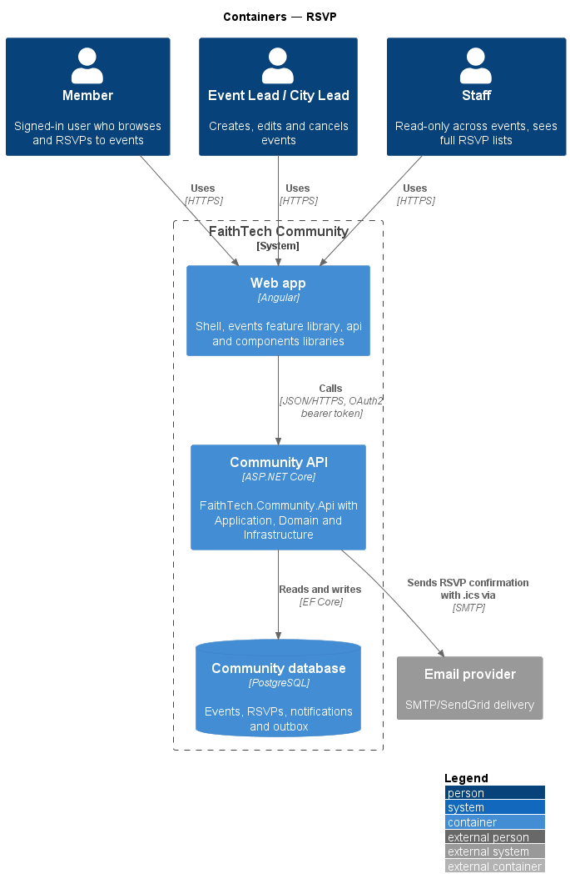
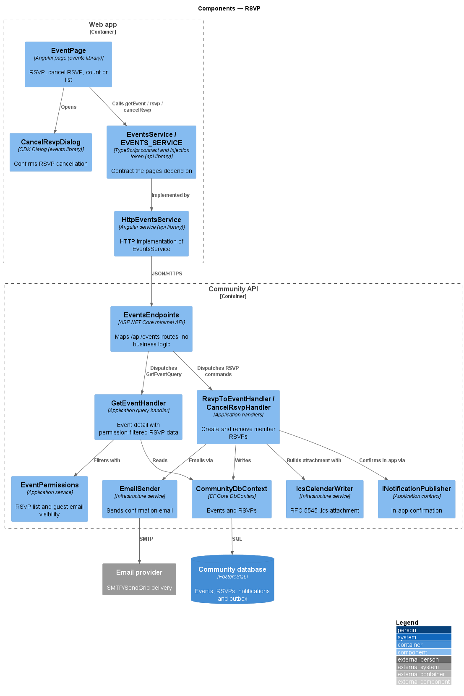
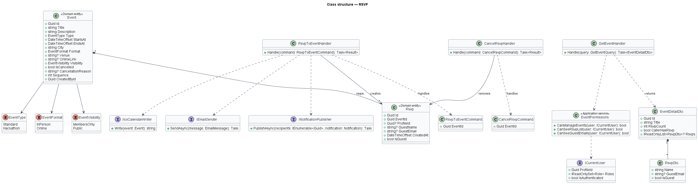
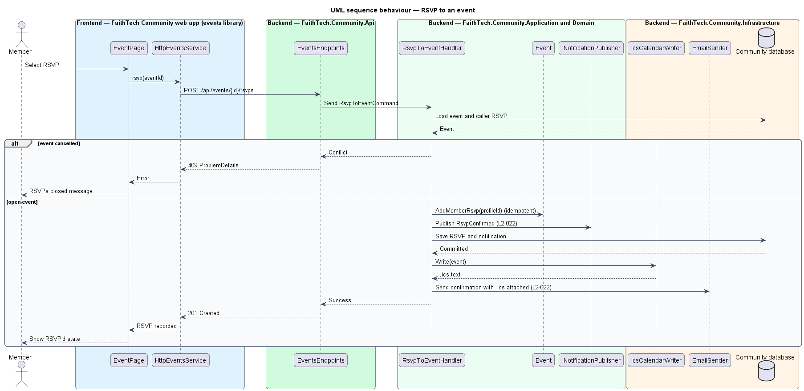
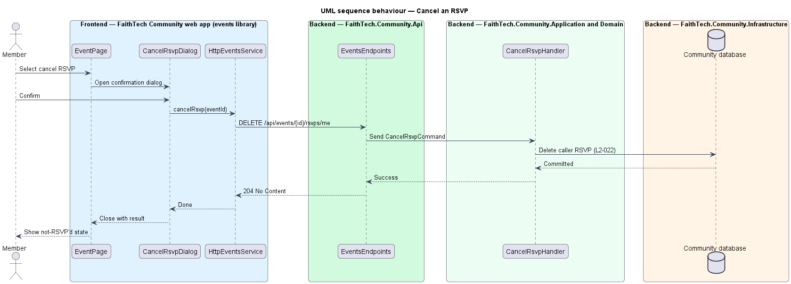
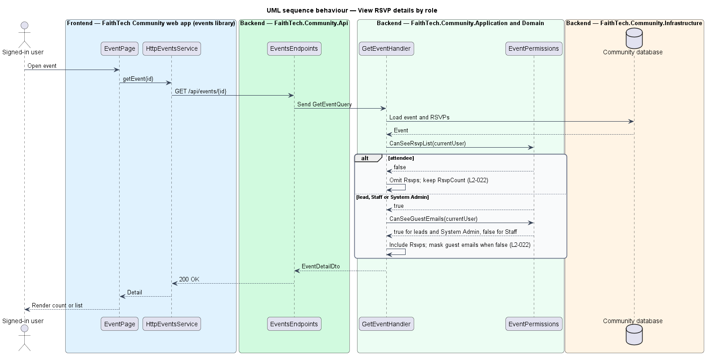

# RSVP

## Overview

An *RSVP* is a member's or guest's statement that they will attend an event. This feature covers a signed-in member RSVPing to an open event, cancelling that RSVP, and who sees which RSVP details on the event page.

Key terms:

- **open event** — event that is not cancelled
- **RSVP list** — names of everyone who RSVP'd to an event
- **attendee** — signed-in member who holds no lead role and is not Staff

Attendees see only the RSVP count. Leads, Staff and System Admin see the full RSVP list. Guest emails are shown to leads and System Admin only, because Staff is read-only and guest emails are personal data. Guest RSVPs are covered by the public-events-and-guest-rsvp feature.

## Description

- **`EventPage`** — routed event detail page in the `events` library (mock: `docs/mocks/pages/event/`, states `default`, `rsvped`, `lead`, `cancelled`). It offers RSVP and cancel-RSVP actions and renders either the RSVP count or the RSVP list.
- **`CancelRsvpDialog`** — Angular CDK Dialog in the `events` library (mock: `docs/mocks/dialogs/cancel-rsvp/`) that confirms cancellation.
- **`EventsService` / `EVENTS_SERVICE`** — `getEvent(id)`, `rsvp(id)` and `cancelRsvp(id)`, implemented by `HttpEventsService`.
- **`EventsEndpoints`** — maps `GET /api/events/{id}`, `POST /api/events/{id}/rsvps` and `DELETE /api/events/{id}/rsvps/me`.
- **`GetEventHandler`** — returns `EventDetailDto`. It includes `Rsvps` only when `EventPermissions.CanSeeRsvpList` is true, and includes guest emails only when `CanSeeGuestEmails` is true (`L2-022`).
- **`RsvpToEventHandler`** — refuses a cancelled event, creates the `Rsvp` idempotently, records an in-app confirmation, and queues a confirmation email with the `.ics` attached.
- **`CancelRsvpHandler`** — removes the caller's `Rsvp`.
- **`IIcsCalendarWriter`** — Infrastructure service that writes the `.ics` attachment (see calendar-export).
- **`IEmailSender`** — Infrastructure email service that sends through SMTP/SendGrid.
- **`INotificationPublisher`** — records the in-app confirmation.

Whether an event has a capacity limit is `<TO SUPPLY>`; the specs define none.

## Requirements

The feature realizes the following level-2 (L2) requirements. Each L2 requirement refines a level-1 (L1) requirement, cited by identifier.

| L2 ID | Refines (L1) | Requirement |
|-------|--------------|-------------|
| `L2-022` | `L1-008` | RSVP |

### Acceptance criteria

**`L2-022` — RSVP**

1. Given a signed-in member and an open event, when they RSVP, then they receive an in-app and email confirmation with the .ics attached.
2. Given an RSVP, when the member cancels it after confirming, then they are removed from the list and can RSVP again any time before the event.
3. Given an attendee who is not a lead or Staff, when they view an event, then they see only the RSVP count.
4. Given a lead, Staff or System Admin, when they view an event, then they see the full RSVP list. Guest emails are shown to leads and System Admin only.
5. Given a lead or System Admin, when they choose "Export CSV" on the RSVP list, then a CSV of the list is downloaded.

## Diagrams

### System context

Members RSVP to events; leads and Staff view RSVP lists. Confirmation emails leave through the email provider.

### Containers

The `EventPage` calls the Community API. The API stores RSVPs in the Community database and sends confirmations through the email provider.

### Components

`GetEventHandler` filters RSVP data through `EventPermissions`. `RsvpToEventHandler` writes the RSVP, records the in-app confirmation and emails the `.ics`.

### Class structure

`Event` composes `Rsvp` records. `EventDetailDto.Rsvps` is null for callers who may see only the count, and `RsvpDto.GuestEmail` is null unless the caller may see guest emails.

### Behaviour — rSVP to an event

The handler refuses cancelled events, records the RSVP once per member, and sends an in-app and email confirmation with the `.ics` attached (`L2-022`).

### Behaviour — cancel an RSVP

The member confirms in `CancelRsvpDialog` before the RSVP is removed from the list (`L2-022`).

### Behaviour — view RSVP details by role

The server decides what RSVP data leaves the API. Attendees receive only the count; leads, Staff and System Admin receive the list; guest emails reach leads and System Admin only (`L2-022`).

