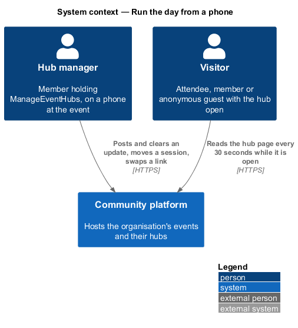
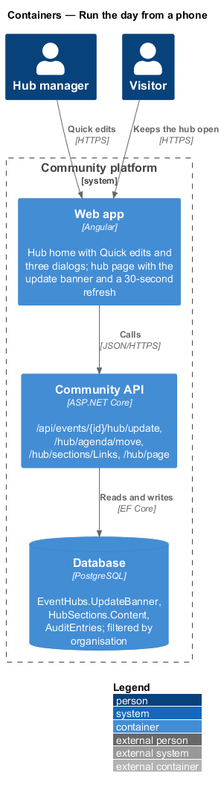
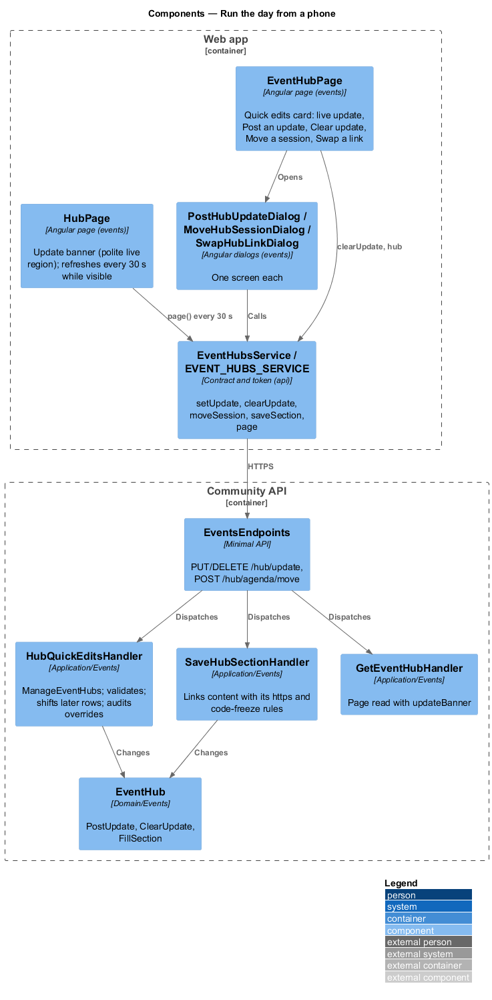
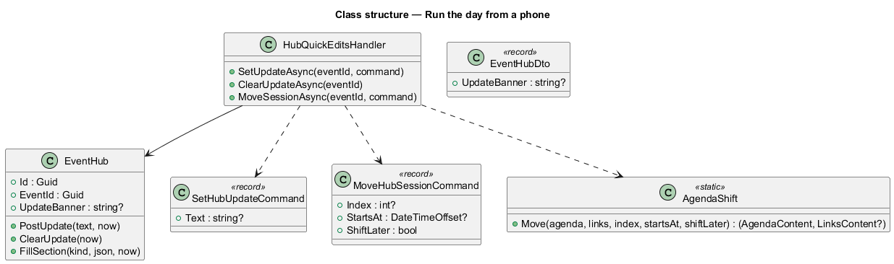
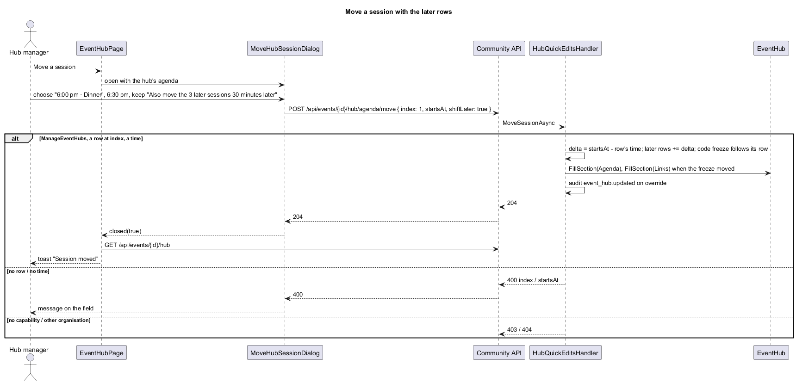
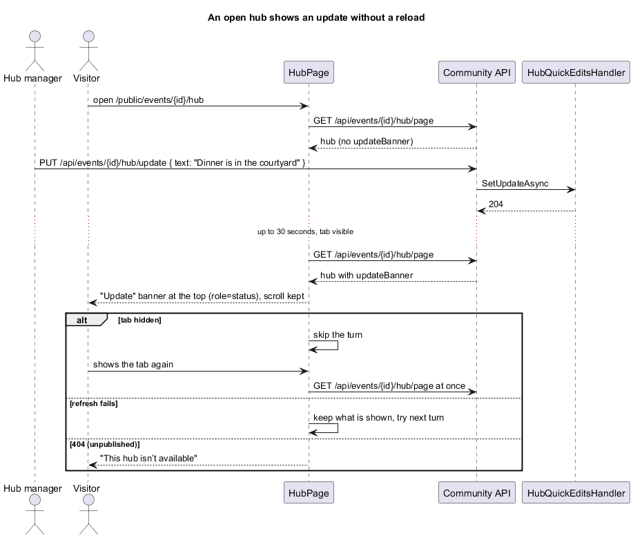

# Run the day from a phone

## Overview

On the day of an event the lead runs the hub from a phone. The hub home gains **Quick edits**: post an update that shows as a banner at the top of the hub and clear it with one tap, move a session (and, if they like, every session after it by the same amount), and swap the submission or feedback link. Each is one screen and changes the hub at once. Hubs that visitors already have open pick up the change within 30 seconds, without a reload. The proposal is `docs/proposals/event-hubs.md` (phase 3); the decisions are in ADR 0044.

Event hubs belong to the events subsystem. Everything here lives in `Application/Events/`, `Domain/Events/` and the `events` library.

Key terms:

- **update** — `EventHub.UpdateBanner`: up to 280 characters, trimmed; null when there is none. Shown on the hub page above every section.
- **later rows** — the agenda rows after the moved row in the agenda's order, which is the order the lead gave the rows (`L2-159`).
- **refresh** — the hub page reading `GET /api/events/{id}/hub/page` again every 30 seconds while its tab is visible.

## Description

- **`EventHub`** (`Domain/Events/EventHub.cs`) gains `PostUpdate(text, now)` and `ClearUpdate(now)`; both touch `UpdatedAt`.
- **`EventHubDto`** gains `UpdateBanner`, filled for the hub home and the page read alike (`L2-189` AC5). The page's visibility rules are unchanged (`L2-166`).
- **`HubQuickEditsHandler`** (`Application/Events/HubQuickEdits.cs`):
  - Every call needs `ManageEventHubs` and a membership (403). A missing hub, or an event of another organisation through the global query filter, is 404. An override by `AdministerOrganisation` is audited as `event_hub.updated` with what changed.
  - `SetUpdateAsync(eventId, { text })`: text required ("Write the update."), at most 280 after trimming ("Use 280 characters or fewer."), 400 under `text`.
  - `ClearUpdateAsync(eventId)`: sets it to null; clearing when there is none is still 204.
  - `MoveSessionAsync(eventId, { index, startsAt, shiftLater })`: `index` must name a row ("Choose a session from the agenda."); `startsAt` is required ("Enter a time."). `AgendaShift.Move` sets the row's time and, with `shiftLater`, adds the same difference to every later row that has a time. When the Links section's `CodeFreezeAt` equals a moved row's old time, it takes that row's new time. Both sections are saved through `EventHub.FillSection`.
- **Swap a link** saves the Links section through the existing `PUT /api/events/{id}/hub/sections/Links` (`SaveHubSectionHandler`, `L2-157`), keeping the other link and the code freeze.
- **`EventHubsService`** (`api`) gains `setUpdate(eventId, text)`, `clearUpdate(eventId)` and `moveSession(eventId, move)`; `EventHubDto` gains `updateBanner`.
- **`EventHubPage`** shows a **Quick edits** `ft-card` first, captioned "Changes show on the hub at once.". With no update it offers Post an update; with one, it shows the text under "Live update" with Change and Clear update. Move a session shows only when the Agenda has rows; Swap a link only when Submission and feedback is shown. The actions are an `ft-stack` of `block` buttons, so they are full width and easy to tap on a phone.
- **Dialogs** (`events`), one screen each, full screen on a phone:
  - `PostHubUpdateDialog`: one `ft-textarea` with a count. "Posting…" while it saves; a failure shows an alert with Try again.
  - `MoveHubSessionDialog`: an `ft-select` of the rows ("6:00 pm · Dinner"), a time `ft-text-field` (`type="time"`), and a one-item `ft-checkbox-group` "Also move the {n} later sessions {30 minutes} later" when there are later rows and the time changed.
  - `SwapHubLinkDialog`: an `ft-radio-group` (Submission, Feedback) and a URL `ft-text-field`.
- **`HubPage`** shows the update in an `ft-alert` (status info, heading "Update", polite) at the top. It refreshes every 30 seconds while `document.visibilityState` is `visible`, and at once on `visibilitychange` back to visible. A refresh replaces the hub signal without the loading state. A failed refresh is ignored; a 404 shows the unavailable state. The timer stops when the page is destroyed.

### API contract

| Method and path | Caller | Success | Failures |
|---|---|---|---|
| `PUT /api/events/{id}/hub/update` `{ text }` | `ManageEventHubs` | 204 | 400 `text`, 401, 403, 404 |
| `DELETE /api/events/{id}/hub/update` | same | 204 | 401, 403, 404 |
| `POST /api/events/{id}/hub/agenda/move` `{ index, startsAt, shiftLater }` | same | 204 | 400 `index`/`startsAt`, 401, 403, 404 |
| `PUT /api/events/{id}/hub/sections/Links` (unchanged, `L2-157`) | same | 204 | 400 `submissionUrl`/`feedbackUrl`, 401, 403, 404 |
| `GET /api/events/{id}/hub` and `/hub/page` | unchanged | 200 with `updateBanner` | unchanged |

### Data

No migration: `EventHubs.UpdateBanner` (`varchar(280)`) has existed since slice 41.

### E2E fake

`e2e/fixtures/mock-event-hubs.ts` answers the update and move endpoints with the same rules and messages, carries `updateBanner` on both reads, and has `failNextQuickEdit()` for the failure states. Specs drive the refresh with Playwright's clock.

## Requirements

| L2 ID | Refines (L1) | Requirement |
|-------|--------------|-------------|
| `L2-188` | `L1-008` | Quick edits on the hub home |
| `L2-189` | `L1-008` | Post and clear an update banner |
| `L2-190` | `L1-008` | Move a session |
| `L2-191` | `L1-008` | Swap a link |
| `L2-192` | `L1-008` | Open hubs show changes without a reload |

They build on `L2-154` (hub home), `L2-157` (section save), `L2-159` and `L2-160` (Agenda, Links), and `L2-163` and `L2-166` (the page and who may read it).

## Diagrams

### System context

### Containers

### Components

### Class structure

### Behaviour — move a session with the later rows

### Behaviour — an open hub shows an update

## Open questions

- **Push instead of poll.** Decided: poll every 30 seconds (ADR 0044). SignalR for anonymous hub viewers is deferred.
- **Notifying RSVPs of a change.** Deferred by the prompt.
- **Undo.** Not offered: Clear update and moving a session back are each one more quick edit.
