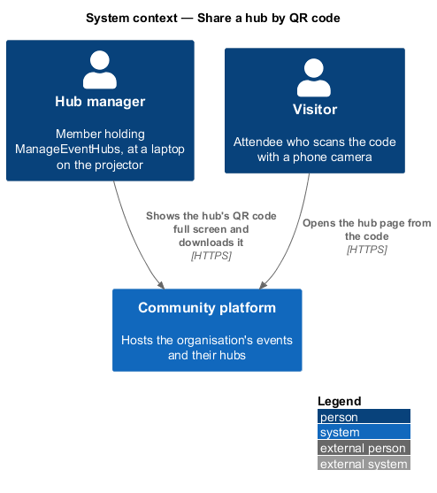
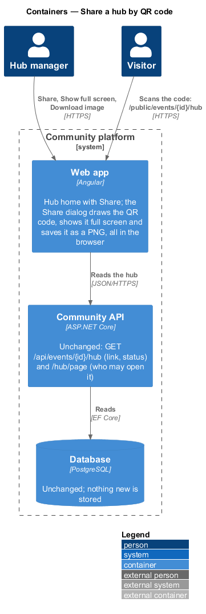
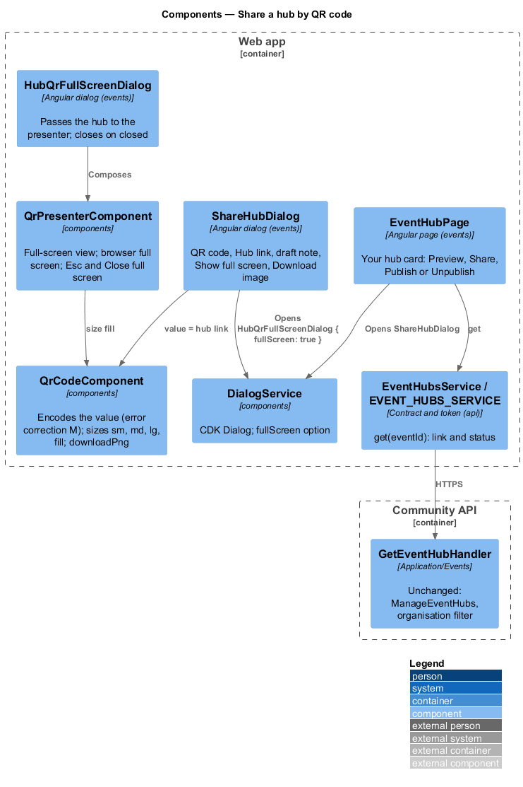
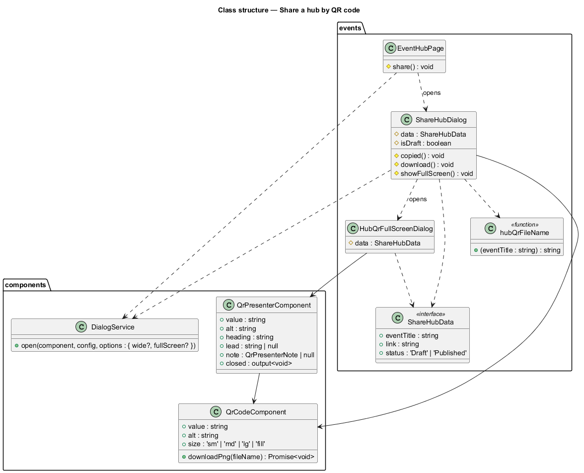
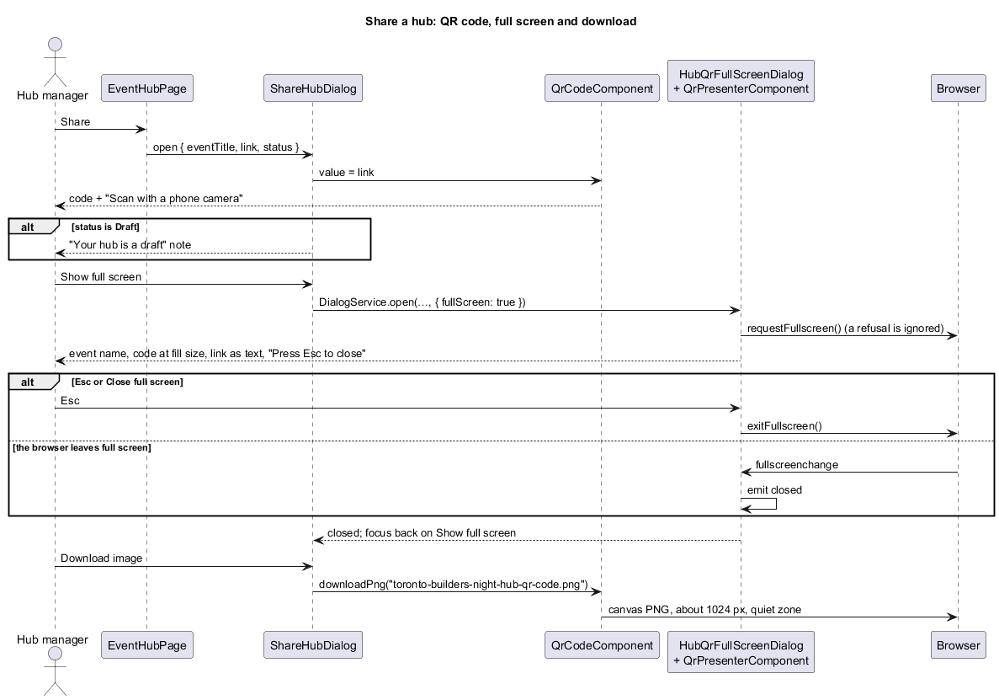
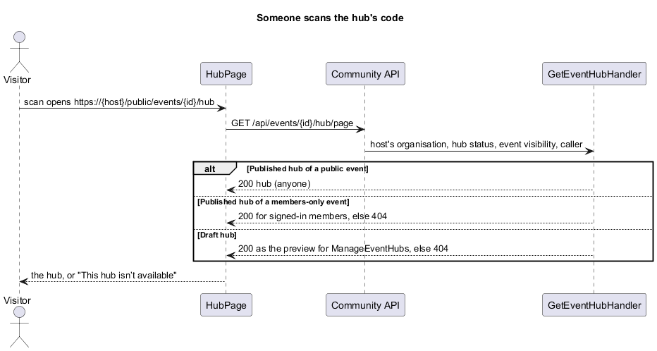

# Share a hub by QR code

## Overview

Slice 43 (`events/preview-and-publish-hub`) gave the hub home a link and Copy link. This slice puts the hub in front of a room: **Share** on the hub home opens a dialog with a QR code that opens the hub, the link beside it, **Show full screen** for a projector and **Download image** for a printed sign. A Draft hub says who the code works for until it is published. The proposal is `docs/proposals/event-hubs.md` (phase 3, "QR share"); the decisions are in ADR 0045.

Event hubs belong to the events subsystem. Everything here lives in the `events` library, with two additions to `components`; there is no backend change.

Key terms:

- **hub link** — `EventHubDto.link`, the hub page's address on the organisation's own host (`https://{host}/public/events/{id}/hub`, `L2-165`). The QR code encodes exactly this.
- **full-screen view** — the `ft-qr-presenter` in a full-viewport CDK dialog, with the browser's full screen when it allows it.
- **draft note** — the warning shown while the hub is a Draft: "Until you publish it, the code opens the hub only for people who manage event hubs. Everyone else sees “This hub isn’t available”."

## Description

- **`EventHubPage`** (`events/src/lib/pages/event-hub/`) — the Your hub card gains **Share** (`ft-button`, icon `qr`) between Preview and Publish/Unpublish. It opens `ShareHubDialog` with `{ eventTitle, link, status }` from the loaded hub. Nothing else on the card changes.
- **`ShareHubDialog`** (`events/src/lib/dialogs/share-hub/`) — `ft-dialog` "Share the hub" (icon `qr`) with: the draft note (`ft-alert` warning "Your hub is a draft") when `status` is Draft; `ft-qr-code` (`alt` "QR code for the {event} hub", caption "Scan with a phone camera"); `ft-copy-field` "Hub link" (help "The QR code opens this link.", `copied` → toast "Link copied" / "Share it with attendees and helpers."). Footer: **Show full screen** (start), **Download image**, **Done** (primary, initial focus).
  - Download calls `QrCodeComponent.downloadPng(hubQrFileName(eventTitle))`: the title in lower case, runs of anything but letters and digits replaced by one hyphen, trimmed of hyphens, then `-hub-qr-code.png`; an empty slug gives `event-hub-qr-code.png`.
  - Show full screen opens `HubQrFullScreenDialog` through `DialogService.open(…, { data }, { fullScreen: true })`; CDK returns focus to Show full screen when it closes.
- **`HubQrFullScreenDialog`** (`events/src/lib/dialogs/hub-qr-full-screen/`) — composes `ft-qr-presenter` with the dialog data (heading the event's title, lead "Scan with a phone camera to open the hub", `note` the draft note for a Draft) and closes its `DialogRef` on `closed`.
- **`QrPresenterComponent`** (`components/src/lib/qr-presenter/`, new; `docs/design-system/components/qr-presenter.html`) — inputs `value`, `alt`, `heading` (required), `lead`, `note` (`{ heading, text }`); output `closed`. Renders Close full screen (focused), the `h2` title (it labels the CDK container), the lead, the note as `ft-alert` warning, `ft-qr-code` at size `fill`, the link as text and "Press Esc to close". After first render it calls `requestFullscreen()` on the document element when the API exists, ignoring a refusal; it listens for `fullscreenchange` and emits `closed` when the browser leaves the full screen it entered; on destroy it leaves full screen if it is still in it. No business logic, no HTTP.
- **`QrCodeComponent`** gains size `fill` (`--qr-size: min(50dvh, 80vw)`).
- **`DialogService.open`** gains `{ fullScreen: true }`: width `100vw`, height `100dvh`, max width and height none, positioned top left, no rounded panel (panel class `ft-dialog-panel--full-screen`). It is used on every viewport width, unlike the phone bottom sheet.
- **`IconComponent`** gains `full-screen` (four corners).

### API contract

No change. The dialog reads what the hub home already loaded:

| Method and path | Caller | Success | Failures |
|---|---|---|---|
| `GET /api/events/{id}/hub` (unchanged, `L2-154`) | `ManageEventHubs` | 200 `EventHubDto` with `link` and `status` | 401, 403, 404 |
| `GET /api/events/{id}/hub/page` (unchanged, `L2-166`) | anyone, by the hub's status and the event's visibility | 200 | 404 "This hub isn’t available" |

The second row is what a scanned code opens.

### Data

No migration and nothing stored. The code, the full-screen view and the PNG are made in the browser.

### E2E fake

No new route: `e2e/fixtures/mock-event-hubs.ts` already answers `GET /api/events/{id}/hub` with `link` (on the fake host) and `status`, and the hub page reads. Specs check that the dialog's Hub link is the fake's `link`, that the full-screen view draws the same code (the same SVG path) at least 300 px square at 1280 × 720, and the downloaded file's name and PNG signature. That `ft-qr-code` is given exactly the hub link is checked by `ShareHubDialog`'s unit test; that it encodes its value correctly is `QrCodeComponent`'s own unit test.

## Requirements

| L2 ID | Refines (L1) | Requirement |
|-------|--------------|-------------|
| `L2-193` | `L1-008` | Share a hub by QR code |
| `L2-194` | `L1-008` | Show a hub's QR code full screen |
| `L2-195` | `L1-008` | Download a hub's QR code as an image |

They build on `L2-154` (the hub home and its 403), `L2-163` to `L2-166` (the hub page, publishing, the link and who may open it) and `L2-151` (the FaithTech seed, which grants `ManageEventHubs` to City Lead and Event Lead). The QR code component itself is `L2-080`'s.

## Diagrams

### System context

### Containers

### Components

### Class structure

### Behaviour — share, show full screen and download

### Behaviour — someone scans the code

## Open questions

- **Where the code is made.** Decided: in the browser from the hub's link (ADR 0045); no endpoint.
- **A Draft hub.** Decided: show the code with the draft note instead of hiding it, so a lead can test it before publishing.
- **SVG download.** Deferred: the component draws PNG only, which prints sharply at sign size.
- **Printed posters and short links.** Deferred by the prompt.
- **Changing the link.** A hub's link changes only if the organisation's host changes; printed codes then stop working. Not addressed here.
