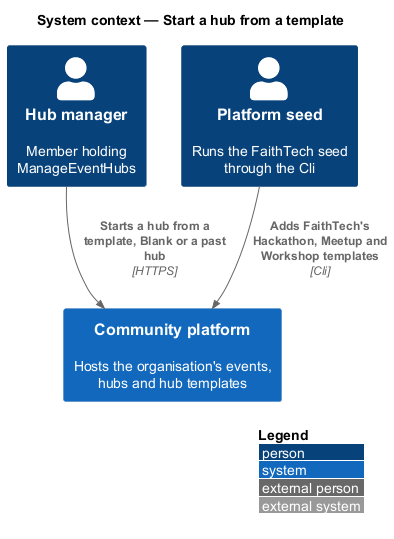
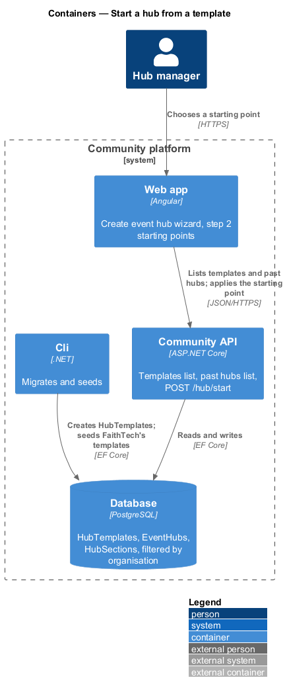
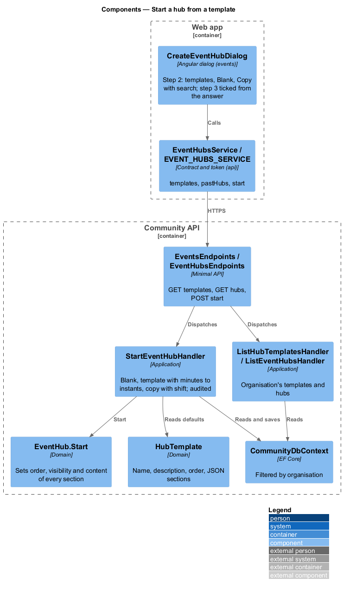
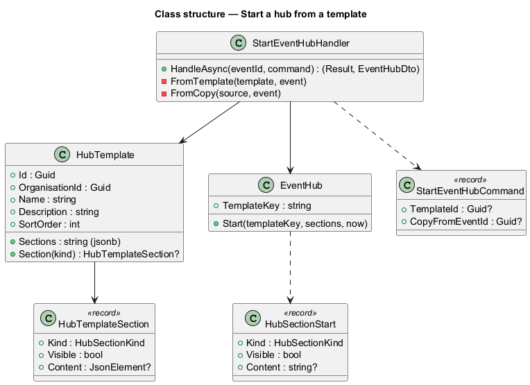
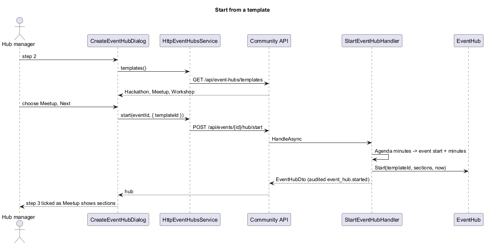
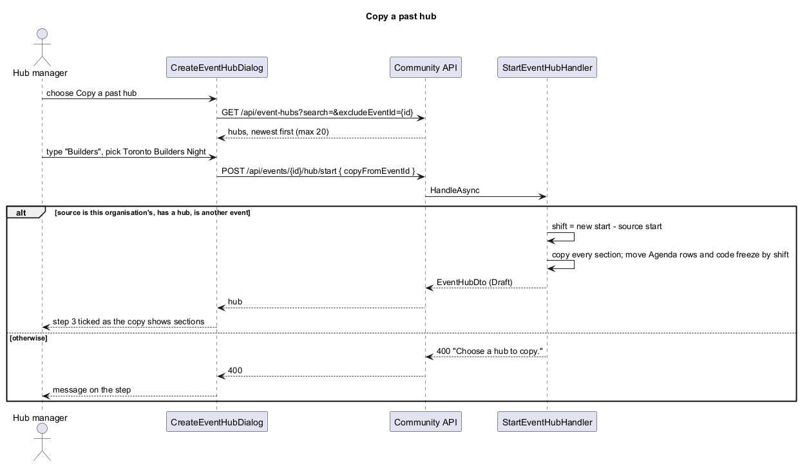

# Start a hub from a template

## Overview

Slice 41 (`events/create-event-hub`) put a four-step wizard in front of a new hub, with **Blank** as the only starting point and the others shown as "Coming soon". This slice turns step 2 on: the lead picks one of the organisation's templates, **Blank** or **Copy a past hub**. A template pre-ticks its sections and fills default text; Copy brings every section of a chosen hub with its times moved to the new event. Templates are organisation data: FaithTech's Hackathon, Meetup and Workshop are seed data, and code never names them. The proposal is `docs/proposals/event-hubs.md`; the decisions are in ADR 0036 and ADR 0041.

Event hubs belong to the events subsystem.

Key terms:

- **template** — a `HubTemplate` of the organisation: a name, a one-line description, its place in the list, which section kinds it shows and default content per kind.
- **starting point** — what step 2 applies: a template, **Blank** or **Copy a past hub**. The hub records it as `TemplateKey`: the template's id, `blank` or `copy`.
- **applying** — `POST /api/events/{id}/hub/start`. It replaces every section's visibility, order and content, so going Back and choosing again replaces what the last choice filled.
- **shift** — the difference between the new event's start and the copied hub's event's start, added to every Agenda row and the code-freeze time.

## Description

- **`HubTemplate`** (`Domain/Events/HubTemplate.cs`) — organisation-scoped: `Id`, `Name` (60), `Description` (120), `SortOrder`, and `Sections`, a JSON array of `{ kind, visible, content }` stored as `jsonb`. Content takes the kind's own shape (`L2-157`), except that an Agenda row holds `minutes` from the event's start instead of `startsAt`. `HubTemplate.Section(kind)` reads one.
- **`EventHub.Start(templateKey, sections, now)`** — takes one `HubSectionStart(kind, visible, content)` per kind in the order wanted, and sets each section's place, visibility and content (`{}` for none). The hub stays a Draft.
- **`StartEventHubHandler`** (`Application/Events/StartEventHub.cs`) — `POST /api/events/{id}/hub/start` with `{ templateId?, copyFromEventId? }`:
  - `ManageEventHubs` or the `AdministerOrganisation` override (audited), else 403; an event of another organisation, or one without a hub, is 404.
  - Neither id: **Blank**, every section shown and empty, in catalogue order, key `blank`.
  - `templateId`: the organisation's template, else 400 "Choose a starting point from the list.". Sections in catalogue order, visibility from the template (a kind it doesn't name is hidden), content from its defaults, with each Agenda row's `minutes` turned into `event.StartsAt + minutes`. Key: the template's id.
  - `copyFromEventId`: an event of the organisation with a hub, other than this one, else 400 "Choose a hub to copy.". Every section's visibility, order and content is copied; Agenda rows' `startsAt` and Links' `codeFreezeAt` move by the shift. Key `copy`.
  - Audited as `event_hub.started` with the key. Answers the manager's `EventHubDto`, so step 3 can tick what the hub now shows.
- **`ListHubTemplatesHandler`** — `GET /api/event-hubs/templates`: the organisation's templates by `SortOrder`, as `{ id, name, description, shown }`.
- **`ListEventHubsHandler`** — `GET /api/event-hubs?search=&excludeEventId=`: the organisation's hubs whose event title contains the text (case-insensitive), newest event first, at most 20, as `{ eventId, title, startsAt }`.
- **`SaveEventHubCommand.TemplateKey`** becomes optional: null keeps the hub's starting point, `blank` is still accepted, anything else is 400 as before (`L2-155` AC5). The wizard stops sending it.
- **FaithTech seed** — `FaithTechSeed.HubTemplates()` holds Hackathon, Meetup and Workshop with fixed ids; `CommunitySeeder` adds those missing by id, so edits survive a re-run. Provisioning gives a new organisation no templates (`L2-171` AC3).
- **`EventHubsService`** (`frontend/projects/api/`) gains `templates()`, `pastHubs(search, excludeEventId)` and `start(eventId, request)`; `HttpEventHubsService` implements them.
- **`CreateEventHubDialog`** — step 2:
  - loads the templates when it opens; a failure shows "We couldn’t load the templates" with **Try again** and leaves **Blank** and **Copy a past hub**;
  - lists the templates (radio, description), then **Blank** and **Copy a past hub**;
  - with Copy chosen, shows "Search past hubs" and the radio list "Which hub?" (loading, empty, no results, failed with **Try again**, and "Choose a hub to copy." when Next is pressed with none chosen);
  - Next applies the starting point (`start`), then ticks step 3 from the answer's visible sections, with "Ticked for {template}." or "Ticked for the hub you copied." before the usual hint. Step 3's save sends visibility only.

### API contract

| Method and path | Caller | Success | Failures |
|---|---|---|---|
| `GET /api/event-hubs/templates` | `ManageEventHubs` | 200 `[{ id, name, description, shown: HubSectionKind[] }]` | 401, 403 |
| `GET /api/event-hubs?search=&excludeEventId=` | `ManageEventHubs` | 200 `[{ eventId, title, startsAt }]`, newest first, max 20 | 401, 403 |
| `POST /api/events/{id}/hub/start` `{ templateId?, copyFromEventId? }` | `ManageEventHubs` | 200 `EventHubDto` | 400 "Choose a starting point from the list." / "Choose a hub to copy.", 401, 403, 404 |
| `PUT /api/events/{id}/hub` | `ManageEventHubs` | 204; `templateKey` optional | as before |

### Data

New table `HubTemplates` (`Id`, `OrganisationId`, `Name`, `Description`, `SortOrder`, `Sections jsonb`), indexed on `OrganisationId, SortOrder`, filtered by the organisation like every scoped table. Migration `HubTemplates`, applied by the Cli. `EventHubs.TemplateKey` keeps its 64 characters (a template id is 36).

### E2E fake

`e2e/fixtures/mock-event-hubs.ts` holds FaithTech's three templates as data and answers the three new calls with the same rules: 403 without `canManageHubs`, Blank, template and copy with the shift, 400 messages, and `templates` / `pastHubs` / `start` failure switches for the error states.

## Requirements

| L2 ID | Refines (L1) | Requirement |
|-------|--------------|-------------|
| `L2-169` | `L1-008`, `L1-026` | Start a hub from a template |
| `L2-170` | `L1-008` | Copy a past hub |
| `L2-171` | `L1-008`, `L1-025` | Hub templates as organisation data |

They change `L2-153` AC4 (step 2) and `L2-155` AC5 (the save's starting point), and build on `L2-151` (the FaithTech seed) and `L2-157` to `L2-162` (section content).

## Diagrams

### System context

### Containers

### Components

### Class structure

### Behaviour — start from a template

### Behaviour — copy a past hub

## Open questions

- **Editing templates** (slice 47). Deferred; the seed's defaults are trusted until an editor validates them.
- **Hackathon section kinds** (slice 46). The templates fill only the phase 1 kinds; slice 46 adds defaults for the kinds it builds.
- **Who edits templates** (proposal open question 3). Decided in slice 47.
