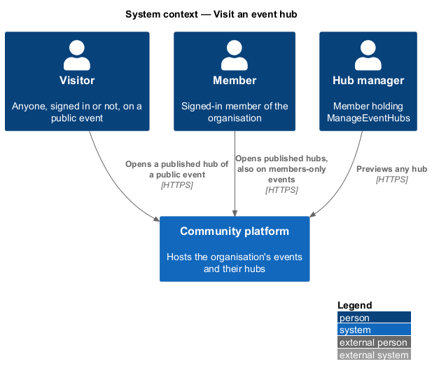
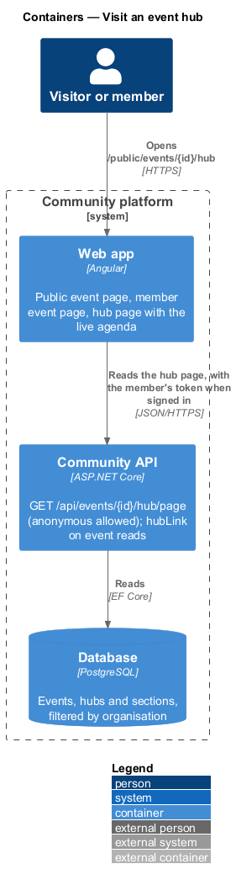
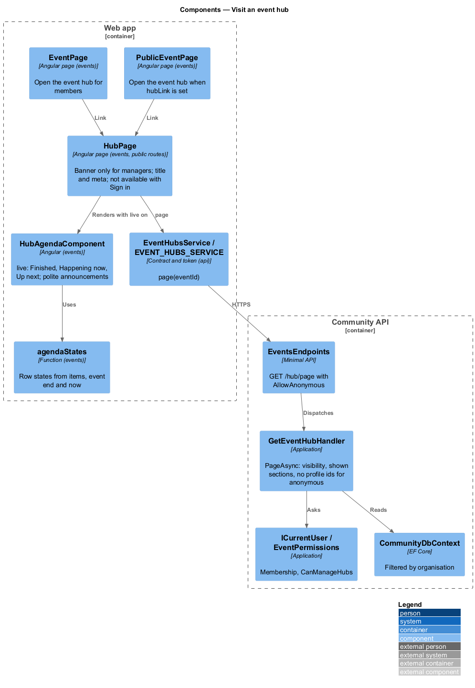
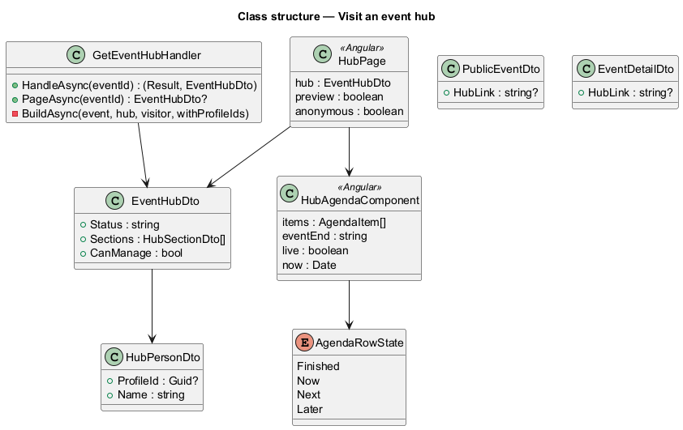
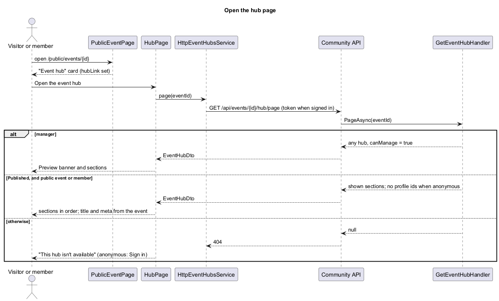
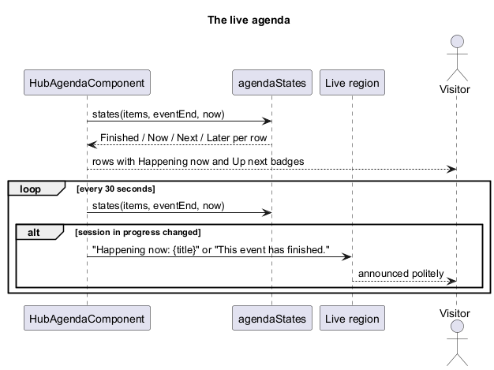

# Visit an event hub

## Overview

Slices 41 to 43 (`events/create-event-hub`, `events/fill-in-hub-sections`, `events/preview-and-publish-hub`) let a lead build, preview and publish a hub. This slice opens the published hub to the people it is for: anyone on a public event, signed-in members on a members-only event. The public event page and the member's event page link to it, and the Agenda highlights the session happening now. The proposal is `docs/proposals/event-hubs.md`; the decisions are in ADR 0036, ADR 0038, ADR 0039 and ADR 0040.

Event hubs belong to the events subsystem.

Key terms:

- **hub page** — the Angular route `/public/events/:id/hub` (slice 43). Read by a hub manager it is the preview; read by anyone else it is the published hub.
- **page read** — `GET /api/events/{id}/hub/page`, the one hub read that accepts anonymous callers. It answers only what a visitor may see.
- **shown section** — a visible section whose state is Ready; Upcoming events is shown only when there are upcoming events (slice 43).
- **live agenda** — the Agenda on the hub page with its Finished, Happening now and Up next states, worked out from the current instant.

## Description

- **`EventsEndpoints`** — `GET /api/events/{id}/hub/page`, mapped in the authenticated events group with an explicit `.AllowAnonymous()`. It is not under `/api/public/` because the app sends a member's token only to non-public API paths, and the read needs to know whether the caller is a member.
- **`GetEventHubHandler.PageAsync`** (`Application/Events/EventHubs.cs`) — the visibility rules (L2-166):
  - a holder of `ManageEventHubs` reads any hub of the organisation, Draft or Published (`canManage: true`);
  - anyone else reads only a Published hub, and on a members-only event only when signed in as a member of the organisation (`ICurrentUser.Membership`);
  - everything else is 404, never 403, so a hub's existence is not revealed. The organisation comes from the host and the global query filter, so another organisation's event is 404.
  - The answer holds only the shown sections. People carry no profile id for anonymous callers, because profiles are for signed-in members only. The event's facts are read from the event on every request, so changing its title, time or venue shows at once.
  - It reuses the slice-42 builders the manager read uses (`ContentAsync`, `PeopleAsync`, `UpcomingAsync`), so the two reads cannot drift.
- **`PublicEventDto`** and **`EventDetailDto`** gain `hubLink`, the hub page's URL when the event has a Published hub, otherwise null.
- **`EventHubsService.page(eventId)`** (`frontend/projects/api/`) — the page read; `EventHubDto` gains `canManage`. The page handles 404 and failures itself, so it can say "This hub isn’t available" or offer **Try again**.
- **`HubPage`** — reads through `page()` instead of the manager `get()`:
  - With `canManage` it shows the slice-43 Preview banner. Without it there is no banner, the document title is the event's title, and the meta description is the Hero subtitle or the event's date, time and place.
  - Not available: "This hub isn’t available". An anonymous visitor reads "It may not be published yet, or it may be for members only. Members can sign in to see it." with **Sign in** (`/sign-in?returnUrl=/public/events/{id}/hub`); a signed-in caller reads "It may not be published yet, or the link may be wrong.".
  - The Hero's RSVP button links to the public event page, where the guest RSVP and the `.ics` stay.
- **`HubAgendaComponent`** gains `live` and `eventEnd` inputs. On the hub page `live` is on: a 30-second timer updates `now`, and `agendaStates(items, eventEnd, now)` (`hub-sections/agenda.ts`) gives each row Finished, Now, Next or Later. A row runs from its time to the next row's time, the last to the event's end. Before the event the first row is Up next; after the last row the Agenda says "This event has finished.". A polite `role="status"` region announces "Happening now: {title}" or "This event has finished." only when the session in progress changes, not on first render. Nothing animates. The section preview dialog leaves `live` off.
- **`PublicEventPage`** and **`EventPage`** — when `hubLink` is set, an "Event hub" card says "The agenda, venue, people and links for the day, in one place." with **Open the event hub** (`ft-button` with `href`, icon `hub`).

### API contract

| Method and path | Caller | Success | Failures |
|---|---|---|---|
| `GET /api/events/{id}/hub/page` | anyone (anonymous allowed) | 200 `EventHubDto`: shown sections only, `canManage`, People without profile ids for anonymous callers | 404 for a Draft hub (unless `ManageEventHubs`), no hub, unknown event, another organisation, or a members-only event read anonymously |
| `GET /api/public/events/{id}` | anyone | 200 `PublicEventDto` with `hubLink` | as before |
| `GET /api/events/{id}` | member | 200 `EventDetailDto` with `hubLink` | as before |

### Data

No schema change.

### E2E fake

`e2e/fixtures/mock-event-hubs.ts` answers `GET /api/events/{id}/hub/page` with the same rules: managers read any hub; others read a Published hub of a public event, or of a members-only event when signed in; everything else is 404. It answers only shown sections and drops profile ids for anonymous callers. `mock-events.ts` adds `hubLink` to the public event and the event detail. Specs drive the live agenda with Playwright's clock (`page.clock`).

## Requirements

| L2 ID | Refines (L1) | Requirement |
|-------|--------------|-------------|
| `L2-166` | `L1-008`, `L1-002` | Who can open a hub's page |
| `L2-167` | `L1-008` | The visitor's hub page and the way to it |
| `L2-168` | `L1-008` | The agenda's live "happening now" |

They build on `L2-023` (public events and guest RSVP), `L2-153` to `L2-162` (create and fill in a hub), `L2-163` to `L2-165` (preview, publish, share) and `L2-151` (the FaithTech seed).

## Diagrams

### System context

### Containers

### Components

### Class structure

### Behaviour — open the hub page

### Behaviour — the live agenda

## Open questions

- **A per-event time zone.** Deferred again (ADR 0040). The live highlight compares instants, so it is right in every time zone; times are shown in the visitor's time zone like every other event time. A per-event zone would change how times read, not which session is live.
- **Update banner** (slice 48) and **QR code** (slice 49). Deferred.
- **Embedding the hub in the public event page.** The public event page links to the hub instead of embedding it, so each page keeps one job: RSVP there, the day's information here.
