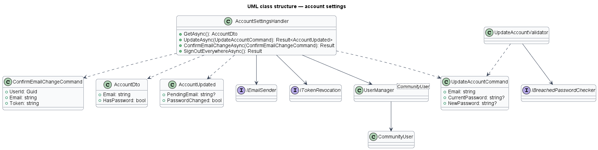
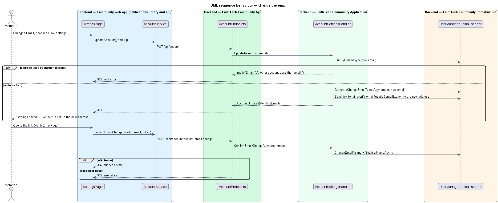
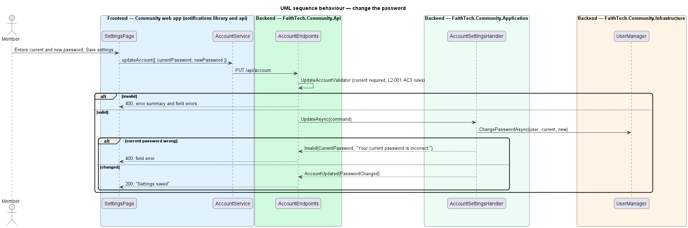
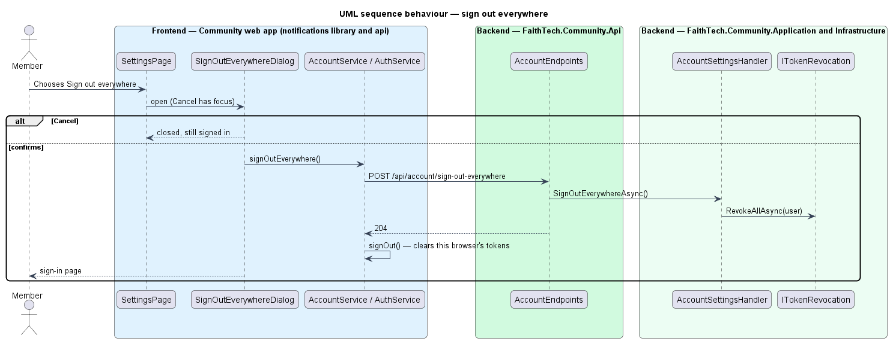

# Account settings

## Overview

A signed-in member shall manage their own account from Settings: change the email they sign in with, change their password, and end every session at once. *Account settings* covers the Account card and the "Sign out everywhere" section of the Settings page (mocks `pages/settings/{default,invalid,busy,success,error}`, `dialogs/sign-out-everywhere/{default,busy,failed}`).

**pending email** — the new address a member asked for. It replaces the sign-in email only when the member opens the verification link sent to it.

The account is global (ADR 0032): a changed email, a changed password and "Sign out everywhere" apply on every organisation host the member belongs to. The verification email is sent in the name of the organisation whose host received the change, with a link back to that host (`L2-134` AC5).

## Description

- **`SettingsPage`** — page in the `notifications` feature library (it owns `/settings`). Its Account card holds Email, Current password (optional) and New password (optional) with "Save settings"; the Appearance and "Email me when" cards keep saving straight away. A failed save shows the error summary and the field errors (`invalid`), saving shows "Saving…" (`busy`), and a save shows the "Settings saved" success alert, which says where the verification link went when the email changed (`success`). Below the form, the "Sign out everywhere" section opens the dialog.
- **`SignOutEverywhereDialog`** — CDK dialog in the `notifications` library (mock `dialogs/sign-out-everywhere`). Cancel has focus first and leaves the member signed in; the danger button revokes every session and then signs this browser out to the sign-in page. While it runs both buttons are disabled; a failure shows the danger alert and keeps the member signed in.
- **`VerifyEmailPage`** — the existing page in the app (`/verify-email`, mocks `pages/verify-email/{default,success,error}`). A link that also carries `email` confirms an email change instead of a sign-up: it shows `email-changed` once confirmed and `email-change-expired` for a used or expired link, each with "Open settings".
- **`AccountService`** / **`ACCOUNT_SERVICE`** / **`HttpAccountService`** — contract, token and HTTP implementation in the `api` library for `GET /api/account`, `PUT /api/account`, `POST /api/account/confirm-email-change` and `POST /api/account/sign-out-everywhere`.
- **`AccountEndpoints`** — the existing minimal API routes under `/api/account` in `FaithTech.Community.Api`, which gain the four account settings routes. `confirm-email-change` opts into anonymous access, because the link proves the request; the others need a signed-in caller.
- **`AccountSettingsHandler`** — Application handler. `GetAsync` returns the caller's email and whether the account has a password. `UpdateAsync` validates the command, then: when the email differs it checks no other account uses it, generates an ASP.NET Identity change-email token for the new address and sends the verification link to it, leaving the sign-in email unchanged; when a new password is given it requires the current one (unless the account has no password yet, as after Google sign-up), applies the sign-up password rules (`L2-001` AC3) and changes it. `ConfirmEmailChangeAsync` applies the change with the token, so the new address is verified and becomes the sign-in email and user name. `SignOutEverywhereAsync` revokes every OpenIddict token of the account through `ITokenRevocation`.
- **`UpdateAccountValidator`** — FluentValidation rules: a valid email of at most 256 characters and the `CommunityPassword` rules for a new password. The handler adds "Enter your current password to change it.", "Your current password is incorrect." and "Another account uses that email.", which need the account. The change-email token comes from the 24-hour email-confirmation token provider; its purpose names the new address.
- **`ITokenRevocation`** — the existing Infrastructure service that revokes every stored token for a user on every organisation host.

## Requirements

The feature realizes the following level-2 (L2) requirement. Each L2 requirement refines a level-1 (L1) requirement, cited by identifier.

| L2 ID | Refines (L1) | Requirement |
|-------|--------------|-------------|
| `L2-052` | `L1-001` | Account settings |

### Acceptance criteria

**`L2-052`**

1. Given a signed-in user, when they change their email, then the new address must be verified before it replaces the old one.
2. Given a signed-in user, when they change their password, then the current password is required, and the new one follows L2-001.3.
3. Given a signed-in user, when they choose "Sign out everywhere", then a confirmation dialog explains that every session on every device ends, including this one; only when they confirm is every session and refresh token for the account revoked, and Cancel leaves them signed in.
4. Given settings, when the user views email preferences, then only announcement emails can be turned off (L2-030.2).

## Diagrams

### Class structure

`AccountSettingsHandler` acts on `CommunityUser` through ASP.NET Identity's `UserManager`, sends the verification link with `IEmailSender` and ends sessions with `ITokenRevocation`.

### Behaviour — change the email

Saving a new email sends a verification link to it; only opening the link replaces the sign-in email (`L2-052` AC1).

### Behaviour — change the password

A new password needs the current one and follows the sign-up rules (`L2-052` AC2).

### Behaviour — sign out everywhere

The dialog revokes every token of the account and then signs this browser out; Cancel changes nothing (`L2-052` AC3).

## Open questions

- None.
