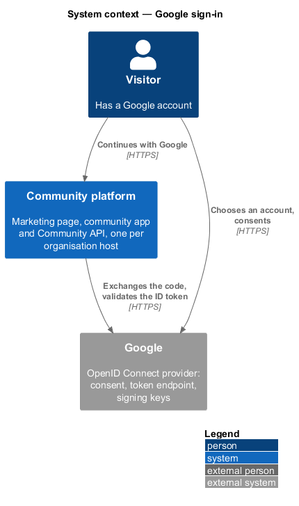
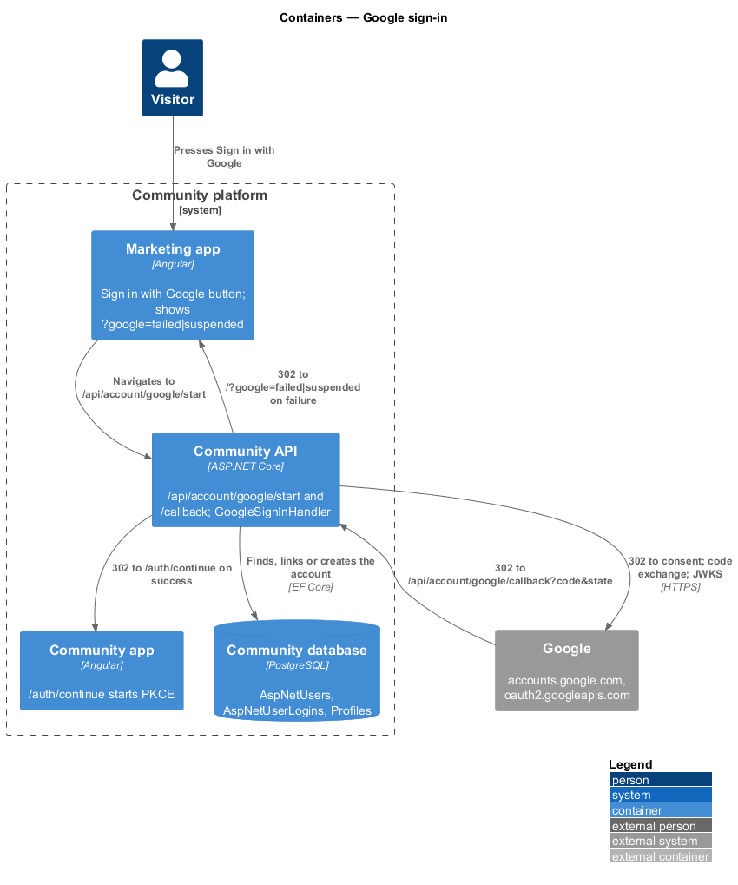
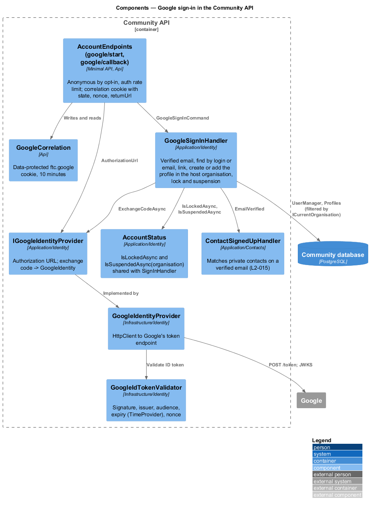
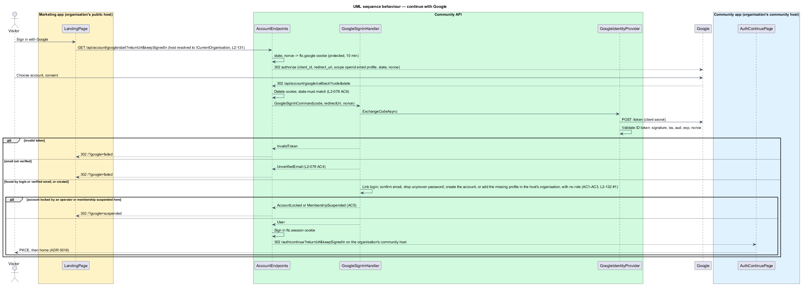

# Google sign-in

## Overview

"Sign in with Google" and "Sign up with Google" are one button and one flow, started on an organisation's host (public or community) and completed on that organisation's community host. Google is the Community platform's first external sign-in method. A Google account whose verified email matches an existing account signs into that account, gaining a profile in the host's organisation if it has none; a new Google account creates an account and a profile in that organisation with no role and a verified email, as any sign-up does (`L2-132` AC1). The result is the same short-lived `ftc.session` cookie the password path sets, followed by the community app's authorization code + PKCE flow.

**ID token** — the signed JWT Google returns from its token endpoint, carrying `sub`, `email`, `email_verified`, `name`, `aud`, `iss`, `exp` and the `nonce` the API sent

**Correlation cookie** — `ftc.google`, a data-protected, `HttpOnly`, `Secure`, `SameSite=Lax` cookie holding the `state`, the nonce, the return URL and "keep me signed in" for 10 minutes; it is deleted on the callback, so a replayed callback fails

**External login** — a row in ASP.NET Identity's `AspNetUserLogins` (provider `Google`, key = `sub`) linking a Google account to a `CommunityUser`; the account is global, so one login serves every organisation host (`L2-078` AC2)

## Description

### Endpoints (Api, `AccountEndpoints`, group `/api/account`, auth rate limit, anonymous by explicit opt-in)

The request has passed `OrganisationResolutionMiddleware`, so `ICurrentOrganisation` names the organisation whose public and community origins the redirects use and whose profile is created or checked (`L2-131`).

- **`GET /api/account/google/start?returnUrl=&keepSignedIn=`** — when `Google:ClientId` or `Google:ClientSecret` is missing, redirects to `<organisation public origin>/?google=failed`. Otherwise creates a 32-byte random `state` and nonce, writes the correlation cookie (only an app-relative `returnUrl` is kept, otherwise `/`), and redirects to `IGoogleIdentityProvider.BuildAuthorizationUrl(state, nonce, redirectUri)` with `redirectUri = <organisation community origin>/api/account/google/callback` (the API sits behind the community origin's proxy; every organisation's callback is a registered redirect URI of the one Google client, `L2-078` AC7).
- **`GET /api/account/google/callback?code=&state=` (or `error=`)** — reads and deletes the correlation cookie, refuses a missing cookie, a missing code or a `state` that does not match (fixed-time comparison), sends `GoogleSignInCommand` and maps the result: success signs in `IdentityConstants.ApplicationScheme` exactly as `POST /api/account/sign-in` does and redirects to `<organisation community origin>/auth/continue?returnUrl=…&keepSignedIn=1|0`; `MembershipSuspended` and `AccountLocked` redirect to `<organisation public origin>/?google=suspended`; anything else to `<organisation public origin>/?google=failed`.

### Application (`Application/Identity/GoogleSignIn.cs`)

- **`IGoogleIdentityProvider`** — the port: `BuildAuthorizationUrl` (null when not configured) and `ExchangeCodeAsync(code, redirectUri, nonce)`, which returns a validated `GoogleIdentity` or null.
- **`GoogleSignInHandler`** — the rules:
  1. No identity → `InvalidToken`.
  2. `EmailVerified` false → `UnverifiedEmail`; nothing is created or linked.
  3. Find by `FindByLoginAsync("Google", sub)`; else by `FindByEmailAsync(email)`, which links with `AddLoginAsync`. If the matching account had not confirmed its email, it is confirmed and its password removed (it was never proven to belong to the email's owner, ADR 0019), and `ContactSignedUpHandler` runs as after a verification link. If the account has no `Profile` in `ICurrentOrganisation`, one is created with no role (`L2-078` AC2, `L2-132` AC1).
  4. Otherwise create a `CommunityUser` with `EmailConfirmed = true` and no password, the login, and a `Profile` in `ICurrentOrganisation` named from Google's `name` (trimmed to 100 characters, or the email's local part); no role is ever granted; `ContactSignedUpHandler` matches the organisation's private contacts (`L2-015`).
  5. `AccountStatus.IsLockedAsync` (the operator lock, every host) and `AccountStatus.IsSuspendedAsync(organisation)` (the membership in this organisation), both shared with `SignInHandler` → `AccountLocked` or `MembershipSuspended` (`L2-078` AC5).
- Lockout is a password rule; it does not block Google sign-in. Sign-up does not write an audit entry, so neither does a Google account creation. Every query on `Profiles` is scoped by the DbContext's global filter on `ICurrentOrganisation`.

### Infrastructure (`Infrastructure/Identity/`)

- **`GoogleIdentityProvider`** — builds `https://accounts.google.com/o/oauth2/v2/auth?response_type=code&scope=openid%20email%20profile&…`, posts the code with the client secret to `https://oauth2.googleapis.com/token` through a named `HttpClient`, and hands the `id_token` to the validator. Any HTTP or protocol failure returns null.
- **`GoogleIdTokenValidator`** — validates with `JsonWebTokenHandler` against signing keys from an `IConfigurationManager<OpenIdConnectConfiguration>` (Google's discovery document in production): issuer `https://accounts.google.com` or `accounts.google.com`, audience = `Google:ClientId`, lifetime against `TimeProvider` with 5 minutes of skew, and `nonce` equal to the expected nonce. Tests use a local RSA key and a static configuration.
- **`GoogleOptions`** — `Google:ClientId`, `Google:ClientSecret` from configuration or environment variables (`Google__ClientId`, `Google__ClientSecret`), shared by every organisation host; never in the repository.

### Data

No schema change beyond the tenancy design: `CommunityDbContext` derives from `IdentityDbContext<CommunityUser, IdentityRole<Guid>, Guid>`, so `AspNetUserLogins` already exists and is global; the profile is found through `Profile.UserId` under the organisation filter (ADR 0032).

### Frontend

- `AuthService.signInWithGoogle(returnUrl?, keepSignedIn?)` in `api` — full-page navigation (`BROWSER_REDIRECT`) to `${API_BASE_URL}/account/google/start`.
- The marketing page's Google button is `ButtonComponent` `variant="google"`; it is busy until the browser leaves and shows "Google sign-in didn't finish" or "This account is suspended" when it comes back with `?google=`.
- The e2e fake (`e2e/fixtures/mock-google.ts`) answers the start endpoint, routes `accounts.google.com` and the callback, and applies the same rules to a Google account the test arranges.

## Requirements

| L2 ID | Refines (L1) | Requirement |
|-------|--------------|-------------|
| `L2-078` | `L1-001` | Google sign-in |
| `L2-079` | `L1-015`, `L1-021` | Marketing page security and privacy |

### Acceptance criteria

Backend criteria are traced by `backend/tests/FaithTech.Community.Api.Tests/Identity/GoogleSignInTests.cs` and `backend/tests/FaithTech.Community.Infrastructure.Tests/Identity/GoogleIdTokenValidatorTests.cs`; the page's behaviour by `e2e/tests/marketing/google-sign-in.spec.ts`.

**`L2-078` — Google sign-in**

1. Given a Google account whose verified email matches no account, when the visitor continues with Google, then an account is created with a profile in the host's organisation named from Google, no role, a verified email and no password (`L2-132` AC1), private contacts in that organisation with that email are matched (`L2-015`), and the member lands in the community app with a PKCE session.
2. Given a Google account whose verified email matches an existing account, when the visitor continues with Google, then the Google login is linked to that account and the member signs into it, gaining a profile in the host's organisation if it has none (`L2-132` AC1); a later sign-in with the same Google account on any organisation's host finds it by its Google login.
3. Given the matching account has never verified its email, when it is linked, then the email is marked verified and the account's unproven password is removed.
4. Given Google reports the email as not verified, when the visitor continues with Google, then sign-in is refused and the page says "Google sign-in didn't finish"; no account is created or linked.
5. Given an account whose profile in the organisation is suspended, or an account locked by a platform operator, when its owner continues with Google, then sign-in is refused with the same message as password sign-in (`L2-132` AC5, AC6, `L2-039`).
6. Given a callback whose `state` is missing, does not match the correlation cookie or was already used, or whose ID token fails signature, issuer, audience, expiry or nonce validation, when it reaches the API, then sign-in is refused and nothing is created or linked.
7. Given the repository, when it is inspected, then it holds no Google client id or secret; the API reads `Google:ClientId` and `Google:ClientSecret` from configuration, shared by every organisation host, and without them the button returns the visitor to the page with the failure message.

**`L2-079` — Marketing page security and privacy**

1. Given more than 20 requests a minute from one IP address to the account endpoints, including the Google start and callback, when another arrives, then the response is 429 (`L2-043` AC5).
2. Given an email, when sign-in fails through the password path or the Google path, then neither response reveals more about the account than the other: suspension is only reported after the person has proven who they are (correct password or verified Google account), and a response never reveals whether the account holds a profile in another organisation.
3. Given the API on an organisation's community host, when a request arrives from that organisation's public origin, then CORS allows it with credentials; a request from any other origin, including another organisation's public origin, is still refused (`L2-131` AC6, `L2-043` AC4).
4. Given the marketing page, when it loads, then every request goes to the organisation's public origin, the organisation's community origin (API and identity server) or, during Google sign-in, Google; the video is self-hosted, the page embeds no third-party frame, and it loads no analytics or tracker.
5. Given the marketing page is served, when it is hosted, then it carries a Content-Security-Policy that allows media only from its own origin and `frame-ancestors 'none'` (`L2-043` AC3; hosting is deferred, the policy is in the design).

## Diagrams

### System context

Google is an external identity provider; the Community platform keeps its own global accounts and one profile per organisation.

### Containers

The API owns the flow; the browser moves between the organisation's marketing app, Google and the organisation's community app.

### Components

Endpoints handle the browser plumbing, the handler owns the rules, Infrastructure owns Google.

### Class structure

The handler depends on the provider port, `ICurrentOrganisation` and the shared lock and suspension rules; logins are Identity's own rows; an account owns one profile per organisation.

### Behaviour — continue with Google

State and nonce are checked before any account is touched; the profile is created or checked in the host's organisation (`L2-078`).

## Open questions

1. Microsoft and Apple sign-in, and the Google button on the community app's own sign-in page, are deferred.
2. A member cannot yet unlink Google or add a password to a Google-created account from Settings; they can use "Forgot your password?" to set one.
3. Capabilities: the login stays global while the profile is per organisation; a known Google account gains a profile on a new organisation's host, and refusal is per membership or by the operator's account lock (ADR 0032).
