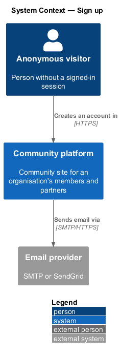
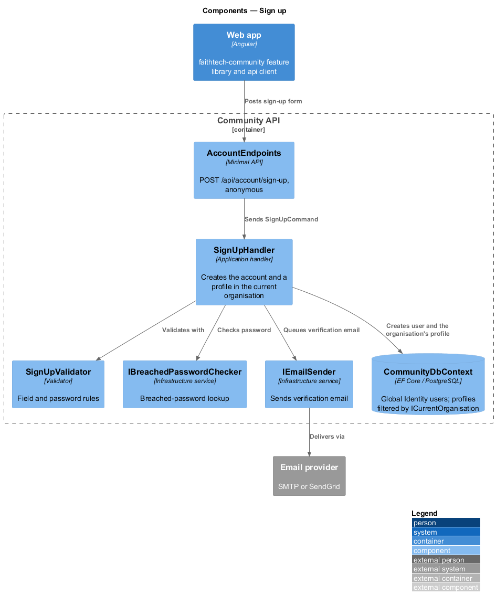
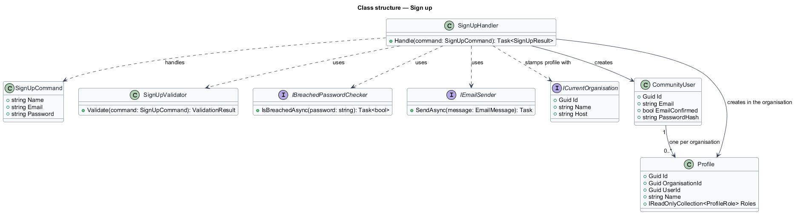
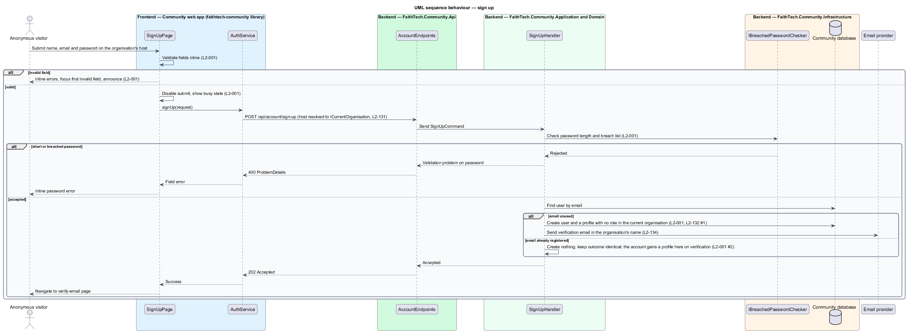

# Sign up

## Overview

The Community platform is open: anyone can create an account and a profile on an organisation's community host. *Sign up* is the first step for every person who has not been invited, and the entry point that turns an anonymous visitor into a member of that organisation.

**account** — ASP.NET Identity user record holding a name, an email and a hashed password; it is global, one per person across every organisation (`L2-132`, ADR 0032)

**profile** — membership of one organisation, created in the organisation the host resolves to (`L2-131`); an account holds at most one profile per organisation

**role** — organisation-defined bundle of capabilities held by a profile (`L2-136`); a new profile holds none

A visitor submits a name, an email and a password. The system creates the account with no role, creates a profile in the host's organisation, sends an email-verification message and shows the verify-email page. The outcome is the same whether or not the email is already registered, so the form does not disclose which emails hold accounts; an existing account gains a profile in the organisation on verification if it has none. The account cannot be used until the email is verified (see the email-verification feature).

## Description

- **`SignUpFormComponent`** — the form lives in the `components` library and `signUpFieldErrors` (in `api`) maps the API's validation problem onto it; the community app's `SignUpPage` and the marketing page share both (`docs/detailed-designs/marketing/landing-page`). A Google sign-up follows `docs/detailed-designs/identity/google-sign-in`.
The slice runs from the `sign-up` mock page to the database and the email provider. The sign-up page belongs to the app shell (`frontend/projects/faithtech-community`) because it precedes any feature library. The page's heading and copy name the organisation ("Join {organisation name}", `L2-134`).

- **`SignUpPage`** — Angular page built from `components` form fields and buttons. It validates fields inline, moves focus to the first invalid field, announces errors through a live region and shows a busy state on the submit button while the request is in flight.
- **`AuthService`** — contract in the `api` library, provided through the `AUTH_SERVICE` injection token and implemented by `HttpAuthService`. It wraps the account endpoints and the OIDC + PKCE client.
- **`AccountEndpoints`** — minimal API route group in `FaithTech.Community.Api`. It maps the account routes, opts each one into anonymous access explicitly, and forwards the request to the Application handler. It holds no business logic. The request has already passed `OrganisationResolutionMiddleware`, so `ICurrentOrganisation` names the organisation the profile is created in (`L2-131` AC1).
- **`CommunityDbContext`** — EF Core context in `FaithTech.Community.Infrastructure`. It stores ASP.NET Identity users alongside community data in PostgreSQL. Identity tables are global; every query on `Profiles` is scoped by the DbContext's global filter on `ICurrentOrganisation`.
- **`SignUpCommand`** — request carrying `Name`, `Email` and `Password`.
- **`SignUpValidator`** — validator in the Application `Profiles/` folder `<TO SUPPLY: final folder for account handlers>`. It requires every field, limits the trimmed name to the profile editor's 100 characters (`UpdateProfileValidator.MaxName`, "Use 100 characters or fewer for your name."), checks the email format and requires a password of at least 12 characters. The sign-up page applies the same name rule before submitting.
- **`IBreachedPasswordChecker`** — Application abstraction implemented in Infrastructure. It reports whether a password appears in a breached-password list. The source of the list is `<TO SUPPLY>`.
- **`SignUpHandler`** — Application handler. It creates the account through `UserManager<CommunityUser>` with no role, creates the empty `Profile` stamped with `ICurrentOrganisation` (`L2-130` AC1), issues a verification token and queues the verification email in the organisation's name (`L2-134` AC5). When the email already exists, it creates nothing and returns the same result; the existing account gains a profile in this organisation when its owner verifies the link (`L2-001` AC2, `L2-132` AC1).
- **`CommunityUser`** — ASP.NET Identity user, global. The former `ProfileId` link is replaced by `Profile.UserId`, so one account may hold a profile in several organisations.
- **`Profile`** — Domain entity holding `OrganisationId`, `UserId`, `Name` and the role collection, empty at creation; unique on (`OrganisationId`, `UserId`).
- **`IEmailSender`** — Application abstraction implemented in Infrastructure over SMTP or SendGrid.

## Requirements

The feature realizes the following level-2 (L2) requirements. Each L2 requirement refines a level-1 (L1) requirement, cited by identifier.

| L2 ID | Refines (L1) | Requirement |
|-------|--------------|-------------|
| `L2-001` | `L1-001` | Sign up |
| `L2-132` | `L1-025`, `L1-001`, `L1-002` | Accounts and memberships |

### Acceptance criteria

**`L2-001` — Sign up**

1. Given an unused email and a valid password, when the visitor submits the sign-up form on an organisation's host, then the account is created, a profile with no role is created in that organisation (`L2-132` AC1), an email-verification message is sent, and the visitor sees the verify-email page.
2. Given an email already registered, when the visitor submits, then the system shows the same "check your email" outcome without revealing that the email exists; on verification the existing account gains a profile in that organisation if it has none (`L2-132` AC1).
3. Given a password shorter than 12 characters or found in a breached-password list, when the visitor submits, then the form shows an inline error on the password field and no account is created.
4. Given an empty or malformed field, when the visitor submits, then each invalid field shows an inline error, focus moves to the first invalid field, and the error is announced to screen readers.
5. Given the form is submitting, when the request is in flight, then the submit button is disabled and shows a busy state.
6. Given a name longer than 100 characters after trimming, when the visitor submits, then the name field shows "Use 100 characters or fewer for your name." and no account is created, so every new name can be saved unchanged in the profile editor (`L2-006`).

**`L2-132` — Accounts and memberships**

1. Given a visitor signs up on an organisation's host (`L2-001`, `L2-078`, `L2-083`), when the account is created, then a profile is created in that organisation, and when the email already has an account, then on verification the existing account gains a profile in that organisation if it has none, with the same `202` outcome either way.
2. Given an invite (`L2-011`) or a connect link (`L2-083`), when it is accepted, then the profile is created in the inviter's or link owner's organisation, whatever host the acceptor started on.
3. Given a verified account with no profile in the current organisation, when it signs in on that host, then the not-a-member page is shown ("You're not a member of {organisation name}") with a sign-out link and, when the account has other memberships, links to their hosts; every API call answers 403 and `/api/me` answers 403 with `reason: not-a-member`.
4. Given an account with profiles in several organisations, when it is used on one host, then only that organisation's profile, roles, capabilities, photos, contacts, notifications and data are visible or counted (`L2-130`).
5. Given a profile is suspended (`L2-039`), when the account signs in on that organisation's host, then sign-in is refused with "Your membership of {organisation name} is suspended"; on another host where it holds an active profile, sign-in succeeds.
6. Given an account locked by a platform operator (`L2-148`), when it signs in on any host, then sign-in is refused with the suspended-account message of `L2-003` AC4.
7. Given a password reset, email verification or Google sign-in (`L2-002`, `L2-004`, `L2-078`), when it completes, then it applies to the account everywhere; it creates no membership.

## Diagrams

### System context

A visitor creates an account and a membership in the Community platform, which sends the verification message through the email provider in the organisation's name.

### Containers

The web app posts the sign-up form to the Community API, which writes the account and the profile to the Community database and sends email through the email provider.

### Components

`AccountEndpoints` forwards a `SignUpCommand` to `SignUpHandler`, which validates, checks the breached-password list, creates the user and the profile in the current organisation, and sends the verification email.

### Class structure

`SignUpHandler` depends on `SignUpCommand`, `SignUpValidator`, `IBreachedPasswordChecker`, `IEmailSender` and `ICurrentOrganisation`, and creates a `CommunityUser` that owns one `Profile` per organisation.

### Behaviour — sign up

The page validates inline before sending. The handler rejects weak passwords, creates the account and the organisation's profile with no role only when the email is unused, and returns the same outcome either way (`L2-001`).

## Open questions

Decisions recorded while building the Domain layer (`FaithTech.Community.Domain`):

- `Profile` requires a non-blank name and starts with an empty `ProfileRole` collection (`L2-001`, `L2-008`).
- Capabilities: the account is global and the profile is the membership, created in the host's organisation; `CommunityUser.ProfileId` is replaced by `Profile.UserId` with a unique index on (`OrganisationId`, `UserId`) (ADR 0032).
