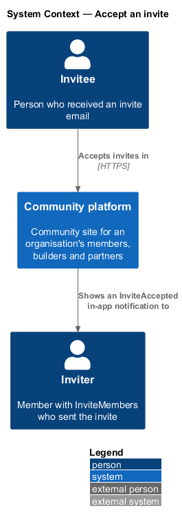
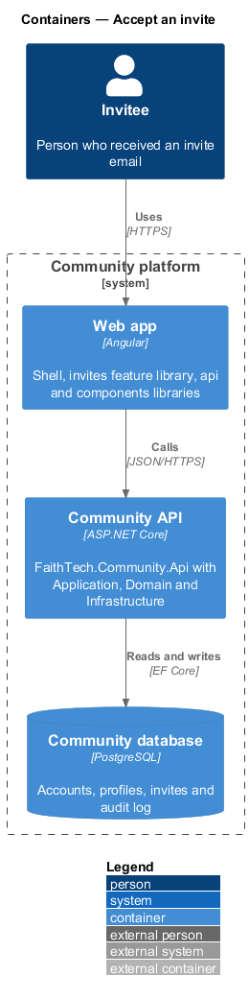
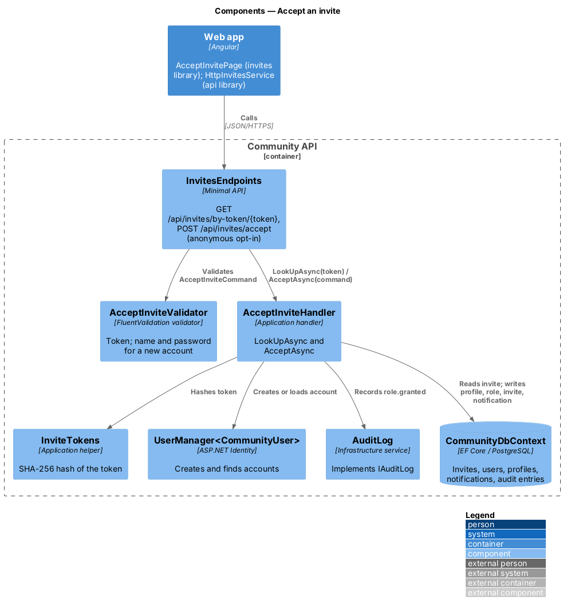
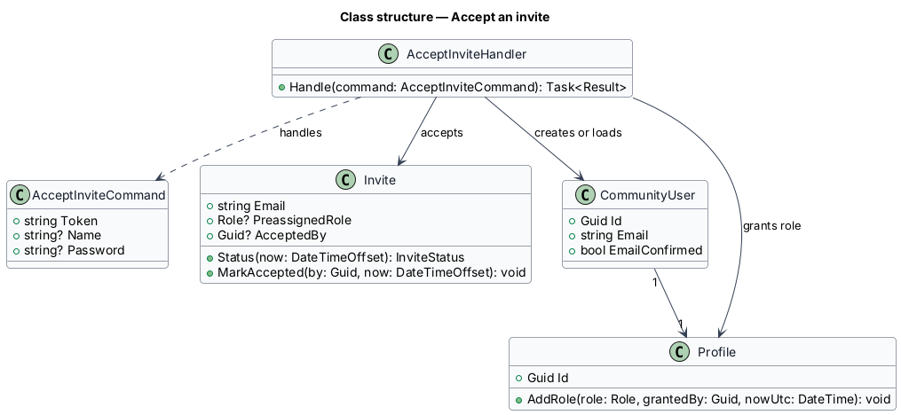
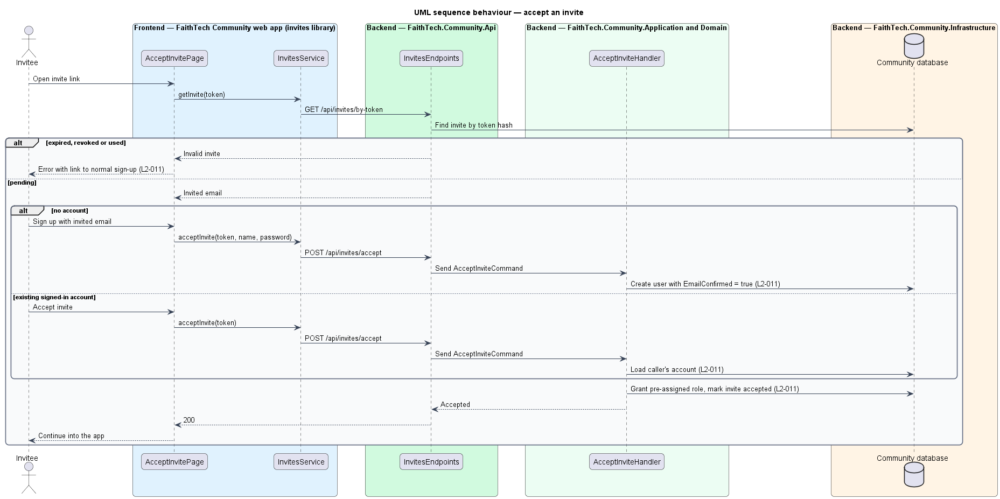

# Accept an invite

## Overview

An invite link brings a person into the community with fewer steps than open sign-up. *Accept an invite* covers opening the link, creating an account or attaching the invite to an existing one, and granting any pre-assigned role.

**invitee** — person addressed by an invite email

**invite token** — random secret in the invite link; the database stores only its hash

Because the invite reached the invited address, signing up with that address counts as email verification. An expired, revoked or already-used invite shows an error and a link to normal sign-up. An existing account that accepts an invite receives the pre-assigned role.

## Description

- **`AcceptInvitePage`** — page in the `invites` feature library, matching the `accept-invite` mock. It shows the sign-up form pre-filled with the invited email, the accept action for a signed-in account, and the invalid-invite error with a sign-up link.
- **`InvitesService`** — contract in the `api` library, provided through the `INVITES_SERVICE` injection token and implemented by `HttpInvitesService`.
- **`InvitesEndpoints`** — minimal API route group in `FaithTech.Community.Api` under `/api/invites`. It holds no business logic.
- **`Invite`** — Domain entity holding `Email`, `TokenHash`, optional `PreassignedRole`, `InvitedBy`, `CreatedAt`, `ExpiresAt` (14 days after creation), `AcceptedAt`, `AcceptedBy`, `RevokedAt` and a derived `Status(now)`. `MarkAccepted(by, now)` and `Revoke(now)` act only on a pending invite.
- **`InviteStatus`** — `Pending`, `Accepted`, `Expired`, `Revoked`.
- **`GetInviteByTokenQuery`** / **`GetInviteByTokenHandler`** — anonymous lookup that returns the invite's email and status for display.
- **`AcceptInviteCommand`** / **`AcceptInviteHandler`** — Application request and handler. For a new account, it creates the user with the invited email marked verified; for a signed-in account, it uses that account. It then grants the pre-assigned role through `Profile.AddRole` and marks the invite accepted in one unit of work.
- **Email mismatch** — a signed-in account whose email differs from the invited email cannot accept (`409`, mock state `wrong-account`; ADR 0006).
- **Role grant audit** — a role granted through an invite is audited as `role.granted` with the inviter as actor (ADR 0006).

## Requirements

The feature realizes the following level-2 (L2) requirements. Each L2 requirement refines a level-1 (L1) requirement, cited by identifier.

| L2 ID | Refines (L1) | Requirement |
|-------|--------------|-------------|
| `L2-011` | `L1-004` | Accept invites |

### Acceptance criteria

**`L2-011`**

1. Given a valid invite link, when the invitee signs up with the invited email, then the email counts as verified and any pre-assigned role is granted.
2. Given an expired, revoked or used invite, when the invitee opens it, then they see an error and a link to normal sign-up.
3. Given an existing account, when its owner accepts an invite, then the pre-assigned role is added to that account.
4. Given an invite is accepted, when the acceptance completes, then the inviter receives an in-app notification.

## Diagrams

### System context

The invitee accepts an invite in FaithTech Community. No external system takes part.

### Containers

The web app sends the token to the Community API, which reads and updates invites, accounts and roles in the Community database.

### Components

`InvitesEndpoints` exposes an anonymous token lookup and the accept command. `AcceptInviteHandler` creates or resolves the account and grants the role.

### Class structure

`AcceptInviteHandler` reads `Invite`, creates or loads `CommunityUser`, and adds the pre-assigned `Role` to the `Profile`.

### Behaviour — accept an invite

A stale invite shows an error with a sign-up link. A pending invite either creates a verified account or attaches to the signed-in account, then grants the pre-assigned role and marks the invite used (`L2-011`).

## Open questions

Decisions recorded while building the Domain layer (`FaithTech.Community.Domain`):

- `Invite.Status(now)` is derived, never stored: revoked wins over accepted, accepted over expired, and an invite is expired from exactly 14 days after creation. Domain rule violations throw `InvalidOperationException` (a broken rule) or `ArgumentException` (invalid input); there is no shared domain exception type. Handlers check permissions and preconditions first and map any remaining violation to a `400` or `409` result.
- Page states: `default` (new account form), `invalid`, `error` (expired: "This invite has expired"; used: "This invite has already been used"; revoked: "This invite was withdrawn"; unknown token: "This invite link isn’t valid"), `existing` (signed in with the invited email: "Accept invite"), `sign-in` (an account already uses the email: "Sign in to accept"), `wrong-account`.
- After a new account accepts, the page signs in with the chosen password and lands on the member's own profile.
