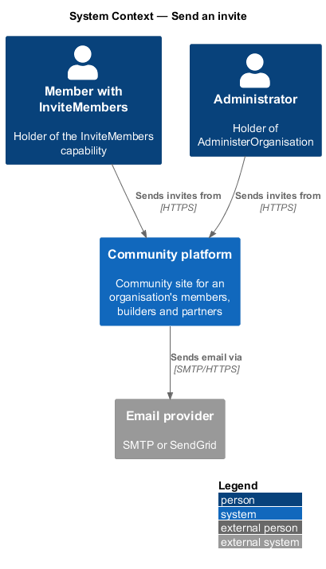
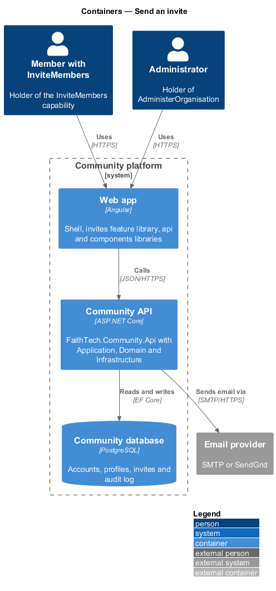
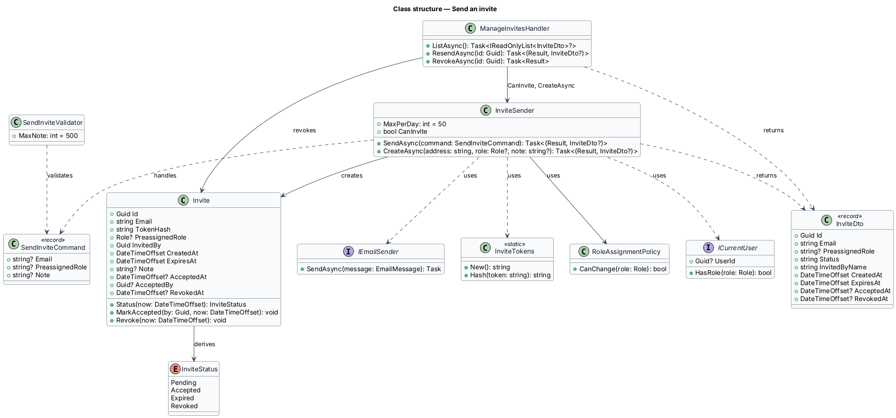
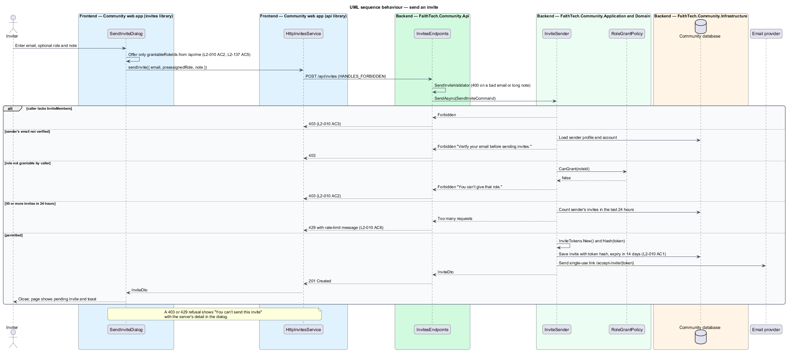
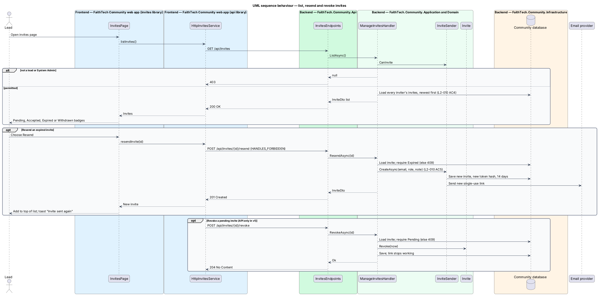

# Send an invite

## Overview

Leads grow the community by inviting people directly. An *invite* is an email carrying a single-use link that lets the recipient join, optionally with a role already granted.

**lead** — holder of any lead role: City Lead, Event Lead, Create Lead or Communications Lead

**pre-assigned role** — role recorded on the invite and granted when the invite is accepted

Any lead or System Admin may send invites. A City Lead may pre-assign only the roles a City Lead may grant under the role-assignment limits (`L2-009`). Each invite expires 14 days after it is sent, may be revoked while pending, and each inviter may send at most 50 invites in 24 hours.

## Description

- **`InvitesPage`** — page in the `invites` feature library, matching the `invites` mock. It lists the inviter's invites with status badges from `components`.
- **`SendInviteDialog`** — Angular CDK dialog matching the `send-invite` mock. It offers only the roles the caller may grant.
- **`InvitesService`** — contract in the `api` library, provided through the `INVITES_SERVICE` injection token and implemented by `HttpInvitesService`.
- **`InvitesEndpoints`** — minimal API route group in `FaithTech.Community.Api` under `/api/invites`. It holds no business logic.
- **`Invite`** — Domain entity holding `Email`, `TokenHash`, optional `PreassignedRole`, `InvitedBy`, `CreatedAt`, `ExpiresAt` (14 days after creation), `AcceptedAt`, `AcceptedBy`, `RevokedAt` and a derived `Status(now)`. `MarkAccepted(by, now)` and `Revoke(now)` act only on a pending invite.
- **`InviteStatus`** — `Pending`, `Accepted`, `Expired`, `Revoked`.
- **`SendInviteCommand`** / **`SendInviteHandler`** — Application request and handler. The handler requires a lead role or System Admin, checks the pre-assigned role against `IRoleAssignmentPolicy`, enforces the 50-per-24-hours limit, creates the `Invite` with a random token, stores only its hash and sends the email.
- **`RevokeInviteCommand`** / **`RevokeInviteHandler`** — mark a pending invite revoked so its link stops working.
- **`ResendInviteCommand`** / **`ResendInviteHandler`** — for an expired invite, create a new one with a new token and 14 days (ADR 0006).
- **`ListInvitesQuery`** / **`ListInvitesHandler`** — return invites with status, newest first. Every lead and System Admin sees every inviter's invites (L2-010 AC4, ADR 0006).
- **`IRoleAssignmentPolicy`** — Application service shared with role assignment; it answers which roles a caller may grant.

## Requirements

The feature realizes the following level-2 (L2) requirements. Each L2 requirement refines a level-1 (L1) requirement, cited by identifier.

| L2 ID | Refines (L1) | Requirement |
|-------|--------------|-------------|
| `L2-010` | `L1-004` | Send invites |

### Acceptance criteria

**`L2-010`**

1. Given a lead or System Admin, when they send an invite to a valid email with an optional personal note, then an invite email is sent with a single-use link that expires after 14 days.
2. Given a pre-assigned role, when the inviter is a City Lead, then only the roles a City Lead is permitted to grant (L2-009) can be chosen.
3. Given a user without a lead role or System Admin, when they call the invite API, then the response is 403.
4. Given the invites page, when a lead or System Admin views it, then it lists the invites sent by every lead, each with its status: pending, accepted or expired.
5. Given an expired invite, when a lead chooses "Resend", then a new invite with a new 14-day link is sent.
6. Given more than 50 invites from one user in 24 hours, when another is sent, then it is rejected with a rate-limit message.

## Diagrams

### System context

Leads and System Admins send invites from FaithTech Community, which delivers them through the email provider.

### Containers

The web app sends invite commands to the Community API, which stores invites in the Community database and sends email.

### Components

`InvitesEndpoints` dispatches send, revoke and list requests. `SendInviteHandler` consults `IRoleAssignmentPolicy` and sends through `IEmailSender`.

### Class structure

`SendInviteHandler` creates `Invite` entities and depends on `IRoleAssignmentPolicy`, `ICurrentUser` and `IEmailSender`. `Invite` derives its `InviteStatus`.

### Behaviour — send an invite

The handler refuses non-leads, refuses roles the caller may not grant, rate-limits at 50 per 24 hours, and otherwise stores the invite and sends a single-use link that expires after 14 days (`L2-010`).

### Behaviour — list and revoke invites

The invites page shows each invite's status. Revoking a pending invite marks it revoked so its link no longer works (`L2-010`).

## Open questions

Decisions recorded while building the Domain layer (`FaithTech.Community.Domain`):

- `Invite.Status(now)` is derived, never stored: revoked wins over accepted, accepted over expired, and an invite is expired from exactly 14 days after creation. Domain rule violations throw `InvalidOperationException` (a broken rule) or `ArgumentException` (invalid input); there is no shared domain exception type. Handlers check permissions and preconditions first and map any remaining violation to a `400` or `409` result.
- Routes: `POST /api/invites` (`Email`, optional `PreassignedRole`, optional `Note` up to 500 characters), `GET /api/invites`, `POST /api/invites/{id}/resend`, `POST /api/invites/{id}/revoke`. Revoke is API-only in v1; the invites mock has no revoke control.
- `Invite` gains an optional `Note`, kept so a resend repeats it.
- A refused send (rate limit, unverified sender, role not allowed) shows the dialog's `limited` state with the server's message.
