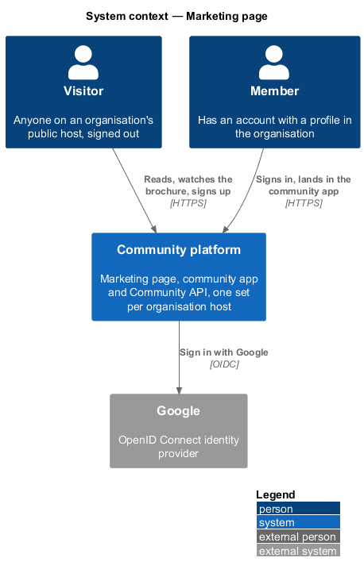
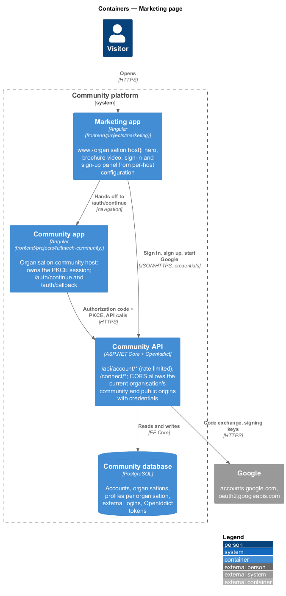
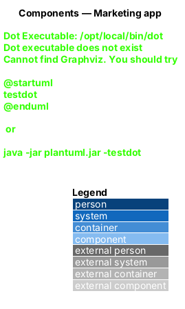
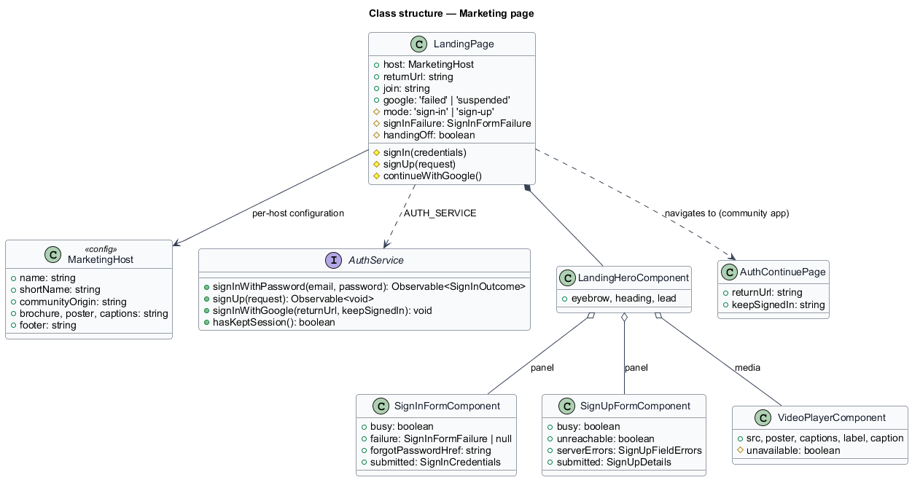
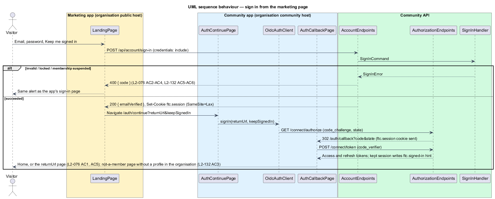
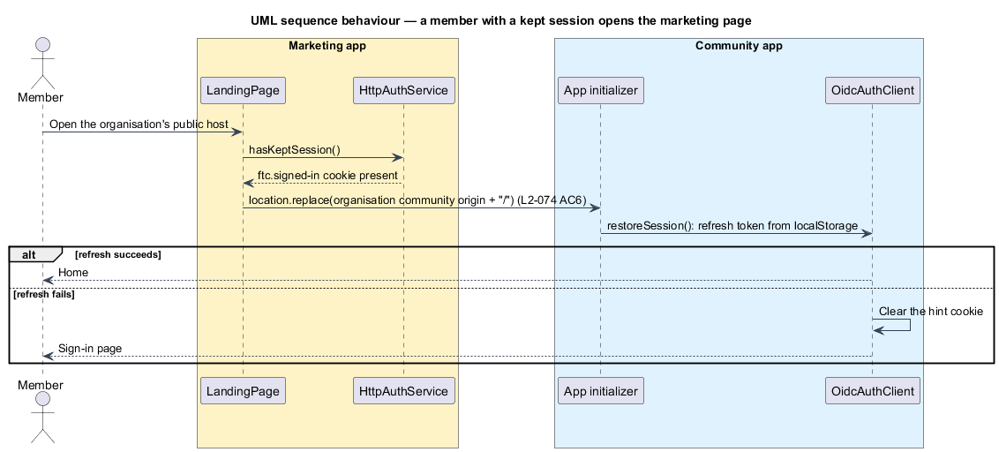

# Landing page

## Overview

The marketing page is an organisation's public front door: one build, served on each organisation's public host with that organisation's name, short name, brochure and footer from configuration keyed by host (`L2-134` AC3, ADR 0018 refined by ADR 0032). A visitor learns what the community is from a split hero and a brochure video of 30 seconds or less, then signs in, signs up or continues with Google without leaving the page, and lands in that organisation's community app with a real authorization code + PKCE session.

**Marketing app** — the second Angular application in the workspace, `frontend/projects/marketing/`, served on its own host (ADR 0018)

**Community app** — the existing application, `frontend/projects/faithtech-community/`, on the organisation's community host (`L2-131`) behind the same proxy as the API and the identity server

**Hand-off** — the step where the marketing page, after the API has accepted the credentials and set the short-lived `ftc.session` cookie, sends the browser to `/auth/continue` on the community host of the organisation whose public host served the page, which starts PKCE

**Session hint** — the non-secret `ftc.signed-in=1` cookie the community app writes for the shared parent domain while it keeps a "Keep me signed in" session; it only decides a redirect

Composition follows a split product hero (headline and video beside the sign-in form at desktop, stacked on phones, short benefit sections, one call to action, one footer). Every colour, type and spacing value comes from `docs/design-system/tokens/`.

## Description

### Hosting shape

- The marketing app is one static Angular build served on each organisation's public host, `www.{organisation host}`. The host's entry in the `Marketing:Hosts` configuration supplies the organisation's name, short name, brochure file names, footer text and community origin; a public host with no entry shows the unknown-host page (`L2-134` AC3, `L2-131` AC2). FaithTech's entry is the configured example: `www.faithtech.community`. The app's own dev server runs on port 4300 (`npm run start:marketing`); Playwright starts it next to the community app.
- The community origin is the `COMMUNITY_ORIGIN` injection token in `app.config.ts`: `http://localhost:4200` in development and, in production, the community origin of the host's configuration entry, read at start-up from the per-host configuration the marketing host serves (`/marketing-host.json`), in place of the former build-time `fileReplacements`. `provideApi(`${COMMUNITY_ORIGIN}/api`)` points `AUTH_SERVICE` at the API on that organisation's community host.
- The API allows the current organisation's public origin in its CORS policy, with credentials, and refuses every other origin, another organisation's public origin included (`L2-131` AC6, `L2-079` AC3), so the marketing page's `POST /api/account/sign-in` can set `ftc.session` on that organisation's API host. `www.{organisation host}` and the community host are the same site, so the `SameSite=Lax` cookie is sent on the community app's `/connect/authorize` navigation.
- No second OpenIddict client: PKCE starts and ends on the organisation's community origin with the one `web` client, whose redirect URIs are every organisation's community host (ADR 0018 refined by ADR 0032), so the tokens live in the community app's storage. The seeder is unchanged.
- The marketing host serves a Content-Security-Policy of `default-src 'self'; connect-src 'self' <community origin>; img-src 'self' data:; media-src 'self'; style-src 'self' 'unsafe-inline'; frame-ancestors 'none'; base-uri 'none'` (L2-079 AC5). DNS, certificates and the host are deferred.

### Marketing app

- **`MarketingAppComponent`** — the shell: `SkipLinkComponent`, `TopBarComponent` `anonymous` with *Join now* and *Sign in*, the router outlet and `SiteFooterComponent`. Routes: `''` → `LandingPage`; `'**'` → redirect to `''`.
- **`LandingPage`** — reads the host's configuration entry (`MarketingHost`: name, short name, brochure, footer, community origin) and composes `LandingHeroComponent` ("{organisation name} headline", `L2-074` AC1) with the panel (`CardComponent` holding `SignInFormComponent` or `SignUpFormComponent`, the Google button in `ftAuthAlternatives`) and the media (`VideoPlayerComponent`), three `BenefitComponent`s and the `CtaBandComponent`. Query parameters drive its state: `join` shows the sign-up form, `google=failed|suspended` shows the Google outcome, `returnUrl` is carried into the hand-off. On init it calls `AUTH_SERVICE.hasKeptSession()` and replaces the location with that organisation's community app home when it is true (L2-074 AC6).
- **Sign in** — the page posts through `AUTH_SERVICE.signInWithPassword`, shows the same failures as the app's sign-in page through `SignInFormComponent`, and on success shows "Signing you in…" (with the unverified notice when `emailVerified` is false) and navigates to `${COMMUNITY_ORIGIN}/auth/continue?returnUrl=…&keepSignedIn=1|0`; an account with no profile in the organisation reaches the community app's not-a-member page (`L2-076` AC1, `L2-132` AC3). An unreachable API shows "We couldn’t reach {organisation short name}" (`L2-134` AC1). Only app-relative `returnUrl`s (`/…`, not `//…`) are carried.
- **Sign up** — `AUTH_SERVICE.signUp`, which creates the account and a profile in the host organisation holding no role (`L2-077` AC1, `L2-132` AC1), `signUpFieldErrors` from `api` for server validation, "Check your inbox" with a link to `${COMMUNITY_ORIGIN}/verify-email?email=…` to send it again.
- **Google** — `AUTH_SERVICE.signInWithGoogle(returnUrl, keepSignedIn)` navigates to `${api}/account/google/start` on the organisation's community host, where a new account gets its profile in that organisation (`L2-078` AC1, `L2-132` AC1); the button shows busy until the browser leaves (`docs/detailed-designs/identity/google-sign-in`).
- **No inline-form exception elsewhere** — the in-page forms are the page's purpose, as the mock shows; the page opens no other editing UI.

### Community app

- **`AuthContinuePage`** (`/auth/continue`) — calls `AUTH_SERVICE.signIn(returnUrl, keepSignedIn === '1')`, showing "Signing you in…". An unsafe `returnUrl` becomes `/`.
- **`OidcAuthClient`** — writes the session hint when it stores a kept refresh token, removes it when it stores a session-only token, signs out, or fails to restore a session. `AuthConfig.sessionHintDomain` sets the cookie's `Domain`: the organisation's parent domain, derived from the current host at run time in place of the former build-time `session-hint-domain.production.ts`, so one build serves every organisation host; unset (host-only) on `localhost`, where cookies are shared across ports.
- **`SignInPage`, `SignUpPage`** — now compose `SignInFormComponent` and `SignUpFormComponent`; behaviour and copy are unchanged.

### Brochure video

- Source in `eng/videos/brochure/`: `script.md` (the narration, 21 seconds), `deck.html` (a timed slide deck using the design-system tokens and mock photos) and `build.mjs` (Kokoro-82M `af_heart` narration and WebVTT captions, Playwright frame capture, ffmpeg mux) (ADR 0020). `node eng/videos/brochure/build.mjs` fails when the result is longer than 30 seconds.
- Shipped assets: `frontend/projects/marketing/public/brochure/brochure.webm`, `brochure-poster.jpg` and `brochure.en.vtt` for the configured example host; another organisation's brochure, poster and captions are the files its configuration entry names (`L2-075` AC2). The captions are the script; the page shows no transcript.
- `VideoPlayerComponent` renders `<video controls preload="none" poster>` with a default English captions track and no `autoplay`; on the media `error` event it swaps to the poster image with a warning alert.

### Security and privacy

- Every request goes to the organisation's public origin, its community origin or, during Google sign-in, Google; there is no analytics, tracker or third-party frame (L2-079 AC4). The e2e suite fails any request it does not recognise.
- The account endpoints keep the auth rate limit (20 a minute per IP) and are anonymous by explicit opt-in; all rules run on the server.

## Requirements

The feature realizes the following level-2 (L2) requirements. Each L2 requirement refines a level-1 (L1) requirement, cited by identifier.

| L2 ID | Refines (L1) | Requirement |
|-------|--------------|-------------|
| `L2-074` | `L1-021`, `L1-016` | Marketing page |
| `L2-075` | `L1-021`, `L1-016` | Brochure video |
| `L2-076` | `L1-001`, `L1-021` | Sign in from the marketing page |
| `L2-077` | `L1-001`, `L1-021` | Sign up from the marketing page |
| `L2-079` | `L1-015`, `L1-021` | Marketing page security and privacy |
| `L2-132` | `L1-025`, `L1-001`, `L1-002` | Accounts and memberships |
| `L2-134` | `L1-025` | Organisation name in copy and email |

Google sign-in (`L2-078`) is designed in [`identity/google-sign-in`](../../identity/google-sign-in/README.md). The rules reused from `L2-001`, `L2-002`, `L2-003`, `L2-004`, `L2-039`, `L2-043`, `L2-044`, `L2-045` and `L2-131` are cross-referenced, not repeated.

### Acceptance criteria

**`L2-074` — Marketing page**

1. Given an anonymous visitor, when they open an organisation's public host, then they see the "{organisation name} headline", the organisation's brochure video, the sign-in form with "Sign in with Google", "Join now", three benefit sections and a footer naming the organisation, all from the configuration entry for that host (`L2-134` AC3), and the page fetches no member data.
2. Given an XS viewport, when the page renders, then the headline, the sign-in panel and the video stack in that order; given an LG or wider viewport, then the headline and video sit beside the sign-in panel; at every width there is no horizontal scroll (`L2-045` AC1).
3. Given the operating system prefers a dark theme, when the page loads, then the dark theme is used, and text and controls meet the contrast of `L2-044` AC4 in both themes.
4. Given axe runs on the marketing page in any of its states, when it finishes, then it reports no WCAG 2.2 A or AA violations, and every control is reachable by keyboard with a visible focus (`L2-044` AC1, AC2).
5. Given a visitor presses "Join now" in the top bar, in the panel or in the call-to-action, when the page responds, then the panel shows the sign-up form without leaving the page, and "Sign in" switches it back.
6. Given a member whose session on that organisation's community host is kept on this device ("Keep me signed in"), when they open the organisation's public host, then they are taken to that organisation's community app home without seeing the page.

**`L2-075` — Brochure video**

1. Given a brochure video, when it is built, then it is 30 seconds or less, and the build fails if it is longer.
2. Given the marketing page on an organisation's public host, when it renders, then the video is the one named by that host's configuration entry (`L2-134` AC3) and shows a poster, the browser's visible controls and English captions turned on, and it never starts playing on its own, with or without sound.
3. Given the operating system prefers reduced motion, when the page renders, then nothing on the page moves until the visitor acts, and the video still waits for Play.
4. Given the video file cannot play, when the player reports the error, then the poster stays with a "This video can't play right now" message.
5. Given the marketing page, when it renders, then the video offers no transcript; its English captions carry the narration.

**`L2-076` — Sign in from the marketing page**

1. Given a verified account with a profile in the organisation and correct credentials, when the visitor signs in on the marketing page, then that organisation's community app completes the authorization code + PKCE flow and the member lands on its home, or on the app page named by `returnUrl` (`L2-003` AC1); an account with no profile in the organisation reaches the not-a-member page (`L2-132` AC3).
2. Given incorrect credentials, when the visitor signs in, then the page shows the generic "Email or password is wrong" error and keeps the details (`L2-003` AC2).
3. Given an account locked after 5 failed attempts, when the visitor signs in, then the page shows "Too many attempts" with a reset-password link (`L2-003` AC3).
4. Given a profile suspended in the organisation, or an account locked by a platform operator, and the correct password, when the visitor signs in, then the page shows the message of `L2-132` AC5 or AC6 (`L2-003` AC4, `L2-039`).
5. Given an unverified account and correct credentials, when the visitor signs in, then they land in the community app, which shows the verify-email banner (`L2-002` AC3).
6. Given "Keep me signed in on this device" is not ticked, when the browser session ends, then the refresh token is discarded (`L2-003` AC8); when it is ticked, the session survives the browser session.
7. Given empty fields, when the visitor submits, then each field shows an inline error and focus moves to the first; given the API cannot be reached, then the page says "We couldn’t reach {organisation short name}" (`L2-134` AC1) and keeps the details.

**`L2-077` — Sign up from the marketing page**

1. Given an unused email and a valid password, when the visitor joins on an organisation's public host, then the account is created with a profile in that organisation holding no role (`L2-132` AC1), a verification email from the organisation (`L2-134` AC5) is sent, and the panel says "Check your inbox" with the email address and a link to send it again (`L2-001` AC1, `L2-002`).
2. Given an email already registered, when the visitor joins, then the panel shows the same "Check your inbox" outcome (`L2-001` AC2), and on verification the existing account gains a profile in the organisation if it has none (`L2-132` AC1).
3. Given a short, breached, empty, malformed or too-long field, when the visitor joins, then the same inline errors and error summary as the app's sign-up page are shown, focus moves to the first invalid field, and no account is created (`L2-001` AC3, AC4, AC6).
4. Given the form is submitting, when the request is in flight, then the submit button is disabled and busy (`L2-001` AC5).

**`L2-079` — Marketing page security and privacy**

1. Given more than 20 requests a minute from one IP address to the account endpoints, including the Google start and callback, when another arrives, then the response is 429 (`L2-043` AC5).
2. Given an email, when sign-in fails through the password path or the Google path, then neither response reveals more about the account than the other: suspension is only reported after the person has proven who they are (correct password or verified Google account), and a response never reveals whether the account holds a profile in another organisation.
3. Given the API on an organisation's community host, when a request arrives from that organisation's public origin, then CORS allows it with credentials; a request from any other origin, including another organisation's public origin, is still refused (`L2-131` AC6, `L2-043` AC4).
4. Given the marketing page, when it loads, then every request goes to the organisation's public origin, the organisation's community origin (API and identity server) or, during Google sign-in, Google; the video is self-hosted, the page embeds no third-party frame, and it loads no analytics or tracker.
5. Given the marketing page is served, when it is hosted, then it carries a Content-Security-Policy that allows media only from its own origin and `frame-ancestors 'none'` (`L2-043` AC3; hosting is deferred, the policy is in the design).

**`L2-132` — Accounts and memberships**

1. Given a visitor signs up on an organisation's host (`L2-001`, `L2-078`, `L2-083`), when the account is created, then a profile is created in that organisation, and when the email already has an account, then on verification the existing account gains a profile in that organisation if it has none, with the same `202` outcome either way.
2. Given an invite (`L2-011`) or a connect link (`L2-083`), when it is accepted, then the profile is created in the inviter's or link owner's organisation, whatever host the acceptor started on.
3. Given a verified account with no profile in the current organisation, when it signs in on that host, then the not-a-member page is shown ("You're not a member of {organisation name}") with a sign-out link and, when the account has other memberships, links to their hosts; every API call answers 403 and `/api/me` answers 403 with `reason: not-a-member`.
4. Given an account with profiles in several organisations, when it is used on one host, then only that organisation's profile, roles, capabilities, photos, contacts, notifications and data are visible or counted (`L2-130`).
5. Given a profile is suspended (`L2-039`), when the account signs in on that organisation's host, then sign-in is refused with "Your membership of {organisation name} is suspended"; on another host where it holds an active profile, sign-in succeeds.
6. Given an account locked by a platform operator (`L2-148`), when it signs in on any host, then sign-in is refused with the suspended-account message of `L2-003` AC4.
7. Given a password reset, email verification or Google sign-in (`L2-002`, `L2-004`, `L2-078`), when it completes, then it applies to the account everywhere; it creates no membership.

**`L2-134` — Organisation name in copy and email**

1. Given any page, dialog, toast, empty state, error message, email subject or email body that names the product, when it renders, then it uses the organisation's name or short name from `/api/me` or the organisation record, never a fixed name ("We couldn't reach {short name}", "Join {name}", "{name} headline", "Hosted by {name}" on public event pages).
2. Given the HTML document title, when any route renders, then it is "{page} · {organisation short name}".
3. Given the public marketing page (`L2-074`), when it is served on an organisation's public host, then its headline, name, brochure video and footer come from the configuration entry for that host; a public host with no entry shows the unknown-host page.
4. Given the `.ics` download (`L2-024`), when it is generated, then `PRODID` and the organiser name carry the organisation's name.
5. Given the invite, announcement, notification and verification emails, when they are rendered, then "{organisation name}" replaces every product name and the links point at the organisation's community host.

## Diagrams

### System context

Visitors and members reach an organisation's community through its marketing page; Google is the only external system.

### Containers

The marketing app talks to the API on the organisation's community host and hands the browser to that community app, which owns the PKCE session.

### Components

`LandingPage` composes shared components and depends only on `AUTH_SERVICE` and the host's configuration entry.

### Class structure

The page's inputs come from the URL; the forms are presentation only.

### Behaviour — sign in from the marketing page

The API sets the short-lived session cookie; the community app completes PKCE (`L2-076`).

### Behaviour — a member with a kept session

The session hint sends the member straight to the community app, which still validates the session (`L2-074` AC6).

## Open questions

1. A session that is not kept lives in one tab's session storage, so the marketing page cannot see it and shows the page; the visitor signs in again (consistent with `L2-003` AC8).
2. Hosting, DNS, certificates and the CSP header are deferred; the policy above is the requirement for whoever hosts it.
3. The Google button on the community app's own sign-in page, other providers, testimonials, pricing, analytics, cookie banners and further marketing pages are deferred.
4. Organisations: one build is served per public host; name, short name, brochure, footer, community origin and the hand-off target come from configuration keyed by host, and per-organisation content beyond those is deferred (ADR 0032 refining ADR 0018).
