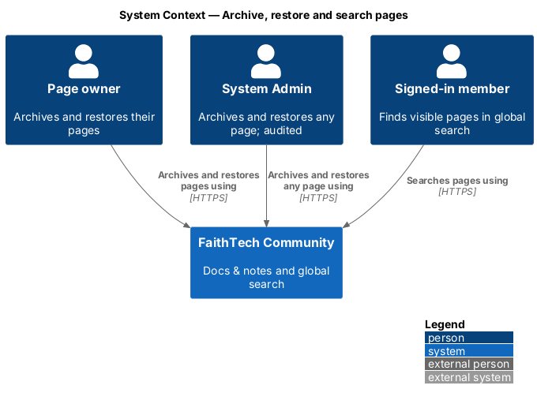
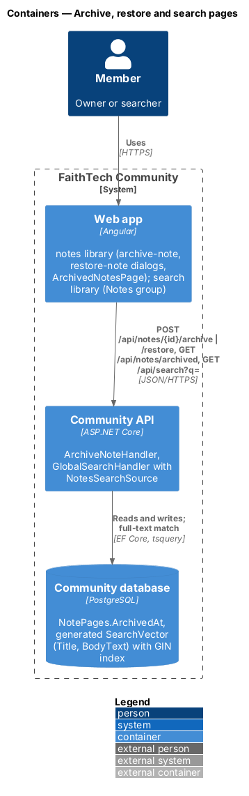
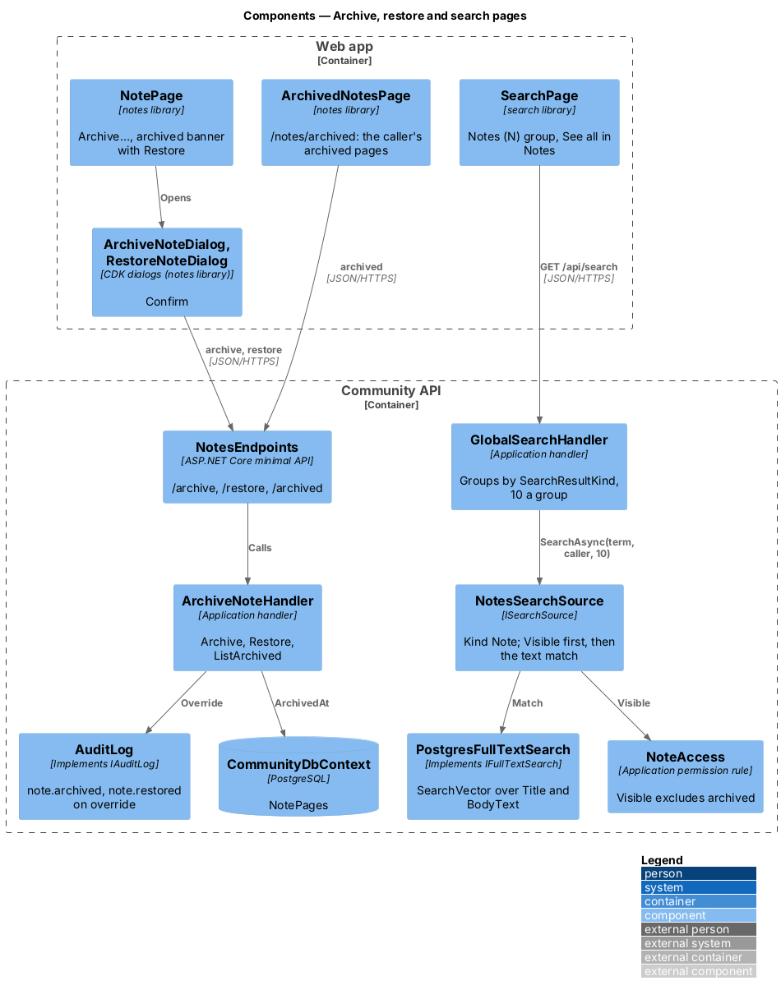
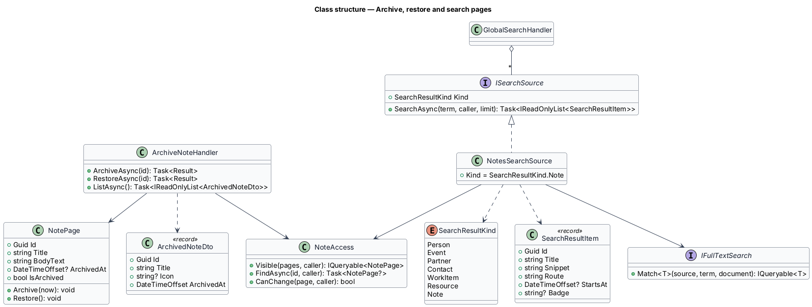

# Archive, restore and search pages

## Overview

Docs & notes (`L1-022`) never deletes a page in v1. **Archiving** is a soft delete: the page leaves every list, search result, backlink and suggestion for everyone except its owner and System Admin, and can be restored from **Archived pages**. Unlike resources, archived pages are not purged. Pages are also found through **global search**, which gains a **Notes** group matching titles and body text, with visibility applied inside the query.

Key terms:

- **archived page** — page with `ArchivedAt` set; read-only, openable only by its owner and System Admin
- **restore** — clearing `ArchivedAt`, which returns the page to every place its visibility allows
- **Notes group** — result group of global search built by `NotesSearchSource`, at most 10 pages, best match first
- **body text** — plain text of a page (`BodyText`), derived on save from the title, block text, image alt text and link-card captions ([ADR 0023](../../../adr/0023-notes-block-storage-ordering-and-concurrency.md))

Search follows the design of `search/global-search` and ADR 0016; archive follows the access rule of [ADR 0025](../../../adr/0025-notes-access-links-and-staff.md).

## Description

### Web app

- **Archive** — *Archive* in the page menu opens `ArchiveNoteDialog` (mock `dialogs/archive-note`): "Archive “{title}”?", "It leaves Notes, search and every page that links to it. You can restore it from Archived pages. Pages inside it stay where they are." with *Archive page* and *Cancel*. On success the app navigates to `/notes` and shows a toast "Archived {title}" with *Undo*, which restores it.
- **`ArchivedNotesPage`** — page at `/notes/archived` (mock `pages/archived-notes`): "Archived pages" with the caller's archived pages, newest archived first, each with "Archived {date}" and *Restore*, which opens `RestoreNoteDialog` ("Restore “{title}”?" with *Restore page*). Empty state "Nothing archived".
- **Archived page view** — opening an archived page (owner or System Admin) shows the read-only view with the banner "This page is archived. Only you and System Admin can see it." and *Restore*.
- **Search** — `SearchPage` in the `search` library renders the new group "Notes ({N})" through `SearchResultsComponent`, each result as "{title} · {owner} · edited {date}" with a "Private", "Shared" or "Shared with you" badge, and "See all in Notes" linking to `/notes?q={term}`. The group label comes from the existing kind-to-label map in the `search` library, which gains `Note → Notes`.

### Community API

- **`NotePage.Archive(now)`** / **`Restore()`** — set and clear `ArchivedAt`. Archiving does not touch children, links, images or the audience.
- **`ArchiveNoteHandler`** — `ArchiveAsync(id)` and `RestoreAsync(id)`: load through `NoteAccess.FindAsync`; `404` when not found; `403` when the caller may not change the page; archiving an archived page or restoring an active one answers `204` and changes nothing. A System Admin action on someone else's page writes `note.archived` or `note.restored`. `ListAsync()` returns the caller's own archived pages (`ArchivedNoteDto`: id, title, icon, archivedAt).
- **Effect of archive on reads** — `NoteAccess.Visible` excludes archived pages, so the list, global search, suggestions, parent options, children and backlinks drop them for everyone. A page link to an archived page reads "Private page" for anyone who cannot open it (`notes/links-and-backlinks`). A child of an archived page keeps its `ParentId`; its breadcrumb shows the archived parent as "Private page" to readers who cannot open it.
- **`NotesSearchSource`** — `ISearchSource` with the new `SearchResultKind.Note`, appended after `Resource`, so `GlobalSearchHandler` returns the group named "Note" last. It starts from `NoteAccess.Visible(db.NotePages.AsNoTracking(), caller)`, calls `IFullTextSearch.Match(visible, term, p => p.Title + " " + p.BodyText)`, takes `limit` (10) best first, and builds `SearchResultItem(id, title or "Untitled", "{owner} · edited {date} · {excerpt}", "/notes/{id}", Badge: "Private" | "Shared" | "Shared with you" | null)`. The excerpt is the first 120 characters of `BodyText` around the first matching word. It is registered beside the other sources in DI.
- **`SearchVectors`** — `Add<NotePage>(builder, "Title", "BodyText")` adds the generated, GIN-indexed `SearchVector`. Because the column is generated, a save, archive or restore is reflected at once with no reindex. The backend tests use the in-memory `IFullTextSearch`, which matches the same document.

### API contract

| Method and path | Request | Responses |
|-----------------|---------|-----------|
| `POST /api/notes/{id}/archive` | — | `204`, `401`, `403`, `404` |
| `POST /api/notes/{id}/restore` | — | `204`, `401`, `403`, `404` |
| `GET /api/notes/archived` | — | `200 [ArchivedNoteDto]`, `401` |
| `GET /api/search?q=` | — | `200 SearchResultsDto` with a `Note` group, `400` term under 2 or over 200 characters, `401` |

### End-to-end tests

`mock-notes.ts` answers archive, restore and the archived list, and contributes Note results to the search fake in the same shape as `NotesSearchSource`. `e2e/pages/archived-notes.page.ts` and `note.dialogs.ts` own the selectors. Specs cover archive with *Undo*, the archived list and restore, an archived page missing for another member (404 page), and the Notes group with its visibility filter.

### Accessibility

The archive and restore dialogs are `ft-dialog` confirmations with focus on the safe action. The toast's *Undo* is reachable by keyboard while the toast shows, and the toast is announced politely.

### Security

Search applies visibility before the text match in one SQL statement, so a hidden page is never ranked, counted or returned. Archive is reversible and leaves the audit trail intact.

## Requirements

The feature realizes the following level-2 (L2) requirements. Each L2 requirement refines a level-1 (L1) requirement, cited by identifier. The acceptance criteria are in `docs/specs/L2.md`.

| L2 ID | Refines (L1) | Requirement |
|-------|--------------|-------------|
| `L2-095` | `L1-022` | Archive and restore pages |
| `L2-096` | `L1-022` | Notes in global search |

`L2-096` extends the result groups of `L2-026` (global search).

## Diagrams

### System context

Owners and System Admin archive and restore pages; every member finds the visible pages through global search.

### Containers

The `notes` library calls the archive endpoints; the `search` library calls global search, which reads the generated search vector on `NotePages`.

### Components

`ArchiveNoteHandler` sets and clears `ArchivedAt`; `NotesSearchSource` plugs into `GlobalSearchHandler` and filters through `NoteAccess.Visible` before `IFullTextSearch`.

### Class structure

`NotesSearchSource` realizes `ISearchSource` with the new `SearchResultKind.Note`.

### Behaviour — archive and restore

Archiving answers `204` and leaves children untouched; the archived list shows only the caller's pages; restore returns the page everywhere.

### Behaviour — Notes in global search

The source filters by visibility, then matches title and body text, and returns at most 10 results.

## Open questions

- Archived pages are kept indefinitely; a purge like ADR 0017's is deferred. Resolved.
- A System Admin finds other members' archived pages by opening them directly; `/notes/archived` lists only the caller's own. An admin view of every archived page is deferred. Resolved here.
- The search excerpt length (120 characters) is chosen here to match the other groups' single-line snippets. Resolved here.
