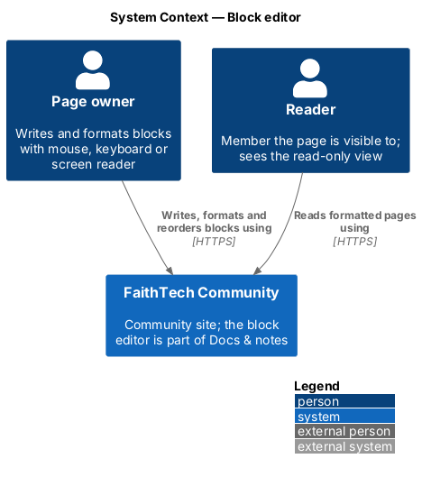
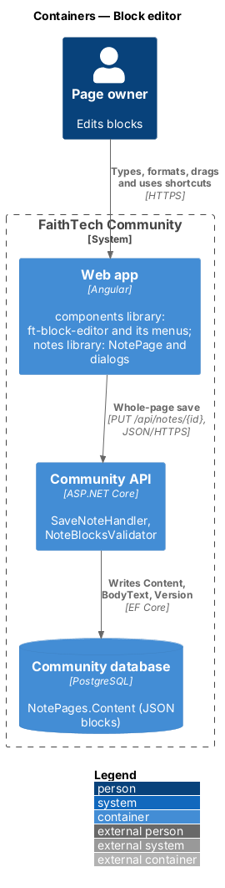
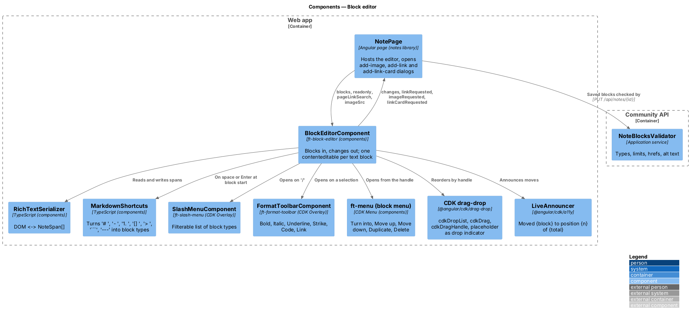
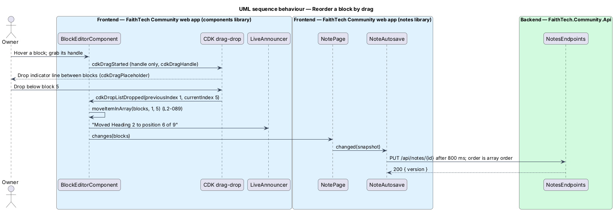
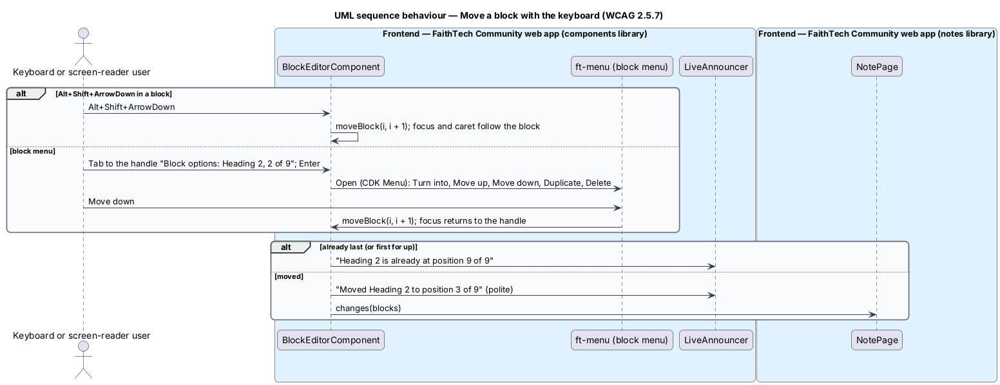

# Block editor

## Overview

The **block editor** is the editing surface of a Docs & notes page (`L1-022`). A page's content is an ordered list of blocks; the owner types into them, formats text, changes a block's type, inserts new blocks and reorders them by drag or by keyboard. Readers see the same blocks in a read-only view.

Key terms:

- **block** — one unit of page content with a stable client-generated `id` and a `type`
- **text block** — block that holds rich text: `paragraph`, `heading1`, `heading2`, `heading3`, `bulleted`, `numbered`, `todo` (with `checked`), `quote`, `callout` (with an emoji `icon`, default 💡) and `code` (plain text, monospace, no highlighting)
- **other block** — `divider`; `image` (`imageId`, required `alt`, optional `caption`, `notes/images`); `link` (link card: an `https://` `url` and an optional `caption`)
- **span** — run of text in a text block with optional marks `bold`, `italic`, `underline`, `strike`, `code`, an `href` (`https://` or `mailto:`) or a `pageId` (page link, `notes/links-and-backlinks`)
- **markdown shortcut** — characters typed at the start of a block that turn it into another type: `# `, `## `, `### `, `- ` or `* `, `1. `, `[] `, `> `, ` ``` `, `---`
- **slash menu** — filterable menu opened by `/` to insert a block or turn the current one into another type
- **block menu** — menu on each block's handle: *Turn into*, *Move up*, *Move down*, *Duplicate*, *Delete*

The editor is built in `components` on `contenteditable` and the Angular CDK, with no third-party editor ([ADR 0024](../../../adr/0024-notes-editor-on-contenteditable-with-cdk.md)). The block JSON shape, limits and whole-page saves are recorded in [ADR 0023](../../../adr/0023-notes-block-storage-ordering-and-concurrency.md). Saving is described in `notes/pages-and-list`.

## Description

### Components library

- **`BlockEditorComponent`** — `ft-block-editor`. Inputs: `blocks` (`NoteBlock[]`), `readonly` (boolean), `pageLinkSearch` (`(q: string) => Observable<PageLinkOption[]>`) and `imageSrc` (`(imageId: string) => Observable<string | null>`). Outputs: `changes` (the full ordered block list after each edit), `linkRequested` (current `href`, from Ctrl+K or the toolbar), `imageRequested` and `linkCardRequested` (the insertion index, from the slash menu). Methods the host calls after a dialog closes: `insertBlock(at, block)`, `applyLink(href | null)`. The functions passed as inputs keep the component free of HTTP calls and of the `api` library. In edit mode each text block renders one `contenteditable="true"` element (`role="textbox"`, `aria-multiline="true"`, labelled by its block type, for example "Heading 2"); a to-do adds a native checkbox; a callout adds an icon button; image and link blocks render a figure or a card with an *Edit* button. Enter at the end of a block creates a Text block below (a list item continues the list; Enter in an empty list item turns it into Text). Backspace at the start of an empty block deletes it and moves the caret to the end of the previous one. Up and Down at the first or last line move between blocks. In `readonly` mode the component renders semantic HTML: `heading1`–`heading3` as `h2`–`h4` (the page title is the `h1`), consecutive `bulleted` and `numbered` blocks as one `ul` or `ol`, `quote` as `blockquote`, `code` as `pre > code`, `divider` as `hr`, an image as `figure` with `img alt` and `figcaption`, a link card as an `a` opening in a new tab with `rel="noopener noreferrer"`, and disabled checkboxes for to-dos.
- **`RichTextSerializer`** — TypeScript in `components/src/lib/block-editor`. `toSpans(element)` walks the block's DOM and produces spans, merging adjacent runs with equal marks; `render(spans, element)` writes text nodes wrapped in `strong`, `em`, `u`, `s`, `code` and `a` elements, never `innerHTML`; `toggleMark(range, mark)` applies or removes a mark across the selection and restores the selection. `document.execCommand` is not used. Paste is intercepted: plain text is inserted, line breaks split into new Text blocks, and HTML on the clipboard is ignored.
- **`MarkdownShortcuts`** — maps a typed prefix to a block type when the following space (or the third backtick, or the third hyphen) is typed at offset 0 of a Text block.
- **`SlashMenuComponent`** — `ft-slash-menu`, opened in a CDK Overlay at the caret when `/` is typed at the start of a block or after a space. It lists the eleven block types with an icon and description, filtered by the text typed after `/` ("No matching blocks" when empty). Arrow keys move the active option (`aria-activedescendant` on the block's textbox), Enter picks, Escape closes and leaves the typed text. Picking *Image* or *Link card* emits `imageRequested` or `linkCardRequested`.
- **`FormatToolbarComponent`** — `ft-format-toolbar` (`role="toolbar"`, "Formatting"), shown in a CDK Overlay above a non-empty selection in a text block (not in `code` blocks): *Bold* (Ctrl+B), *Italic* (Ctrl+I), *Underline* (Ctrl+U), *Strikethrough* (Ctrl+Shift+S), *Inline code* (Ctrl+E), *Link* (Ctrl+K). Buttons are toggle buttons with `aria-pressed` and roving tabindex. Alt+F10 moves focus into the toolbar; Escape returns it to the selection. On macOS Cmd replaces Ctrl.
- **Block handle and block menu** — each block has a handle button ("Block options: {type}, {n} of {total}", `aria-haspopup="menu"`) that is both the `cdkDragHandle` and the trigger of the block menu (`ft-menu` on CDK Menu). *Turn into* opens a submenu of the text types; *Duplicate* copies the block with a new id; *Delete* removes it and focuses the previous block.
- **Reorder by drag** — the block list is a `cdkDropList`; each block is a `cdkDrag` that starts only from its handle. The `cdkDragPlaceholder` is a 2 px line in `--color-focus-ring` that shows where the block will land. `cdkDropListDropped` calls `moveItemInArray` and emits `changes`. Drag preview motion follows `prefers-reduced-motion`.
- **Reorder by keyboard** — Alt+Shift+↑ and Alt+Shift+↓ move the focused block one position, keeping focus and caret in it; *Move up* and *Move down* in the block menu do the same and return focus to the handle. `LiveAnnouncer` (CDK a11y) announces "Moved {block} to position {n} of {total}" politely, where `{block}` is the type and the first words of the text, or "{block} is already at position {n} of {total}" at either end (`L2-089`, WCAG 2.5.7).
- **Design tokens** — the editor reads block typography, callout background, code font and drop indicator colour by role from the design system (`docs/design-system/components/block-editor.html`, `<TO SUPPLY>` until the design-system page for the editor exists); features do not override its styles.

### Notes library

- **`NotePage`** hosts `ft-block-editor`, supplies `pageLinkSearch` (calls `NOTES_SERVICE.linkSuggestions`) and `imageSrc` (`notes/images`), forwards `changes` to `NoteAutosave`, and opens the feature dialogs: `AddLinkDialog` ("Add a link": URL field, *Remove link* when editing an existing one; accepts `https://` and `mailto:` only), `AddLinkCardDialog` (URL and optional caption) and `AddImageDialog` (`notes/images`). Every dialog is a CDK Dialog through `DialogService` and `ft-dialog`; the editor keeps its saved selection and restores it when a dialog closes.

### Community API

- **`NoteBlock`** / **`NoteSpan`** — C# records in `Domain/Notes/`, serialised by `NoteJson` with `System.Text.Json`, camelCase names and null values omitted, so the stored JSON matches the TypeScript interfaces in `api`.
- **`NoteBlocksValidator`** — Application service run by `SaveNoteHandler`. It refuses with `400` and a field error: more than 500 blocks; an unknown `type`; a missing, duplicate or longer than 36-character block `id`; more than 10,000 characters of text in one block; a span `href` that is not an absolute `https://` or `mailto:` URI; a span with both `href` and `pageId`; marks on a `code` block's spans; spans on a `divider`, `image` or `link` block; a `link` block `url` that is not `https://` or is over 2,000 characters; a caption over 200 characters; a callout `icon` over 16 characters; an image block with empty `alt`, `alt` over 250 characters, or an `imageId` that is not one of the page's `NoteImage`s. `Normalise` drops fields that do not belong to the type, merges adjacent spans with equal marks and clears the text of page-link spans (`notes/links-and-backlinks`). `BodyText(title, blocks)` joins the title and every block's text, image alt text and link-card captions with line breaks, truncated to 100,000 characters.

### Wire shape

```json
{ "id": "b7", "type": "todo", "checked": false,
  "spans": [ { "text": "Book the venue for " }, { "text": "Builders Night", "bold": true },
             { "text": "", "pageId": "3f2c…" } ] }
```

### End-to-end tests

`e2e/pages/note.page.ts` exposes intent-level actions (`typeInBlock`, `applyShortcut`, `openSlashMenu`, `formatSelection`, `dragBlock`, `moveBlockWithKeyboard`) and `e2e/pages/note.dialogs.ts` the link and link-card dialogs. Specs in `e2e/tests/notes/` cover each block type, every markdown shortcut, the slash menu, each format and its shortcut, drag reorder, keyboard reorder with its announcement, the read-only view and axe checks. Unit specs sit next to `RichTextSerializer` and `MarkdownShortcuts`.

### Accessibility

Every action has a keyboard path: shortcuts and the slash menu for block types, the toolbar and shortcuts for marks, Alt+Shift+arrows and the block menu for order. Focus is always visible; the handle is reachable by Tab from its block. Each block is labelled by type, and the live region reports moves. Colour is never the only signal of a mark. Touch targets meet 24 × 24 CSS pixels (`L2-099`).

### Security

Content never travels as HTML. The serializer builds DOM from text nodes and a fixed set of elements; `href` values are re-checked in the browser and on the server (`https:` and `mailto:` only), so a `javascript:` URL cannot be stored or rendered. External links open with `rel="noopener noreferrer"`.

## Requirements

The feature realizes the following level-2 (L2) requirements. Each L2 requirement refines a level-1 (L1) requirement, cited by identifier. The acceptance criteria are in `docs/specs/L2.md`.

| L2 ID | Refines (L1) | Requirement |
|-------|--------------|-------------|
| `L2-087` | `L1-022` | Block types |
| `L2-088` | `L1-022` | Inline formatting, markdown shortcuts and the slash menu |
| `L2-089` | `L1-022` | Reorder blocks by drag and by keyboard |
| `L2-099` | `L1-022` | Notes accessibility |

## Diagrams

### System context

The owner writes, formats and reorders blocks with a mouse, a keyboard or a screen reader; readers see the formatted page.



### Containers

All editing happens in the web app. The API receives the whole ordered block list on each save and validates it before writing `Content`.



### Components

`BlockEditorComponent` composes the serializer, the shortcuts, the slash menu, the formatting toolbar, the block menu, CDK drag-drop and the live announcer. `NotePage` feeds it and opens the dialogs it asks for.



### Class structure

The C# `NoteBlock` and `NoteSpan` records and the TypeScript interfaces share one wire shape. The editor's inputs and outputs keep it independent of `api`.


### Behaviour — markdown shortcuts, slash menu and formatting

A shortcut changes the block type in place; the slash menu inserts or turns a block, handing image and link card to the page's dialogs; marks toggle on the selection; Ctrl+K opens "Add a link".


### Behaviour — reorder by drag

Dragging starts from the handle only, shows a drop indicator, and saves the new array order through autosave.



### Behaviour — reorder by keyboard

Alt+Shift+arrows and the block menu move a block one position and announce the new position; this is the single-pointer alternative to dragging that WCAG 2.5.7 asks for.



## Open questions

- Undo and redo rely on the browser's native history inside one block; undo across blocks (a moved or deleted block) is deferred. *Delete* in the block menu removes the block at once and autosaves. Resolved here.
- Paste keeps text and line breaks only; pasted formatting and pasted images are dropped. Resolved here.
- Nested list indentation (Tab to indent) is not part of `L2-087`; list items are flat. Resolved.
- The block `id` is generated in the browser (`crypto.randomUUID()`), so drag tracking and Angular's `track` do not depend on the server. Resolved here.
