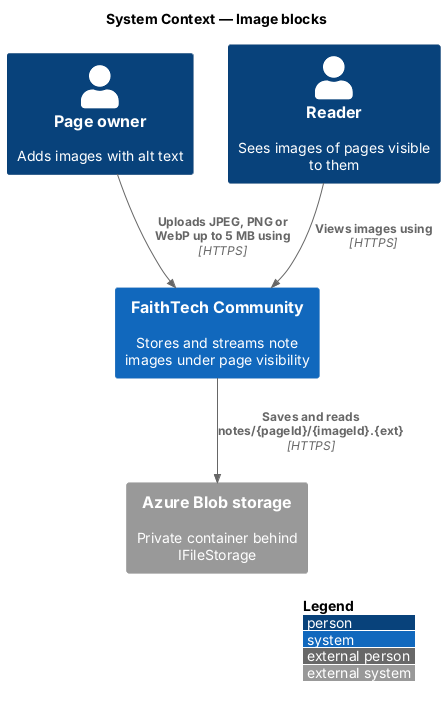
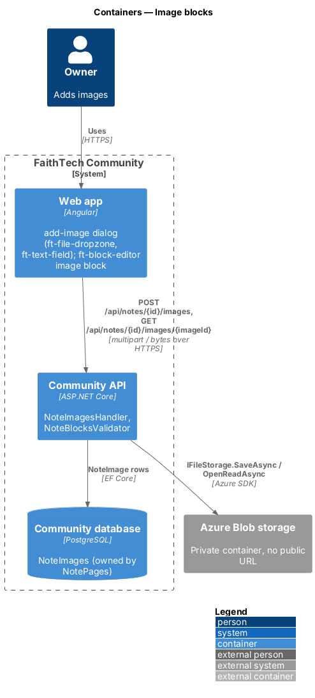
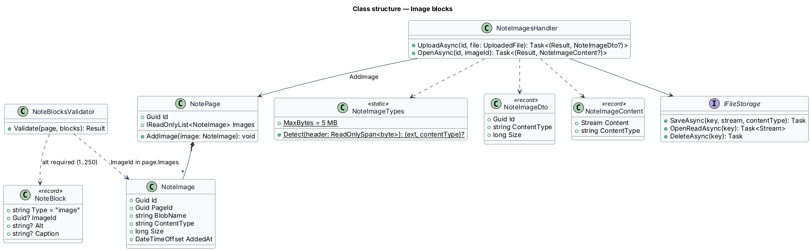
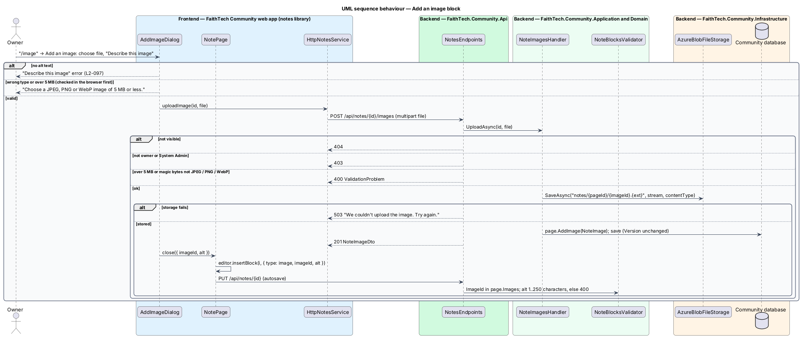

# Image blocks

## Overview

An **image block** shows a picture inside a Docs & notes page (`L1-022`): a screenshot in a how-to, a floor plan in a run sheet. Images follow the photos rule (`L2-007` AC3): every image carries alt text. Image files are stored privately behind the existing `IFileStorage` abstraction of ADR 0017 and are only ever read through the API under the page's visibility.

Key terms:

- **note image** — uploaded file attached to one page (`NoteImage`), referenced by `imageId` from an image block
- **alt text** — description of the image for people who cannot see it, required, 1 to 250 characters, held on the block
- **orphaned image** — note image no block references any more; its clean-up is deferred

## Description

### Web app

- **`AddImageDialog`** — CDK dialog in the `notes` library (mock `dialogs/add-image`) opened from the slash menu's *Image* or an image block's *Edit*. It holds an `ft-file-dropzone` ("Choose an image", JPEG, PNG or WebP, 5 MB or less), a preview, an `ft-text-field` "Describe this image" (required, 250 characters, hint "Say what matters in the picture for someone who can’t see it.") and an `ft-text-field` "Caption (optional)". The browser checks type and size first; *Add image* uploads with a progress state and closes with `{ imageId, alt, caption }`. *Edit* on an existing block reopens the dialog with alt and caption and an optional replacement file.
- **Image block** — `ft-block-editor` renders a `figure` with an `img` whose `src` comes from the `imageSrc` input and whose `alt` is the block's alt text, and the caption as `figcaption`. While loading it shows `ft-skeleton`; on a failed load it shows a placeholder with the alt text.
- **`imageSrc`** — `NotePage` implements it with `NOTES_SERVICE.image(id, imageId)`, which fetches the bytes as a `Blob` with the bearer token; the page creates an object URL, caches it per `imageId` for the page's lifetime and revokes it on destroy.
- **`HttpNotesService`** — `uploadImage(id, file)` posts multipart `file` with upload progress; `image(id, imageId)` uses `responseType: 'blob'`.

### Community API

- **`NoteImage`** — owned entity of `NotePage` in the `NoteImages` table: `Id`, `PageId`, `BlobName` (`notes/{pageId}/{imageId}.{ext}`), `ContentType`, `Size`, `AddedAt`. Adding an image does not change the page's `Version`, so an upload never causes an edit conflict.
- **`NoteImagesHandler`** — `UploadAsync(id, file)`: `404` when the page is not visible; `403` when the caller may not change it or is unverified; `400` "Choose a JPEG, PNG or WebP image of 5 MB or less." when the file is empty, over 5 MB, or its leading bytes are not JPEG (`FF D8 FF`), PNG (`89 50 4E 47 0D 0A 1A 0A`) or WebP (`RIFF` … `WEBP`); `400` when the page is archived. The stored content type comes from the detected bytes, never from the request. It writes the blob with `IFileStorage.SaveAsync`, then adds the `NoteImage` and saves; a storage failure answers `503` "We couldn’t upload the image. Try again." and adds no row. A System Admin upload to someone else's page is audited as `note.edited`. `OpenAsync(id, imageId)` loads the page through `NoteAccess.FindAsync` and the image from that page only, and streams `IFileStorage.OpenReadAsync(blobName)`; anything not found answers `404`.
- **`NotesEndpoints`** — `POST /api/notes/{id}/images` with a request size limit of 5 MB plus 64 KB for the multipart envelope; `GET /api/notes/{id}/images/{imageId}` answers the bytes with the stored `Content-Type`, `X-Content-Type-Options: nosniff` and `Cache-Control: private, max-age=3600`. Image ids are immutable, so a cached copy never goes stale.
- **`NoteBlocksValidator`** (image part) — an image block shall have an `imageId` that is one of the page's `NoteImage`s and a non-empty `alt` of at most 250 characters; a save that breaks either answers `400` (`L2-097`). An image id from another page is refused, so a block cannot show an image the page does not own.
- **Storage** — `AzureBlobFileStorage` writes to the same private container as resources under the `notes/` prefix (ADR 0017); there is no SAS or public URL. Unlike resources, an upload is not retried through a database queue: the member retries the dialog.

### API contract

| Method and path | Request | Responses |
|-----------------|---------|-----------|
| `POST /api/notes/{id}/images` | multipart `file` | `201 NoteImageDto { id, contentType, size }`, `400`, `401`, `403`, `404`, `413` over the request limit, `503` storage unavailable |
| `GET /api/notes/{id}/images/{imageId}` | — | `200` image bytes, `401`, `404` |

### End-to-end tests

`mock-notes.ts` accepts uploads into memory and serves the bytes back under the same visibility rule. Specs in `e2e/tests/notes/` add an image with alt text, refuse an empty description and an oversized or wrong-type file, check the rendered `alt`, and check that a reader without access gets the not-available page. Backend tests fake `IFileStorage` and assert the magic-byte checks and the `400` on a missing alt.

### Accessibility

Alt text is required at the point of upload and enforced on save. The dropzone is a labelled button with the accepted types in its description. Upload progress is an `ft-progress` with a text value.

### Security

Images stream through the API with the page's visibility check. Content type is decided by the file's bytes, and `nosniff` stops the browser from reinterpreting it. SVG is not accepted, so no uploaded image can carry script.

## Requirements

The feature realizes the following level-2 (L2) requirements. Each L2 requirement refines a level-1 (L1) requirement, cited by identifier. The acceptance criteria are in `docs/specs/L2.md`.

| L2 ID | Refines (L1) | Requirement |
|-------|--------------|-------------|
| `L2-097` | `L1-022` | Image blocks and alt text |

## Diagrams

### System context

The owner uploads images; readers view them; files live in private Azure Blob storage and reach the browser only through the API.

### Containers

The web app uploads multipart files and fetches images as blobs; the API stores bytes through `IFileStorage` and rows in `NoteImages`.

### Components

`NoteImagesHandler` checks access, size and bytes and talks to `AzureBlobFileStorage`; `NoteBlocksValidator` ties each image block to an image of its page and requires alt text.

### Class structure

`NotePage` composes its `NoteImage`s; image blocks refer to them by id.

### Behaviour — add an image block

The dialog requires alt text, the server checks size and bytes and stores the file, and the next autosave validates the new block.

### Behaviour — show an image

Each image is fetched with the member's token under the page's visibility and shown from an object URL.

## Open questions

- Orphaned images (removed blocks, abandoned uploads) stay in storage; clean-up is deferred, as the proposal states. Resolved.
- No limit on the number of images per page is set beyond the 500-block limit. `<TO SUPPLY>` if storage use needs a cap.
- Note images share the private resources container under `notes/`; a separate container is not needed while `IFileStorage` has one binding. Resolved here.
- Images are not resized or thumbnailed in v1; the browser scales them to the editor width. Resolved here.
