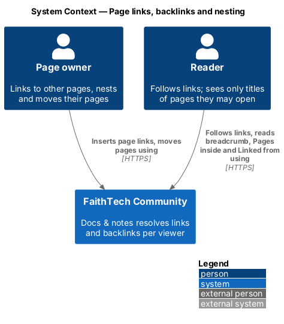
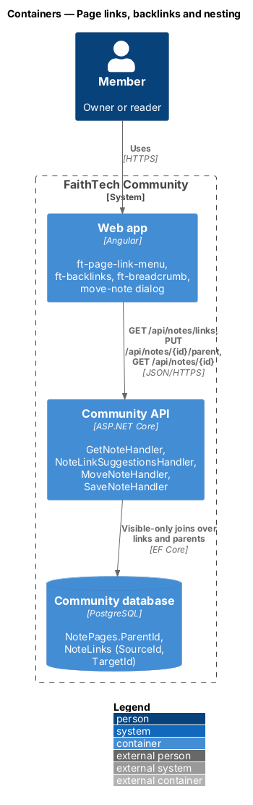
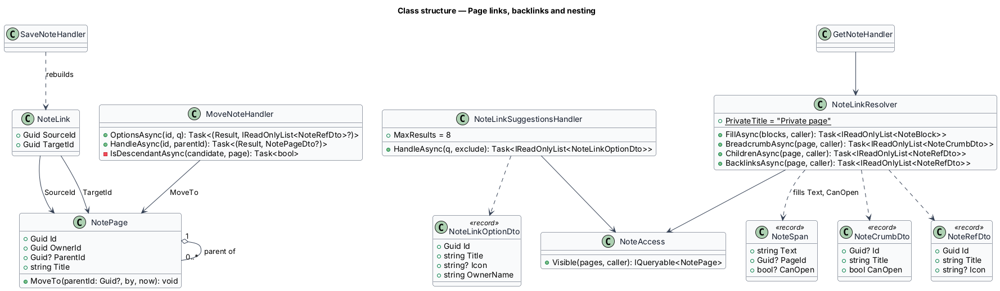
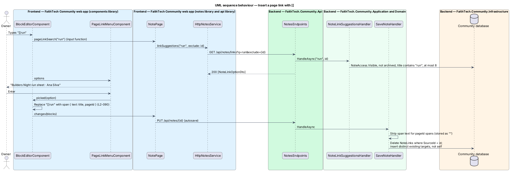
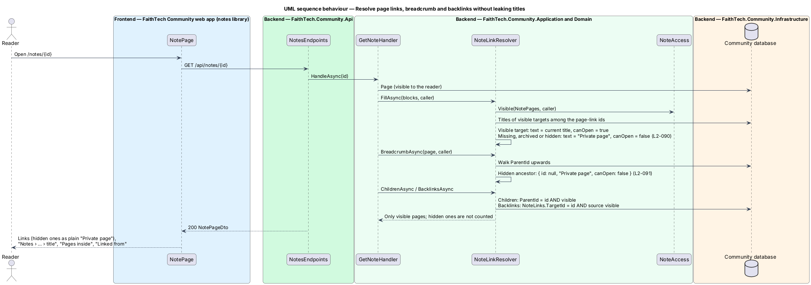
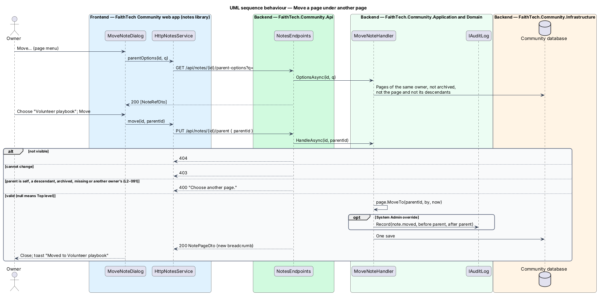

# Page links, backlinks and nesting

## Overview

Pages in Docs & notes (`L1-022`) refer to each other in two ways. A **page link** is a piece of text inside a block that opens another page; a page lists its **backlinks** under "Linked from". A page may also sit **inside** another page, which gives it a breadcrumb and gives the parent a "Pages inside" list. Both relations cross the visibility boundary, so the design resolves them per viewer and never shows the title of a page the viewer may not open.

Key terms:

- **page link** — span with a `pageId`; its text is the target's current title, filled at read time, never stored
- **"Private page"** — text shown in place of a title for a link target or ancestor the viewer may not open, whether it is missing, archived or hidden; the three cases are indistinguishable
- **backlinks** — pages that link to this page and that the viewer may open, shown as "Linked from"; hidden sources are neither named nor counted
- **parent** — page another page sits inside; it shall be owned by the same owner as the child
- **breadcrumb** — "Notes › {ancestors} › {title}" built from the parent chain
- **children** — pages whose parent is this page and that the viewer may open, shown as "Pages inside"

The access rule behind every lookup is `NoteAccess.Visible` (`notes/share-and-visibility`). The decisions on read-time titles and same-owner parents are recorded in [ADR 0025](../../../adr/0025-notes-access-links-and-staff.md); the links table is part of [ADR 0023](../../../adr/0023-notes-block-storage-ordering-and-concurrency.md).

## Description

### Web app

- **Page-link autocomplete** — typing `[[` in a text block opens `PageLinkMenuComponent` (`ft-page-link-menu` in `components`) in a CDK Overlay. The text typed after `[[` is the query; the editor calls its `pageLinkSearch` input, which `NotePage` implements with `NOTES_SERVICE.linkSuggestions(q, id)`, debounced by 200 ms. Options show the icon, the title and the owner's name; "No pages match" when empty. Enter or click replaces `[[query` with a span `{ text: title, pageId }`; Escape leaves the typed text. The slash menu has no page-link entry; `[[` is the one way in.
- **Page links in the editor** — a page-link span renders as an `a` to `/notes/{pageId}` with a page icon. When `canOpen` is false it renders as plain text "Private page" with no link, in both the editor and the read-only view. The owner can delete it like any text; its text cannot be edited (it is `contenteditable="false"` inside the block).
- **`BreadcrumbComponent`** — `ft-breadcrumb` with "Notes" (`/notes`), each ancestor, and the page title as the current item. An ancestor with `canOpen` false reads "Private page" and is not a link (`L2-091`). At XS widths the middle ancestors collapse into "…", as `ft-breadcrumb` already does.
- **"Pages inside"** — below the editor, an `ft-list` of the visible children with icon and title, and for the owner a *New page inside* button that calls `create({ parentId: id })`.
- **`BacklinksComponent`** — `ft-backlinks` in `components`: a titled section "Linked from" listing page links (icon and title), with the empty text "No pages link here yet." It takes the list as an input and makes no HTTP call.
- **`MoveNoteDialog`** — CDK dialog in the `notes` library opened from *Move*: an `ft-radio-group` "Move to" with *Top level* followed by a searchable list of candidate parents from `parentOptions(id, q)`, and *Move* / *Cancel*. On success it closes with a toast "Moved to {title}" or "Moved to the top level".

### Community API

- **`NoteLink`** — entity in `Domain/Notes/` with `SourceId` and `TargetId`, both FKs to `NotePages`, key `(SourceId, TargetId)`, indexed on `TargetId`. It is not part of the page aggregate, so it is written by the handler, not by `NotePage`.
- **`SaveNoteHandler`** (link part) — `NoteBlocksValidator.Normalise` clears the text of every page-link span, so a title is never stored in another page's content. `PageLinks(blocks)` collects the distinct target ids; the handler deletes the source's `NoteLinks` rows and inserts one for each target that exists and is not the page itself, in the same save as the content. Unknown ids stay in the content and resolve to "Private page"; no row is written for them.
- **`NoteLinkResolver`** — Application service used by `GetNoteHandler`. `FillAsync(blocks, caller)` loads the titles of the link targets that are in `NoteAccess.Visible` for the caller in one query and sets each page-link span's `text` (title, or "Untitled") and `canOpen` true; every other target gets "Private page" and `canOpen` false. `BreadcrumbAsync` walks `ParentId` from the page to the root (same-owner rule keeps the chain within one owner's pages) and marks each ancestor `canOpen` by the same rule; an archived ancestor is openable only by its owner and System Admin. `ChildrenAsync` returns visible pages with `ParentId = id`, ordered by title. `BacklinksAsync` returns visible pages that have a `NoteLinks` row with `TargetId = id`, most recently edited first. Each query applies `Visible` inside SQL, so hidden pages are never loaded.
- **`NoteLinkSuggestionsHandler`** — `GET /api/notes/links?q=&exclude=`: at most 8 pages from `NoteAccess.Visible` (archived excluded) whose title contains `q`, title prefix matches first, excluding `exclude` (the page being edited). An empty `q` returns the caller's 8 most recently edited visible pages.
- **`MoveNoteHandler`** — `OptionsAsync(id, q)` answers the page owner's active pages, excluding the page and its descendants, filtered by title; `HandleAsync(id, parentId)` answers `404` when the page is not visible, `403` when the caller may not change it, and `400` "Choose another page." when the parent is the page itself, one of its descendants, archived, missing, or owned by anyone other than the page's owner. `null` moves the page to the top level. The descendant check walks children breadth-first from the page. A System Admin move writes `note.moved` with the old and new parent.
- **`CreateNoteHandler`** (parent part) — a `parentId` on create follows the same rule with the caller as the owner; a parent the caller may not see answers the same `400`, so the check reveals nothing.
- **Archiving** — archiving a page does not touch its children or its links (`notes/archive-and-search`); the archived page drops out of other members' backlinks, children and suggestions because `Visible` excludes it, and links to it read "Private page" for them.

### API contract

| Method and path | Request | Responses |
|-----------------|---------|-----------|
| `GET /api/notes/links?q=&exclude=` | — | `200 [NoteLinkOptionDto { id, title, icon, ownerName }]`, `401` |
| `GET /api/notes/{id}/parent-options?q=` | — | `200 [NoteRefDto { id, title, icon }]`, `401`, `403`, `404` |
| `PUT /api/notes/{id}/parent` | `{ parentId: uuid \| null }` | `200 NotePageDto`, `400` "Choose another page.", `401`, `403`, `404` |

`NotePageDto` carries `breadcrumb` (`[{ id \| null, title, canOpen }]`), `children` and `backlinks` (`[NoteRefDto]`), and page-link spans with `text` and `canOpen` filled.

### End-to-end tests

`mock-notes.ts` resolves link text, breadcrumb, children and backlinks with the same visibility rule. Specs in `e2e/tests/notes/` insert a link with `[[`, follow it, check "Private page" for a hidden target and a hidden ancestor, check that a hidden source is absent from "Linked from", move a page and assert the cycle refusal.

### Accessibility

The autosuggest follows the combobox listbox pattern with `aria-activedescendant` on the block's textbox. The breadcrumb is a `nav` labelled "Breadcrumb" with `aria-current="page"` on the title. "Pages inside" and "Linked from" are headed sections (`h2`) so screen-reader users can jump to them.

### Security

No query that serves another page's title runs outside `Visible`. Stored content holds only target ids. A link to a guessed id gives the author "Private page" whether or not that page exists, and the target owner never sees the author's page in "Linked from" unless they may open it.

## Requirements

The feature realizes the following level-2 (L2) requirements. Each L2 requirement refines a level-1 (L1) requirement, cited by identifier. The acceptance criteria are in `docs/specs/L2.md`.

| L2 ID | Refines (L1) | Requirement |
|-------|--------------|-------------|
| `L2-090` | `L1-022` | Page links and backlinks |
| `L2-091` | `L1-022` | Nested pages, move and breadcrumb |

## Diagrams

### System context

Owners link and nest pages; readers follow links and see only the titles of pages they may open.

### Containers

The web app asks for suggestions, parent options and moves; the API answers from `NotePages.ParentId` and `NoteLinks` with visibility applied in each query.

### Components

`NoteLinkResolver` serves `GetNoteHandler`; `NoteLinkSuggestionsHandler` serves the `[[` menu; `MoveNoteHandler` serves the move dialog; `SaveNoteHandler` rebuilds `NoteLinks`.

### Class structure

`NotePage` refers to its parent; `NoteLink` joins a source page to a target page. The resolver produces crumbs, references and filled spans.

### Behaviour — insert a page link

`[[` opens suggestions limited to visible pages. The save stores the target id without its text and rebuilds the source's links.

### Behaviour — resolve links without leaking titles

At read time the resolver fills titles only for visible targets and ancestors and returns only visible children and backlinks; everything else reads "Private page" or is left out.

### Behaviour — move a page

The dialog offers only the owner's other pages outside the page's own subtree; the server checks the same rule and refuses a cycle with `400`.

## Open questions

- `GET /api/notes/{id}/parent-options` is added to the proposal's API table so the move dialog can list only valid parents; `GET /api/notes/links` stays limited to page-link suggestions. Resolved here.
- Nesting has no depth limit in v1; the breadcrumb collapses long chains. Resolved here.
- A link from a page to itself is kept in the content but writes no `NoteLinks` row, so a page never lists itself under "Linked from". Resolved here.
- Children are ordered by title; manual ordering of child pages is deferred. Resolved here.
