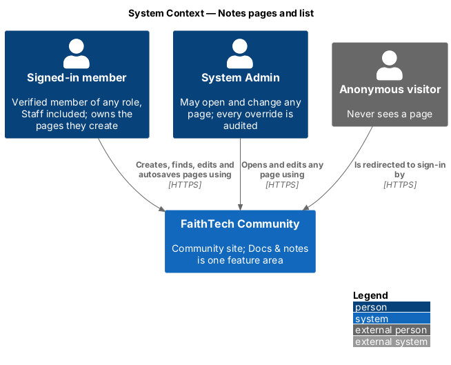
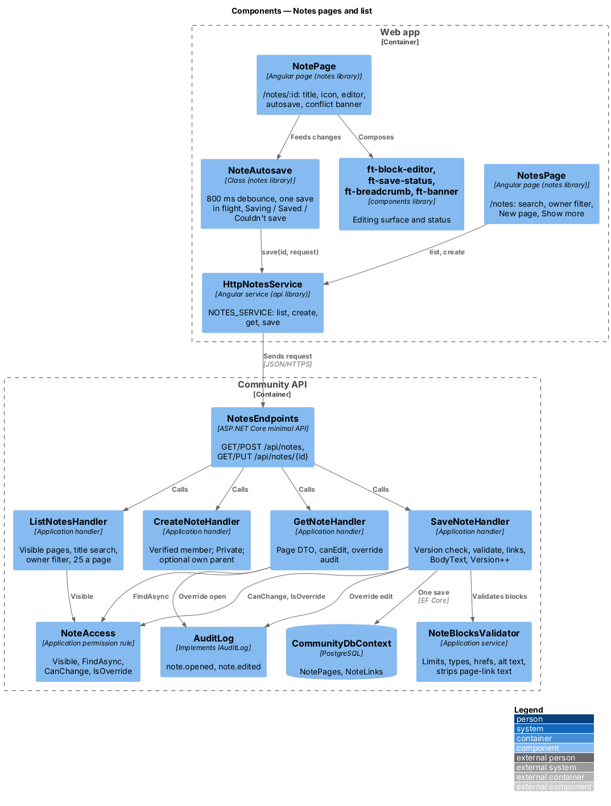
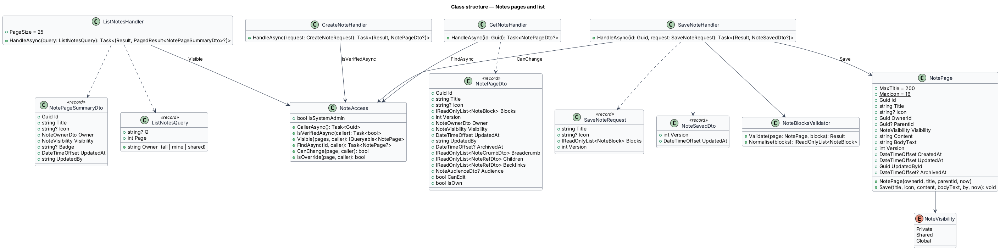
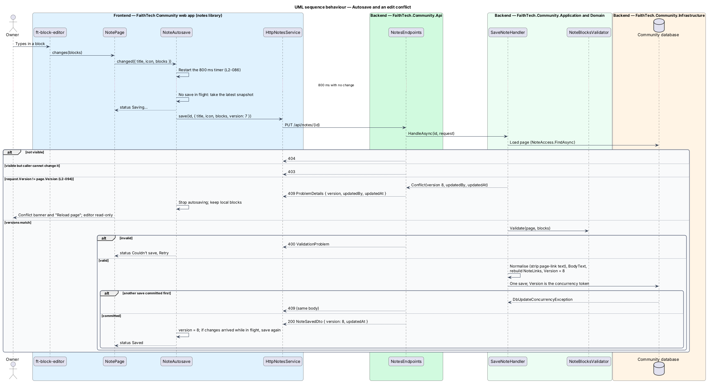
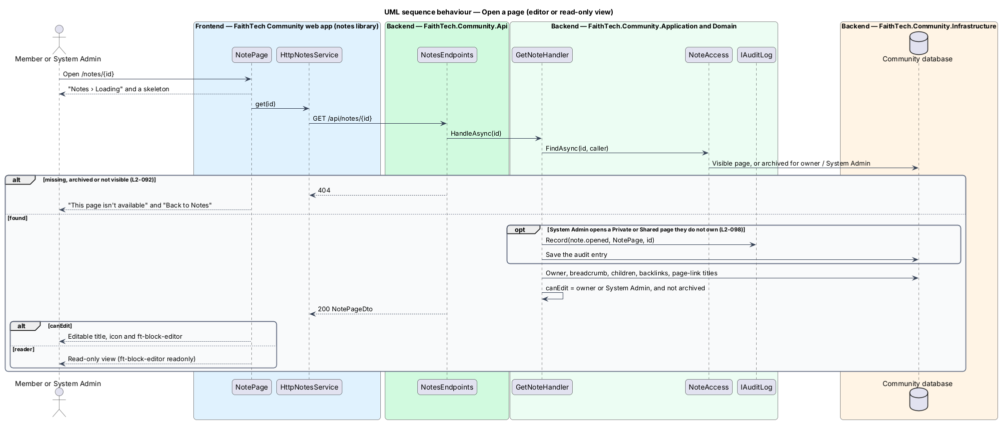

# Notes pages and list

## Overview

**Docs & notes** (`notes`, `L1-022`) gives FaithTech members one place for the living, written knowledge of a city team: meeting notes, run sheets, playbooks and how-tos that today sit in Google Drive, SharePoint and email. Resources (`L1-020`) holds finished files; Docs & notes holds pages that members write in the app.

Key terms:

- **page** — titled, ordered list of blocks owned by one member, with an optional emoji icon, an optional parent page and a visibility
- **block** — one unit of page content: a paragraph, heading, list item, to-do, quote, callout, code, divider, image or link card (`notes/block-editor`)
- **owner** — member who created the page and the only member, besides System Admin, who may change it
- **version** — integer on the page that every save increments; a save names the version it started from (ADR 0023)
- **autosave** — save sent by the editor 800 ms after the last change, with at most one save in flight
- **edit conflict** — save whose version no longer matches the stored page; the server refuses it with `409` and overwrites nothing

This design covers the Notes list, creating a page, opening it as an editor or a read-only view, the page title and icon, autosave and the edit-conflict path. The editing surface is `notes/block-editor`; links, nesting and the breadcrumb are `notes/links-and-backlinks`; visibility and sharing are `notes/share-and-visibility`; archive and search are `notes/archive-and-search`; images are `notes/images`. Storage and concurrency are recorded in [ADR 0023](../../../adr/0023-notes-block-storage-ordering-and-concurrency.md), the editor in [ADR 0024](../../../adr/0024-notes-editor-on-contenteditable-with-cdk.md) and access in [ADR 0025](../../../adr/0025-notes-access-links-and-staff.md).

## Description

The slice runs from the `notes` feature library in the web app to the `NotePages` table in the Community database.

### Web app

- **`NotesPage`** — page in the `notes` library at `/notes` (mock `pages/notes`). The header reads "Notes" with the count of visible pages and offers ghost *Archived* (`/notes/archived`) and primary *New page*. Below it a `<form role="search">` holds the title search box ("Search page titles") and an `ft-select` owner filter: *All pages*, *Mine*, *Shared with me*. Rows show the icon (or the default page icon), the title ("Untitled" when empty), "{owner} · Edited {date}" with the owner as "you" for the caller's own pages, and an `ft-badge` "Private", "Shared" or "Shared with you" (nothing for Global). The list is ordered by most recently edited, 25 at a time, with *Show more*. Loading, empty, no-results and error states use `ft-list-skeleton`, `ft-empty-state` and `ft-alert`. Term and filter live in the address (`/notes?q=&owner=`).
- **New page** — *New page* calls `create({})` and navigates to `/notes/{id}` with focus in the title. A page is always created Private (`L2-092`); there is no create dialog because a new page has no required field.
- **`NotePage`** — page at `/notes/:id` (mock `pages/note`: editor, read-only, shared-with-you, private, admin, archived, conflict, loading, error, missing). It shows `ft-breadcrumb` (`notes/links-and-backlinks`), the icon button, the title, a meta line "{owner} · Edited {date} by {who}", `ft-save-status`, the page menu (*Share*, *Page settings*, *Move*, *Archive*) built on `ft-menu`, and `ft-block-editor`. The title is a single-line `contenteditable` heading (`h1`) with the placeholder "Untitled"; Enter moves focus to the first block. *Page settings* opens `NoteSettingsDialog` (title and icon) for keyboard and screen-reader users who prefer a form. A reader (`canEdit` false) gets the same layout with the editor in `readonly` mode and no menu.
- **`NoteAutosave`** — plain class in the `notes` library, owned by `NotePage`. `changed(snapshot)` restarts an 800 ms timer. When it fires and no save is in flight, it sends `save(id, { title, icon, blocks, version })`. Changes made while a save is in flight are kept, and one more save follows when the response arrives. A `200` stores the new version and sets the status to *Saved*. A `400`, `5xx` or network failure sets *Couldn’t save* with *Retry*; the next change or *Retry* resends the latest snapshot. A `409` stops autosaving, keeps the local blocks and raises the conflict banner. Leaving the route flushes a pending save, and `beforeunload` asks the browser to confirm while a change is unsaved.
- **Conflict banner** — `ft-banner` (warning) with the copy from `L2-094` naming who saved and when, and *Reload page*, which discards local changes and loads the stored page. The editor turns read-only while the banner shows.
- **`SaveStatusComponent`** — `ft-save-status` in `components`: "Saving…", "Saved" or "Couldn’t save" with a *Retry* button, in a polite live region that announces only changes to *Couldn’t save* and back, so typing does not cause a stream of announcements.
- **`NotesService`** / **`NOTES_SERVICE`** / **`HttpNotesService`** — contract, injection token and HTTP implementation in `api/src/lib/notes`. This slice uses `list({ q, owner, page })`, `create({ title?, parentId? })`, `get(id)` and `save(id, request)`. `save` maps a `409` to a typed `NoteConflict` error carrying `version`, `updatedBy` and `updatedAt`.
- **Shell** — `shell/navigation.ts` adds the secondary nav item "Notes" (`/notes`, `notes` icon) for every signed-in member, after Resources. `app.routes.ts` lazy-loads `NOTES_ROUTES` from `@faithtech-community/notes` at `notes` behind the signed-in guard. `NOTES_ROUTES` maps `''` to `NotesPage`, `archived` to `ArchivedNotesPage` and `:id` to `NotePage` (with a `canDeactivate` that flushes autosave).

### Community API

- **`NotesEndpoints`** — `Api/Endpoints/NotesEndpoints.cs`, a `/api/notes` group with `RequireAuthorization()`; anonymous callers get `401`. No business rule lives in the endpoints.
- **`NoteAccess`** — the permission rule in `Application/Notes/` (detailed in `notes/share-and-visibility`): `Visible`, `FindAsync`, `CanChange`, `IsOverride`, `IsVerifiedAsync`.
- **`ListNotesHandler`** — `HandleAsync(ListNotesQuery(q, owner, page))`: starts from `NoteAccess.Visible`; `owner=mine` keeps the caller's pages, `owner=shared` keeps pages owned by someone else that are Shared with the caller by name or by a role held now; `q` is a case-insensitive contains match on the title (body text is searched by global search, `notes/archive-and-search`). Orders by `UpdatedAt` descending, 25 a page, at most 100 (`L2-046`), with the total.
- **`CreateNoteHandler`** — refuses a caller whose email is not verified with `403` "Verify your email before creating pages." (the same check as `AddResourcesHandler`). It trims the title (at most 200 characters), checks an optional `parentId` (`notes/links-and-backlinks`), creates `new NotePage(ownerId, title, parentId, now)` with Private visibility, version 1 and `Content` `[]`, and answers `201` with the page.
- **`GetNoteHandler`** — loads the page through `NoteAccess.FindAsync` (visible, or archived for its owner and System Admin) and answers `null` (mapped to `404`) otherwise. It reads the blocks with `NoteJson.Read`, fills page-link text, breadcrumb, children and backlinks through `NoteLinkResolver`, and sets `canEdit` (owner or System Admin, and not archived) and `isOwn`. A System Admin opening a Private or Shared page they do not own writes `note.opened`.
- **`SaveNoteHandler`** — `HandleAsync(id, SaveNoteRequest(title, icon, blocks, version))`: `404` when not visible; `403` when the caller may not change it; `400` "Restore this page before editing it." when archived; `409` when `version` differs from the stored version, with `version`, `updatedBy` (name) and `updatedAt` as ProblemDetails extensions (`Result.Conflict`). It then runs `NoteBlocksValidator` (`400` with field errors), normalises the blocks, writes `Content`, derives `BodyText`, rebuilds `NoteLinks`, sets `UpdatedAt` and `UpdatedById`, increments `Version` and saves once. `Version` is also an EF Core concurrency token, so two saves that pass the check at once cannot both commit; the loser's `DbUpdateConcurrencyException` maps to the same `409`. A System Admin save of someone else's page writes `note.edited` with the version before and after and the title, never the content.

### Data model

| Table | Columns | Notes |
|-------|---------|-------|
| `NotePages` | `Id` (uuid, PK), `Title` (varchar 200), `Icon` (varchar 16, null), `OwnerId` (uuid), `ParentId` (uuid, null, FK `NotePages`), `Visibility` (varchar 16), `Content` (text, JSON array of blocks), `BodyText` (text), `Version` (int, concurrency token), `CreatedAt`, `UpdatedAt`, `UpdatedById`, `ArchivedAt` (null), `SearchVector` (generated `tsvector`, PostgreSQL only) | Indexes on `(ArchivedAt, UpdatedAt)`, `OwnerId`, `ParentId`; GIN on `SearchVector` |
| `NoteShareMembers`, `NoteShareRoles` | `PageId` + `ProfileId` / `Role` | `notes/share-and-visibility` |
| `NoteLinks` | `SourceId`, `TargetId` | `notes/links-and-backlinks` |
| `NoteImages` | `Id`, `PageId`, `BlobName`, `ContentType`, `Size`, `AddedAt` | `notes/images` |

`ConfigureNotes(builder)` in `CommunityDbContext` maps all four; the `Notes` migration in `Infrastructure/Persistence/Migrations/` creates them and is applied by the Cli (`migrate`), never by the API. The seeder adds a small set of sample pages with fixed ids and skips any that exist, so it is safe to re-run.

### API contract

| Method and path | Request | Responses |
|-----------------|---------|-----------|
| `GET /api/notes?q=&owner=all\|mine\|shared&page=` | — | `200 PagedResult<NotePageSummaryDto>`, `400` unknown owner value, `401` |
| `POST /api/notes` | `{ title?, parentId? }` | `201 NotePageDto` with `Location`, `400` title too long or parent refused, `401`, `403` email not verified |
| `GET /api/notes/{id}` | — | `200 NotePageDto`, `401`, `404` missing, archived (for anyone but owner and System Admin) or not visible |
| `PUT /api/notes/{id}` | `{ title, icon, blocks, version }` | `200 { version, updatedAt }`, `400` validation or archived, `401`, `403` not owner or System Admin, `404`, `409 { version, updatedBy, updatedAt }` |

`NotePageSummaryDto`: `id`, `title`, `icon`, `owner { id, name, initials, isYou }`, `visibility`, `badge`, `updatedAt`, `updatedBy`. `NotePageDto` adds `blocks`, `version`, `createdAt`, `archivedAt`, `parentId`, `breadcrumb`, `children`, `backlinks`, `audience`, `sharedWithYou`, `canEdit` and `isOwn`.

### End-to-end tests

`e2e/fixtures/mock-notes.ts` is the fake for every `/api/notes` route: an in-memory page set seeded per test, the same visibility rule, version check and `409` body as the API, and loud failure for any unrecognised request. `e2e/pages/notes.page.ts` and `note.page.ts` own the selectors; specs in `e2e/tests/notes/` cover the list, creation, autosave states, the conflict banner (the fixture bumps the stored version to simulate another save) and axe checks on every state.

### Accessibility

The list is a `ft-list` of links with the badge text in the accessible name. The title is an `h1` with `role="textbox"` while editable and a plain `h1` when read-only. The save status is a polite live region; the conflict banner is `role="alert"` and moves focus to *Reload page*.

### Security

Every read starts from `NoteAccess.Visible`, so the list, the page and the `409` body never expose a page the caller may not open. The `409` body names who saved last only to a caller who may already open the page. Content is JSON data, never HTML, so nothing from a page is rendered as markup (`notes/block-editor`).

## Requirements

The feature realizes the following level-2 (L2) requirements. Each L2 requirement refines a level-1 (L1) requirement, cited by identifier. The acceptance criteria are in `docs/specs/L2.md`.

| L2 ID | Refines (L1) | Requirement |
|-------|--------------|-------------|
| `L2-085` | `L1-022` | Notes list: create and find pages |
| `L2-086` | `L1-022` | Page editor: title, icon, blocks and autosave |
| `L2-094` | `L1-022` | Edit conflicts |

## Diagrams

### System context

Every verified member creates and edits their own pages; System Admin may open and change any page; anonymous visitors never see one.

### Containers

The `notes` library calls the Community API through `HttpNotesService` with a bearer token. The API reads and writes the `NotePages` table; the Cli applies the `Notes` migration and seeds sample pages.

### Components

`NotePage` hands changes to `NoteAutosave`, which sends whole-page saves. `NotesEndpoints` dispatches to one handler per operation; each handler goes through `NoteAccess`, and `SaveNoteHandler` validates with `NoteBlocksValidator`.

### Class structure

`NotePage` holds the content as a JSON string with an integer `Version`. The handlers return summary and page DTOs; `SaveNoteRequest` carries the version the client started from.

### Behaviour — create and list

The list applies visibility, the owner filter and the title match in one query. *New page* creates a Private page and opens it.

### Behaviour — autosave and an edit conflict

The editor saves 800 ms after the last change, one save at a time. A version mismatch, detected before the write or by the concurrency token during it, answers `409` and stops autosave behind the conflict banner.

### Behaviour — open a page

A page the caller may not open answers `404`. A System Admin opening someone else's Private or Shared page is audited. `canEdit` chooses the editor or the read-only view.

## Open questions

- The list's search box matches titles only, as the proposal states; body text is found through global search. Resolved.
- A conflict keeps the local blocks in memory until *Reload page*; copying them out is left to the member. Merging or a "keep mine" option is deferred with co-editing. Resolved.
- A System Admin edit writes one `note.edited` entry per save, so an override editing session can write several entries (ADR 0025). Resolved.
- Saving an archived page answers `400` "Restore this page before editing it."; the proposal does not name the status. Resolved here.
