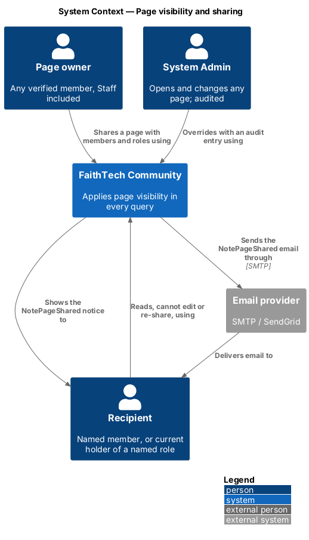
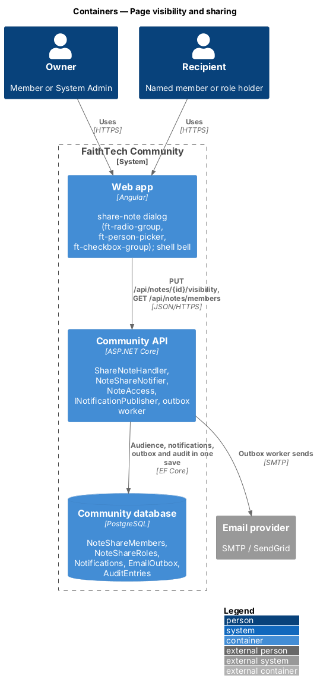
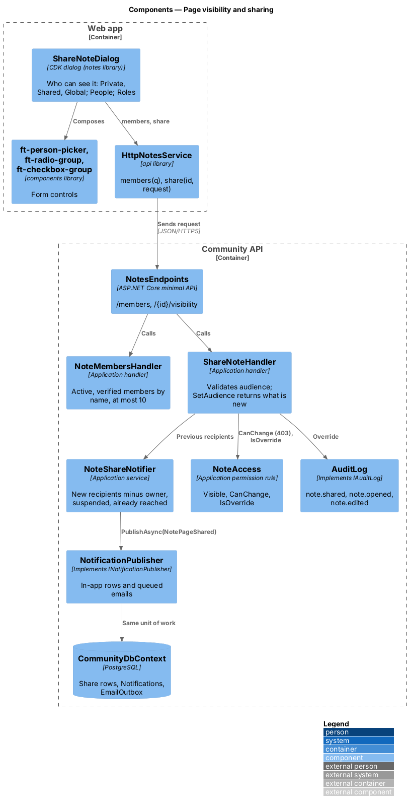
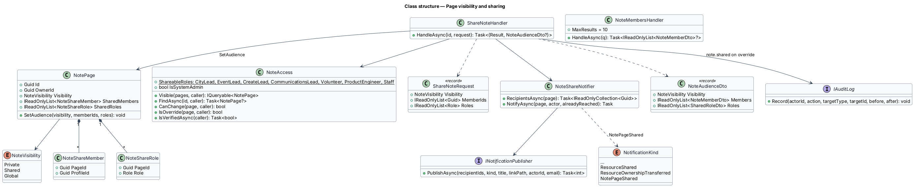
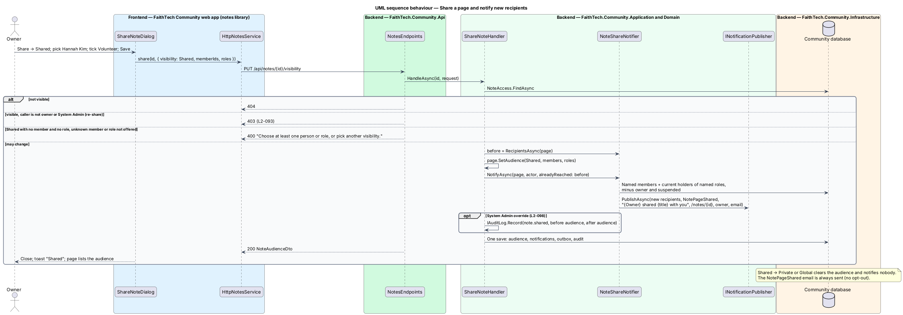
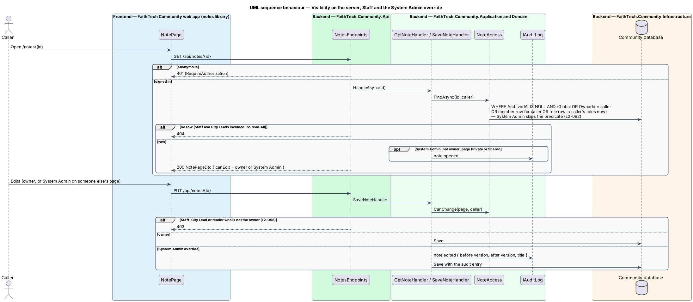

# Page visibility and sharing

## Overview

Every Docs & notes page (`L1-022`) has a **visibility** that decides who may open it, using the same three levels as Resources (`L2-060`, `L2-061`, ADR 0017). Unlike a resource, a new page starts **Private**: notes are often drafts, and the owner chooses when to widen them. Only the owner changes a page; System Admin may override, and every override is audited. This slice covers the rule itself, sharing with members and roles, the `NotePageShared` notification, and how Staff, City Leads and System Admin are treated.

Key terms:

- **Private** — visible to the owner and System Admin only; the default for every new page
- **Shared** — visible to the owner, the members named in its audience, the current holders of the roles named in its audience, and System Admin
- **Global** — visible to every signed-in member
- **audience** — named members (`NoteShareMember`) and named roles (`NoteShareRole`) of a Shared page; a role audience is live, evaluated against the caller's roles on every request
- **recipients** — members notified when a page is shared: each new named member plus every current holder of each new named role, de-duplicated, excluding the owner, suspended members and anyone the previous audience already reached
- **override** — action by a System Admin on a page they do not own; written to the audit log

The decisions are recorded in [ADR 0025](../../../adr/0025-notes-access-links-and-staff.md).

## Description

### Web app

- **`ShareNoteDialog`** — CDK dialog in the `notes` library (mock `dialogs/share-note`) opened from *Share* in the page menu. An `ft-radio-group` "Who can see it" offers *Private — only you*, *Shared — people and roles you choose* and *Global — every signed-in member*. Shared reveals "Share with": an `ft-person-picker` "People" in multiple mode fed by `members(q)` and an `ft-checkbox-group` "Roles" (City Lead, Event Lead, Create Lead, Communications Lead, Volunteer, Product Engineer, Staff), with the caption "Everyone you add gets a notification. They can read it, but can’t edit or share it." Saving Shared with nobody shows "Choose at least one person or role, or pick another visibility." on the picker and in the error summary. The submit reads *Share* for Shared and *Save* otherwise.
- **Page audience and banners** — `NotePage` shows the visibility next to the meta line. The owner of a Private page sees the banner "Only you can see this. System Admin can too, and every time they open it, it’s recorded in the audit log." A recipient sees "{Owner} shared this with {you | everyone who has the {role} role}. You can read it, but not edit or share it." and no menu. A System Admin on someone else's page sees "You’re viewing {owner}’s page as System Admin. Changes are recorded in the audit log." Exact copy follows the mocks and `L2-092`/`L2-093`.
- **Bell and email** — the `NotePageShared` notice "{Owner} shared {title} with you" links to `/notes/{id}` through the shell's existing `NoticeListComponent`.
- **`HttpNotesService`** — `members(q)` calls `GET /api/notes/members?q=`; `share(id, { visibility, memberIds, roles })` calls `PUT /api/notes/{id}/visibility`.

### Community API

- **`NoteAccess`** — scoped Application service in `Application/Notes/`, modelled on `ResourceAccess`.
  - `Visible(pages, caller)` returns active pages (`ArchivedAt` null) that are Global, owned by the caller, or Shared with a `NoteShareMember` for the caller or a `NoteShareRole` the caller holds now. For System Admin it returns every active page. The caller's roles come from `ICurrentUser`, so a role change applies on the next request.
  - `FindAsync(id, caller)` returns the visible page, or an archived page when the caller is its owner or a System Admin, or `null`.
  - `CanChange(page, caller)` is true for the owner and System Admin only. No role, Staff and City Lead included, grants a write on someone else's page.
  - `IsOverride(page, caller)` is true when a System Admin acts on a page they do not own.
  - `IsVerifiedAsync(caller)` reads `EmailConfirmed`; create, share and image upload refuse an unverified caller with `403`.
  - `ShareableRoles` lists the seven roles offered in the dialog, the same list as `ResourceAccess.ShareableRoles`.
- **`NotePage.SetAudience(visibility, memberIds, roles)`** — replaces the share rows; Private and Global clear them.
- **`ShareNoteHandler`** — `HandleAsync(id, ShareNoteRequest)`: `404` when not visible; `403` when the caller may not change it (a recipient trying to re-share, `L2-093`); `400` when Shared has no member and no role, a member id is not an active member, or a role is not shareable; `400` when the page is archived. It takes the recipients the current audience reaches (`NoteShareNotifier.RecipientsAsync`), applies the new audience, asks the notifier to tell only the new ones, records `note.shared` with the audience before and after on an override, and saves once. Answers `200 NoteAudienceDto`.
- **`NoteShareNotifier`** — Application service in `Notes/`, the counterpart of `ShareNotifier`. It resolves recipients and calls `INotificationPublisher.PublishAsync(recipients, NotificationKind.NotePageShared, "{Owner} shared {title} with you", "/notes/{id}", ownerId, email)`. The email has the subject "{Owner} shared {title} with you", the heading "A page was shared with you", the body "{Owner} shared “{title}” with {you | everyone who has the {role} role, which includes you}." and the button "Open the page". It is an activity email and always sent; the announcement opt-out does not apply. Notifications and queued emails join the share's unit of work. The actor is the owner even when a System Admin shares, so the notice names the page's owner.
- **`NoteMembersHandler`** — `GET /api/notes/members?q=`: up to 10 active, verified, not suspended members matching the name, excluding the caller, with initials, photo, highest role and home city (`NoteMemberDto`). Any verified member may call it; an unverified caller gets `403`.
- **System Admin auditing** — `GetNoteHandler` writes `note.opened` when a System Admin opens a Private or Shared page they do not own; every other override (`note.edited`, `note.shared`, `note.moved`, `note.archived`, `note.restored`, and image uploads as `note.edited`) is written by the handler that performs it, through `IAuditLog.Record(actor, action, "NotePage", id, before, after)` in the same save.

### API contract

| Method and path | Request | Responses |
|-----------------|---------|-----------|
| `PUT /api/notes/{id}/visibility` | `{ visibility, memberIds, roles }` | `200 NoteAudienceDto`, `400`, `401`, `403`, `404` |
| `GET /api/notes/members?q=` | — | `200 [NoteMemberDto]`, `401`, `403` unverified |

Every `/api/notes` endpoint answers `401` to an anonymous caller and `404` for a page the caller may not open, whatever the reason.

### End-to-end tests

`mock-notes.ts` applies the same rule, records notifications through the shared `MockNotifications`, and refuses a recipient's share with `403`. Specs in `e2e/tests/notes/` sign in as System Admin, City Lead, Staff and Volunteer through the auth fixture and cover default Private, sharing with a member and a role, the notice in the bell, a recipient's read-only view, Staff refused on another member's page, and the System Admin banner.

### Accessibility

The dialog is an `ft-dialog` with a labelled radio group, the person picker's combobox pattern and an error summary that receives focus on a failed submit. Banners are `role="status"`.

### Security

Visibility is a predicate inside every SQL query that reads pages: list, page, search, suggestions, parent options, backlinks, breadcrumb, children and image streaming. There is no read-all role other than System Admin; Staff read only what the rule grants (`L2-098`). Role audiences are evaluated live, so removing a role removes access at once.

## Requirements

The feature realizes the following level-2 (L2) requirements. Each L2 requirement refines a level-1 (L1) requirement, cited by identifier. The acceptance criteria are in `docs/specs/L2.md`.

| L2 ID | Refines (L1) | Requirement |
|-------|--------------|-------------|
| `L2-092` | `L1-022` | Page visibility and access on the server |
| `L2-093` | `L1-022` | Share pages with members and roles |
| `L2-098` | `L1-022` | Staff and System Admin on pages |

The `NotePageShared` kind also extends the notification sources of `L2-027` (in-app) and `L2-028` (email); the `note.*` actions extend the audit log of `L2-041`.

## Diagrams

### System context

The owner shares a page; recipients are told in the app and by email; System Admin may override with an audit entry.

### Containers

The dialog sends the audience; the API writes the audience, notifications, queued emails and any audit entry in one transaction; the outbox worker sends the email.

### Components

`ShareNoteHandler` checks `NoteAccess`, applies the audience and hands the new recipients to `NoteShareNotifier`, which publishes `NotePageShared`.

### Class structure

`NotePage` composes its share rows; `NoteAccess` turns the caller's id and current roles into one query predicate; `NoteShareNotifier` depends on `INotificationPublisher`.

### Behaviour — share and notify

Only recipients the previous audience did not reach are notified, in the same save as the share; a recipient's attempt to re-share answers `403`.

### Behaviour — visibility, Staff and the System Admin override

The predicate decides `404` for everyone without access, Staff and City Leads included; `CanChange` decides `403` on writes; System Admin overrides are audited.

## Open questions

- Pages may be shared with the same seven roles as resources; Attendee and System Admin are not offered. Resolved here.
- The email copy ("A page was shared with you", "Open the page") follows the `ResourceShared` pattern; final copy follows the mock `notifications/email/note-shared`. Resolved here.
- An unverified member may read pages shared with them but may not create, share or upload; the proposal names verification only for creating. Resolved here.
