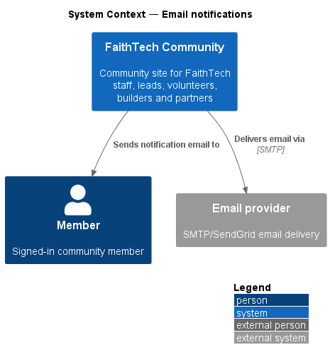
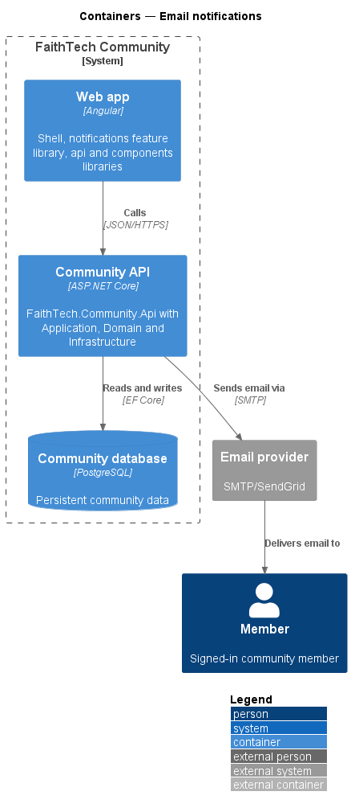
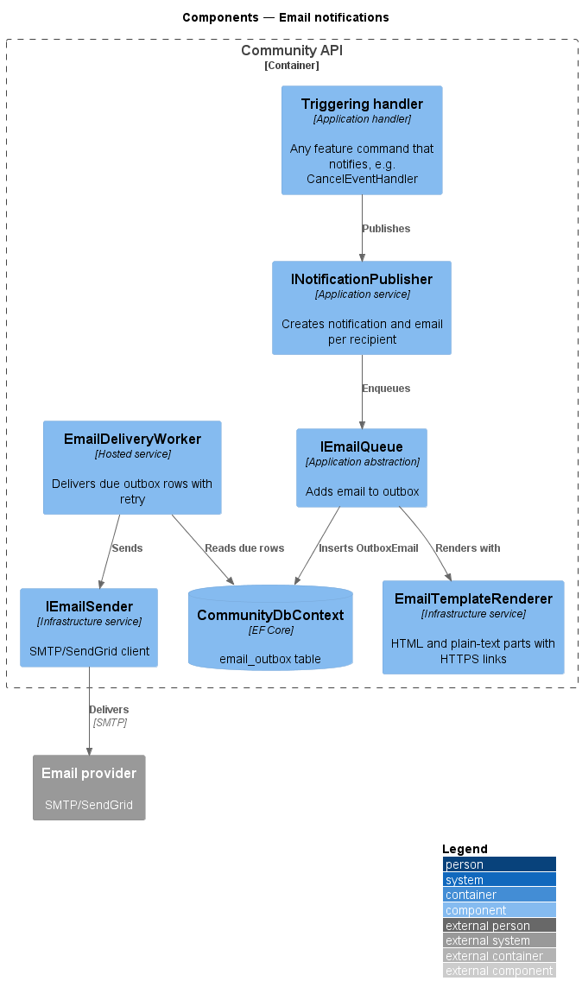
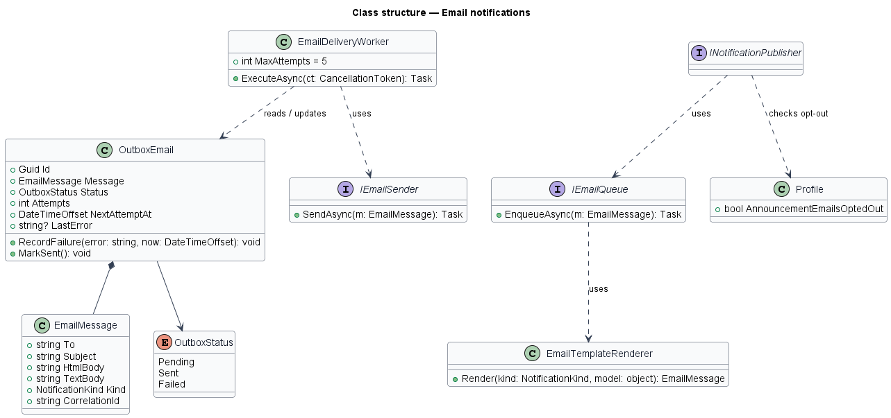
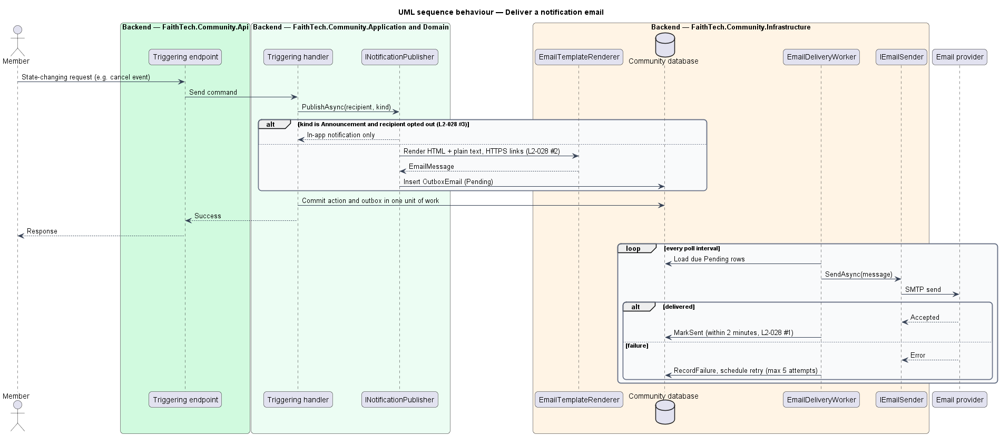

# Email notifications

## Overview

FaithTech Community sends email for the occurrences listed in `L2-028`: a contact signed up, an event cancelled or changed, invites, RSVP confirmations, role changes, Agile assignments and workspace additions, Planning Poker invitations, and announcements. This feature describes the shared outbound email pipeline that every one of those sources uses.

- **email outbox** — table of rendered emails waiting to be delivered, written in the same transaction as the action that triggered them
- **delivery worker** — background service that reads the outbox and hands each message to the email provider
- **announcement opt-out** — member preference that suppresses announcement emails only

The outbox decouples the triggering action from delivery. The triggering action succeeds even when the email provider is unavailable, and the worker retries delivery later (`L2-047`).

## Description

- **`IEmailQueue`** — Application abstraction. `EnqueueAsync(EmailMessage)` adds a message to the outbox inside the caller's unit of work.
- **`EmailMessage`** — value object with `To`, `Subject`, `HtmlBody`, `TextBody`, `Kind` and `CorrelationId`.
- **`EmailTemplateRenderer`** — Infrastructure service that renders each `NotificationKind` template into HTML and plain-text parts and builds every link from the configured HTTPS base URL.
- **`OutboxEmail`** — Infrastructure persistence entity with `Status`, `Attempts`, `NextAttemptAt` and `LastError`.
- **`EmailDeliveryWorker`** — hosted background service in Infrastructure. It polls due outbox rows, calls `IEmailSender`, and on failure schedules a retry with backoff, up to 5 attempts.
- **`IEmailSender`** / **`SmtpEmailSender`** — Infrastructure sender that delivers through SMTP or SendGrid, chosen by configuration.
- **`INotificationPublisher`** — Application service that writes the in-app `Notification` and, for kinds with an email form, calls `IEmailQueue`. For `NotificationKind.Announcement` it skips recipients whose `AnnouncementEmailsOptedOut` flag is set.
- **`CommunityDbContext`** — holds the `email_outbox` table.

The worker poll interval and backoff schedule are `<TO SUPPLY>`; they shall keep first delivery within 2 minutes.

## Requirements

The feature realizes the following level-2 (L2) requirements. Each L2 requirement refines a level-1 (L1) requirement, cited by identifier.

| L2 ID | Refines (L1) | Requirement |
|-------|--------------|-------------|
| `L2-028` | `L1-010` | These emails are sent: a contact signed up, an event cancelled or changed, invites, RSVP confirmations, role changes, Agile assignments and workspace additions, Planning Poker invitations, and announcements. |

### Acceptance criteria

**`L2-028` — Email notifications**

1. Given a triggering action, when it completes, then the email is queued and sent within 2 minutes, retrying on failure up to 5 times.
2. Given an email, when it is rendered, then it includes a plain-text part, and every link uses HTTPS.
3. Given a user who opted out of announcement emails, when an announcement is sent, then no announcement email reaches them, but other notification emails still do.

## Diagrams

### System context

FaithTech Community sends notification email to members through an external email provider.

### Containers

The Community API writes emails to an outbox in the Community database and delivers them to the email provider over SMTP.

### Components

A triggering handler publishes through `INotificationPublisher`, which enqueues a rendered email. `EmailDeliveryWorker` later delivers it through `IEmailSender`.

### Class structure

`OutboxEmail` owns an `EmailMessage` and tracks attempts and status. `INotificationPublisher` checks `AnnouncementEmailsOptedOut` before it enqueues an announcement.

### Behaviour — deliver a notification email

The triggering action commits the outbox row with its own changes. The worker delivers it within 2 minutes and retries failures up to 5 times (`L2-028`).

