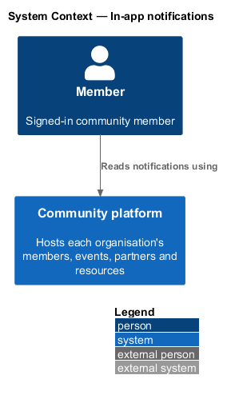
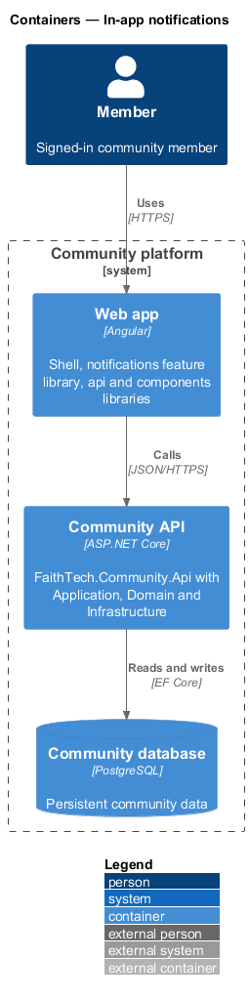
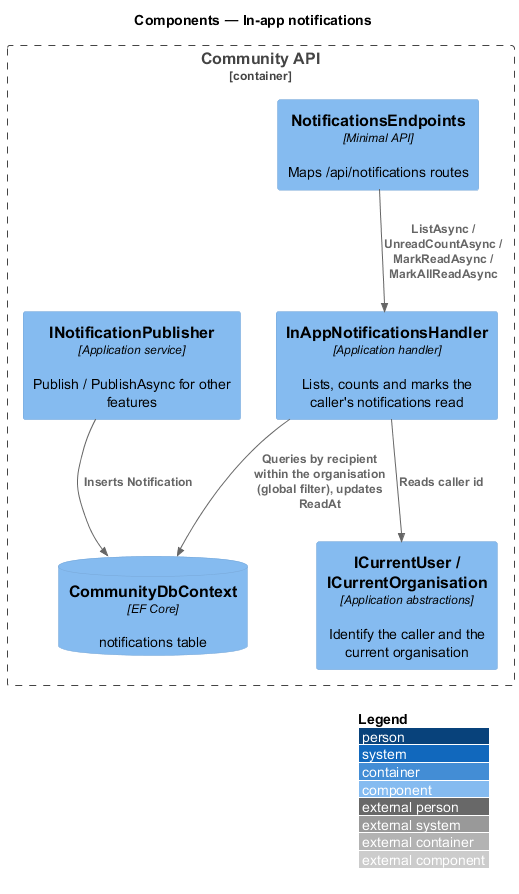
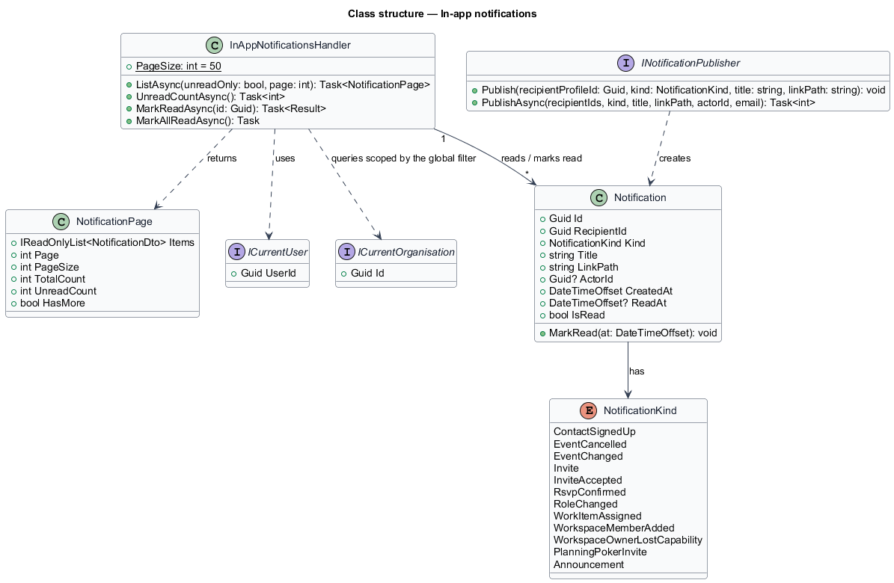
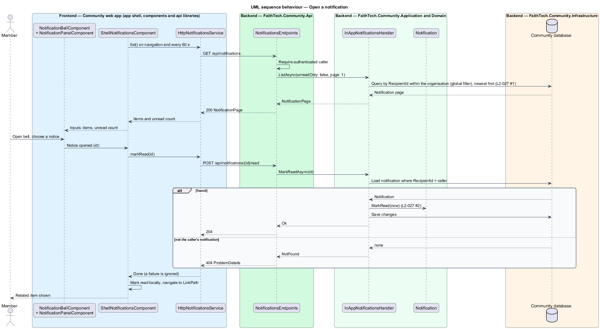
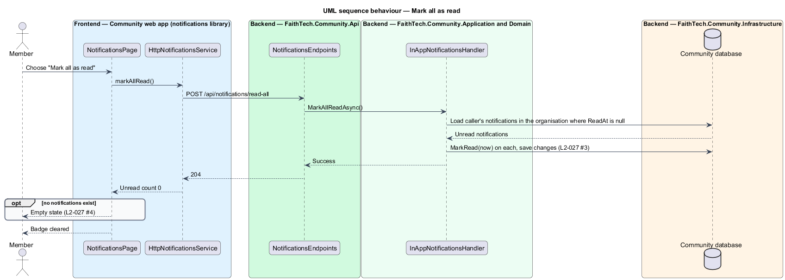

# In-app notifications

## Overview

The Community platform tells members about activity that concerns them in their organisation. A *notification* is a short record addressed to one member that describes something that happened, such as a contact signing up or an event being cancelled, and links to the related item. This feature covers the in-app channel: the bell in the app shell, its panel, and the notifications page. The email channel is described in the email notifications design (`L2-028`).

- **notification** — record addressed to one recipient that names an occurrence and links to the item it concerns
- **unread count** — number of the recipient's notifications that have no read time
- **bell** — app-shell control that shows the unread count and opens the notification panel

Other features create notifications through one Application service, so every source produces the same record. A notification belongs to the organisation it was raised in and only to its recipient; no other member reads it, and every query is scoped to the current organisation by the DbContext's global filter on `ICurrentOrganisation` (`L2-027`, `L2-130` AC2).

## Description

- **`NotificationBellComponent`** and **`NotificationPanelComponent`** — components in the `components` library. The bell renders a `<button aria-haspopup="dialog">`, never a link, with `aria-expanded` and, while open, `aria-controls` naming the panel, and the unread count; the panel shows the latest notices, "Mark all read" and "See all". They receive items and the count through inputs and emit events; they make no HTTP calls.
- **`NoticeListComponent`** — the `.notice` rows (initials, the notice's title as the link to its item, time and "Unread") in `components`, used by the panel and the page. With `deferNavigation` it cancels the link's own navigation so the host marks the notice read first.
- **`ShellNotificationsComponent`** — glue in the app shell (`faithtech-community/src/app/shell`) that feeds the bell and panel from `NotificationsService`. It reloads on every navigation and every 60 seconds while the tab is visible, marks an opened notice read and then navigates to its `LinkPath`. It is not in the `notifications` library, because the shell never imports a feature library eagerly (ADR 0016).
- **`NotificationsPage`** — page in the `notifications` feature library (mock `pages/notifications`). It lists notifications newest first, 50 at a time with a **Show older notifications** button, filters to **All** or **Unread** (mock `pages/notifications/unread`), shows the empty state when none exist, and offers "Mark all as read".
- **`NotificationsService`** / **`NOTIFICATIONS_SERVICE`** / **`HttpNotificationsService`** — API client contract, injection token and HTTP implementation in the `api` library.
- **`NotificationsEndpoints`** — minimal API mapping in `FaithTech.Community.Api` for `GET /api/notifications?unreadOnly=&page=`, `GET /api/notifications/unread-count`, `POST /api/notifications/{id}/read` and `POST /api/notifications/read-all`. Another member's notification id answers `404`.
- **`InAppNotificationsHandler`** — lists a page of 50 of the caller's notifications ordered by `CreatedAt` descending, filtered by recipient (and, with `unreadOnly`, by a null `ReadAt`) in the database query, with `totalCount`, `unreadCount`, `hasMore` and each actor's name; counts the unread; and sets `ReadAt` on one or all of the caller's unread notifications.
- **`INotificationPublisher`** — Application service other features call: `Publish` adds one in-app notification; `PublishAsync` adds one per recipient and queues their email (email notifications design).
- **`Notification`** — Domain entity with `RecipientId`, `Kind`, `Title` (required), `LinkPath` (required), an optional `ActorId` (the member whose action raised it; the notice shows their initials, or the organisation's short name without one, `L2-134`), `CreatedAt` and `ReadAt`. `MarkRead(at)` keeps the first read time.
- **`NotificationKind`** — enumeration of notification sources, listed in `L2-028`.
- **`CommunityDbContext`** — persists `Notification` rows in the `Notifications` table, indexed by recipient and time.

Server push for the unread count is deferred (ADR 0016).

## Requirements

The feature realizes the following level-2 (L2) requirements. Each L2 requirement refines a level-1 (L1) requirement, cited by identifier.

| L2 ID | Refines (L1) | Requirement |
|-------|--------------|-------------|
| `L2-027` | `L1-010` | In-app notifications |
| `L2-130` | `L1-025`, `L1-015` | Organisation record and isolation |

### Acceptance criteria

**`L2-027` — In-app notifications**

A notification belongs to the organisation it was raised in; on a host a member sees only that organisation's notifications (`L2-130` AC2, `L2-132` AC4).

1. Given a new notification in the current organisation, when the user is signed in on its host, then the bell shows an unread count, and the panel lists notifications newest first.
2. Given the panel, when the user opens a notification, then it is marked read and they are taken to the related item.
3. Given unread notifications, when the user chooses "Mark all as read", then the count clears.
4. Given the notifications page, when there are none, then an empty state is shown.
5. Given the notifications page, when the user chooses "Unread", then only unread notifications are listed, and "All" lists every notification again.
6. Given more than 50 notifications, when the page loads, then the newest 50 are listed with "Show older notifications", which appends the next 50 and disappears when none are left.

**`L2-130` — Organisation record and isolation**

1. Given any scoped record, when it is created, then it is stamped with the current organisation, and no request can set a different one.
2. Given a list, search, export, notification, SignalR group or report, when it is built, then the organisation filter is applied in the database query through the context's global filter, not after loading the data (`L2-042` AC3).
3. Given a record id that belongs to another organisation, when it is requested by id, by link, by `.ics`, by public event page, by connect link, by invite token or by share, then the response is 404 or the "unknown" outcome the feature already uses, never the record (`L2-042` AC2).
4. Given a unique rule in any feature (one connect link per owner, one pending connection, unique chapter name, unique role name), when it is enforced, then it is unique within the organisation only, so two organisations may each hold the same value.
5. Given an uploaded file (photo, contact photo, resource, note image), when it is stored, then its blob path starts with the organisation's id, and it is served only on that organisation's host.
6. Given an email the system sends, when it is composed, then its sender display name, subject prefix, footer and links use the organisation's name and host, and the unsubscribe link (`L2-028`) works on that host.
7. Given the audit log, when any entry is written, then it belongs to the organisation and is listed only on that organisation's audit page (`L2-041`).

## Diagrams

### System context

A member reads notifications that the Community platform creates about activity that concerns the member in their organisation.

### Containers

The bell and the notifications page live in the web app, which calls the Community API; the API stores notifications in the Community database.

### Components

`NotificationsEndpoints` dispatches queries and commands to handlers, which scope every read and write to the caller through `ICurrentUser`. Other features write notifications through `INotificationPublisher`.

### Class structure

`Notification` carries a `NotificationKind` and an optional `ReadAt`. The handlers depend on `ICurrentUser` to restrict each operation to the recipient.

### Behaviour — open a notification

The panel lists notifications newest first (`L2-027`). Opening one marks it read and navigates to its `LinkPath`.

### Behaviour — mark all as read

"Mark all as read" sets `ReadAt` on every unread notification of the caller in one statement, and the badge clears (`L2-027`). An empty result shows the empty state.

## Open questions

Decisions recorded while building the Domain layer (`FaithTech.Community.Domain`):

- `NotificationKind` adds `InviteAccepted` (inviter notified, `L2-011` AC4) and `WorkspaceOwnerLostCapability` (every administrator notified, `L2-037` AC2, `L2-139` AC4), which are in-app occurrences not listed in `L2-028`.
- Capabilities: the kind `WorkspaceOwnerLostCityLead` is renamed `WorkspaceOwnerLostCapability` and is raised when a workspace owner loses `OwnWorkspaces` (ADR 0033): one notification per administrator, "{Name} no longer holds a role that can own workspaces: {workspace list}", linking to the workspace's settings, or to `/workspaces` when several are listed; the email subject is "{Workspace} needs a new owner" or "{N} workspaces need a new owner". A data migration renames the kind on stored notifications.
- `NotificationKind` adds `NotePageShared` ("{Owner} shared {title} with you", linking to `/notes/{id}`), published in-app and by email through `INotificationPublisher.PublishAsync` by `NoteShareNotifier`; the email cannot be turned off (`L2-093`, `notes/share-and-visibility`).
