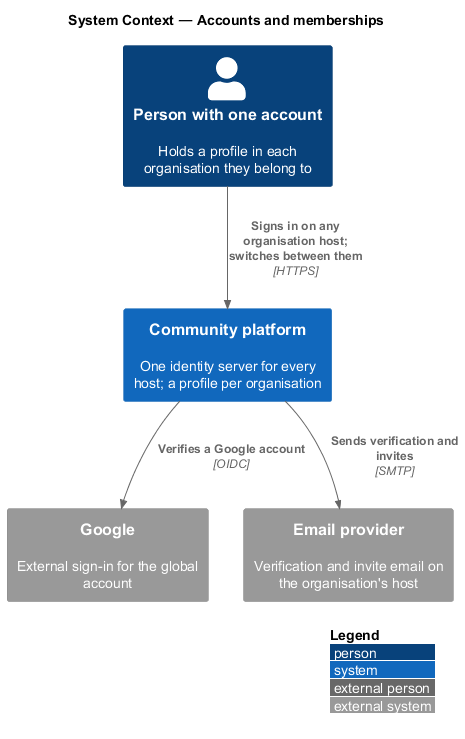
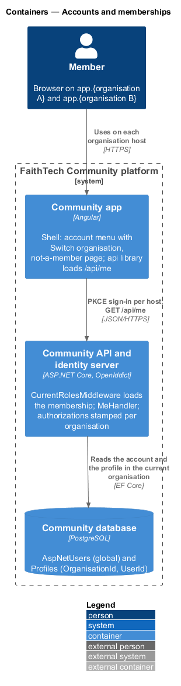
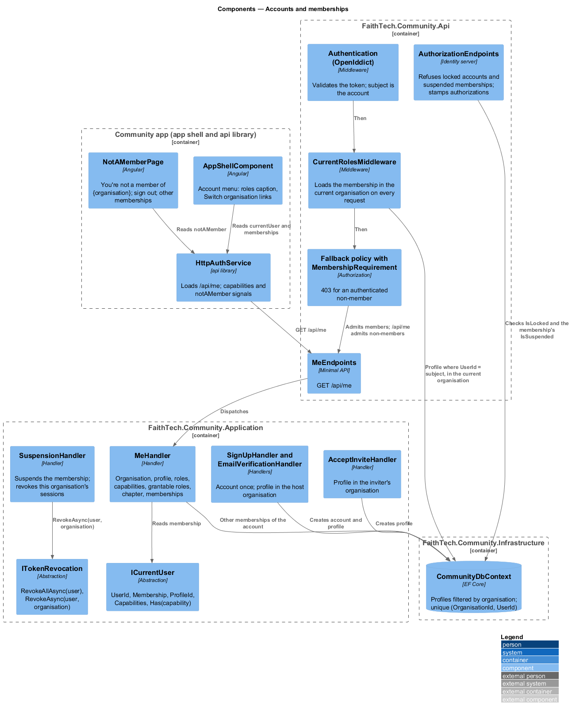
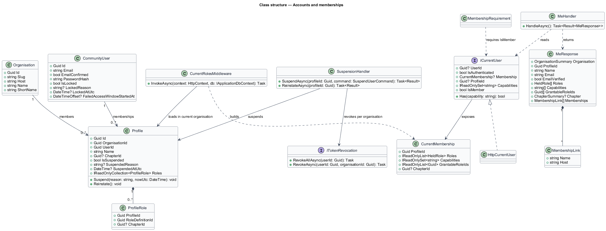
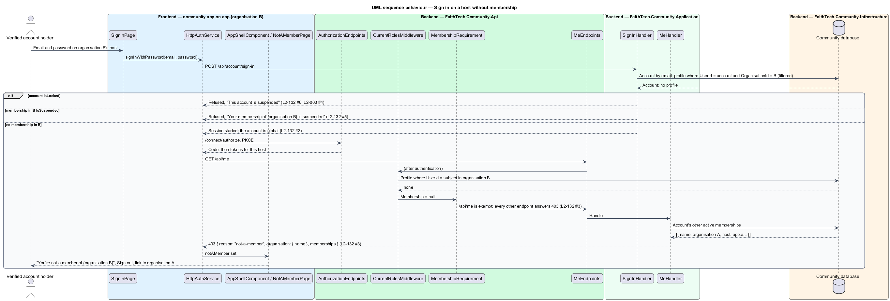
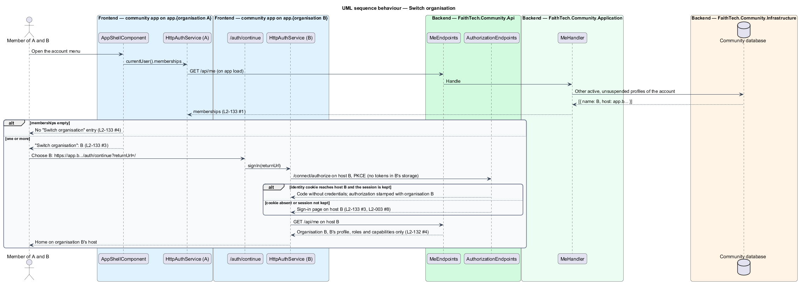
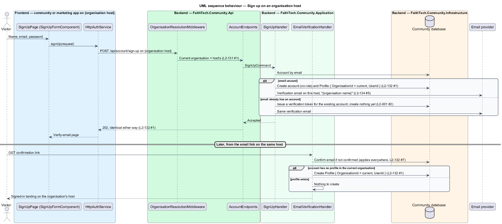

# Accounts and memberships

## Overview

An account is global and a profile is a membership of one organisation (ADR 0032). Today `CommunityUser` holds one `ProfileId` and the profile is the whole person; the account and the profile are created together at sign-up and never part. On the platform, one person may belong to several organisations with one account, and each organisation sees only its own profile of that person: its own name, roles, photos, home chapter, contacts, notifications and settings. This design covers how a membership is created, how a request on a host finds the caller's membership there, what happens when there is none, how a membership is suspended as distinct from an account being locked, and how a member moves between their organisations.

- **account** — ASP.NET Identity user record (`CommunityUser`): email, hashed password, Google login, email verification and sign-in lockout; global, not scoped
- **membership** — a `Profile` in one organisation, linked to an account by `Profile.UserId`; an account holds at most one per organisation
- **current membership** — the caller's profile in the current organisation, loaded on every request
- **not a member** — state of an authenticated caller whose account holds no profile in the current organisation
- **membership suspension** — `Profile.IsSuspended`, set by that organisation's administrator (`L2-039`); it refuses the account on that host only
- **account lock** — `CommunityUser.IsLocked`, set by a platform operator (`L2-148` AC5); it refuses the account on every host
- **kept session** — a "Keep me signed in on this device" session, whose refresh token lives in the community origin's storage (`L2-003` AC8)

Joining an organisation is never automatic: a membership comes from sign-up on the organisation's host, an invite or a connect link (`L2-132` AC1, AC2). Everything keyed by profile today stays per organisation with no further change, because the profile is the membership.

## Description

### Domain — `Profiles/`, `Identity/`

- **`Profile`** — gains `OrganisationId` (`IOrganisationScoped`, stamped on save) and `UserId` (the account). The unique index `Profiles (OrganisationId, UserId)` enforces one membership per account per organisation, and `AspNetUsers.ProfileId` is dropped (ADR 0032). `IsSuspended`, `SuspendedReason` and `SuspendedAtUtc` keep their names and now mean membership suspension. `HomeCity` becomes `ChapterId` in the chapters design.
- **`CommunityUser`** — in `FaithTech.Community.Application/Identity/`, loses `ProfileId` and gains `IsLocked`, `LockedReason` and `LockedAtUtc`, written only by platform operations. `EmailVerified` (`Domain/Identity/`) carries the profile id of the membership being verified, as today.

### Application — `Organisations/`, `Identity/`, `Invites/`

- **`CurrentMembership`** — record in `Application/Organisations/`: `ProfileId`, `Roles` (role id, name, chapter), `Capabilities`, `GrantableRoleIds`, `ChapterId` and `IsSuspended`. Null when the caller is not a member.
- **`ICurrentUser`** — keeps `UserId` and `IsAuthenticated`; `Roles` and `HasRole(Role)` give way to `Membership` (`CurrentMembership?`), `ProfileId`, `Capabilities`, `Has(capability)` (ADR 0033) and `IsMember`. Handlers that today look the caller's profile up through `CommunityUser.ProfileId` read `ProfileId` instead.
- **`SignUpHandler`** — runs on an organisation's host. When the email is unused, it creates the account with no role and a `Profile` in the current organisation, then sends the verification email on that host. When the email already has an account, it issues that account a verification token and sends the same email, so the `202` outcome is identical; on confirmation, `EmailVerificationHandler` marks the email confirmed if it is not and creates the profile in the current organisation if the account has none there (`L2-132` AC1). The submitted name reaches the confirmation step on the link itself: `VerificationEmails` adds `name` and a `join` token made by the email-confirmation token provider for the purpose `JoinOrganisation:{organisation id}:{name}`, so nothing new is stored, the token expires with the link, and a changed name or another host's link is refused. A member who signs up again on their own host is sent nothing.
- **`GoogleSignInHandler`** — creates the account on first use as today, and creates the profile in the current organisation only when the sign-in started from the sign-up form on that host (`signUp=true` on `/api/account/google/start`, kept in the correlation cookie; `L2-078`); a plain Google sign-in on a host where the account has no profile ends not a member (`L2-132` AC7).
- **`AcceptInviteHandler`** and the connect handler — the invite and the connect link are scoped records, and their links carry the inviter's host, so the current organisation is the inviter's. Accepting creates the account if needed and the profile in that organisation, whatever host the acceptor started on (`L2-132` AC2). An account that already holds a profile there is linked to the existing one. `Memberships.JoinAsync` creates the profile for an existing account, named as on its newest other profile, since the account holds no name; `POST /api/connect` is open to a signed-in non-member for this.
- **`SignInHandler`** and `AuthorizationEndpoints` — before issuing a session or a code: an account with `IsLocked` is refused with "This account is suspended" (`L2-003` AC4, `L2-132` AC6); an account whose profile in the current organisation `IsSuspended` is refused with "Your membership of {organisation name} is suspended" (`L2-132` AC5); an account with no profile here signs in, because the account is global, and the app shows the not-a-member page. `AccountStatus.IsSuspendedAsync` takes the organisation into account.
- **`ITokenRevocation`** — keeps `RevokeAllAsync(userId)` for sign-out and the account lock, and gains `RevokeAsync(userId, organisationId)` for membership suspension. `/connect/authorize` stamps every authorization it creates with the current organisation's id in the authorization's properties; the stamp is used for revocation only and never for resolution (`L2-131` AC5).
- **`SuspensionHandler`** (`Admin/`) — suspends the caller's organisation's profile and calls `RevokeAsync(userId, organisationId)`, so the account's sessions in other organisations are untouched (`L2-132` AC5, `L2-039`).
- **`MeHandler`** — new handler behind `GET /api/me`, replacing the inline query in `MeEndpoints`. For a member it returns the organisation (`slug`, `name`, `shortName`, `host`, `chapterLabel` singular and plural or null), `profileId`, `name`, `email`, `emailVerified`, `roles` (`id`, `name`, `chapter` when tagged), `capabilities`, `grantableRoleIds` (the role definitions the caller may grant under the grant rules, so the role dialogs offer the right options), `chapter` (`id`, `name` or null) and `memberships`: the account's other active, unsuspended profiles as `{ name, host }` (`L2-133` AC1). For an authenticated non-member it returns 403 with `{ reason: "not-a-member", organisation: { name }, email, memberships: [...] }`; `email` is the account's, which the not-a-member page says it is signed in as (`L2-132` AC3).

### Api — `Authentication/`, `Endpoints/`

- **`CurrentRolesMiddleware`** — keeps its place after `UseAuthentication` and its purpose (the role freshness policy, `L2-042` AC4) and loads the current membership instead of a role array: the profile where `UserId` is the token subject in the filtered context (so the organisation predicate is implicit), its roles, the capabilities computed from their definitions, and the grantable role ids. The result goes into `HttpContext.Items` for `HttpCurrentUser`. A suspended membership is treated as absent.
- **`MembershipRequirement`** — added to the fallback authorization policy next to `RequireAuthenticatedUser()`: an authenticated caller without a current membership is refused with 403 on every endpoint except `GET /api/me`, the account endpoints, `/connect/*`, `/api/site` and `/api/platform/*` (`L2-132` AC3). Anonymous endpoints are unchanged.
- **`MeEndpoints`** — `GET /api/me` dispatches to `MeHandler` and maps the not-a-member result to 403 with the body above.

### Frontend — `api`, app shell

- **`CurrentUser`** (`frontend/projects/api/src/lib/auth/auth.service.ts`) — gains `organisation`, `roles` as `{ id, name, chapter }`, `capabilities`, `grantableRoleIds`, `chapter` and `memberships`. `AuthService` exposes `capabilities: Signal<string[]>` in place of `roles` for navigation (`navigation.ts` keys each section on a capability, ADR 0033), and `notAMember: Signal<NotAMember | null>` set when `/api/me` answers 403 with `reason: not-a-member`.
- **Account menu** (`AppShellComponent.accountEntries`) — the header caption lists the role names from `/api/me`. When `memberships` is not empty, a "Switch organisation" group lists each other organisation by name as a link to `https://{host}/auth/continue?returnUrl=/`; with one membership the group is absent (`L2-133` AC3, AC4). The menu component in `components` already renders headers, items and dividers; the group is a header entry followed by link items.
- **`NotAMemberPage`** — system page in the app (`frontend/projects/faithtech-community/src/app/pages/not-a-member`, `L2-048`, `docs/mocks/pages/not-a-member`): "You're not a member of {organisation name}", who the account is signed in as, a sign-out button, and links to the account's other memberships when there are any (`L2-132` AC3). `authGuard` sends every shell route to `/not-a-member` while `notAMember` is set, and `notAMemberGuard` sends anyone else from it to `/`. `GET /api/me` carries `HANDLES_FORBIDDEN`, so its 403 does not open the forbidden page.
- **Session across hosts** — tokens and the refresh token live in the storage of the origin that obtained them, so a switch always starts the PKCE flow on the target host (`/auth/continue`, ADR 0018). The identity server is one process serving every host; it recognises the member without credentials when its sign-in cookie reaches the target host, which `Identity:CookieDomain` decides: the platform's parent domain when every host is under it, otherwise host-only. A session that is not kept, or a target host outside the cookie domain, asks for credentials (`L2-133` AC3). `Identity:CookieDomain` is unset by default (host-only); Deferred: the value in production is set once a custom host outside the platform domain exists, which waits on DNS and host-binding automation (the proposal's Deferred list).
- **Capability refresh** — `HttpAuthService` reloads `/api/me` when a request answers 403 for an action the shell showed as allowed, so a role, definition or chapter change reaches the navigation on the next request (`L2-133` AC5).

### E2E fake

`mock-api.ts` holds one organisation per host and a membership table keyed by account and organisation; a spec that needs two organisations seeds both and switches host (ADR 0032). Signing in "as a City Lead" selects the seeded FaithTech membership.

## Requirements

The feature realizes the following level-2 (L2) requirements. Each L2 requirement refines a level-1 (L1) requirement, cited by identifier. Sign-up (`L2-001`), sign-in (`L2-003`), invites (`L2-011`), connect links (`L2-083`), suspension (`L2-039`) and navigation by capability (`L2-045`) are referenced, not repeated.

| L2 ID | Refines (L1) | Requirement |
|-------|--------------|-------------|
| `L2-132` | `L1-025`, `L1-001`, `L1-002` | Accounts and memberships |
| `L2-133` | `L1-025` | Organisation switcher and `/api/me` |

### Acceptance criteria

**`L2-132` — Accounts and memberships**

An account is global; a profile is a membership of one organisation (ADR 0032).

1. Given a visitor signs up on an organisation's host (`L2-001`, `L2-078`, `L2-083`), when the account is created, then a profile is created in that organisation, and when the email already has an account, then on verification the existing account gains a profile in that organisation if it has none, with the same `202` outcome either way.
2. Given an invite (`L2-011`) or a connect link (`L2-083`), when it is accepted, then the profile is created in the inviter's or link owner's organisation, whatever host the acceptor started on.
3. Given a verified account with no profile in the current organisation, when it signs in on that host, then the not-a-member page is shown ("You're not a member of {organisation name}") with a sign-out link and, when the account has other memberships, links to their hosts; every API call answers 403 and `/api/me` answers 403 with `reason: not-a-member`.
4. Given an account with profiles in several organisations, when it is used on one host, then only that organisation's profile, roles, capabilities, photos, contacts, notifications and data are visible or counted (`L2-130`).
5. Given a profile is suspended (`L2-039`), when the account signs in on that organisation's host, then sign-in is refused with "Your membership of {organisation name} is suspended"; on another host where it holds an active profile, sign-in succeeds.
6. Given an account locked by a platform operator (`L2-148`), when it signs in on any host, then sign-in is refused with the suspended-account message of `L2-003` AC4.
7. Given a password reset, email verification or Google sign-in (`L2-002`, `L2-004`, `L2-078`), when it completes, then it applies to the account everywhere; it creates no membership.

**`L2-133` — Organisation switcher and `/api/me`**

1. Given a signed-in member, when the app loads or restores a session, then `GET /api/me` returns the organisation (name, short name, chapter label singular and plural or none), the profile, the roles held (role id, name, chapter if tagged), the capabilities held, the home chapter, and the account's other memberships (organisation name and host).
2. Given the response, when the shell renders, then the top bar shows the organisation's short name as the product name, the page titles use the organisation name (`L2-134`), and the navigation is built from the capabilities (`L2-045` AC4).
3. Given an account with more than one membership, when the account menu opens (`L2-003` AC9), then it offers "Switch organisation" listing the other organisations by name; choosing one opens that organisation's host, where the kept session signs the member in without re-entering credentials (ADR 0018's same-site model does not apply across hosts, so a session that is not kept asks for sign-in).
4. Given an account with one membership, when the account menu opens, then there is no "Switch organisation" entry.
5. Given a role, a definition or a chapter changes, when the member's next request runs, then the server authorises with the new capabilities (`L2-042` AC4), and `/api/me` reports them; the app reloads `/api/me` when a `403` arrives for an action the shell believed allowed.

## Diagrams

### System context

One person with one account belongs to several organisations and meets each on its own host; the platform's single identity server signs them in everywhere.

### Containers

The community app on each host calls the one API, whose identity server issues tokens per host and whose database holds global accounts and per-organisation profiles.

### Components

`CurrentRolesMiddleware` loads the current membership in the filtered context; the fallback policy refuses non-members; `MeHandler` answers the contract the shell builds its navigation and switcher from.

### Class structure

`CommunityUser` is global and carries the operator lock; `Profile` carries `OrganisationId` and `UserId` and the membership suspension; `CurrentMembership` is what `ICurrentUser` exposes.

### Behaviour — sign in on a host without membership

Sign-in succeeds because the account is global, the membership middleware finds no profile, `/api/me` answers 403 with `reason: not-a-member`, and the shell shows the not-a-member page (`L2-132` AC3).

### Behaviour — switch organisation

The account menu lists the other memberships from `/api/me`; the chosen host starts its own PKCE flow and the identity server signs the member in without credentials when its cookie reaches that host (`L2-133` AC3, AC4).

### Behaviour — sign up on an organisation host

A new email gets an account and a profile in the host's organisation; an existing email gets the same `202` and gains the profile on verification (`L2-132` AC1).

