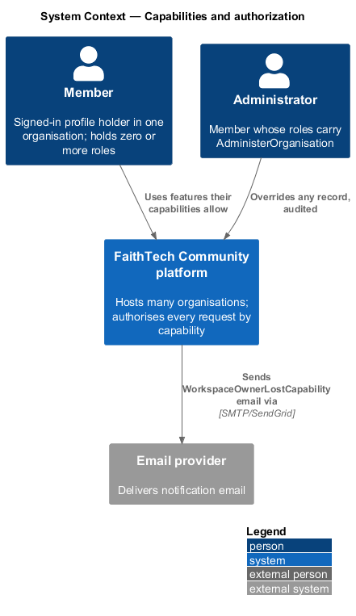
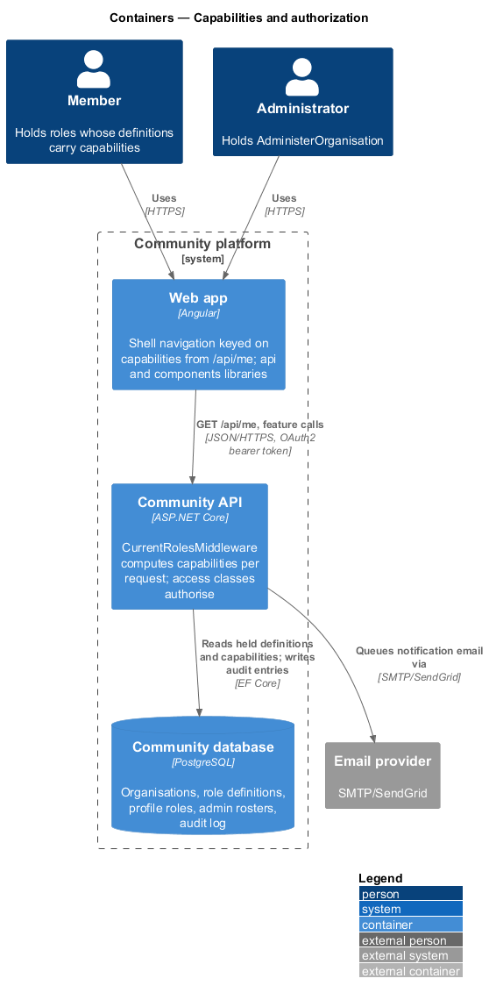
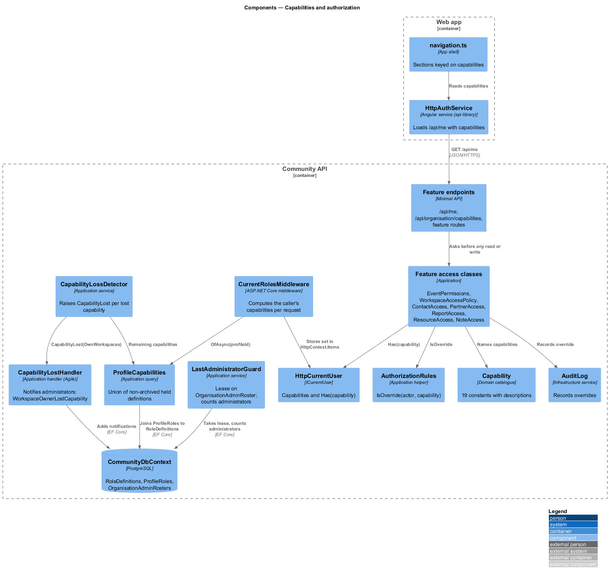
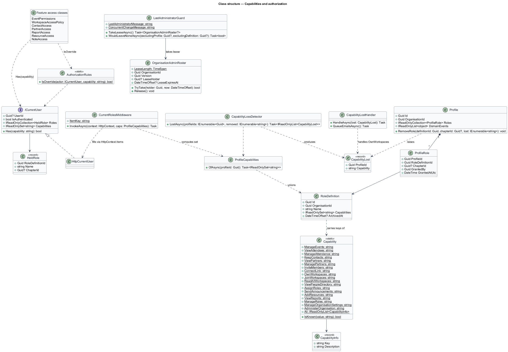
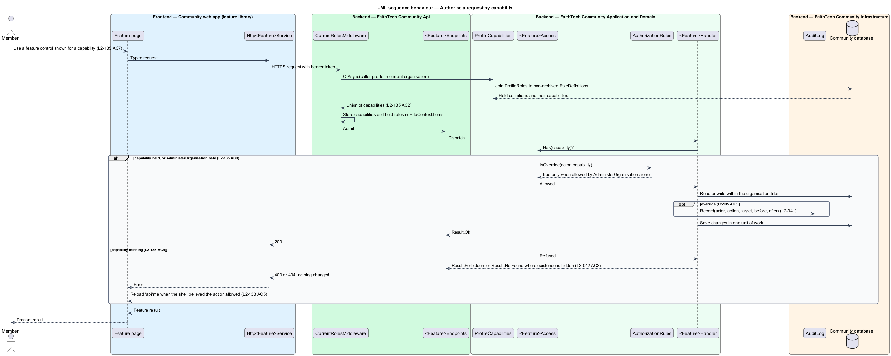
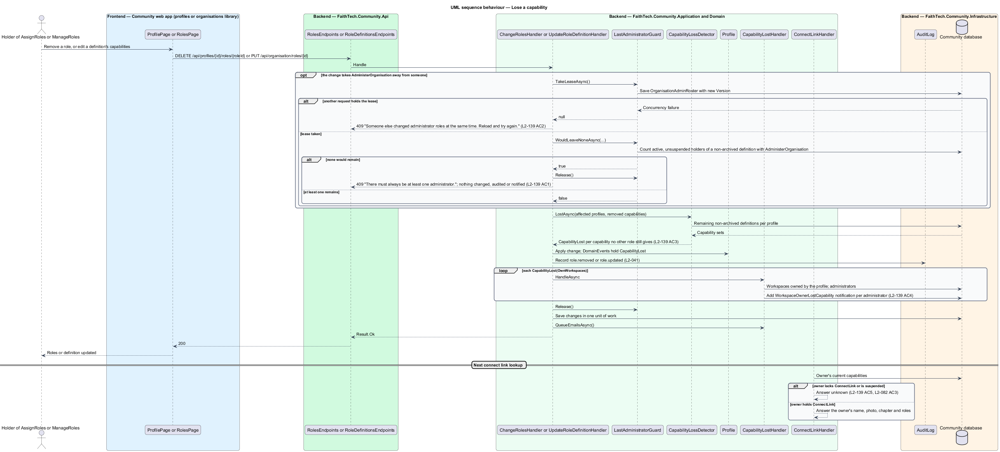

# Capabilities and authorization

## Overview

FaithTech Community is becoming a platform that hosts many organisations in one deployment (ADR 0032). Today the server decides every permission by role name: `Role` is a Domain enumeration of nine values, and `RoleAssignmentPolicy`, `LeadRoles`, `TeamRoles`, `EventPermissions`, `WorkspaceAccessPolicy`, `ContactAccess`, `PartnerAccess`, `ReportAccess`, `ResourceAccess` and `NoteAccess` compare the caller's roles against those values. An organisation that wants a role the enumeration does not name cannot have one. This feature replaces the comparison by role name with a comparison by capability (ADR 0033).

- **capability** — named right the platform defines once, such as the right to manage events or to keep private contacts
- **capability catalogue** — fixed list of the 19 capabilities, held in code; an organisation chooses which roles carry them and never adds, renames or removes one
- **role definition** — organisation-owned named bundle of capabilities that a profile may hold (`docs/detailed-designs/organisations/role-definitions-and-grant-rules`)
- **baseline right** — action every signed-in member of an organisation may take without any capability: view profiles, the team, events and announcements; RSVP; open resources and notes visible to them; create their own notes; search; edit their own profile and settings
- **override** — action a caller is allowed only because they hold `AdministerOrganisation`, either lacking the specific capability or not owning the record; every override is audited
- **administrator** — active, unsuspended member whose roles carry `AdministerOrganisation` (seeded as System Admin in FaithTech)
- **last-administrator lease** — short-lived lock on a per-organisation roster row that serialises every change which could leave the organisation without an administrator

The capability set is computed on every request from the caller's current roles in the current organisation, so a role change or a definition edit is live on the next call without any token revocation. This keeps the role freshness policy of the server authorization design (`docs/detailed-designs/platform/server-authorization`, `L2-042` AC4). The frontend reads the same set from `/api/me` and uses it only to hide controls; the server stays the authority.

The feature sits in the organisations subsystem because the catalogue belongs to the platform and the roles that carry capabilities belong to an organisation. It refines ADR 0004, ADR 0005, ADR 0009, ADR 0011 and ADR 0014, each of which names a role where the rule now names a capability.

## Description

The slice runs from the shell navigation in the web app through `ICurrentUser` to the access class of every feature, with one Domain catalogue at the root.

### Domain

- **`Capability`** (`Domain/Organisations/Capability.cs`, new) — static class holding the 19 string constants `ManageEvents`, `ViewAttendees`, `ManageAttendance`, `KeepContacts`, `ViewPartners`, `ManagePartners`, `InviteMembers`, `ConnectLink`, `OwnWorkspaces`, `JoinWorkspaces`, `ReadAllWorkspaces`, `ViewPeopleDirectory`, `AssignRoles`, `SendAnnouncements`, `AddResources`, `ViewReports`, `ManageRoles`, `ManageOrganisationSettings` and `AdministerOrganisation`, an ordered `All` list and a one-line description per entry (`L2-135` AC1). `IsKnown(string)` validates a value a role definition tries to carry. Adding an entry is a code change with a requirement.
- **`Role`** (`Domain/Profiles/Role.cs`) — the enumeration is removed. `ProfileRole` references a `RoleDefinition` by id and an optional chapter instead (role-definitions design). `TeamRoles` (`Domain/Team/`) is removed; the team list reads the definition flag `ShowOnTeam`.
- **`CapabilityLost`** (`Domain/Profiles/CapabilityLost.cs`, new) — record `(Guid ProfileId, string Capability)` replacing `CityLeadRoleRemoved`. `Profile.RemoveRole` raises one per capability that the removed definition carried and no remaining held definition still carries; the caller passes the capability sets, because the entity does not load definitions. A definition edit raises the same event for every holder through `CapabilityLossDetector` (below) (`L2-139` AC3).
- **`OrganisationAdminRoster`** (`Domain/Organisations/OrganisationAdminRoster.cs`, new) — one row per organisation keyed by `OrganisationId`, generalising `SystemAdminRoster` (`Domain/Admin/`), which is removed. It keeps `Version` as the optimistic concurrency token, `LeaseHolder`, `LeaseExpiresAt`, `TryTake(holder, now)`, `Release()` and the 30-second `LeaseLength` (`L2-139` AC2).

### Application

- **`ICurrentUser`** (`Application/Common/ICurrentUser.cs`) — gains `IReadOnlySet<string> Capabilities` and `Has(string capability)`; `HasRole(Role)` is removed. `Has` is true when the set contains the capability or contains `AdministerOrganisation` (`L2-135` AC3). `Roles` becomes the held assignments (`HeldRole`: definition id, name, optional chapter id), which only `RoleGrantPolicy`, share audiences and `/api/me` read.
- **`CurrentRolesMiddleware`** (`Api/Authentication/`) — runs after authentication, loads the caller's profile in `ICurrentOrganisation` (tenancy design), joins `ProfileRole` to the non-archived `RoleDefinition` rows and stores the union of their capabilities and the held roles in `HttpContext.Items` under `ItemKey`. **`HttpCurrentUser`** reads them from there and never from token claims (`L2-135` AC2).
- **`AuthorizationRules`** (`Application/Common/AuthorizationRules.cs`) — gains `IsOverride(ICurrentUser actor, string capability)`: true when `actor.Has(AdministerOrganisation)` and the capability itself is not in `actor.Capabilities`. Access classes combine it with ownership: a change to a record the actor does not own is an override when the actor lacks the owner's standing and holds `AdministerOrganisation` (`L2-135` AC5). This is the one rule behind today's `EventPermissions.IsAdminOverride`, `WorkspaceAccess.Admin` and `ContactAccessKind.AdminOverride`.
- **`LeadRoles`** (`Application/Common/`) — removed. Each use names one capability.
- **Access classes** — each keeps its shape and reads capabilities. The table lists every comparison that changes.

| Class | Today | After |
|-------|-------|-------|
| `EventPermissions` | `CanManageEvents` for Event Lead, City Lead, System Admin | `Has(ManageEvents)` |
| | `CanSeeRsvpList` for leads, Staff, System Admin; `CanViewCheckIn` the same | `Has(ViewAttendees)` or `Has(ManageAttendance)` |
| | `CanSeeGuestEmails`, `CanExportRsvps`, `CanCheckIn` for leads and System Admin | `Has(ManageAttendance)` |
| | `IsAdminOverride`, `IsCheckInOverride` | `IsOverride(actor, ManageEvents)`, `IsOverride(actor, ManageAttendance)` |
| `WorkspaceAccessPolicy` | `ReadsEverything` for Staff or System Admin; `IsSystemAdmin` | `Has(ReadAllWorkspaces)`; `Has(AdministerOrganisation)` |
| | `Classify` ranks `Admin` by System Admin and `Staff` by Staff | `Admin` by `AdministerOrganisation`; `Staff` renamed `Reader`, by `ReadAllWorkspaces` |
| | member candidates hold a lead or volunteer role; owner holds City Lead | candidates `JoinWorkspaces`; owner and reassignment target `OwnWorkspaces` |
| `ContactAccess` | `CanKeepContacts` for leads or System Admin; `AdminOverride` by System Admin | `Has(KeepContacts)`; `AdminOverride` when not owner and `Has(AdministerOrganisation)` |
| `PartnerAccess` | `CanRead` leads, Staff, System Admin; `CanWrite` leads, System Admin; `CanRestore` System Admin | `Has(ViewPartners)` or `Has(ManagePartners)`; `Has(ManagePartners)`; `Has(AdministerOrganisation)` |
| | `AuditAdminWrite` when System Admin without a lead role | `IsOverride(actor, ManagePartners)` |
| `ReportAccess` | `CanRead` Staff or System Admin | `Has(ViewReports)` |
| `ResourceAccess` | `CanContribute` by `ContributorRoles`; `IsSystemAdmin`; `ShareableRoles`; `Roles` | `Has(AddResources)`; `Has(AdministerOrganisation)`; the organisation's non-archived definitions; held definition ids |
| `NoteAccess` | `IsSystemAdmin`; `ShareableRoles`; `Roles` | as `ResourceAccess` |
| `ConnectLinkHandler` | `CanHaveLink` City Lead or System Admin; lookup checks the owner's roles | `Has(ConnectLink)`; lookup computes the owner's current capabilities |
| `RoleAssignmentPolicy` | City Lead or System Admin | `RoleGrantPolicy` over `AssignRoles` and the grant rules (role-definitions design) |
| Invites, People, Announcements, Admin endpoints | lead roles; City Lead, Staff, System Admin; Communications Lead; System Admin | `InviteMembers`; `ViewPeopleDirectory`; `SendAnnouncements`; `AdministerOrganisation` |

- **`RoleKeys`** (`Application/Common/RoleKeys.cs`, new) — until the web app names roles by definition id (slice 12), a request names a role by its definition's key; `DefinitionsAsync(keys)` resolves them to the organisation's non-archived definitions, answering null when a key names none. A resource or page can be shared with any of them except a definition carrying `AdministerOrganisation`, whose holders read everything already (`IsShareable`). `Invite.PreassignedRole` and `Resource.OwnerRole` store the key.
- **`ProfileHolding.Capability(capability)`** (`Application/Common/`, new) and **`Profile.HoldsCapability`** — the database filter and the in-memory check for profiles whose own non-archived definitions carry a capability, with no `AdministerOrganisation` stand-in; workspace owners and members, partner owners, owner candidates and the administrator list read them. Until the team list filters by role definition (slice 12), its Leads filter is a team role carrying `InviteMembers` and its Volunteers filter a team role without it.
- **`ProfileCapabilities`** (`Application/Organisations/ProfileCapabilities.cs`, new) — query helper `OfAsync(profileId)` returning a profile's held non-archived definitions (`HeldRole`: id, key, name) and their capability union. `CurrentMembership` carries both. `CurrentRolesMiddleware`, the connect link lookup and `CapabilityLossDetector` share it, so there is one way to compute the set.
- **`CapabilityLossDetector`** (`Application/Organisations/`, new) — `LostAsync(profileIds, removedCapabilities)` returns a `CapabilityLost` per profile and capability that no remaining definition still gives. `ChangeRolesHandler` uses it for a removal and `UpdateRoleDefinitionHandler` for an edit (`L2-139` AC3, AC6).
- **`CapabilityLostHandler`** (`Application/Agile/Archive.cs`, renaming `CityLeadRoleRemovedHandler`) — reacts to `OwnWorkspaces` only. For each workspace the profile owns it notifies every administrator in-app with kind `WorkspaceOwnerLostCapability` (`NotificationKind`, replacing `WorkspaceOwnerLostCityLead`), title "{Name} no longer holds a role that can own workspaces: {workspace list}", linking to the workspace settings, and queues the emails after the save (`L2-139` AC4, ADR 0011). An archived workspace is not flagged, as today.
- **Connect links** — `ConnectLinkHandler.LookupAsync` answers unknown when the owner is suspended or the owner's current capabilities lack `ConnectLink`; nothing is stored, so the link works again as soon as the capability is held again (`L2-139` AC5). `ConnectLookupDto.LeadRole` carries the owner's held role names.
- **`LastAdministratorGuard`** (`Application/Organisations/`, new) — `TakeLeaseAsync()` takes the organisation's roster lease in a save of its own, mapping a `DbUpdateException` to the 409 "Someone else changed administrator roles at the same time. Reload and try again."; `WouldLeaveNoneAsync(excludingProfile?, excludingDefinition?)` counts the active, unsuspended profiles that would still hold a non-archived definition carrying `AdministerOrganisation`; `Release()`. Four handlers call it: `ChangeRolesHandler` (removal of a role carrying the capability), `SuspendProfileHandler`, `UpdateRoleDefinitionHandler` (edit that drops the capability) and `ArchiveRoleDefinitionHandler` (`L2-139` AC1, AC2). A refusal answers 409 "There must always be at least one administrator." with nothing saved, audited or notified. The overlap is tested as today, with a test-only EF interceptor on the in-memory provider.

### API

- **`CapabilitiesEndpoints`** (`Api/Endpoints/`, new) — `GET /api/organisation/capabilities` returns the catalogue with descriptions to any member (`L2-135` AC1).
- **`MeEndpoints`** — `GET /api/me` adds `capabilities` (the computed set) and `roles` as held assignments (id, name, chapter); `grantableRoleIds` is added by the role-definitions design (`L2-133` AC1, `L2-135` AC7).

### Frontend

- **`capability.ts`** (`frontend/projects/api/src/lib/shared/`, new) — `CAPABILITIES` const tuple, the `Capability` type, `hasAny(held, ...wanted)` (`AdministerOrganisation` answers yes to everything, as on the server) and the `HeldRole` shape. **`role.ts`** loses `isLead` and `LEAD_ROLES`; `events.service.ts` loses `EVENT_MANAGERS` (`canManageEvents` takes capabilities) and `resources.service.ts` loses `RESOURCE_CONTRIBUTOR_ROLES`. `ROLES`, `ROLE_LABELS`, `ROLE_DESCRIPTIONS`, `assignableRoles` and the share-role lists stay until the role pickers and share dialogs read `GET /api/organisation` (slice 14); they label and offer roles, they decide nothing.
- **`AuthService`** (`api/src/lib/auth/auth.service.ts`) — `CurrentUser` gains `capabilities: Capability[]` and `roles: HeldRole[]` (`{ id, key, name, chapterId, isOversight }`, as `/api/me` answers them); the service exposes `capabilities: Signal<Capability[]>`. Its `roles` signal keeps the held keys only for the role pickers until slice 14; no page decides from it. The account menu names roles from `HeldRole.name`, and the home banner names the held oversight role (`IsOversight`) when the member holds nothing that writes.
- **Feature pages** — each decision reads a capability: home quick actions (`ManageEvents`, `KeepContacts`) and pipeline (`ViewPartners` or `ManagePartners`); events New event (`ManageEvents`); team Invite (`InviteMembers`); invites My QR code (`ConnectLink`); resources Add resource (`AddResources`); announcements Compose (`SendAnnouncements`); workspaces New workspace (`OwnWorkspaces`) and the read-only subtitle (`ReadAllWorkspaces` without `AdministerOrganisation`); people management (`AssignRoles`) and its subtitle (`AdministerOrganisation`). Unit specs arrange a capability set, never a role name.
- **`httpErrorInterceptor`** (`api/src/lib/errors/`) — any 403, whether or not the caller handles it, reloads `/api/me` (except a 403 from `/api/me` itself, which only says the account is not a member here), so the navigation and pages follow the fresh capabilities without a page load (`L2-133` AC5).
- **`navigation.ts`** (`faithtech-community/src/app/shell/`) — each `Section.opens` takes the capability list: Contacts `KeepContacts`; Partners `ViewPartners` or `ManagePartners`; Workspaces `OwnWorkspaces`, `JoinWorkspaces` or `ReadAllWorkspaces`; People `ViewPeopleDirectory`; Reports `ViewReports`; Organisation `ManageRoles` or `ManageOrganisationSettings`; Admin `AdministerOrganisation`; Home, Events, Team, Announcements, Resources and Notes stay open to everyone (ADR 0009 refined). Hiding is a convenience only (`L2-135` AC7).
- **`mock-api.ts`** and **`role-definitions.ts`** (`e2e/fixtures/`) — `role-definitions.ts` holds the FaithTech definitions (with the seed's ids) and grant rules as data; `holds(caller, capability)` answers as `ICurrentUser.Has`, `carries(roles, capability)` as `ProfileHolding` (no `AdministerOrganisation` stand-in), `canGrant` as `RoleAssignmentPolicy`, `isOverride` as `AuthorizationRules.IsOverride`, `isShareable` as `RoleKeys.IsShareable`, `onTeam` by `ShowOnTeam` and `firstRoleCarrying` as the connect link's and event host's role name. `/api/me` answers held roles and capabilities from them. `CITY_LEAD_ROLES`, `LEAD_ROLES`, `TEAM_LEAD_ROLES`, `TEAM_ROLES` and every fixture's role-name list are removed. `addAccount` takes FaithTech role keys, or a role the test names with an explicit `capabilities` set, and `signInAs` signs either in.

## Requirements

The feature realizes the following level-2 (L2) requirements. Each L2 requirement refines a level-1 (L1) requirement, cited by identifier.

| L2 ID | Refines (L1) | Requirement |
|-------|--------------|-------------|
| `L2-135` | `L1-026`, `L1-015` | Capability catalogue and server authorisation |
| `L2-139` | `L1-026`, `L1-014` | Last administrator and consequences of role changes |

### Acceptance criteria

**`L2-135` — Capability catalogue and server authorisation**

1. Given the platform, when `GET /api/organisation/capabilities` is called by any member, then it lists exactly: `ManageEvents`, `ViewAttendees`, `ManageAttendance`, `KeepContacts`, `ViewPartners`, `ManagePartners`, `InviteMembers`, `ConnectLink`, `OwnWorkspaces`, `JoinWorkspaces`, `ReadAllWorkspaces`, `ViewPeopleDirectory`, `AssignRoles`, `SendAnnouncements`, `AddResources`, `ViewReports`, `ManageRoles`, `ManageOrganisationSettings`, `AdministerOrganisation`, each with a one-line description, and no organisation can add, rename or remove one.
2. Given a request, when the server authorises it, then it checks the caller's capabilities, computed on that request from the union of the capabilities of every non-archived role the caller's profile holds in the current organisation, and never compares a role name.
3. Given a holder of `AdministerOrganisation`, when any capability is checked, then it is held.
4. Given an action that needs a capability the caller lacks, when it is called, then the response is 403 (or 404 where `L2-042` AC2 hides existence), and nothing changes.
5. Given an action the caller is allowed only because they hold `AdministerOrganisation` (they lack the specific capability, or do not own the record), when it succeeds, then it is an override and an audit entry is written (`L2-041`); given the caller holds the specific capability or owns the record, then it is not audited (role changes excepted, `L2-138` AC5).
6. Given every signed-in member of the organisation, when they view profiles, the team, events and announcements, RSVP, open resources and notes visible to them, create their own notes, search, or edit their own profile and settings, then no capability is required.
7. Given the frontend, when it decides what to show, then it reads capabilities from `/api/me`, never role names, and hiding is a convenience only: the server refuses what the member may not do.

**`L2-139` — Last administrator and consequences of role changes**

1. Given an organisation, when a role removal, a profile suspension, a definition edit or a definition archive would leave no active, unsuspended profile holding `AdministerOrganisation`, then it is refused with 409 "There must always be at least one administrator." and nothing changes, is audited or is notified.
2. Given two such requests that overlap, when both settle, then at most one succeeds: each takes the organisation's administrator-roster lease in a save of its own before counting, and the loser answers 409 "Someone else changed administrator roles at the same time. Reload and try again."; a lease left behind expires after 30 seconds.
3. Given a profile loses a capability (its role was removed, or its definition lost the capability) and no other role it holds still gives it, when the change is saved, then a `CapabilityLost(profile, capability)` domain event is raised in the same unit of work.
4. Given `CapabilityLost` for `OwnWorkspaces` on a profile that owns workspaces, when it is handled, then every administrator is notified (`WorkspaceOwnerLostCapability`, "{Name} no longer holds a role that can own workspaces: {workspace list}") so they can reassign the owner (`L2-037` AC2); the workspace keeps working meanwhile.
5. Given `CapabilityLost` for `ConnectLink`, when it is handled, then the profile's connect link answers as unknown until the capability is held again (`L2-082` AC3).
6. Given a definition gains a capability, when the change is saved, then every holder has it on their next request, and nothing is notified.

## Diagrams

### System context

Every member reaches organisation data through the platform, which authorises each call by capability. Administrators are notified by email when a workspace owner loses `OwnWorkspaces`.

### Containers

The web app hides sections and controls from the capabilities in `/api/me`. The Community API computes the set on every request from the role definitions in the Community database and refuses what the member may not do.

### Components

`CurrentRolesMiddleware` loads the caller's held definitions through `ProfileCapabilities` and fills `HttpCurrentUser`. Each feature access class asks `ICurrentUser.Has` and `AuthorizationRules.IsOverride`; `LastAdministratorGuard` serialises the guarded operations on `OrganisationAdminRoster`; `CapabilityLossDetector` raises `CapabilityLost` for `CapabilityLostHandler`.

### Class structure

`Capability` is the catalogue. `ICurrentUser` exposes the computed set; `AuthorizationRules` and every access class depend on it. `Profile` raises `CapabilityLost`; `OrganisationAdminRoster` carries the lease that `LastAdministratorGuard` takes.

### Behaviour — authorise a request by capability

The middleware computes the caller's capabilities from their current roles before the endpoint runs. The access class answers 403 for a missing capability, 404 where existence is hidden, and audits the action when it is an override (`L2-135`).

### Behaviour — lose a capability

A role removal or a definition edit first takes the last-administrator lease when `AdministerOrganisation` is at stake, then raises `CapabilityLost` for each capability no remaining role still gives; the Agile handler notifies every administrator about workspaces that need a new owner, and the connect link lookup answers unknown on its next call (`L2-139`).

## Open questions

- `ProfileRole` rows that reference an archived definition contribute nothing to the capability set but stay on the profile and the badges, so archival is refused while holders exist (`L2-136` AC4); the design keeps the rows rather than deleting them.
- Role labels and descriptions stay in `role.ts` until slice 14: profile, team and announcement DTOs still carry role keys, and the role pickers and share dialogs offer keys; slice 14 brings names, descriptions and grantable roles from `GET /api/organisation`.
- `WorkspaceAccess.Staff` is renamed `Reader` because the rank no longer corresponds to a role; the test names that read "Staff" change with it.
- The audit log's category filter for overrides stays as today; whether an override by a holder of `AdministerOrganisation` who also holds the specific capability should be recorded is settled by `L2-135` AC5: it is not.
