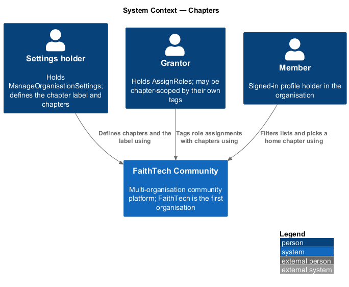
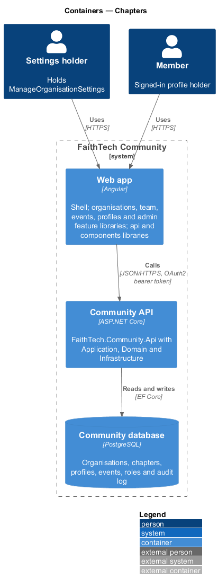
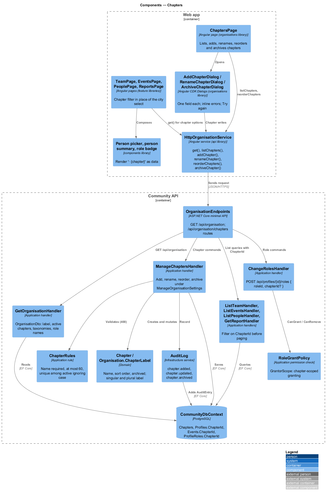
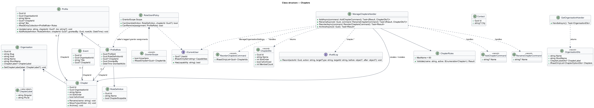
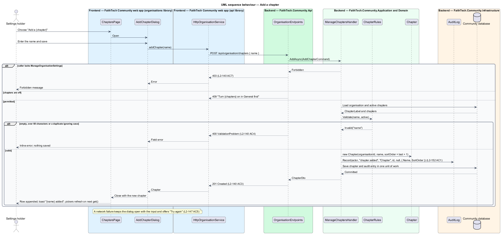
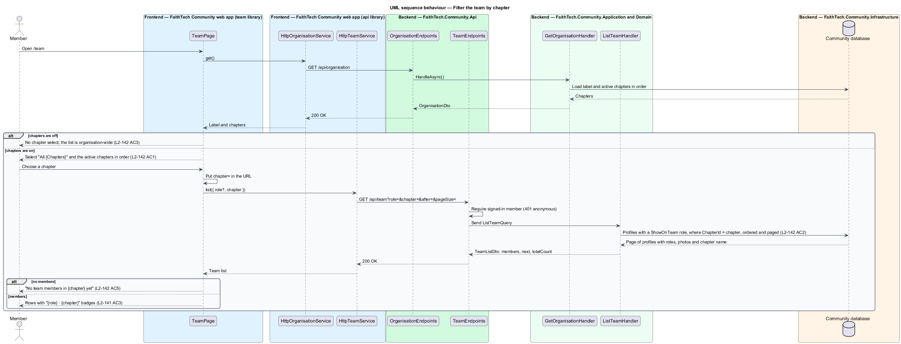
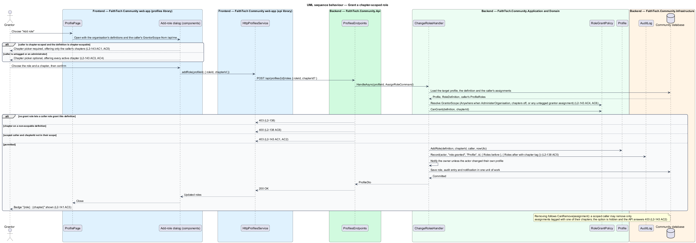

# Chapters

## Overview

A **chapter** — one subdivision of an organisation, at a single level with no hierarchy, carrying a name the organisation chooses under a label the organisation chooses. An **organisation** — tenant of the platform: a named community with its own host, members, roles, chapters, taxonomies, data and audit log (`organisations/tenancy-and-host-resolution`, [ADR 0032](../../../adr/0032-multi-tenancy-organisation-per-host.md)). The **chapter label** — the singular and plural words an organisation uses for its chapters, for example City/Cities, Campus/Campuses or Region/Regions (seeded as City/Cities in FaithTech). An organisation with no label has no chapters, and every chapter control, filter, badge and suffix in the product is hidden.

Today the product stores a **city** as free text in three places: `Profile.HomeCity`, `Event.City` and `Contact.City`. Four pages (team, events, People and Reports) build a filter from the distinct values they find. Chapters replace the first two with a reference to a chapter the organisation defines; the contact's city stays free text because a contact describes an outsider and the field is a postal fact. A **chapter tag** — the optional chapter reference on a profile, an event or a role assignment. Chapters tag; they never hide: data stays organisation-wide, a member of one chapter sees every other chapter's events, team and partners, and private contacts remain the only visibility exception ([ADR 0034](../../../adr/0034-chapters-are-tags-not-boundaries.md)).

A **chapter-scopable role** — role definition flagged `ChapterScopable`, whose assignments may carry a chapter tag (`organisations/role-definitions-and-grant-rules`). A **chapter-scoped grantor** — holder of a grantor role whose own assignment of that role is chapter-tagged; such a grantor may add and remove only assignments tagged with one of their own chapters. That restriction on granting is the whole meaning of chapter scoping. It limits who may assign, never what anyone may see.

This design covers the chapter aggregate and label, the Chapters settings page, the chapter tag on profiles, events and role assignments, the chapter filter that replaces the distinct-city lists, the "· {chapter}" suffix in pickers and badges, chapter-scoped granting, the FaithTech migration from city text and turning chapters off. The General page that holds the label switch is in `organisations/organisation-settings`; role definitions and the grant rules the scoping sits inside are in `organisations/role-definitions-and-grant-rules`.

## Description

### Domain

- **`Organisation.ChapterLabel`** — optional value object on the `Organisation` aggregate (`Domain/Organisations/`) with `Singular` and `Plural`, each required when present and at most 30 characters (`L2-140` AC1). A null label means chapters are off (`L2-140` AC2). Clearing the label keeps every `Chapter` row and every chapter tag (`L2-140` AC6); setting it again shows them.
- **`Chapter`** — new aggregate in `Domain/Organisations/` with `Id`, `OrganisationId`, `Name` (at most 60 characters, unique among active chapters of the organisation ignoring case, `L2-140` AC4), `SortOrder` and `IsArchived`. Methods: `Rename(name)`, `MoveTo(sortOrder)` and `Archive()`. There is no delete (`L2-140` AC5).
- **`Profile.ChapterId`** — optional reference replacing the free-text `HomeCity` (`Profile.cs`, mapped today with `HasMaxLength(100)` and the index `IX_Profiles_HomeCity`). `Profile.Update(name, chapterId, bio)` replaces `Update(name, homeCity, bio)`. The index becomes `IX_Profiles_ChapterId`, which Reports read (ADR 0030, ADR 0034).
- **`Event.ChapterId`** — optional reference replacing `Event.City` (`Event.cs`, mapped with `HasMaxLength(100)`); none means organisation-wide and is shown as "{Organisation}-wide" (`L2-141` AC2). The event's `Create` and `Update` methods take `chapterId` in place of `city`. A new index `IX_Events_ChapterId` serves the filter.
- **`Contact.City`** — unchanged free text (`Contact.cs`, `HasMaxLength(200)`), labelled "City" whatever the chapter label (`L2-141` AC4).
- **`ProfileRole.ChapterId`** — optional chapter tag on a role assignment, allowed only when the definition is chapter-scopable (`L2-138` AC6). `Profile.AddRole(definition, chapterId, grantedBy, nowUtc)` refuses a chapter on a non-scopable definition, and a profile may hold the same definition once per chapter tag.
- A partner has no chapter; Reports attribute it to its owner's home chapter (`L2-141` AC5, ADR 0030).

### Application

- **`GetOrganisationHandler`** — answers `GET /api/organisation` for every member with **`OrganisationDto`**: `Name`, `ShortName`, `ChapterLabel` (`Singular`, `Plural`, or null), `Chapters` (the active chapters in order as `ChapterOptionDto` `Id`, `Name`; empty when chapters are off), the taxonomies (`organisations/taxonomies`) and the non-archived role names and ids (`L2-136` AC8). Every chapter picker and filter in the product reads this one response (`L2-142` AC1).
- **`ListChaptersHandler`** — answers `GET /api/organisation/chapters` with **`ChapterDto`** rows: `Id`, `Name`, `SortOrder`, `IsArchived` and `MemberCount` (profiles whose `ChapterId` is the chapter). The page shows active chapters by default and archived ones under the "Archived" filter (`L2-140` AC3).
- **`ManageChaptersHandler`** — `AddAsync(AddChapterCommand)`, `RenameAsync(id, RenameChapterCommand)`, `ReorderAsync(ReorderChaptersCommand)` and `ArchiveAsync(id)` in `Application/Organisations/`. Each requires `ManageOrganisationSettings` (`403` otherwise, `L2-140` AC7), requires chapters to be on, applies **`ChapterRules`** (trimmed name required, at most 60 characters, unique among active chapters ignoring case; a violation answers `400` with problem details naming the field) and writes `chapter.added`, `chapter.updated` or `chapter.archived` through `IAuditLog` with the before and after values in the same unit of work (`L2-152` AC1). Reorder takes the full ordered list of active chapter ids and answers `400` when the list is not a permutation of them.
- **`UpdateOrganisationHandler`** — the General page's `PUT /api/organisation` (`organisations/organisation-settings`). Turning chapters off clears `ChapterLabel` only; turning them on sets the label. Both are audited as `organisation.updated`.
- **`ListTeamHandler`** — `ListTeamQuery` gains `ChapterId?` in place of `City?`; `TeamListDto` loses `Cities`; `TeamMemberDto.HomeCity` becomes `ChapterName`. The filter compares `Profile.ChapterId` in the database before paging (ADR 0015 unchanged otherwise).
- **`ListEventsHandler`** — `ListEventsQuery` gains `ChapterId?` in place of `City?`; `EventListDto` loses `Cities`; `EventSummaryDto.City` becomes `ChapterName` (null shown as "{Organisation}-wide"). The events filter also offers "{Organisation}-wide", which selects events with no chapter (`L2-142` AC2).
- **`ListPeopleHandler`** — `PersonSummary.HomeCity` becomes `ChapterName`; the query gains `ChapterId?`.
- **`GetReportHandler`** — `GetReportQuery.City` becomes `ChapterId`; `CitiesAsync` (the distinct non-blank home cities and event cities) is replaced by the organisation's active chapters; members by chapter, the partner pipeline per owner chapter and announcements per sender chapter group by `ChapterId` and are named from the chapter list; profiles and events with no chapter fall under "No {chapter}" as today's "No city" (ADR 0030).
- **`RoleGrantPolicy`** — replaces `RoleAssignmentPolicy` (`Application/Admin/`) over the grant rules (`organisations/role-definitions-and-grant-rules`). Chapter scoping is one check inside it. **`GrantorScope`** — the chapters a caller may grant within: *anywhere* when the caller holds `AdministerOrganisation`, when chapters are off, or when any of the caller's assignments of a grantor role is untagged; otherwise the set of chapter tags on those assignments. `CanGrant(definition, chapterId)` requires, for a scoped caller, that the definition is chapter-scopable and `chapterId` is in the scope (`L2-143` AC1, AC5); `CanRemove(assignment)` requires the assignment's tag to be in the scope (`L2-143` AC2). An untagged grantor and an administrator are never scoped (`L2-143` AC3, AC4); chapters off suspends scoping (`L2-143` AC6). The web app mirrors the scope only to hide options; the server decides.
- **`ChangeRolesHandler`** — the body of `POST /api/profiles/{id}/roles` is `{ roleId, chapterId? }`; the audit entry `role.granted` and `role.removed` records the chapter tag (`L2-138` AC5).

### Infrastructure

- **`CommunityDbContext`** — maps `Chapters` (`Name` `HasMaxLength(60)`, unique index on `OrganisationId` and the lower-cased name among active rows), `ChapterLabel` as an owned type on `Organisations` (`HasMaxLength(30)` each), `Profiles.ChapterId` with `IX_Profiles_ChapterId`, `Events.ChapterId` with `IX_Events_ChapterId` and `ProfileRoles.ChapterId`.
- **`ChaptersFromCities`** — EF Core migration in `Infrastructure/Persistence/Migrations/`, applied by the Cli (`L2-141` AC6). For FaithTech it sets the label City/Cities, creates one `Chapter` per distinct trimmed, case-folded value across `Profiles.HomeCity` and `Events.City`, maps every row whose trimmed, case-folded value matches, sets the rest to none and writes each unmatched value with its table and row id to the migration log, then drops `HomeCity` and `City`. Running it again changes nothing. The spelling chosen for a chapter's name when values differ only in case or surrounding spaces: `<TO SUPPLY>`.
- **`CommunitySeeder`** — the demo "City NN" values become seeded chapters (ADR 0034).

### Web app

- **`ChaptersPage`** — tab of `OrganisationPage` in the `organisations` feature library at `/organisation/chapters` (`organisations/organisation-settings`). It lists the active chapters in order in a `ListComponent` with name and "{n} members", offers "Add a {chapter}", a row menu with Rename and Archive, reorder by drag and by keyboard with the `L2-089` pattern (move up and down buttons with a live-region announcement), and an "Archived" filter (`L2-140` AC3). When chapters are off it shows an empty state that links to General to turn them on. A holder of only `ManageRoles` sees the list read-only (`L2-147` AC2).
- **`AddChapterDialog`**, **`RenameChapterDialog`**, **`ArchiveChapterDialog`** — CDK dialogs in the `organisations` library. Add and rename take one `ft-text-field` with the counter "{n} / 60" and show the inline error from a `400` (`L2-140` AC4); archive confirms "Members and events keep {name}, but it leaves every picker and filter." A failed save keeps the dialog open with the input and offers "Try again" (`L2-147` AC5). A success closes the dialog and raises a toast.
- **`OrganisationService`** / **`ORGANISATION_SERVICE`** / **`HttpOrganisationService`** — API client in the `api` library: `get()` for `GET /api/organisation`, `listChapters()`, `addChapter(name)`, `renameChapter(id, name)`, `reorderChapters(ids)` and `archiveChapter(id)` for the chapter routes. `get()` is cached per session and refreshed after any settings write.
- **Filters** — `TeamPage` (`team.page.ts`), `EventsPage`, `PeoplePage` and `ReportsPage` replace their `cityOptions` (built from the response's `cities`) with `chapterOptions` built from `OrganisationService.get()`: "All {Chapters}" and the active chapters in order, plus "{Organisation}-wide" on events only. The URL carries `chapter=` in place of `city=` (`L2-142` AC1). An empty result names the chapter ("No upcoming events in Toronto", `L2-142` AC5). When chapters are off the select is not rendered (`L2-142` AC3).
- **Pickers and badges** — `ft-person-picker` and `ft-person-summary` in `components` render "{name} · {role} · {chapter}", omitting what is missing (`L2-142` AC4). Role badges render "{role} · {chapter}" for a tagged assignment and "{role}" otherwise, on the profile page, People, the team list and the connect page (`L2-141` AC3). Both components take the text as data and know no chapter label.
- **Profile and event forms** — `EditProfilePage` replaces the "Home city" text field with an `ft-select` "Home {chapter}" of the active chapters plus the member's current one if archived (`L2-141` AC1). `EventFormPage` does the same for "{Chapter}" with a "{Organisation}-wide" option (`L2-141` AC2). Both read the options from `OrganisationService.get()`.
- **Add-role dialog** — the `components` role dialog gains an optional `ft-select` for the chapter when the chosen definition is chapter-scopable; the options are the active chapters, narrowed to the caller's `GrantorScope` from `/api/me` and required when the caller is scoped (`L2-143` AC1).

### E2E fake

`mock-api.ts` gains an `organisation` record (label and chapters) and answers `GET /api/organisation` and the chapter routes; profiles carry `chapterId` in place of `homeCity`; the team, events, People and Reports handlers filter by `chapter=`; the role-change handler applies the same `GrantorScope` rule.

## Requirements

The feature realizes the following level-2 (L2) requirements. Each L2 requirement refines a level-1 (L1) requirement, cited by identifier.

| L2 ID | Refines (L1) | Requirement |
|-------|--------------|-------------|
| `L2-140` | `L1-027`, `L1-028` | Chapter label and list |
| `L2-141` | `L1-027`, `L1-002`, `L1-008` | Chapters on profiles, events and role assignments |
| `L2-142` | `L1-027`, `L1-007`, `L1-008`, `L1-024` | Chapter filters |
| `L2-143` | `L1-027`, `L1-026` | Chapter-scoped granting |

### Acceptance criteria

**`L2-140` — Chapter label and list**

1. Given a holder of `ManageOrganisationSettings` on General (`/organisation`), when they turn "This organisation has {chapters}" on and enter a singular and plural label (each required when on, up to 30 characters, for example City/Cities), then `PUT /api/organisation` saves them, every chapter control and filter in the product uses the label at once, and `organisation.updated` is audited.
2. Given chapters are off, when any page renders, then no chapter picker, filter, column, badge or "· {chapter}" suffix is shown, and `GET /api/organisation` returns no chapter label and an empty chapter list.
3. Given chapters are on, when the holder opens Chapters (`/organisation/chapters`), then it lists the active chapters in order with their member count, offers "Add a {chapter}", rename, reorder (drag and keyboard, `L2-089`'s pattern) and archive, and an "Archived" filter; `POST`, `PUT`, `PUT .../order` and `POST .../archive` under `/api/organisation/chapters` apply the changes, each audited under `chapters`.
4. Given a chapter name that is empty, longer than 60 characters or already used by an active chapter ignoring case, when it is saved, then an inline error is shown, the API answers 400 and nothing is saved.
5. Given an archived chapter, when records reference it, then they keep it and display its name; it leaves every picker and filter; it is never deleted.
6. Given the holder turns chapters off while chapters exist, when they confirm the dialog "Members and events keep their {chapter}, but nothing will show it until you turn {chapters} back on", then the label is cleared and the chapters and tags are kept.
7. Given any member without `ManageOrganisationSettings`, when they call a chapter or general-settings write endpoint, then the response is 403; `GET /api/organisation` is readable by every member.

**`L2-141` — Chapters on profiles, events and role assignments**

1. Given chapters are on, when a member edits their profile (`L2-006`), then "Home {chapter}" is an optional picker of the active chapters (plus the member's current one if archived) in place of the former free-text home city; the profile page and person cards show it.
2. Given chapters are on, when an event is created or edited (`L2-020`), then "{Chapter}" is an optional picker of the active chapters; none means organisation-wide, shown as "{Organisation}-wide"; the event list, event page, public page, `.ics` location line and Home show the chapter name.
3. Given a role assignment on a chapter-scopable definition (`L2-138` AC6), when it is shown as a badge on a profile, in People, on the team list or on the connect page, then it reads "{role} · {chapter}", or "{role}" when untagged.
4. Given a contact (`L2-013`), when it is created or edited, then its city stays a free-text field labelled "City", whatever the chapter label, because a contact is an outsider.
5. Given a partner, when it is shown or counted, then it has no chapter of its own; reports attribute it to its owner's home chapter (`L2-125`).
6. Given the FaithTech migration, when it runs, then one chapter per distinct trimmed, case-folded former home city and event city value is created with the label City/Cities, exact matches are mapped, unmatched values are set to none and written to the migration log, and running it again changes nothing.

**`L2-142` — Chapter filters**

1. Given chapters are on, when the team list (`L2-019`), the event list (`L2-021`), People (`L2-053`) and Reports (`L2-124`) render their filter, then it offers "All {Chapters}" and the active chapters in order, from `GET /api/organisation`, in place of the former distinct-city lists, and the URL carries `chapter=` in place of `city=`.
2. Given a chapter filter, when it is applied, then only records tagged with that chapter are listed, and an event with no chapter appears only under "All {Chapters}" and under "{Organisation}-wide" when that option is offered (events only).
3. Given chapters are off, when those pages render, then the filter is absent and the lists are organisation-wide.
4. Given a people picker or share picker that shows a person's role and city (`L2-056` AC4, `L2-061` AC1, `L2-064` AC3, `L2-093` AC2), when it renders, then it shows "{name} · {role} · {chapter}", omitting what is missing.
5. Given an empty result for a chapter, when the list renders, then the empty state names the chapter ("No upcoming events in Toronto").

**`L2-143` — Chapter-scoped granting**

1. Given a grantor whose own assignment of the grantor role is tagged with a chapter, when they add a chapter-scopable role, then the chapter picker is required and offers only their own chapters; when they add a non-scopable role, then no restriction applies beyond the grant rules.
2. Given such a grantor, when they try to remove an assignment tagged with a chapter that is not one of theirs, or an untagged one, then the option is not shown and the API answers 403.
3. Given a grantor whose assignment of the grantor role is untagged, when they add or remove roles, then they may tag any active chapter or none, within the grant rules.
4. Given a holder of `AdministerOrganisation`, when they add or remove roles, then chapter scoping never applies.
5. Given a grantor who holds the grantor role for several chapters, when they grant, then the picker offers each of those chapters.
6. Given chapters are turned off (`L2-140` AC6), when grants are checked, then chapter scoping does not apply until they are turned on again.

## Diagrams

### System context

A settings holder defines the chapters; every member reads them through pickers, filters and badges; a grantor is limited by their own chapter tags. No external system takes part.

### Containers

The `organisations`, `team`, `events`, `profiles` and `admin` feature libraries read chapter options from the Community API through the `api` library. The API persists chapters, labels and tags in the PostgreSQL Community database.

### Components

`GetOrganisationHandler` feeds every picker and filter; `ManageChaptersHandler` changes the list under `ManageOrganisationSettings`; `RoleGrantPolicy` applies `GrantorScope` inside `ChangeRolesHandler`; the list handlers filter on `ChapterId`.

### Class structure

`Organisation` owns `ChapterLabel` and `Chapter` rows; `Profile`, `Event` and `ProfileRole` reference a chapter by id. `RoleGrantPolicy` computes a `GrantorScope` from the caller's own tagged assignments.

### Behaviour — add a chapter

The dialog posts the name; the handler requires `ManageOrganisationSettings` and chapters on, applies `ChapterRules`, appends the chapter at the end of the order and audits `chapter.added` in the same unit of work (`L2-140` AC3, AC4, AC7).

### Behaviour — filter the team by chapter

The team page builds its filter from `GET /api/organisation` and sends `chapter=`; `ListTeamHandler` compares `Profile.ChapterId` in the database before paging (`L2-142` AC1, AC2, AC5).

### Behaviour — grant a chapter-scoped role

`RoleGrantPolicy` resolves the caller's `GrantorScope`; a scoped caller may tag only their own chapters and may not remove an assignment outside them, while an untagged grantor or an administrator is unrestricted (`L2-143` AC1 to AC6).

## Open questions

Decisions recorded for this design ([ADR 0034](../../../adr/0034-chapters-are-tags-not-boundaries.md)):

- Chapters are tags and filters, never a visibility boundary; a single level with no hierarchy. Resolved.
- `Contact.City` stays free text; a partner has no chapter and counts under its owner's chapter. Resolved.
- Chapter scoping limits granting only and is bypassed by `AdministerOrganisation`, by an untagged grantor and while chapters are off. Resolved.
- **Decided (slice 19):** `ChaptersFromCities` groups the former home city and event city values by their trimmed, upper-cased text and names each chapter by the most-used spelling, ties going to the first in ordinal order. It creates chapters only for an organisation with a chapter label, after any it already has, in name order. The migration log is both: each unmatched value is written to `AuditEntries` as `chapter.migration.unmatched` with the value in `BeforeJson`, and raised as a PostgreSQL `NOTICE`, which the Cli prints. The migration adds the `ChapterId` columns, copies the data, then drops `HomeCity` and `City`, so it is safe to run once and a second run finds nothing to do.
- **Decided (slice 19):** the chapter query filter hides every chapter while the label is null (`QueryFilters.ChaptersOn`), so a tag's name disappears from every DTO while chapters are off and returns, unchanged, when they are turned back on. A profile or event save while chapters are off keeps its current tag. A pick other than the current tag must be an active chapter, else 400 "Choose a {chapter} from the list." under `ChapterId`; the current tag stays valid after it is archived (`L2-140` AC5).
- **Decided (slice 19):** "{Organisation}-wide" is the short name plus "-wide" (`OrganisationNames.chapterPlace`), shown in the event list, Home and report event rows; the event page, public page and `.ics` give the venue alone for an organisation-wide event. Search no longer matches a member's or an event's chapter name; the subtitle still shows it.
- **Decided (slice 20):** the team, events, People and Reports take `chapter={id}` in place of `city=`, and their filters list "All {Chapters}" then the active chapters in order from `GET /api/organisation` (Reports carries the same list in its response). Events also take `chapter=none` for the organisation-wide events, offered as "{Organisation}-wide"; a value that is neither `none` nor an id is 400 "Filter by a chapter from the list." The team, events and People ignore an unknown id and every id while chapters are off; Reports answers an id that is not an active chapter with 400 under `chapter` while chapters are on (the page falls back to the defaults, `L2-124` AC5) and ignores it while they are off.
- **Decided (slice 20):** the list DTOs lose their distinct-city lists, and every field that carried a home or event city is named for the chapter: `TeamMemberDto.ChapterName`, `PersonSummary.ChapterName`, the note, resource and audience members' `ChapterName`, `ConnectLookup.LeadChapterName`, `InviteLookup.InviterChapterName`, and the report's `Chapter`, `ChapterName`, `Chapters`, `MembersByChapter` and row `Chapter`. While chapters are off they are null or empty, so the pickers and person summaries render "{name} · {role}" and Reports has no members-by-chapter chart, no chapter column and one "Partner pipeline" row.
- **Decided (slice 20):** the Reports pipeline lists the active chapters in order, then archived owner chapters by name, then "No {chapter}" when it has partners. The CSV words its headings from the chapter label and is named `{organisation}-report-{chapter or all-{chapters}}-{period}-{yyyy-MM-dd}.csv` ("all" while chapters are off). Empty states name the chapter: "No volunteers in Vancouver yet", "No upcoming events in Toronto", "No upcoming FaithTech-wide events", "No one in Austin yet".
- A profile may hold the same chapter-scopable definition once per chapter tag, so a lead for two chapters holds two assignments; the badge shows one per assignment. Confirmed with `L2-143` AC5.
- Chapter-targeted announcement audiences and chapter pages are deferred (ADR 0034).
- **Decided (slice 18):** the label stays as the two columns `Organisation.ChapterLabelSingular` and `ChapterLabelPlural`, set together or cleared together by `SetChapterLabel`, rather than an owned type. `PUT /api/organisation` is a full replace: its body carries `chapterLabel` (`{ singular, plural }`, or null to turn chapters off), and the validator answers "Enter the singular label too." / "Enter the plural label too." under `ChapterLabel.Singular` and `ChapterLabel.Plural`.
- **Decided (slice 18):** an active name is unique through `Chapter.NormalizedName` (the trimmed name upper-cased) and the unique index `IX_Chapters_OrganisationId_NormalizedName` filtered to `"ArchivedAtUtc" IS NULL`, so an archived chapter frees its name. A taken name answers 400 "There’s already a {chapter} called {name}." A chapter write while chapters are off answers 409 "Turn chapters on in General first."; the list stays readable. Reorder is audited as `chapter.reordered` on the organisation.
- **Decided (slice 18):** `GET /api/organisation/chapters` answers `ManageOrganisationSettings` and, read-only, `ManageRoles`. `ChapterDto.MemberCount` counts the profiles whose home chapter it is (slice 19).
- **Decided (slice 18):** add and rename share one feature dialog, `ChapterNameDialog`, in place of `AddChapterDialog` and `RenameChapterDialog`. The rename description omits the counts the mock shows ("186 members, 19 events and 5 role assignments") until the tags exist (slices 19 and 21), and so does `TurnChaptersOffDialog` ("{n} {chapters} and every tag are kept."). `ReorderableListComponent` in `components` (drag, Move up and Move down, the live-region announcement) is the design system's reorderable list; the stages and types tabs reuse it.
