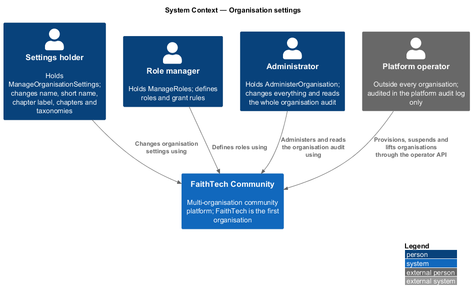
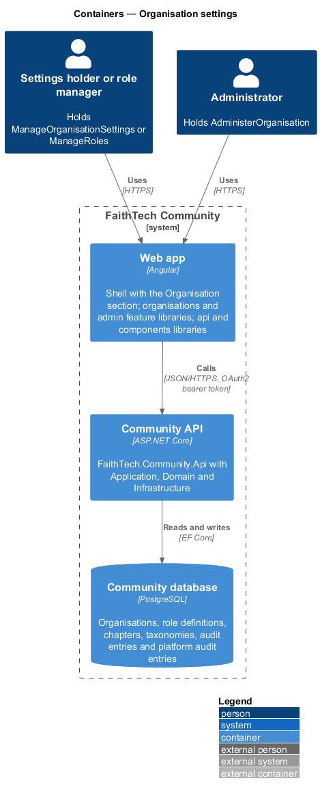
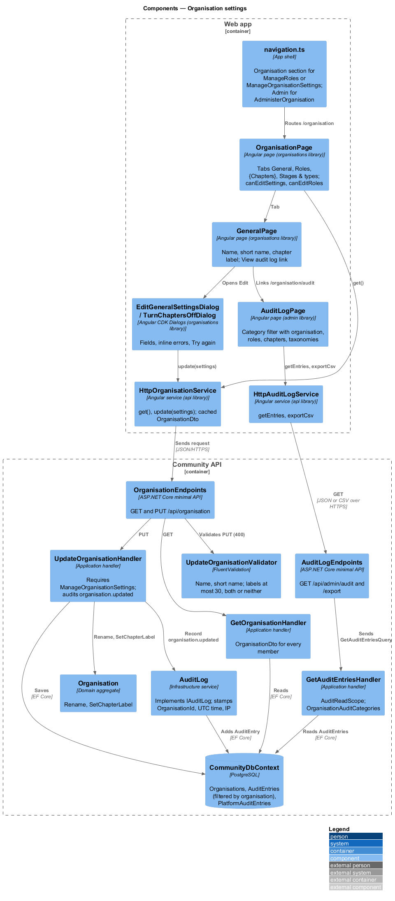
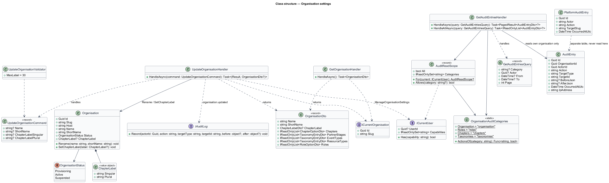
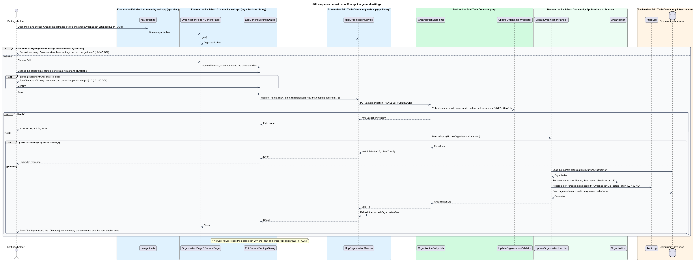
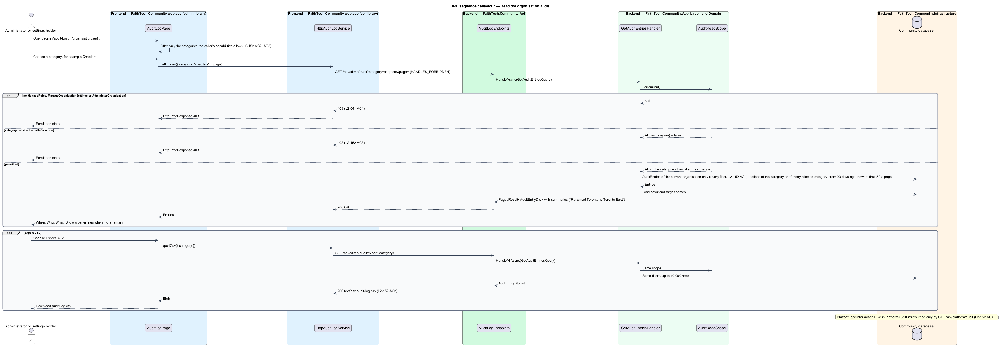

# Organisation settings

## Overview

An **organisation** — tenant of the platform: a named community with its own host, members, roles, chapters, taxonomies, data and audit log ([ADR 0032](../../../adr/0032-multi-tenancy-organisation-per-host.md), `organisations/tenancy-and-host-resolution`). **Organisation settings** — the facts an organisation defines about itself as data rather than code: its name and short name, whether it has chapters and what they are called, its role definitions and grant rules, its chapters, and its partner stages, event types and resource types. The **Organisation section** — the navigation section at `/organisation` that holds the four settings pages General, Roles, Chapters and Stages & types.

Who may open the section is decided by two capabilities (`organisations/capabilities-and-authorization`, [ADR 0033](../../../adr/0033-capability-based-authorisation.md)). `ManageRoles` lets a holder define roles and grant rules. `ManageOrganisationSettings` lets a holder change the name, short name, chapter label, chapters and the three taxonomies. `AdministerOrganisation` carries both. A member who holds one of the two sees the whole section, with the pages the other capability governs read-only (seeded in FaithTech so that only System Admin holds any of them).

Every settings change writes an **organisation audit entry** — an `AuditEntry` of the existing audit log (`admin/audit-log`) under one of four new categories, `organisation`, `roles`, `chapters` and `taxonomies`, readable on the existing audit log page and included in its export. A holder of `ManageRoles` or `ManageOrganisationSettings` who is not an administrator reads only the categories they may change. The **platform audit log** — separate record of platform operator actions (`organisations/platform-operations`) that lives outside every organisation and never appears on an organisation's audit page.

This design covers the Organisation section in the shell, the `/organisation` page and its tabs, the per-capability read-only and editable rules, the `organisations` feature library and its API client, the General page with `GET` and `PUT /api/organisation`, the four audit categories on the audit log page and its export, partial audit visibility for non-administrators and the separation of the platform audit. The Roles page is in `organisations/role-definitions-and-grant-rules`, the Chapters page in `organisations/chapters` and the Stages & types page in `organisations/taxonomies`.

## Description

### Web app

- **`navigation.ts`** — the shell's single ordered list of sections (`frontend/projects/faithtech-community/src/app/shell/navigation.ts`, [ADR 0009](../../../adr/0009-shell-navigation-by-role.md)). Each section's `opens` predicate reads the caller's capabilities from `GET /api/me` in place of role names (ADR 0033). A new entry **Organisation** (`href: '/organisation'`, `icon: 'organisation'`, `secondary: true`) sits after Reports and before Admin and opens for `ManageRoles` or `ManageOrganisationSettings`; Admin opens for `AdministerOrganisation` (`L2-147` AC1). As a secondary section it sits behind More on phones and from 768px to 1023px.
- **`organisations` feature library** — new project at `frontend/projects/organisations/` exposing its routes through `public-api.ts`; the app lazy-loads it at `/organisation` behind the auth guard. It depends only on `components` and `api`.
- **`OrganisationPage`** — page at `/organisation` with the heading "{Organisation name}" and an `ft-tabs` tablist "Organisation settings" of child routes: General (`/organisation`), Roles (`/organisation/roles`), {Chapters} (`/organisation/chapters`; labelled with the plural label when chapters are on, "Chapters" when off) and Stages & types (`/organisation/taxonomies`). The page computes `canEditSettings` (`ManageOrganisationSettings` or `AdministerOrganisation`) and `canEditRoles` (`ManageRoles` or `AdministerOrganisation`) from `/api/me` and passes them to the tab pages, which hide their action buttons and row menus when false and show the inline message "You can view these settings but not change them." (`L2-147` AC2). A member without either capability is sent to the forbidden page by the route guard, and the API answers `403` (`L2-147` AC3).
- **`GeneralPage`** — the General tab (mock `organisation/general`). An `ft-description-list` shows Name, Short name and "{Chapters}: on, called {Singular}/{Plural}" or "off", with one **Edit** button that opens **`EditGeneralSettingsDialog`**: `ft-text-field` Name and Short name, an `ft-switch` "This organisation has chapters" and, when on, the fields "Singular label" and "Plural label" with the counter "{n} / 30" (`L2-140` AC1). Turning the switch off while chapters exist first opens **`TurnChaptersOffDialog`**, "Members and events keep their {chapter}, but nothing will show it until you turn {chapters} back on" (`L2-140` AC6). Save shows "Saving…" and is disabled while in flight; a `400` maps onto the fields; a failed save keeps the dialog open with the input and offers "Try again" (`L2-147` AC5); success closes the dialog, refreshes `OrganisationService.get()` and shows the toast "Settings saved".
- **`OrganisationService`** / **`ORGANISATION_SERVICE`** / **`HttpOrganisationService`** — API client in the `api` library. `get()` calls `GET /api/organisation` and caches the **`OrganisationDto`** for the session; `update(settings)` calls `PUT /api/organisation` and refreshes the cache; the chapter, role and taxonomy methods are listed in their designs. Every write carries the `HANDLES_FORBIDDEN` `HttpContextToken`, so a `403` reaches the dialog rather than the global redirect.
- **`AuditLogPage`** — the existing page in the `admin` library at `/admin/audit-log`. Its `CATEGORIES` list gains Organisation (`organisation`), Chapters (`chapters`) and Stages & types (`taxonomies`); the existing "Role changes" (`roles`) now also covers role definitions and grant rules (`L2-152` AC2). The page reads the caller's capabilities and offers only the categories the caller may read; `AuditCategory` in `audit-log.service.ts` gains the three values. The shell routes `/organisation/audit` to the same page so a non-administrator can reach it from a "View audit log" link on `GeneralPage` without the Admin section.

### Community API

- **`OrganisationEndpoints`** — minimal API mapping `GET /api/organisation` for every signed-in member and `PUT /api/organisation` for `ManageOrganisationSettings`, plus the chapter, role and taxonomy routes of the sibling designs. `GET` answers `200`; `PUT` answers `200`, `400` or `403`.
- **`GetOrganisationHandler`** — returns **`OrganisationDto`**: `Name`, `ShortName`, `ChapterLabel` (`Singular`, `Plural` or null), `Chapters` (active, in order), `PartnerStages`, `EventTypes`, `ResourceTypes` (active, in order) and `Roles` (non-archived definitions' ids and names). It reads the current organisation through `ICurrentOrganisation` and the query filter (ADR 0032).
- **`UpdateOrganisationCommand`** (`Name`, `ShortName`, `ChapterLabelSingular?`, `ChapterLabelPlural?`) / **`UpdateOrganisationValidator`** / **`UpdateOrganisationHandler`** — the validator requires a trimmed `Name` and `ShortName` (maximum lengths `<TO SUPPLY>`) and, when either label is given, both labels of at most 30 characters each (`L2-140` AC1). The handler requires `ManageOrganisationSettings` (`403`, `L2-140` AC7), calls `Organisation.Rename(name, shortName)` and `Organisation.SetChapterLabel(label)` (null when both labels are absent, keeping every chapter and tag, `L2-140` AC6), and writes `organisation.updated` through `IAuditLog` with the before and after `{ Name, ShortName, ChapterLabel }` in the same unit of work (`L2-152` AC1). The short name and name reach every page title, email and message through the organisation-name substitution of `L2-134`.
- **`Organisation`** — Domain aggregate in `Domain/Organisations/` (`organisations/tenancy-and-host-resolution`) with `Slug`, `Host`, `Name`, `ShortName`, `Status` and `ChapterLabel`; `Rename` and `SetChapterLabel` are the two mutators this design uses.
- **`OrganisationAuditCategories`** — Application constants mapping each category to its actions: `organisation` → `organisation.updated`; `roles` → every action starting `role.` (today `role.granted` and `role.removed`, now also `role.defined`, `role.updated`, `role.archived` and `role.grants.updated`); `chapters` → `chapter.added`, `chapter.updated`, `chapter.archived`; `taxonomies` → `taxonomy.updated`. `GetAuditEntriesHandler` extends its category `switch` with the three new cases.
- **`GetAuditEntriesHandler`** — `HandleAsync` and `HandleAllAsync` (`Application/Admin/GetAuditEntries.cs`) replace the System Admin check with **`AuditReadScope`**: an `AdministerOrganisation` holder reads every category; a `ManageRoles` holder reads `roles`; a `ManageOrganisationSettings` holder reads `organisation`, `chapters` and `taxonomies`; anyone else is refused with `403` (`L2-041` AC4). For a partial reader, no category means the union of the categories they may read, and a category outside it answers `403` (`L2-152` AC3). The export applies the same scope. Summaries gain one line per new action ("Renamed Toronto to Toronto East", "Defined the role Meet-up Lead").
- **`AuditEntry.OrganisationId`** — every organisation audit entry carries the organisation and is covered by the global query filter (ADR 0032), so an organisation's page can only ever read its own entries. Platform operator actions are written to **`PlatformAuditEntry`**, a separate table with no `OrganisationId` that only `GET /api/platform/audit` reads (`organisations/platform-operations`, `L2-152` AC4).

### E2E fake

`mock-api.ts` answers `GET` and `PUT /api/organisation` from its organisation record, applies the capability checks and the partial `AuditReadScope` to `GET /api/admin/audit`, and writes the four categories into its audit entries so the audit log specs assert the filter and export.

## Requirements

The feature realizes the following level-2 (L2) requirements. Each L2 requirement refines a level-1 (L1) requirement, cited by identifier. The General page also realizes `L2-140` AC1, AC6 and AC7, listed in `organisations/chapters`.

| L2 ID | Refines (L1) | Requirement |
|-------|--------------|-------------|
| `L2-147` | `L1-028`, `L1-016` | Organisation settings page and access |
| `L2-152` | `L1-028`, `L1-014` | Organisation-level audit |

### Acceptance criteria

**`L2-147` — Organisation settings page and access**

1. Given a holder of `ManageRoles` or `ManageOrganisationSettings`, when the shell renders, then **Organisation** is a secondary section (`L2-045` AC4, AC5) placed before Admin, and opens `/organisation` with tabs General, Roles, {Chapters} (when on, or "Chapters" when off, to turn them on), and Stages & types.
2. Given a holder of only `ManageRoles`, when they open `/organisation`, then General, Chapters and Stages & types are read-only and Roles is editable; given only `ManageOrganisationSettings`, then Roles is read-only and the others editable; given `AdministerOrganisation`, then everything is editable.
3. Given any other member, when they open any `/organisation` route or call any write endpoint under `/api/organisation`, then the response is 403 and the forbidden page is shown (`L2-048` AC2).
4. Given every settings page and dialog, when it renders, then it follows `L2-044` (accessibility), `L2-045` (responsive layout) and `L2-054` (toasts, busy and failed states), with mocks `organisation/general`, `organisation/roles`, `organisation/chapters`, `organisation/taxonomies` and their dialogs in every state.
5. Given a settings save that fails, when the API answers an error, then the dialog stays open with the input and offers "Try again".

**`L2-152` — Organisation-level audit**

1. Given any change to the organisation's general settings, role definitions, grant rules, chapters or taxonomies, when it succeeds, then an audit entry is written under the category `organisation`, `roles`, `chapters` or `taxonomies` with the actor, the UTC time, the IP address, the target and the before and after values (`L2-041`).
2. Given the audit log page (`L2-041`), when it renders, then its category filter offers the four new categories alongside the existing ones, and the export includes them.
3. Given a holder of `ManageRoles` or `ManageOrganisationSettings` without `AdministerOrganisation`, when they open the audit log, then they see only the entries of the categories they may change; `AdministerOrganisation` sees everything.
4. Given a platform operator action, when it is audited, then it goes to the platform audit log (`L2-148` AC4), never to an organisation's audit log, and an organisation's audit page never shows it.

## Diagrams

### System context

Settings holders and role managers change the organisation's settings; an administrator reads the whole organisation audit; a platform operator's actions never reach it.

### Containers

The `organisations` feature library and the `admin` library's audit page call the Community API through the `api` library. The API persists the organisation and its audit entries in the PostgreSQL Community database.

### Components

The shell opens the section by capability; `OrganisationPage` passes `canEditSettings` and `canEditRoles` to its tabs; `UpdateOrganisationHandler` writes `organisation.updated`; `GetAuditEntriesHandler` reads under `AuditReadScope`.

### Class structure

`UpdateOrganisationHandler` mutates `Organisation` and records through `IAuditLog`; `GetAuditEntriesHandler` depends on `AuditReadScope`, which is built from `ICurrentUser` capabilities and `OrganisationAuditCategories`.

### Behaviour — change the general settings

The dialog puts the name, short name and chapter label; the handler requires `ManageOrganisationSettings`, validates, mutates `Organisation` and audits `organisation.updated` in one unit of work (`L2-140` AC1, AC6, AC7; `L2-147` AC5; `L2-152` AC1).

### Behaviour — read the organisation audit

The audit page offers only the categories the caller may read; the handler resolves `AuditReadScope` from capabilities, refuses a category outside it and reads only the organisation's own entries (`L2-152` AC2, AC3, AC4).

## Open questions

Decisions recorded for this design (ADR 0032, ADR 0033 and the proposal):

- The Organisation section is a secondary section before Admin, opened by `ManageRoles` or `ManageOrganisationSettings`; Admin is opened by `AdministerOrganisation`. Resolved.
- The existing `roles` audit category keeps its `role.` prefix rule, so role definitions and grant rules fall under it; the category label becomes "Roles". A `ManageRoles` holder therefore also reads `role.granted` and `role.removed`. Proposed here; a separate `role-definitions` category would be a spec change to `L2-152`.
- A non-administrator reaches the audit page through `/organisation/audit`, a shell route to the `admin` library's `AuditLogPage`, linked from General; the four tabs of `L2-147` AC1 are unchanged. Proposed here, pending the mocks.
- Maximum lengths of the organisation name and short name: 80 and 20 characters, as the mocks show (`dialogs/edit-general-settings`; `docs/mocks/README.md` open question 25). Not fixed by `L2-130` or `L2-149`.
- Changing the host or slug is not a setting; it belongs to the platform operator (`organisations/platform-operations`).
- Organisation-level branding (logo, colours) is deferred (proposal).
