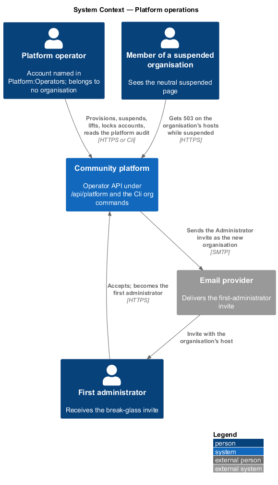
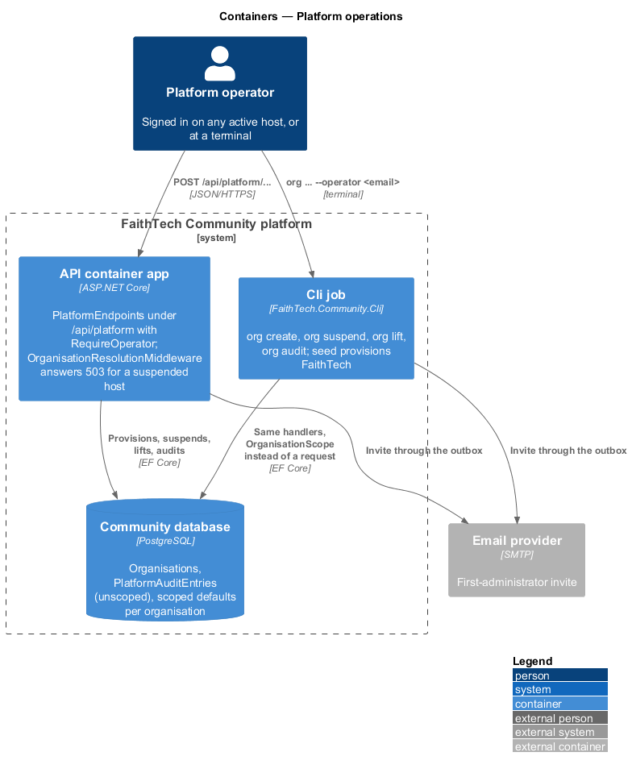
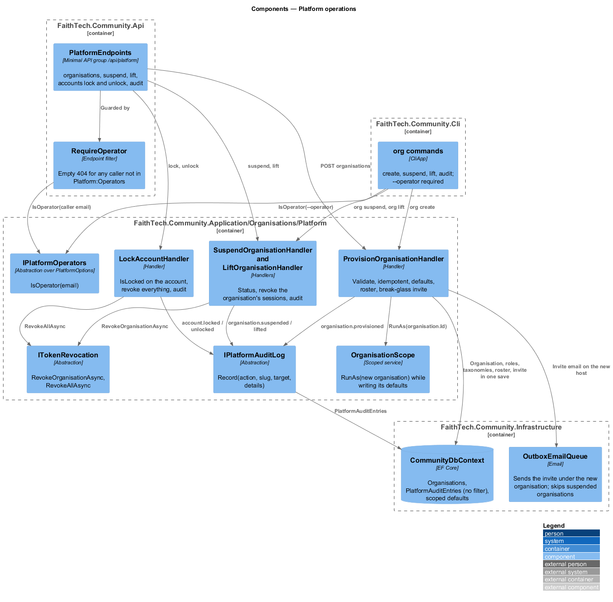
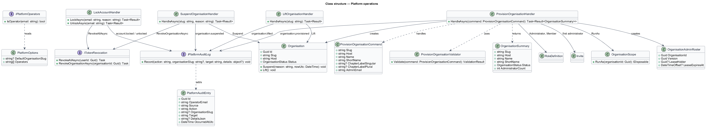
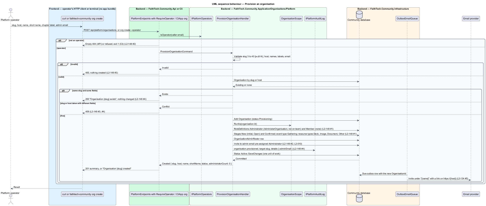
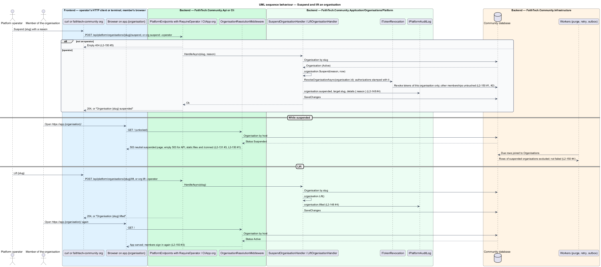

# Platform operations

## Overview

An organisation does not create itself. Someone outside every organisation provisions it with its host and its first administrator, can suspend it and lift the suspension, and can lock an account across the whole platform. That someone is a platform operator, and this design covers who operators are, what they may do, through which two surfaces, and how every operator action is recorded (`L1-029`, ADR 0032).

- **platform operator** — account named in the `Platform:Operators` configuration list; authenticated like any account and recognised by that list, never by a role in any organisation
- **operator API** — the endpoints under `/api/platform`, which answer 404 to anyone who is not an operator, so the surface is not revealed
- **`org` commands** — the Cli project's `org create`, `org suspend`, `org lift` and `org audit`, the second operator surface
- **provisioning** — creating an organisation with its host, name, short name, optional chapter label, two default role definitions, default taxonomies and an invite to its first administrator
- **break-glass** — the first-administrator invite: the one way an operator puts anyone inside an organisation, recorded in the platform audit log
- **platform audit log** — record of operator actions that belongs to no organisation and never appears on an organisation's audit page
- **account lock** — operator action that refuses an account on every host and revokes all its sessions; distinct from membership suspension, which an organisation's administrator applies to one profile (`L2-039`)

An operator reads no organisation data. On a host where the operator's account holds no profile they are a non-member like anyone else (`docs/detailed-designs/organisations/accounts-and-memberships`); to act inside an organisation they are invited by its administrator. The operator endpoints return an organisation's own settings only: name, slug, host, status and administrator count.

## Description

The code lives in `FaithTech.Community.Application/Organisations/Platform/`, with the entity in `Domain/Organisations/`, the persistence in `Infrastructure/Persistence/`, the endpoints in `Api/Endpoints/PlatformEndpoints.cs` and the commands in the Cli project.

### Domain — `Organisations/`

- **`Organisation`** — `Suspend(reason, nowUtc)` sets `Status` to `Suspended` with the reason and time; `Lift()` sets it back to `Active` and clears them (`docs/detailed-designs/organisations/tenancy-and-host-resolution`).
- **`PlatformAuditEntry`** — entity with `Id`, `OperatorEmail`, `Source` (`Api` or `Cli`), `Action` (`organisation.provisioned`, `organisation.suspended`, `organisation.lifted`, `account.locked`, `account.unlocked`), `OrganisationSlug` (null for account actions), `Target` (the slug or the email), `DetailsJson` and `OccurredAtUtc`. It does not implement `IOrganisationScoped`, so the global filter and the stamping never touch it, and `AuditLog` never writes it (`L2-148` AC4, `L2-152` AC4).
- **`OrganisationAdminRoster`** — one row per organisation, created at provisioning, that replaces `SystemAdminRoster` and keeps its 30-second lease (ADR 0033).

### Application — `Organisations/Platform/`

- **`PlatformOptions.Operators`** — the operator emails; validated on start as well-formed addresses (`L2-148` AC1). `IPlatformOperators.IsOperator(email)` compares case-insensitively; `ICurrentUser.IsPlatformOperator` is true when the authenticated account's email is listed.
- **`IPlatformAuditLog`** — `Record(action, organisationSlug, target, details)` adds a `PlatformAuditEntry` stamped with the operator, the source and the UTC time; the entry is saved in the same unit of work as the action.
- **`ProvisionOrganisationCommand`** — `Slug`, `Host`, `Name`, `ShortName`, `ChapterLabelSingular`, `ChapterLabelPlural` and `AdminEmail`. `ProvisionOrganisationValidator` requires a slug of 3 to 40 lower-case letters, digits and hyphens, a host name, a name up to 100 characters, a short name up to 30, both chapter labels or neither, and a well-formed administrator email (`L2-149` AC3).
- **`ProvisionOrganisationHandler`** — loads any organisation with the slug or the host. When one has the same slug and the same fields, it returns `Exists` and changes nothing; when the slug or the host is taken with different fields, it returns `Conflict` (409); when the slug and the host are free, it creates the organisation with status `Provisioning`, enters `OrganisationScope.RunAs(organisation.Id)` so the scoped rows are stamped with the new organisation, and writes in one unit of work: the role definitions **Administrator** (`AdministerOrganisation`, `ShowOnTeam` false) and **Member** (no capability), no chapter, the partner stages "New" (`IsInitial`, kind Open) and "Confirmed" (kind Confirmed), the event type "Gathering", the resource types Deck, Image, Document and Other, the `OrganisationAdminRoster` row, and an `Invite` to `AdminEmail` pre-assigned Administrator; sets the status to `Active`; records `organisation.provisioned` with the administrator email as the break-glass grant; and saves (`L2-149` AC1, AC2, AC4). The invite email leaves through the outbox under the new organisation's name and host (`L2-134` AC5). The role definition and taxonomy types are owned by the role-definitions and taxonomies designs.
- **`SuspendOrganisationHandler`** — `Handle(slug, reason)` loads the organisation, calls `Suspend`, calls `ITokenRevocation.RevokeOrganisationAsync(organisationId)`, which revokes every authorization and token stamped with that organisation (accounts-and-memberships design), records `organisation.suspended` and saves. From the next request its hosts answer the neutral suspended page (`L2-150` AC1); the same account's sessions in other organisations are untouched (`L2-150` AC2).
- **`LiftOrganisationHandler`** — `Handle(slug)` calls `Lift`, records `organisation.lifted` and saves; the next request on its hosts behaves as before, and members sign in again (`L2-150` AC3).
- **`LockAccountHandler`** — `Lock(email, reason)` sets `CommunityUser.IsLocked`, `LockedReason` and `LockedAtUtc`, calls `RevokeAllAsync(userId)` and records `account.locked`; `Unlock(email)` clears them and records `account.unlocked`. Sign-in on any host then refuses the account with the suspended-account message (`L2-148` AC5, `L2-132` AC6).
- **`GetPlatformAuditHandler`** — the platform audit entries, newest first, with `page` and `pageSize`.
- **`GetOrganisationSummaryHandler`** — `Slug`, `Host`, `Name`, `ShortName`, `Status`, `AdministratorCount` (active, unsuspended profiles holding a definition with `AdministerOrganisation`) and nothing else (`L2-148` AC3).
- **Workers** — `ResourceMaintenanceWorker`, `PhotoStorageRetryWorker` and `OutboxEmailQueue` join their rows to `Organisations` and skip rows whose organisation is `Suspended`, without marking them failed, until it is lifted (`L2-150` AC4).

### Api — `Endpoints/PlatformEndpoints.cs`

- **`RequireOperator`** — endpoint filter on the `/api/platform` group. An unauthenticated or non-operator caller gets an empty 404, never 401 or 403, so the surface is not revealed (`L2-148` AC2, `L2-150` AC5). The group is exempt from `MembershipRequirement`, because an operator holds no membership on the host they call.
- Routes: `POST /api/platform/organisations` (201 with the summary, 200 when it already exists, 400, 409), `GET /api/platform/organisations/{slug}` (the summary), `POST /api/platform/organisations/{slug}/suspend` `{ reason }`, `POST /api/platform/organisations/{slug}/lift`, `POST /api/platform/accounts/{email}/lock` `{ reason }`, `POST /api/platform/accounts/{email}/unlock`, `GET /api/platform/audit`.
- The group is served on every resolved host; the current organisation of the request is irrelevant to it and is never read.

### Cli — `CliApp`

- **`org create --slug <slug> --host <host> --name <name> --short-name <short> [--chapter-label <Singular/Plural>] --admin-email <email> --operator <email>`** — builds `ProvisionOrganisationCommand` and runs the handler. `--chapter-label` takes `City/Cities`. Exit 0 and "Organisation {slug} created" or "Organisation {slug} exists"; exit 1 with the validation or conflict message otherwise (`L2-149` AC1, AC4).
- **`org suspend <slug> --reason <reason> --operator <email>`**, **`org lift <slug> --operator <email>`**, **`org audit [--take <n>]`** — run the matching handlers and print the result; `org audit` prints the newest entries, 50 by default.
- **`--operator`** — every `org` command requires an email listed in `Platform:Operators` and refuses with exit 1 otherwise; the audit entry records that email with `Source = Cli` (`L2-148` AC2, AC4). The Cli reads the same `Platform` section as the API from its `appsettings.json` and environment.
- The `org` commands register `OrganisationScope` as `ICurrentOrganisation`, because the Cli has no request. `migrate`, `seed` and the other commands are unchanged; `seed` provisions FaithTech through the same handler (`L2-151`).

### Configuration in production

`Platform__Operators__0`, `Platform__Operators__1`, … on the container app and the Cli jobs, next to the existing settings in `docs/detailed-designs/platform/private-preview-wall`. The operator's own account is created by signing up on any organisation's host before the first `org create`; production seeds no operator account (decided in slice 26). The Cli reads the same `Platform:Operators` list from its configuration and passes it to `CliApp.RunAsync`.

### Open questions

- A new organisation's community host is a custom domain on the container app with a managed certificate; creating the DNS record and binding the host are the owner's steps until automation is built (proposal, deferred).
- The operator API is reachable on any host, including a suspended organisation's, only when the resolution middleware admits the request; on a suspended host it does not (`L2-131` AC3). Operators act from an active host or the Cli. There is no dedicated platform host in v1 (decided in slice 26); one would be a new host kind in the resolution middleware.
- Slice 26 decisions:
  - `ICurrentUser.OperatorEmail` and `IsPlatformOperator` are computed by `CurrentRolesMiddleware`, and only for requests under `/api/platform`, by reading the signed-in account's email and comparing it with the list. Other requests never pay for the lookup and never see an operator.
  - `RequireOperator` sets `PlatformActor` (operator email, source `Api`); the Cli's `org` commands set it from `--operator` with source `Cli`. `PlatformAuditLog`, which writes `PlatformAuditEntry` from that actor, lives in `Application/Organisations/Platform/` beside its interface, since it needs nothing beyond `IApplicationDbContext`.
  - The group is `AllowAnonymous` at the policy level, so the fallback policy never answers 401. `RequireOperator` answers 404 with the status code pages turned off for that response, so the body is empty. The endpoint sweep in `ServerAuthorizationTests` expects that 404 for every `/api/platform` route.
  - Lock and unlock answer 204. A lock needs a reason of 1 to 500 characters (400 "Enter a reason."), and an unknown email answers 404. The account is found by normalised email, so the path's case does not matter.
  - The `PlatformOperatorsAuditAndAccountLock` migration adds `AspNetUsers.IsLocked`, `LockedReason` (500) and `LockedAtUtc`, and the `PlatformAuditEntries` table.
- Slice 27 decisions:
  - `L2-149` AC3 and AC4 overlap on a slug in use. A slug that exists answers 200 ("exists") when every field matches the earlier command, including the first administrator's email, and 409 when any differs. A host another organisation uses answers 400 on `Host`. Field errors answer 400 from `ProvisionOrganisationValidator`, shared by the endpoint and `org create`.
  - `ProvisionOrganisationHandler` saves the organisation as `Provisioning` first, then calls `OrganisationScope.Set` with it, so the defaults, the roster row, the invite and its outbox email are stamped with the new organisation and the email names its name and origin. It then makes the organisation `Active` and records `organisation.provisioned`. A run that stopped while `Provisioning` is finished by the same command, since `OrganisationSeeder` adds only what is missing by key.
  - `OrganisationSeeder.SeedOrganisationAsync(OrganisationSeed)` in `Application/Organisations/Platform/` is shared by provisioning (`OrganisationSeed.Default()`) and the FaithTech seed (`CommunitySeeder`).
  - Provisioning's invite has no inviter (`InvitedBy` is empty): accepting it notifies no one, and the lookup names "A {short name} lead".
  - `IClientRedirects` (OpenIddict in Infrastructure) adds `https://{host}/auth/callback` and `https://{host}/` to the `web` client. `CommunitySeeder` keeps redirect URIs it did not write, so a re-seed never removes a provisioned host.
  - `POST /api/platform/organisations` answers 201 with `Location` and the organisation summary, or 200 with the summary when it exists. `org create` prints "Organisation {slug} created" or "Organisation {slug} exists" and exits 1 with the message otherwise. `--chapter-label` takes `Singular/Plural`.
- Slice 28 decisions:
  - `SuspendOrganisationHandler` holds both `SuspendAsync` and `LiftAsync`, as `LockAccountHandler` holds lock and unlock. Instead of a new `ITokenRevocation.RevokeOrganisationAsync`, it calls the existing `RevokeAsync(userId, organisationId)` for every account with a profile in the organisation, which revokes the sessions stamped with that organisation and leaves the rest (`L2-150` AC2).
  - Both routes answer 204. A reason of 1 to 500 characters is required (400 "Enter a reason."), an unknown slug answers 404, and suspending an organisation that is not Active, or lifting one that is not Suspended, answers 409.
  - `org suspend <slug> --reason <reason>` and `org lift <slug>` print "Organisation {slug} suspended" or "... lifted", and exit 1 with the message otherwise.
  - The workers skip a suspended organisation in one place: `OrganisationWork.ForEachAsync`, which every worker runs through, now runs only Active organisations, so the rows of a suspended organisation are neither processed nor marked failed until it is lifted (`L2-150` AC4).

## Requirements

The feature realizes the following level-2 (L2) requirements. Each L2 requirement refines a level-1 (L1) requirement, cited by identifier. Invites (`L2-010`), host resolution (`L2-131`), memberships (`L2-132`), the FaithTech seed (`L2-151`) and organisation-level audit (`L2-152`) are referenced, not repeated.

| L2 ID | Refines (L1) | Requirement |
|-------|--------------|-------------|
| `L2-148` | `L1-029`, `L1-015` | Platform operator |
| `L2-149` | `L1-029`, `L1-025` | Provisioning an organisation |
| `L2-150` | `L1-029` | Suspending and lifting an organisation |

### Acceptance criteria

**`L2-148` — Platform operator**

1. Given the deployment, when it starts, then the platform operators are the accounts named in `Platform:Operators` (emails); an operator is authenticated like any account and recognised by that list, never by a role in any organisation.
2. Given an operator, when they call the operator API (`/api/platform/*`) or run the Cli `org` commands, then the call is allowed; given any other caller, then the API answers 404 so the surface is not revealed, and the Cli refuses.
3. Given an operator, when they call any organisation endpoint on a host where they hold no profile, then they are treated as a non-member (`L2-132` AC3); operators read no organisation data, and no operator endpoint returns organisation records beyond the organisation's own settings (name, slug, host, status, administrator count).
4. Given an operator action, when it succeeds, then a platform audit entry records the operator, the action, the organisation and the UTC time, outside any organisation's audit log, readable through `GET /api/platform/audit` and the Cli `org audit`.
5. Given an operator locks an account (`POST /api/platform/accounts/{email}/lock`, with a reason), when the account next signs in on any host, then sign-in is refused (`L2-132` AC6) and every session is revoked; `unlock` reverses it; both are platform-audited.

**`L2-149` — Provisioning an organisation**

1. Given an operator, when they run `org create --slug --host --name --short-name [--chapter-label City/Cities] --admin-email` or `POST /api/platform/organisations` with the same fields, then the organisation is created with status Active, its host maps to it, and it holds two role definitions, **Administrator** (`AdministerOrganisation`, not on the team list) and **Member** (no capability), no chapters unless a label was given, and default taxonomies (stage "New" (initial, Open) and "Confirmed" (Confirmed); event type "Gathering"; resource types Deck, Image, Document, Other).
2. Given the first administrator email, when provisioning completes, then an invite pre-assigned Administrator is sent to it (`L2-010`), recorded in the platform audit log as the break-glass grant; accepting it creates the account if needed and the first administrator profile.
3. Given a slug or host already in use, or a slug that is not 3 to 40 lower-case letters, digits and hyphens, when provisioning runs, then it is refused with 400 and nothing is created.
4. Given the same command run again with the same slug and fields, when it runs, then nothing changes and it reports the organisation exists (idempotent); with different fields it is refused with 409.
5. Given a provisioned organisation, when its first administrator signs in, then the Organisation section is available to them and the product works with no further operator action.

**`L2-150` — Suspending and lifting an organisation**

1. Given an operator, when they suspend an organisation with a reason (`org suspend` or `POST /api/platform/organisations/{slug}/suspend`), then its status is Suspended, every request on its hosts answers the neutral suspended page (`L2-131` AC3), every session of its members in that organisation is revoked, and the action is platform-audited.
2. Given a member of a suspended organisation who also belongs to another, when they use the other organisation's host, then nothing is affected.
3. Given an operator lifts the suspension, when the next request arrives on the organisation's hosts, then the organisation behaves exactly as before, and members sign in again.
4. Given a suspended organisation, when scheduled jobs run (resource purge, retries, email), then its work is skipped, not failed, until it is lifted.
5. Given any caller other than an operator, when they call suspend or lift, then the response is 404.

## Diagrams

### System context

An operator provisions, suspends and lifts organisations through the operator API or the Cli; the first administrator receives an invite by email, and an unknown or suspended host shows a neutral page to everyone.

### Containers

The operator API lives in the API container; the `org` commands run in the Cli job against the same database; the platform audit table belongs to no organisation.

### Components

`RequireOperator` hides the `/api/platform` group from everyone else; the handlers in `Organisations/Platform/` write the organisation, its defaults, the invite and the platform audit entry in one unit of work.

### Class structure

`ProvisionOrganisationHandler` creates the `Organisation` with its default `RoleDefinition`s, taxonomies, roster and `Invite`; the suspend, lift and lock handlers share `IPlatformAuditLog` and `ITokenRevocation`.

### Behaviour — provision an organisation

The handler validates, refuses a taken slug or host, reports an identical repeat as existing, and otherwise writes the organisation, its defaults and the break-glass invite in one unit of work (`L2-149`).

### Behaviour — suspend and lift

Suspending sets the status, revokes the organisation's sessions and audits; every request on its hosts then gets 503 until lifting, when the next request behaves as before (`L2-150`).

