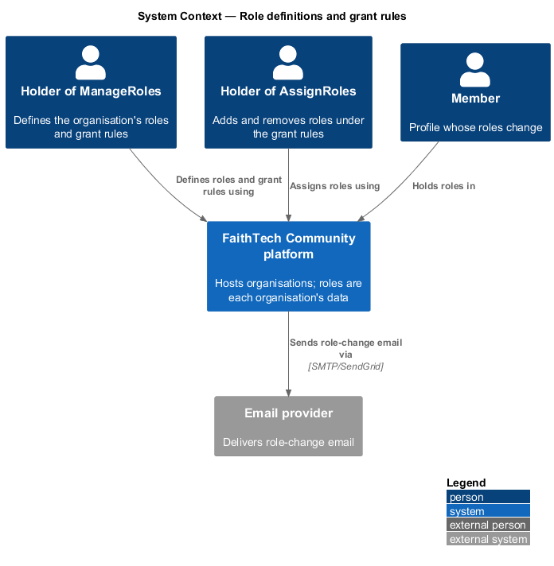
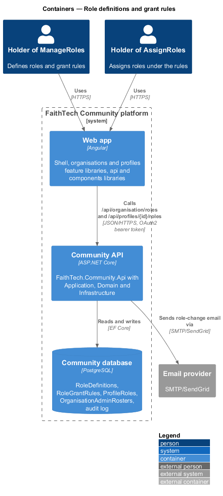
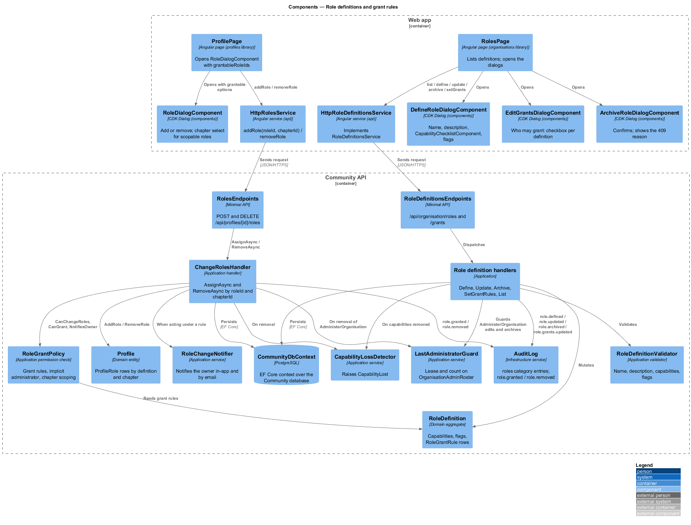
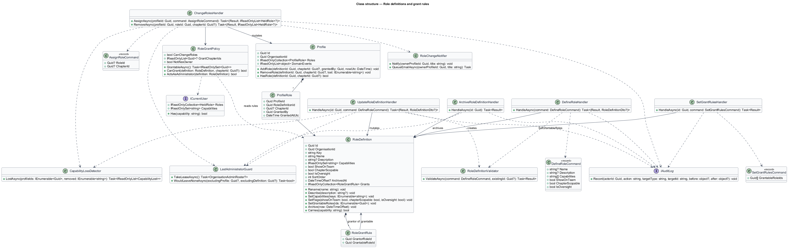
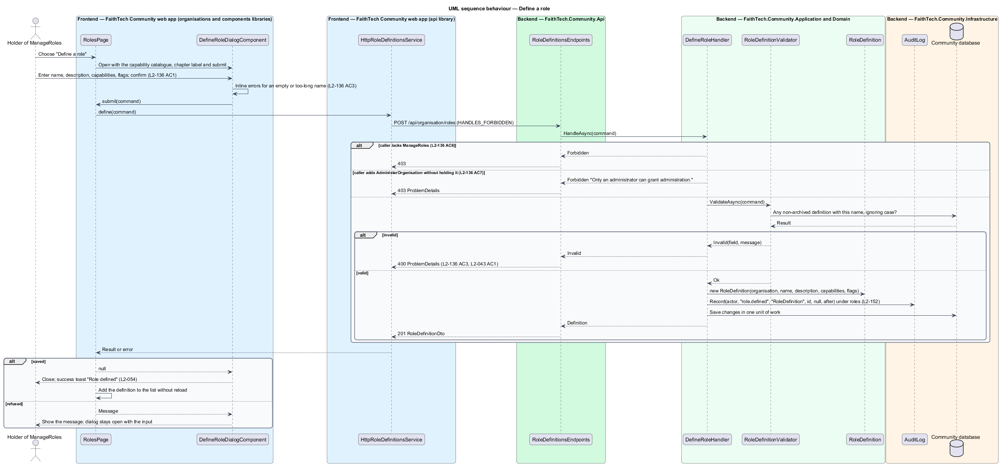
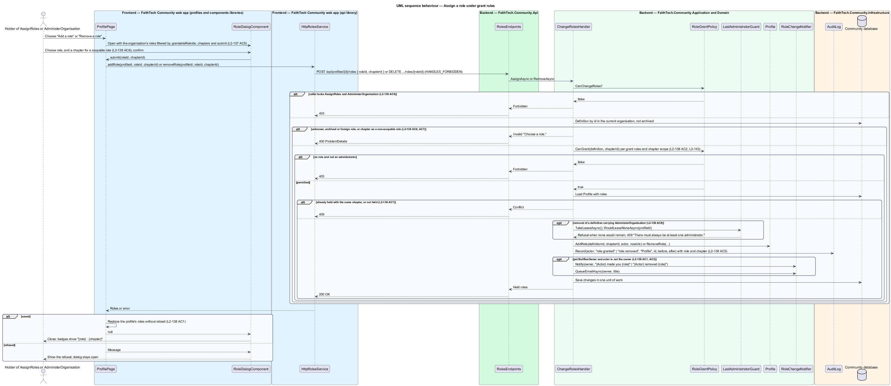
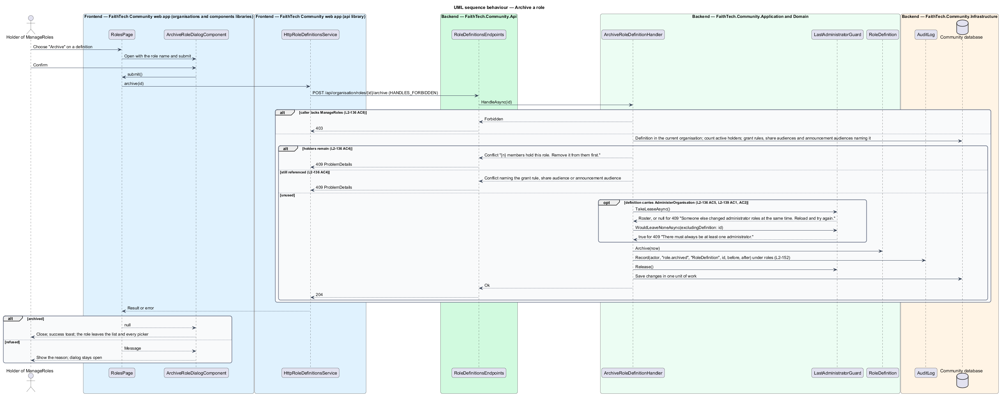

# Role definitions and grant rules

## Overview

In a platform that hosts many organisations (ADR 0032), each organisation defines its own roles. Today the nine roles are a Domain enumeration and the rule for who may grant which role is a class, `RoleAssignmentPolicy`, copied into the web app as `assignableRoles` and into the e2e fake. This feature turns both into organisation data (ADR 0033).

- **role definition** — organisation-owned record naming a role: a name unique within the organisation, a description, a set of capabilities from the catalogue (`docs/detailed-designs/organisations/capabilities-and-authorization`), and three flags
- **team-list flag** (`ShowOnTeam`) — whether holders appear on the team list
- **chapter-scopable flag** (`ChapterScopable`) — whether an assignment of the role may be tagged with a chapter (`docs/detailed-designs/organisations/chapters`)
- **oversight flag** (`IsOversight`) — whether Home shows holders the "You're viewing as {role}" banner
- **grant rule** — statement that holders of one definition, the grantor, may add and remove another, the grantable, on any profile in the organisation
- **implicit administrator grant** — a definition carrying `AdministerOrganisation` may grant and remove every role without a rule, and only such a definition may grant a role that carries `AdministerOrganisation`
- **role assignment** — `ProfileRole` row linking a profile to a definition, optionally tagged with a chapter

A grantor's rules apply only while its definition carries `AssignRoles`. Edits to a definition are live: every holder's capabilities change on their next request. Definitions are archived, never deleted, and archival is refused while anything still uses the definition. The organisation always keeps at least one administrator, guarded by the last-administrator lease described in the capabilities design.

The feature sits in the organisations subsystem. The Roles settings page lives under the Organisation section; the add-role and remove-role dialogs still open from the profile page (`docs/detailed-designs/admin/assign-roles`), now offering the roles the caller's grant rules allow.

## Description

The slice runs from the Roles page and the role dialogs in the web app to the `RoleDefinitions`, `RoleGrantRules` and `ProfileRoles` tables.

### Domain

- **`RoleDefinition`** (`Domain/Organisations/RoleDefinition.cs`, new) — aggregate with `Id`, `OrganisationId`, `Key` (stable slug used by the seed and migrations), `Name` (1 to 60 characters), `Description` (up to 200), `Capabilities` (set of catalogue keys), `ShowOnTeam`, `ChapterScopable`, `IsOversight`, `SortOrder`, `ArchivedAt` and `Grants`, the set of `RoleGrantRule` rows it is the grantor of. `Rename`, `Describe`, `SetCapabilities(keys)` (refusing an unknown key), `SetFlags`, `SetGrantableRoles(ids)` and `Archive(now)` enforce the invariants; a capability set that drops `AdministerOrganisation` and an archive are checked by the handler against the roster before they run.
- **`RoleGrantRule`** (`Domain/Organisations/RoleGrantRule.cs`, new) — row `(GrantorRoleId, GrantableRoleId)`, owned by the grantor definition.
- **`ProfileRole`** (`Domain/Profiles/ProfileRole.cs`) — `Role` becomes `RoleDefinitionId`, with `ChapterId?`, `GrantedBy` and `GrantedAtUtc` as today. **`Profile`** gains `AddRole(definitionId, chapterId, grantedBy, nowUtc)`, which refuses the same definition and chapter tag twice, `RemoveRole(definitionId, chapterId, lostCapabilities)` and `HasRole(definitionId, chapterId?)`.
- **`CapabilityLost`** and **`OrganisationAdminRoster`** — as in the capabilities design.

### Application

- **`RoleGrantPolicy`** (`Application/Admin/RoleGrantPolicy.cs`, replacing `RoleAssignmentPolicy`) — reads `ICurrentUser` and the organisation's definitions.
  - `CanChangeRoles` is `Has(AssignRoles)` or `Has(AdministerOrganisation)` (`L2-138` AC4).
  - `GrantableAsync()` returns the definition ids the caller may add and remove: every non-archived definition for a holder of `AdministerOrganisation`; otherwise the union of the grant rules of every grantor definition the caller holds that carries `AssignRoles`, minus any definition carrying `AdministerOrganisation` (`L2-137` AC2, AC3, AC4). `/api/me` returns it as `grantableRoleIds` (`L2-137` AC5).
  - `CanGrant(definition, chapterId)` adds chapter scoping: when the caller's assignments of the grantor roles are all chapter-tagged, the change is allowed only for an assignment tagged with one of those chapters; an untagged grantor assignment may grant anywhere; a holder of `AdministerOrganisation` is never scoped; scoping is off while the organisation has no chapter label. `GrantChapterIds` (null when unscoped) feeds the picker (`L2-143`, owned by the chapters design).
  - `ActsAsAdministrator(definition)` is true when the change is allowed only by `AdministerOrganisation` and not by a rule the caller holds. `NotifiesOwner` is its negation, so a grantor acting under a rule notifies the owner and an administrator does not (`L2-138` AC1, AC3).
- **`ChangeRolesHandler`** (`Application/Admin/ChangeRoles.cs`, rewritten) — `AssignAsync(profileId, AssignRoleCommand(roleId, chapterId))` and `RemoveAsync(profileId, roleId, chapterId?)`. In order: `CanChangeRoles` else 403; resolve the definition in the current organisation, not archived, else 400 "Choose a role." (`L2-138` AC7); a chapter on a non-scopable definition, or an archived or foreign chapter, else 400 (`L2-138` AC6); `CanGrant` else 403 (`L2-138` AC2); load the profile else 404; the same assignment already held, or a removal of one not held, else 409 (`L2-138` AC7); for a removal of a definition carrying `AdministerOrganisation`, `LastAdministratorGuard.TakeLeaseAsync` then `WouldLeaveNoneAsync(profileId)` else 409 "There must always be at least one administrator." (`L2-138` AC8); apply the change to `Profile`; `IAuditLog.Record(actor, "role.granted" | "role.removed", "Profile", id, before, after)` with the role, the chapter tag and both role sets (`L2-138` AC5); `RoleChangeNotifier.Notify` and `QueueEmailAsync` with "{Actor} made you {role}" or "{Actor} removed {role}" when `NotifiesOwner` and the actor is not the owner; `CapabilityLossDetector` and `CapabilityLostHandler` for a removal; one `SaveChangesAsync`. Both routes return the profile's held roles (id, name, chapter).
- **`RoleLabels`** (`Application/Admin/`) — removed; names come from the definition.
- **Role definition handlers** (`Application/Organisations/`, new) — `ListRoleDefinitionsHandler` (non-archived in `SortOrder` with holder count, capability summary and flags; `archived=true` lists archived read-only, `L2-136` AC6), `DefineRoleHandler` (`L2-136` AC1), `UpdateRoleDefinitionHandler` (`L2-136` AC2), `ArchiveRoleDefinitionHandler` (`L2-136` AC4) and `SetGrantRulesHandler` (`L2-137` AC1). Each requires `Has(ManageRoles)` else 403 (`L2-136` AC8) and audits under the `roles` category with before and after (`L2-152`).
- **`RoleDefinitionValidator`** — name required, trimmed, 1 to 60 characters, unique among the organisation's non-archived definitions ignoring case; description up to 200; every capability known to the catalogue; `ChapterScopable` only while chapters are on. Failures answer 400 with problem details naming the field (`L2-136` AC3, `L2-043` AC1).
- **Guards in the handlers** — adding `AdministerOrganisation` to any definition by a caller without it answers 403 "Only an administrator can grant administration." (`L2-136` AC7). A grant rule whose grantable carries `AdministerOrganisation` under a grantor that does not answers 400 (`L2-137` AC3). Rules for a grantor without `AssignRoles` are stored and inactive (`L2-137` AC2). An edit that drops `AdministerOrganisation`, and an archive, take the last-administrator lease and count as in the capabilities design (`L2-136` AC5). Archival is refused with 409 "{n} members hold this role. Remove it from them first." while any active profile holds it, and with 409 naming the grant rule, resource or note share audience, or announcement audience that still names it (`L2-136` AC4).
- **`CapabilityLossDetector`** — an edit that removes capabilities runs it over every holder, so `CapabilityLost` is raised for each capability no other held role gives (`L2-139` AC3); a gained capability raises nothing (`L2-139` AC6).

### API

- **`RoleDefinitionsEndpoints`** (`Api/Endpoints/`, new) — `GET /api/organisation/roles?archived=`, `POST /api/organisation/roles`, `PUT /api/organisation/roles/{id}`, `POST /api/organisation/roles/{id}/archive`, `PUT /api/organisation/roles/{id}/grants` `{ grantableRoleIds }`. Requests carry `HANDLES_FORBIDDEN` so a 403 reaches the dialog.
- **`RolesEndpoints`** — `POST /api/profiles/{id}/roles` `{ roleId, chapterId? }` and `DELETE /api/profiles/{id}/roles/{roleId}?chapterId=` replace the role-name routes.
- **`OrganisationEndpoints`** (tenancy design) — `GET /api/organisation` lists the non-archived definitions (id, name, description, flags) for every member, which the pickers read (`L2-136` AC8). **`MeEndpoints`** adds `grantableRoleIds` and `grantChapterIds`.

### Frontend

- **`RolesPage`** (`frontend/projects/organisations/`, new feature library, route `/organisation/roles`) — lists the definitions with name, description, holder count, capability summary and flag badges, an "Archived" filter, and the actions "Define a role", edit, "Who may grant" and archive. Read-only for a caller without `ManageRoles` (`L2-147` AC2). Composed from the `components` library; follows `L2-044`, `L2-045` and `L2-054`.
- **`RoleDefinitionsService`** / **`ROLE_DEFINITIONS_SERVICE`** / **`HttpRoleDefinitionsService`** (`api/src/lib/organisations/`, new) — the five role-definition calls. **`OrganisationService`** / **`ORGANISATION_SERVICE`** (tenancy design) supplies the definition list and the capability catalogue to pickers.
- **`CapabilityChecklistComponent`** (`components`, new) — a checkbox per catalogue entry with its description, built on `CheckboxGroupComponent`, with a disabled state and caption per entry; used by the define-role dialog and the grants dialog.
- **`DefineRoleDialogComponent`** (`components`, new, modes `define` and `edit`) — name, description, `CapabilityChecklistComponent` and the three switches, the chapter switch shown only when the dialog receives a chapter label (`L2-136` AC1). It owns invalid, busy and failed states as `RoleDialogComponent` does, and shows a message `submit` resolves to, such as the 403 for `AdministerOrganisation` (ADR 0005 pattern).
- **`EditGrantsDialogComponent`** (`components`, new) — "Holders of {role} may add and remove:" with a checkbox per non-archived definition; entries carrying `AdministerOrganisation` are disabled with "Only administrators can grant administration" when the grantor does not carry it; a caption "This role can't assign roles until it has the Assign roles capability" shows when the grantor lacks `AssignRoles` (`L2-137` AC1 to AC3).
- **`ArchiveRoleDialogComponent`** (`components`, new) — confirmation that shows the 409 reason inside the dialog.
- **`RoleDialogComponent`** (`components`, extended) — `RoleOption` gains `chapterScopable`; `RoleDialogData` gains `chapters` (the active chapters), `chapterLabel` and `chapterRequired`; in add mode the dialog shows a chapter select for a scopable option, and `submit(value, chapterId?)` carries the tag (`L2-138` AC6). Remove mode lists the held assignments the caller may remove, each labelled "{role} · {chapter}" when tagged.
- **`ProfilePage`** (`profiles`) — builds the options from `GET /api/organisation` filtered by `grantableRoleIds` and passes `grantChapterIds` from `/api/me`; the invite dialog and the People page apply the same filter (`L2-137` AC5). `role.ts` loses `assignableRoles`.
- **`mock-api.ts`** (`e2e/fixtures/`) — holds the definitions and grant rules as data, answers the five definition routes and the rewritten role routes, and computes `grantableRoleIds` by the same rule.

Mocks: `organisation/roles` and the define-role, edit-grants and archive-role dialogs in every state are named by `L2-147` AC4 and are not yet written; the page follows them once they exist.

## Requirements

The feature realizes the following level-2 (L2) requirements. Each L2 requirement refines a level-1 (L1) requirement, cited by identifier.

| L2 ID | Refines (L1) | Requirement |
|-------|--------------|-------------|
| `L2-136` | `L1-026`, `L1-028` | Role definitions |
| `L2-137` | `L1-026` | Grant rules |
| `L2-138` | `L1-003`, `L1-026` | Assigning roles under grant rules |

### Acceptance criteria

**`L2-136` — Role definitions**

1. Given a holder of `ManageRoles` on the Roles page (`/organisation/roles`), when they choose "Define a role", then a dialog asks for a name (required, up to 60 characters, unique within the organisation ignoring case), a description (optional, up to 200), the capabilities (checkbox per catalogue entry with its description) and three switches: "Show on the team list", "Can be held for a {chapter}" (shown only when chapters are on, `L2-140`) and "Oversight role (shows a viewing-as banner)"; `POST /api/organisation/roles` saves it, a success toast confirms (`L2-054`), and an audit entry `role.defined` is written.
2. Given a definition, when the holder edits its name, description, capabilities or flags and saves, then `PUT /api/organisation/roles/{id}` applies the change, every holder's capabilities change on their next request (`L2-133` AC5), and `role.updated` records the before and after.
3. Given a name that is empty, too long or already used by a non-archived definition, when the dialog is saved, then the field shows an inline error, the API answers 400 with problem details (`L2-043` AC1), and nothing is saved.
4. Given a definition with holders, when the holder archives it, then the request is refused with 409 "{n} members hold this role. Remove it from them first."; given it is named by a grant rule, a share audience or an announcement audience, then 409 names what still uses it; given nothing uses it, then `POST /api/organisation/roles/{id}/archive` archives it, it leaves every picker, and `role.archived` is written.
5. Given a definition that carries `AdministerOrganisation`, when an edit would remove that capability, or an archive is attempted, and no other active, unsuspended member would be left holding `AdministerOrganisation`, then the request is refused with 409 "There must always be at least one administrator." (`L2-139`).
6. Given the Roles page, when it renders, then it lists the non-archived definitions in order with name, description, the number of holders, a capability summary and the flags, with an "Archived" filter to show archived ones read-only; the page follows `L2-044` and `L2-045`.
7. Given a holder of `ManageRoles` who does not hold `AdministerOrganisation`, when they add `AdministerOrganisation` to any definition, then the request is refused with 403 "Only an administrator can grant administration."
8. Given any member without `ManageRoles`, when they call any role-definition endpoint, then the response is 403; `GET /api/organisation` still lists the non-archived role names and ids for pickers.

**`L2-137` — Grant rules**

1. Given a holder of `ManageRoles` on the Roles page, when they open "Who may grant" for a definition, then a dialog shows every non-archived definition as a checkbox under "Holders of {role} may add and remove:", and `PUT /api/organisation/roles/{id}/grants` saves the chosen set, audited as `role.grants.updated` with before and after.
2. Given a grantor definition that does not carry `AssignRoles`, when rules are saved for it, then the dialog explains "This role can't assign roles until it has the Assign roles capability", and the rules are stored but inactive until it does.
3. Given a grantable definition that carries `AdministerOrganisation`, when it is chosen for a grantor that does not, then the checkbox is disabled with "Only administrators can grant administration" and the API answers 400.
4. Given a holder of `AdministerOrganisation`, when they add or remove any role, then no rule is needed (`L2-138` AC3).
5. Given the invite dialog (`L2-010` AC2), the add-role and remove-role dialogs (`L2-138`) and the People page (`L2-053`), when they offer roles, then they offer exactly the roles the caller's rules allow, computed by the server and returned by `/api/me` as `grantableRoleIds`.

**`L2-138` — Assigning roles under grant rules**

1. Given a holder of `AssignRoles`, when they add or remove a role that a grant rule lets one of their roles grant, on any profile in the organisation, then `POST /api/profiles/{id}/roles` `{ roleId, chapterId? }` or `DELETE /api/profiles/{id}/roles/{roleId}` succeeds, the profile's roles update without a page reload, and the profile owner is notified in-app and by email ("{Actor} made you {role}" / "removed {role}") unless the actor changed their own profile.
2. Given a holder of `AssignRoles`, when they try to add or remove a role no rule lets them grant, then the option is not shown and the API answers 403.
3. Given a holder of `AdministerOrganisation`, when they add or remove any role, then the change succeeds; the owner is not notified when the actor acts as administrator.
4. Given a member without `AssignRoles` or `AdministerOrganisation`, when they call either endpoint, then the response is 403.
5. Given any role change, by anyone, when it succeeds, then an audit entry `role.granted` or `role.removed` records the actor, the profile, the role, the chapter tag and the before and after role sets (`L2-041`).
6. Given a role whose definition is chapter-scopable and chapters are on, when the add-role dialog shows it, then a {chapter} picker (optional unless `L2-143` requires one) tags the assignment; a chapter on a non-scopable role answers 400.
7. Given a role id that is archived or belongs to another organisation, when it is assigned, then the API answers 400 "Choose a role."; adding a role already held with the same chapter tag, or removing one not held, answers 409.
8. Given the last holder of a role with `AdministerOrganisation`, when anyone tries to remove it, then the change is refused with 409 "There must always be at least one administrator." (`L2-139` AC1).

## Diagrams

### System context

A holder of `ManageRoles` defines roles and grant rules; a holder of `AssignRoles` assigns roles under those rules; the member whose roles change is notified by email through the email provider.

### Containers

The `organisations` and `profiles` feature libraries open dialogs from `components` and call the Community API through the `api` library. The API persists definitions, rules and assignments in the Community database and audits every change.

### Components

`RolesPage` opens the define-role, edit-grants and archive-role dialogs; `ProfilePage` opens `RoleDialogComponent`. `RoleDefinitionsEndpoints` dispatches to the definition handlers; `RolesEndpoints` dispatches to `ChangeRolesHandler`, which consults `RoleGrantPolicy` and `LastAdministratorGuard`.

### Class structure

`RoleDefinition` owns its `RoleGrantRule` rows; `ProfileRole` references a definition and an optional chapter. `RoleGrantPolicy` reads `ICurrentUser` and the definitions; `ChangeRolesHandler` depends on it, on `LastAdministratorGuard`, `IAuditLog`, `RoleChangeNotifier` and `CapabilityLossDetector`.

### Behaviour — define a role

`DefineRoleHandler` validates the name, description and capabilities, refuses `AdministerOrganisation` from a caller without it, saves the definition and audits `role.defined` (`L2-136` AC1, AC3, AC7).

### Behaviour — assign a role under grant rules

`ChangeRolesHandler` applies `RoleGrantPolicy` before any write. A change under a rule notifies the owner; a change by an administrator does not; every change is audited (`L2-138`).

### Behaviour — archive a role

`ArchiveRoleDefinitionHandler` refuses while holders or references remain, takes the last-administrator lease for a definition carrying `AdministerOrganisation`, then archives and audits `role.archived` (`L2-136` AC4, AC5).

## Open questions

- Removal takes an optional `chapterId` query parameter to pick one assignment when a profile holds the same role for more than one chapter; the proposal's route lists only the role id. Confirm the query parameter or decide that removal drops every assignment of that role.
- The e2e fake and the Api test fixture grant FaithTech roles by definition key; a definition created in a spec uses the same data shape.
- `RoleDefinition.Key` is set by the seed and provisioning and is `<TO SUPPLY>` for a definition created on the Roles page; the design proposes a slug derived from the name at creation, never changed by a rename.
