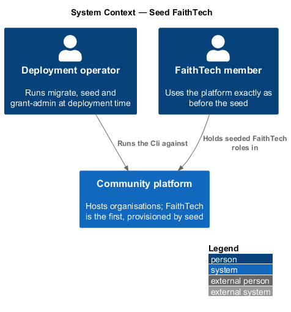
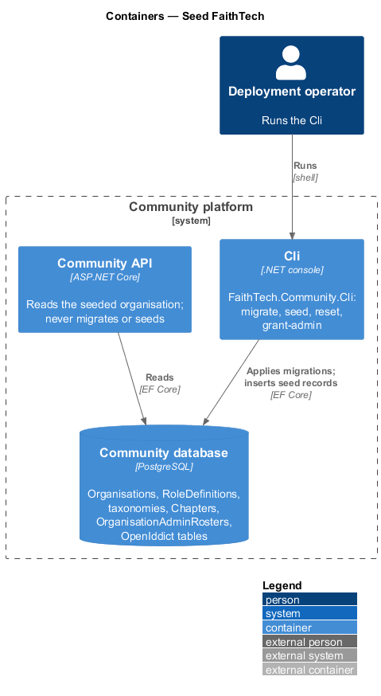
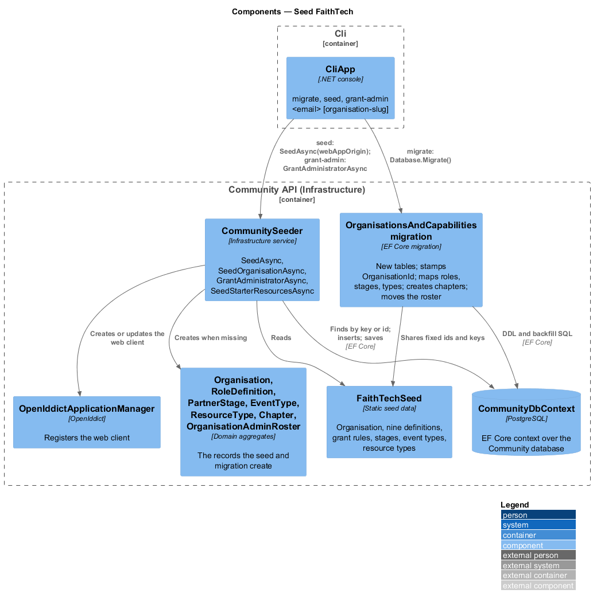
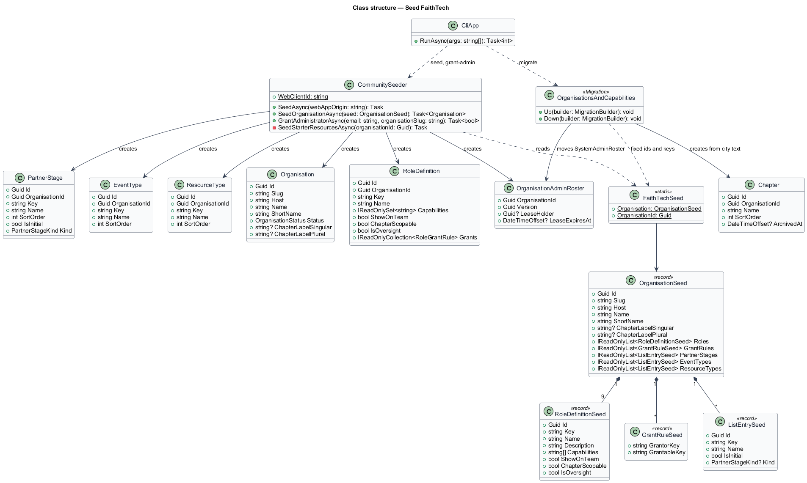
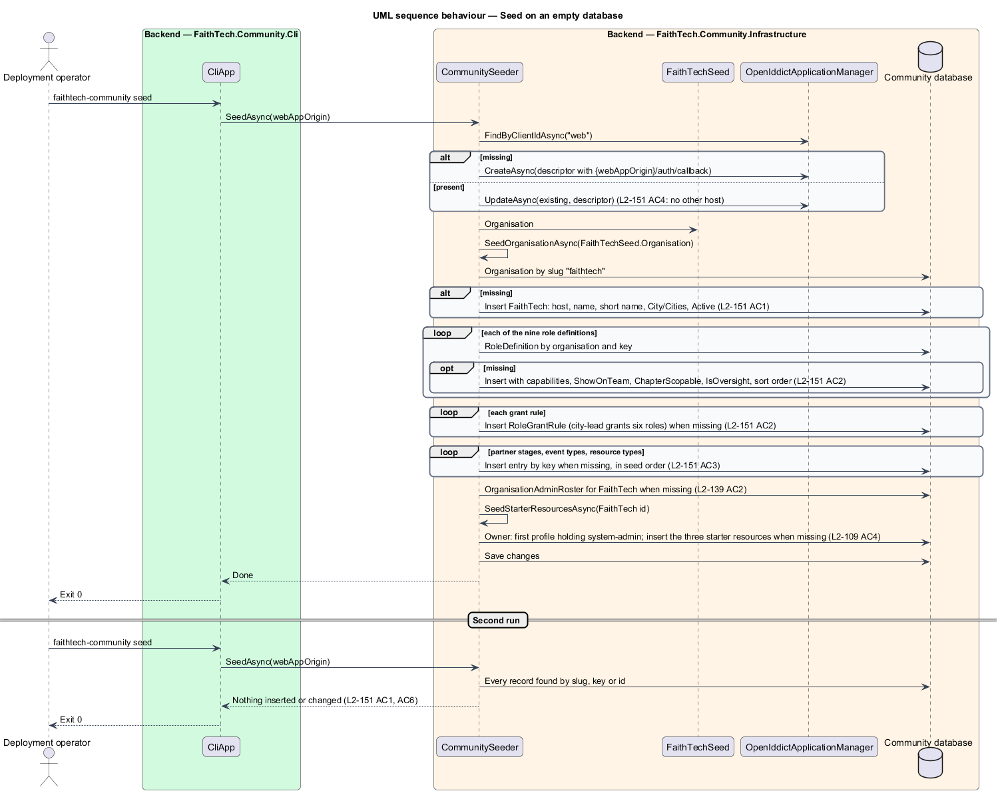
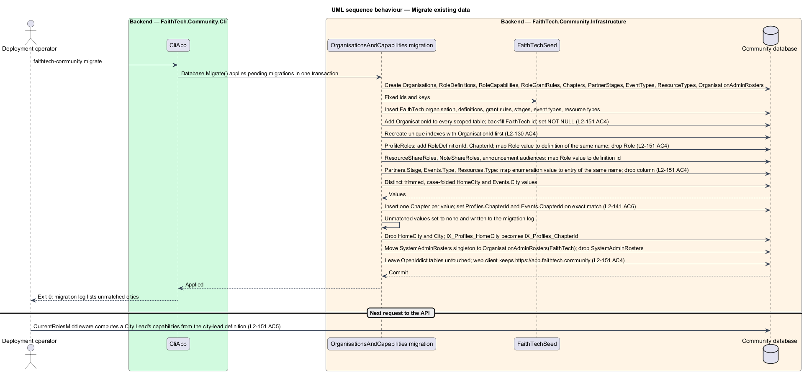

# Seed FaithTech

## Overview

FaithTech Community becomes a platform that hosts many organisations, each defining its roles, chapters and vocabularies as data (ADR 0032, ADR 0033, ADR 0034, ADR 0035). FaithTech is the first organisation, and `L1-025` requires that everything it does today is unchanged. This feature is the data that makes that true: the idempotent seed that creates the FaithTech organisation with its nine role definitions, grant rules, chapter label, partner stages, event types and resource types, and the one-time migration that moves existing FaithTech data onto the new model.

- **seed** — idempotent routine in `CommunitySeeder` that inserts the records a deployment needs and changes nothing on a second run
- **production seed** — the subset of seeding that runs in production: the `web` OpenIddict client, the organisation seed, the administrator roster and the starter resources, and nothing else (`L2-109` AC4)
- **definition key** — stable key on a role definition, partner stage, event type or resource type that the seed and the migration use to find a record; the name may change, the key never does. FaithTech's role keys are the former `Role` values (`CityLead`, `SystemAdmin`), so the migration maps each value to the key of the same spelling and the role names the API returns stay the same until the web app reads definitions
- **regression property** — the condition that every existing acceptance test naming a FaithTech role still passes with the seed in place, because the seeded definitions and grant rules reproduce the former `Role` enumeration, `RoleAssignmentPolicy` and access-class rules exactly

The seed is the only place in requirements, designs and code where the FaithTech role names City Lead, Event Lead, Create Lead, Communications Lead, Staff, Volunteer, Product Engineer, Attendee and System Admin appear. Every rule elsewhere names a capability.

The feature sits in the organisations subsystem beside the capabilities, role-definitions, chapters and taxonomies designs, whose entities it populates. The Infrastructure project owns it, because seeding and migrations live there and are run by the Cli, never by the API.

## Description

The slice runs from the Cli commands through `CommunitySeeder` and one EF Core migration to the Community database.

### Seed data

- **`FaithTechSeed`** (`Infrastructure/Persistence/Seed/FaithTechSeed.cs`, new) — static data class holding the FaithTech organisation and every record the seed inserts, with fixed ids so that the migration and the seed agree. Its contents:
  - The organisation: slug `faithtech`, host `app.faithtech.community`, name "FaithTech Community", short name "FaithTech", chapter label City/Cities, status Active (`L2-151` AC1).
  - Nine role definitions, each with key, name, description, capabilities, `ShowOnTeam`, `ChapterScopable`, `IsOversight` and sort order (`L2-151` AC2):

| Key | Name | Capabilities | Team | Chapter-scopable | Oversight |
|-----|------|--------------|------|------------------|-----------|
| `CityLead` | City Lead | `ManageEvents`, `ViewAttendees`, `ManageAttendance`, `KeepContacts`, `ViewPartners`, `ManagePartners`, `InviteMembers`, `ConnectLink`, `OwnWorkspaces`, `JoinWorkspaces`, `ViewPeopleDirectory`, `AssignRoles`, `AddResources` | yes | yes | no |
| `EventLead` | Event Lead | `ManageEvents`, `ViewAttendees`, `ManageAttendance`, `KeepContacts`, `ViewPartners`, `ManagePartners`, `InviteMembers`, `JoinWorkspaces`, `AddResources` | yes | yes | no |
| `CreateLead` | Create Lead | `ViewAttendees`, `ManageAttendance`, `KeepContacts`, `ViewPartners`, `ManagePartners`, `InviteMembers`, `JoinWorkspaces`, `AddResources` | yes | yes | no |
| `CommunicationsLead` | Communications Lead | Create Lead's set plus `SendAnnouncements` | yes | yes | no |
| `Staff` | Staff | `ViewAttendees`, `ViewPartners`, `ReadAllWorkspaces`, `ViewPeopleDirectory`, `ViewReports`, `AddResources` | no | no | yes |
| `Volunteer` | Volunteer | `JoinWorkspaces` | yes | yes | no |
| `ProductEngineer` | Product Engineer | none | no | no | no |
| `Attendee` | Attendee | none | no | no | no |
| `SystemAdmin` | System Admin | `AdministerOrganisation` | no | no | no |

  - Grant rules: `CityLead` may grant `EventLead`, `CreateLead`, `CommunicationsLead`, `Volunteer`, `ProductEngineer` and `Attendee`; no other definition has rules; `SystemAdmin` grants implicitly (`L2-151` AC2).
  - Partner stages in order: `lead` "Lead" (initial, kind Open), `in-funnel` "In Funnel" (Open), `confirmed` "Confirmed" (Confirmed). Event types: `gathering` "Gathering", `builders-night` "Builders night", `hackathon` "Hackathon", `prayer-and-planning` "Prayer & planning", `panel` "Panel". Resource types: `deck`, `logo`, `image`, `training`, `template`, `document`, `other` with the names Deck, Logo, Image, Training, Template, Document and Other (`L2-151` AC3).
  - The descriptions of the nine definitions are today's `ROLE_DESCRIPTIONS` from `role.ts`, with "FaithTech" in the Staff line replaced by the organisation's short name at display time.

### Seeder

- **`CommunitySeeder.SeedAsync(webAppOrigin)`** (`Infrastructure/Persistence/CommunitySeeder.cs`) — the production seed, in order: the `web` OpenIddict client with `{webAppOrigin}/auth/callback` as its only redirect URI, as today; `SeedOrganisationAsync(FaithTechSeed)`; the `OrganisationAdminRoster` row for FaithTech, replacing the `SystemAdminRoster` singleton; `SeedStarterResourcesAsync`, whose owner is the first profile holding a definition that carries `AdministerOrganisation` and whose types are the entries keyed `logo`, `training` and `document` (`L2-151` AC6, `L2-109` AC4). Every step finds its record by key or id and inserts only what is missing, so a second run changes nothing and an organisation's later edits survive (`L2-151` AC1).
- **`SeedOrganisationAsync(OrganisationSeed)`** (new, on `CommunitySeeder`) — inserts the organisation by slug, then each definition, grant rule, stage, event type and resource type by key within that organisation. Provisioning (`docs/detailed-designs/organisations/platform-operations`) reuses it with the two-role Administrator and Member seed, so there is one way to seed an organisation.
- **`GrantAdministratorAsync(email, organisationSlug)`** (renaming `GrantSystemAdminAsync`) — finds the account by normalised email, then its profile in the named organisation; answers false when either is missing. It grants the organisation's lowest-sorted non-archived definition carrying `AdministerOrganisation` (System Admin for FaithTech, Administrator for a provisioned organisation), already held being a no-op, and writes `role.granted` with an empty actor id and IP address `cli`, as today.
- **Demo and load data** — `SeedLoadTestUsersAsync`, `SeedSearchRecordsAsync` and `SeedReportRecordsAsync` stay separate commands; their "City NN" values become seeded chapters of FaithTech and their events reference the `gathering` event type (ADR 0034). They never run in production.

### Migration

- **`OrganisationsAndCapabilities`** (`Infrastructure/Persistence/Migrations/`, new; the timestamped class name is assigned when it is generated) — one migration, run by the Cli `migrate` command, that moves existing FaithTech data onto the new model (`L2-151` AC4):
  1. Creates `Organisations`, `RoleDefinitions`, `RoleCapabilities`, `RoleGrantRules`, `Chapters`, `PartnerStages`, `EventTypes`, `ResourceTypes` and `OrganisationAdminRosters`.
  2. Inserts the FaithTech organisation, its definitions, grant rules, stages, event types and resource types with the fixed ids from `FaithTechSeed`, so the backfill below has targets without depending on the seeder.
  3. Adds `OrganisationId` to every scoped table (profiles, contacts, partners, events, invites, connect links, announcements, resources, note pages, workspaces, notifications, audit entries and the rest), backfills it with the FaithTech id, makes it non-null, and recreates every unique index with the organisation first (`L2-130` AC4).
  4. `ProfileRoles`: adds `RoleDefinitionId` and `ChapterId`, maps each former `Role` enumeration value to the definition whose key is that value, then drops `Role`. `ResourceShareRoles`, `NoteShareRoles` and role audiences on announcements map the same way.
  5. `Partners.Stage`, `Events.Type` and `Resources.Type`: adds the list-entry foreign key, maps each enumeration value to the entry of the same name (`InFunnel` to `in-funnel`, `BuildersNight` to `builders-night`, `PrayerAndPlanning` to `prayer-and-planning`), then drops the enumeration column. `PartnerStageChanges` records stage keys.
  6. Chapters: one chapter per distinct trimmed, case-folded `Profiles.HomeCity` and `Events.City` value, named by its first-seen spelling; sets `Profiles.ChapterId` and `Events.ChapterId` for exact matches; values that match no chapter after folding are set to none and written to the migration log; drops `HomeCity` and `City` (`L2-141` AC6). `IX_Profiles_HomeCity` becomes an index on `ChapterId` (ADR 0034).
  7. Moves the `SystemAdminRosters` singleton to an `OrganisationAdminRosters` row for FaithTech (and for any other organisation already provisioned) and drops the old table (`20261031142650_OrganisationAdminRosters`); a lease in flight on the singleton is dropped, since it lasts 30 seconds.
  8. Leaves the OpenIddict tables untouched: the `web` client keeps `https://app.faithtech.community/auth/callback` and gains no other host; provisioning adds hosts later (`L2-151` AC4).

  **Delivered as several migrations.** The slice plan (`docs/prompts/README.md`) lands this work in one migration per slice that changes the schema rather than one `OrganisationsAndCapabilities` migration, so each slice ships and merges on its own. Slice 01 adds `Organisations` and inserts the FaithTech row (`Organisations` migration); later slices add the rest of the steps above in order. The FaithTech ids in `FaithTechSeed` keep every migration and the seeder in agreement.

  `AspNetUsers.ProfileId` becoming `Profiles.UserId` with a unique index on (`OrganisationId`, `UserId`) is owned by `docs/detailed-designs/organisations/accounts-and-memberships` and runs in the same migration. Running the migration twice is prevented by the EF migrations history, as for every migration.

### Cli

- **`CliApp`** (`Cli/CliApp.cs`) — `grant-admin <email> [organisation-slug]`; the slug defaults to `Platform:DefaultOrganisationSlug`, which is `faithtech` in every environment today. The usage line and the "No account uses {email}. Sign up first, then grant the role." message gain "in {organisation}". `migrate`, `seed` and `reset` are unchanged in name.

### Tests and the e2e fake

- **`CommunityApiFactory`** (`backend/tests/FaithTech.Community.Api.Tests/`) — seeds `FaithTechSeed` into each fixture's in-memory database and resolves `localhost` to FaithTech, so a test that grants "CityLead" grants the definition keyed `CityLead` and every existing test that names a FaithTech role runs unchanged. The regression property is this suite: `AssignRolesTests`, `LastAdminConcurrencyTests`, `RoleFreshnessTests` and every authorisation test in the feature folders pass against the seed (`L2-151` AC5).
- **`mock-api.ts`** (`e2e/fixtures/`) — holds the same definitions, grant rules, stages and types as data, so specs keep signing in as a FaithTech role while the app sees only capabilities (ADR 0033).

## Requirements

The feature realizes the following level-2 (L2) requirements. Each L2 requirement refines a level-1 (L1) requirement, cited by identifier.

| L2 ID | Refines (L1) | Requirement |
|-------|--------------|-------------|
| `L2-151` | `L1-025`, `L1-026`, `L1-027`, `L1-028` | FaithTech seed |

### Acceptance criteria

**`L2-151` — FaithTech seed**

1. Given the seed, when it runs, then the organisation FaithTech exists with slug `faithtech`, host `app.faithtech.community`, short name "FaithTech", name "FaithTech Community", chapter label City/Cities, and status Active; running it again changes nothing.
2. Given the seed, when it runs, then these role definitions exist with these capabilities, team-list flag, chapter-scopable flag and grant rules:
   - City Lead: ManageEvents, ViewAttendees, ManageAttendance, KeepContacts, ViewPartners, ManagePartners, InviteMembers, ConnectLink, OwnWorkspaces, JoinWorkspaces, ViewPeopleDirectory, AssignRoles, AddResources; on the team list; chapter-scopable; may grant Event Lead, Create Lead, Communications Lead, Volunteer, Product Engineer and Attendee.
   - Event Lead: ManageEvents, ViewAttendees, ManageAttendance, KeepContacts, ViewPartners, ManagePartners, InviteMembers, JoinWorkspaces, AddResources; on the team list; chapter-scopable.
   - Create Lead: ViewAttendees, ManageAttendance, KeepContacts, ViewPartners, ManagePartners, InviteMembers, JoinWorkspaces, AddResources; on the team list; chapter-scopable.
   - Communications Lead: Create Lead's set plus SendAnnouncements; on the team list; chapter-scopable.
   - Staff: ViewAttendees, ViewPartners, ReadAllWorkspaces, ViewPeopleDirectory, ViewReports, AddResources; oversight; not on the team list.
   - Volunteer: JoinWorkspaces; on the team list; chapter-scopable.
   - Product Engineer and Attendee: no capability; not on the team list.
   - System Admin: AdministerOrganisation; not on the team list.
3. Given the seed, when it runs, then the partner stages are Lead (initial, Open), In Funnel (Open) and Confirmed (Confirmed); the event types are Gathering, Builders night, Hackathon, Prayer & planning and Panel; the resource types are Deck, Logo, Image, Training, Template, Document and Other, in those orders.
4. Given existing FaithTech data, when the migration runs, then every scoped row is stamped with the FaithTech organisation, every `ProfileRole` maps its former role value to the definition of the same name, every partner, event and resource maps its former enumeration value to the entry of the same name, chapters are created from former city text (`L2-141` AC6), and the `web` OpenIddict client keeps `https://app.faithtech.community` and gains no other host.
5. Given the seeded rules, when every acceptance test in this document that names a FaithTech role runs, then it passes unchanged with the seed in place: a City Lead may do exactly what `L2-009` allowed, Staff may write nothing but their own resources and notes, and System Admin overrides everything, audited.
6. Given production (`L2-109` AC4), when seeding runs, then this seed, the System Admin roster for FaithTech and the starter resources run, and nothing else.

## Diagrams

### System context

An operator runs the Cli against the Community database at deployment time. FaithTech members then use the platform exactly as before, because the seeded definitions reproduce the former rules.

### Containers

The Cli project runs the migration and the seeder against the Community database and registers the `web` client with the identity server's tables. The API never migrates or seeds.

### Components

`CliApp` dispatches `migrate` to the EF migrations and `seed` and `grant-admin` to `CommunitySeeder`, which reads `FaithTechSeed` and writes through `CommunityDbContext`.

### Class structure

`FaithTechSeed` is an `OrganisationSeed` of definition, grant-rule, stage, event-type and resource-type seeds. `CommunitySeeder` turns it into `Organisation`, `RoleDefinition`, `PartnerStage`, `EventType`, `ResourceType` and `OrganisationAdminRoster` rows; the migration shares the fixed ids.

### Behaviour — seed on an empty database

The `seed` command inserts the `web` client, the FaithTech organisation and its lists, the administrator roster and the starter resources, each only when missing; a second run finds everything and changes nothing (`L2-151` AC1, AC6).

### Behaviour — migrate existing data

The `migrate` command creates the new tables, inserts the FaithTech records by fixed id, stamps every scoped row, maps roles and list entries by name, creates chapters from city text and moves the administrator roster, logging unmatched cities (`L2-151` AC4).

## Open questions

- Decided: the fixed ids for the organisation, the nine definitions and the list entries are the constants in `FaithTechSeed`, chosen once and never changed, as the starter resource ids are.
- Decided: unmatched city values (`L2-141` AC6) are written to the audit log as `chapter.migration.unmatched` with their table, row and value, and raised as notices in the Cli's `migrate` output.
- Decided: the migration drops `HomeCity` and `City`, since the chapter rows and the audit entries carry the same text.
- Decided (slice 29): `grant-admin <email> [organisation-slug]` runs `CommunitySeeder.GrantAdministratorAsync(email, slug)`. The slug defaults to `Platform:DefaultOrganisationSlug`, which the Cli's `Program` passes to `CliApp.RunAsync`. The command grants that organisation's first role carrying `AdministerOrganisation` to the account's profile there, audited in that organisation, and prints "{email} is an administrator in {organisation}." It exits 1 with "No organisation has the slug {slug}." or "No account uses {email} in {organisation}. Sign up first, then grant the role." For FaithTech it seeds the organisation and its lists first when the database has not been seeded, as before.
- Decided (slice 29): `seed` is the production seed in every environment (`L2-151` AC6, `L2-109` AC4). On an empty database it inserts the `web` client, the FaithTech organisation, its definitions and lists, and its roster, and nothing else; the starter resources wait for a System Admin to own them. Demo and load-test data come only from `seed-load-users`, `seed-search-records` and `seed-report-records`. A re-seed keeps every provisioned host's redirect URI.
- Decided (slice 29 regression sweep): no rule names a FaithTech role outside the seed.
  - The backend has none.
  - In the frontend, the `ROLES`, `ROLE_LABELS`, `ROLE_DESCRIPTIONS`, `SHAREABLE_ROLES` and `NOTE_SHAREABLE_ROLES` constants are gone, and `Role` is a definition key.
  - `OrganisationRoles` (`frontend/projects/api/src/lib/organisations/`) reads the organisation's non-archived definitions from `GET /api/organisation`. It names every role key on the team list, people pickers, invites, workspaces, notes and resources. It also fills the resource and page share pickers and the announcement audience picker (`L2-061` AC1, `L2-093` AC2, `L2-029` AC1).
  - The anonymous invite page takes the role's name from the lookup's new `preassignedRoleName`.
  - The announcements list names a role audience "everyone who has the {role} role" (or "{a}, {b} or {c}"), as the note page does, instead of pluralising with a Staff exception; the announcements mock is updated to match.
- Deferred (slice 29 regression sweep): fixed copy that mentions FaithTech roles. Examples are "New owner (City Leads only)", "This area is for System Admins", "Choose a City Lead." (`Archive.NotCityLeadMessage`) and the "A City Lead" fallback in `Agile/Workspaces.cs`. This is wording, not a rule, and the `L2` criteria and the e2e specs that `L2-151` AC5 keeps unchanged quote it, so rewording it needs its own requirements and mocks.
